# Cours 8

*[albedo]: Le terme « albedo » provient du latin albēdō, qui se traduit par « blancheur ».
*[PBR]: Physically Based Rendering
*[HDRI]: High Dynamic Range Image

<!-- 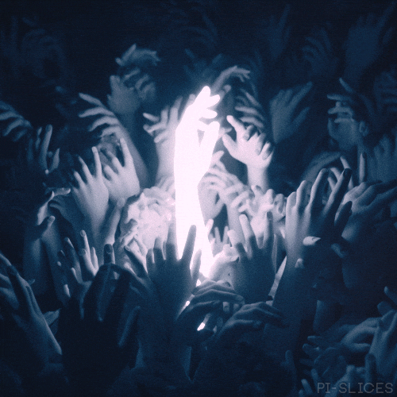{.w-100 .aspect-4-3} -->

## Le level design

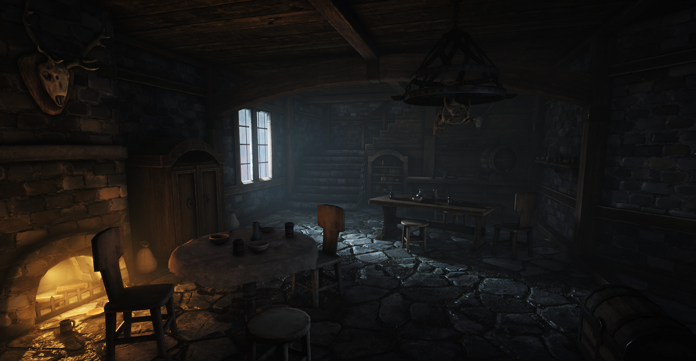{data-zoom-image .w-100}

> Un bon niveau n'est pas un beau décor, en tout cas, pas que.<br>
> C'est un décor qui **informe, guide ou récompense**.

### Couleurs

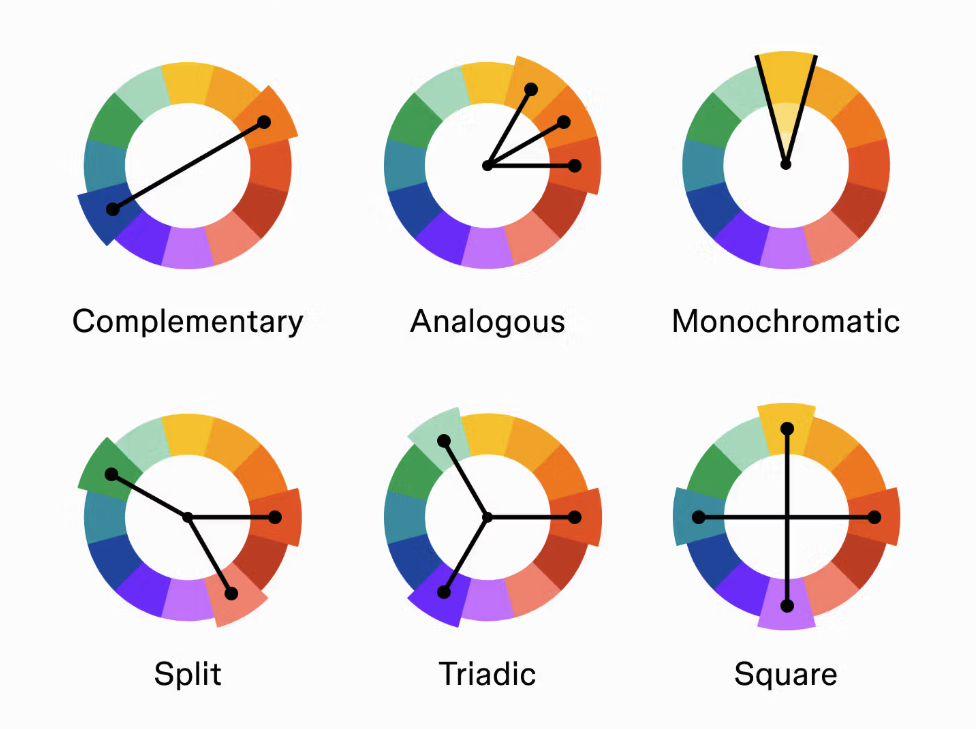{data-zoom-image .w-50}

[Roue chromatique](https://www.figma.com/fr-fr/roue-chromatique/)

### Balisage

Le balisage (ou _signposting_) c'est les techniques de design (visuelles, sonores ou narratives) utilisées pour guider le joueur, orienter son attention sans l'interrompre avec des textes ou des flèches.

<div class="grid grid-1-3" markdown>
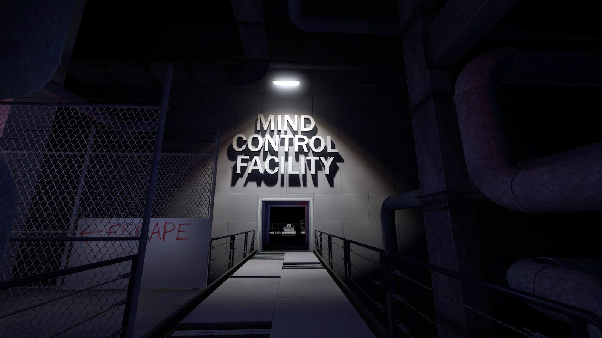{data-zoom-image .aspect-16-9} 

<div markdown>
**Lumière**<br>L'oeil va vers le plus clair
</div>
</div>

<div class="grid grid-1-3" markdown>
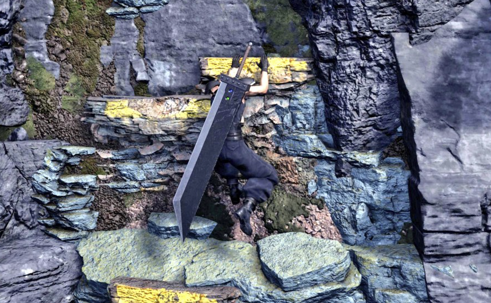{data-zoom-image .aspect-16-9} 

<div markdown>
**Couleur**<br>Une tache contrastée dans un décor uniforme attire
</div>
</div>

<div class="grid grid-1-3" markdown>
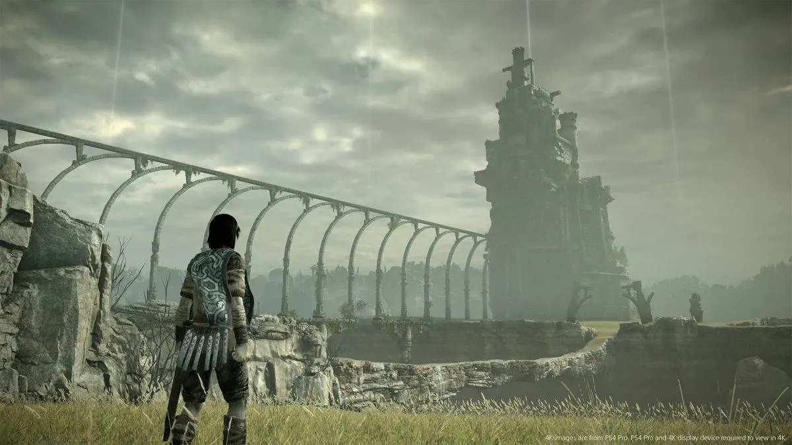{data-zoom-image .aspect-16-9} 

<div markdown>
**Lignes**<br>Chemins, clôtures, rangées d'arbres pointent quelque part 
</div>
</div>

<div class="grid grid-1-3" markdown>
{data-zoom-image .aspect-16-9}

<div markdown>
**Repères** (*landmarks*)<br>Un élément visible de partout (tour, arbre géant)
</div>
</div>


<!-- ### La lisibilité

> Si tout brille, rien ne brille

Ce qui est **interactif** doit se distinguer de ce qui est **décoratif**.

> Ce qui brille, bouge ou contraste me concerne. Le reste est du paysage -->

<!-- ### Placer l'objectif

> Visible tôt, atteignable tard

Montrer la destination dès le début, la faire mériter par un détour : l'objectif se comprend en cinq secondes **et** il y a une raison d'explorer.

Corollaire : **récompenser les détours**. Un recoin exploré contient quelque chose (une pièce, un point de vue, un raccourci). Un cul-de-sac vide punit la curiosité pour le reste du jeu. -->

<!-- ## Pratique

Atelier : la passe d'habillage et d'éclairage de la zone 1.

1. **Greybox validé** : la zone 1 se joue du début à la fin, les métriques sont respectées
1. **Dressing** : grandes masses, éléments de gameplay, puis détails
1. **Materials** : variantes rangées dans **Assets > _ > Materials**, aucun material de pack modifié
1. **Éclairage** : décor en **Static**, lumières du décor en `Baked`, un **Light Probe Group** sur le parcours, **Generate Lighting**
1. **Ambiance** : skybox, lumière ambiante et brouillard réglés
1. **Post-traitement** : un Global Volume avec Bloom, Vignette, Color Adjustments et Tonemapping, réglés avec la main légère
1. **Guidage** : l'objectif est éclairé et visible tôt; les impasses sont dans la pénombre
1. **Test** : faire jouer la zone à un collègue **sans rien dire**. Noter où il hésite, où il se perd, ce qu'il ignore 

-->

## L'éclairage

<!-- 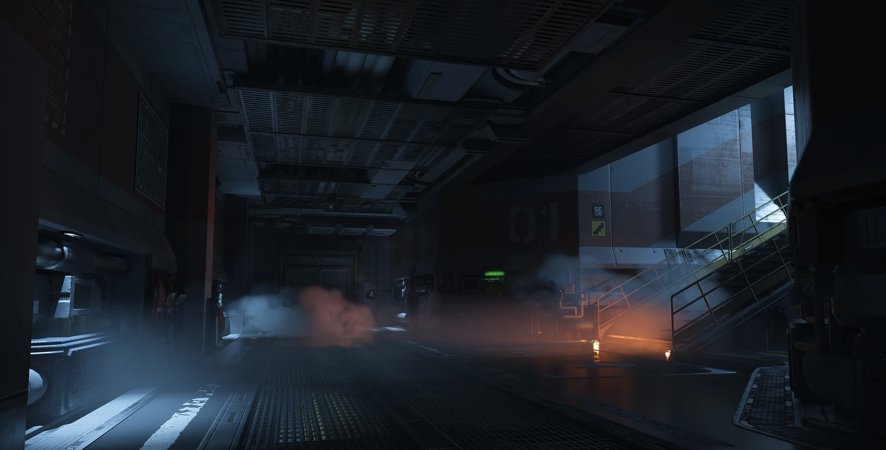{.w-100 data-zoom-image} -->

<!-- https://www.youtube.com/watch?v=5rxMdiCkQGk -->
<!-- https://www.youtube.com/watch?v=aG8dUWVcLvw -->

### Lumières par défaut

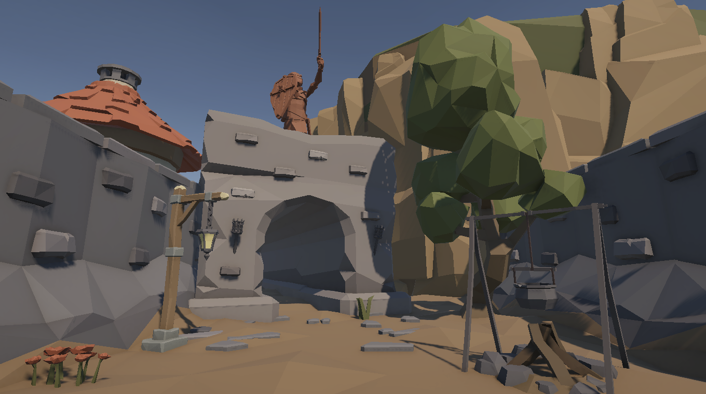{data-zoom-image}

Pour voir ce que fait chaque lumière retirons ce que Unity allume par défaut :

1. Dans la **Hierarchy**, sélectionner **Directional Light**; dans l'**Inspector**, la désactiver (case à cocher en haut)<br>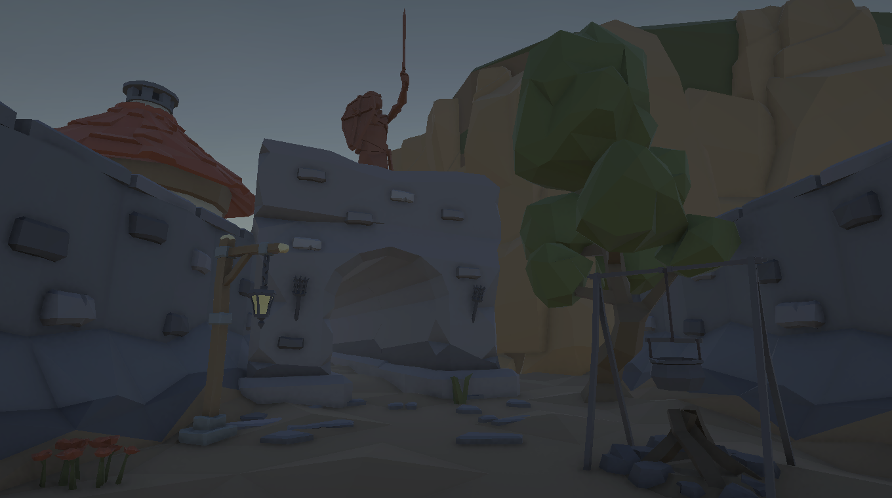{data-zoom-image .w-10}
1. Ouvrir **Window > Rendering > Lighting**, onglet **Environment** :
  - **Environment Lighting > Intensity Multiplier** à `0`
  - **Environment Reflections > Intensity Multiplier** à `0`<br>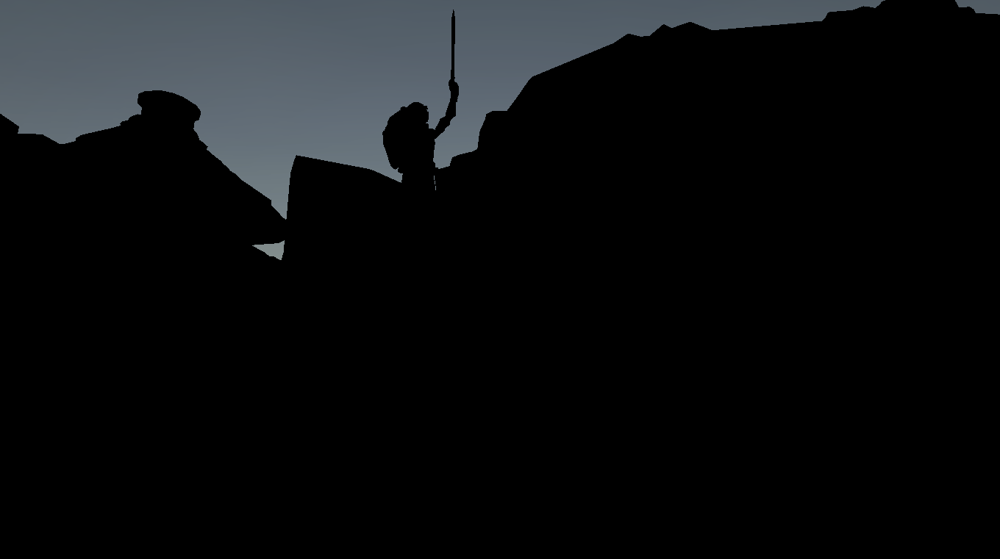{data-zoom-image .w-10}

  ??? quote "Évitez la valeur 0 pour l'intensité"

      Très rare qu'on veut 0. C'est un effet exploité dans le genre [Film noir](https://fr.wikipedia.org/wiki/Film_noir). 

      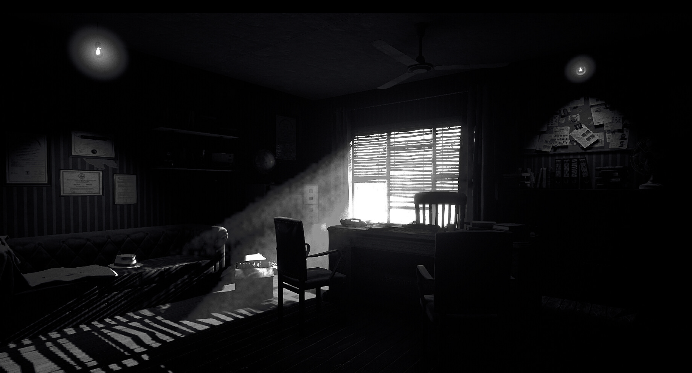{data-zoom-image .w-20}
    
      Une scène trop sombre peut être fatiguante pour les yeux. Une intensité de `0.3` par exemple, est souvent plus intéressante.

      [:simple-youtube: Exemple](https://www.youtube.com/shorts/OGiQ6H0tPLk)

<!-- https://www.reddit.com/r/Unity3D/comments/1u6bfm8/just_add_lighting/ -->
    
??? tip "Retirer le ciel"

    On peut aussi retirer le skybox en assignant None à Skybox Material, mais "Environment Lighting" se réaffichera avec une couleur d'ambiance. En appliquant noir, on arrive au même résultat.

    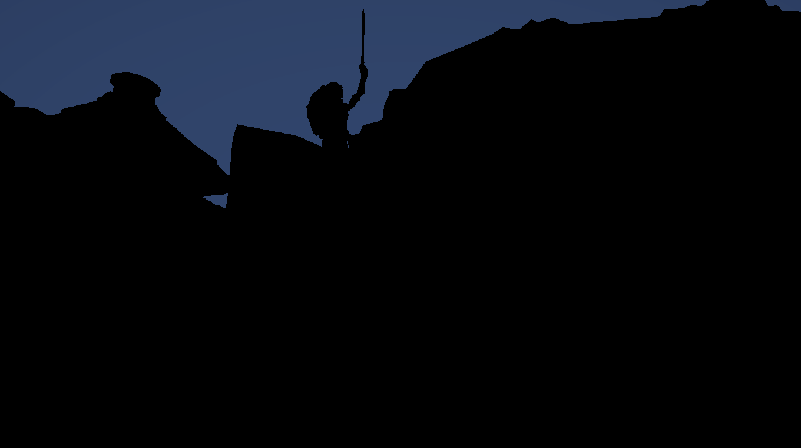{data-zoom-image .w-10}

    Le ciel n'a plus de skybox, mais est bleu ! Ça c'est parce que la caméra applique un fond si aucun skybox n'est configuré.

    - Ouvrir l'inspecteur de la caméra
    - Sous environnement, remplacer background type par Solid Color
    - Choisir noir, et là, c'est le noir total

    Dans la scène, ça commence à être difficile de voir quoi que ce soit 😅

    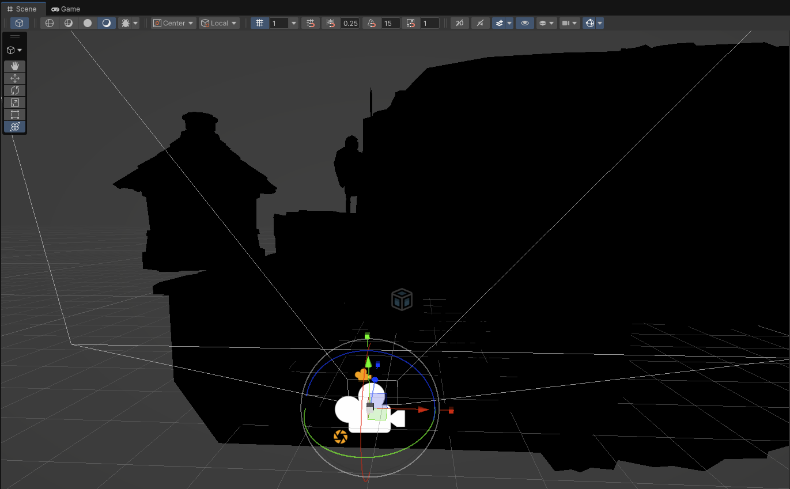{data-zoom-image .w-10}
    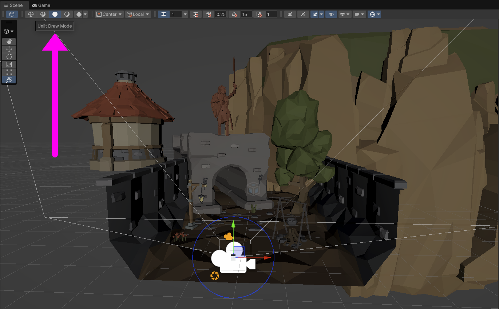{data-zoom-image .w-10}

### Les types de lumières

| Lumière | Métaphore |
|---|---|
| **Directional Light** | Le soleil (partout, une seule direction) |
| **Point Light** | Une ampoule (rayonne dans toutes les directions) |
| **Spot Light** | Un projecteur (cône orienté) |
| Area Light | Un panneau lumineux (_baked_ seulement) |

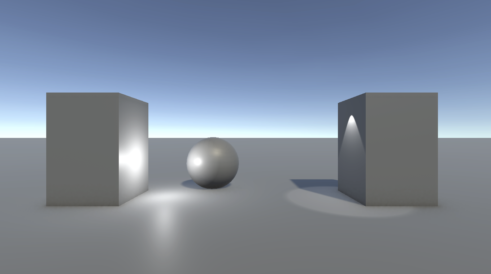{data-zoom-image}

<!-- Configurations importantes dans _Inspector_ : **Color**, **Intensity**, **Range** (Point et Spot) et **Shadow Type**. -->

#### Exemple d'éclairage

<div class="grid" markdown>
<figure markdown>
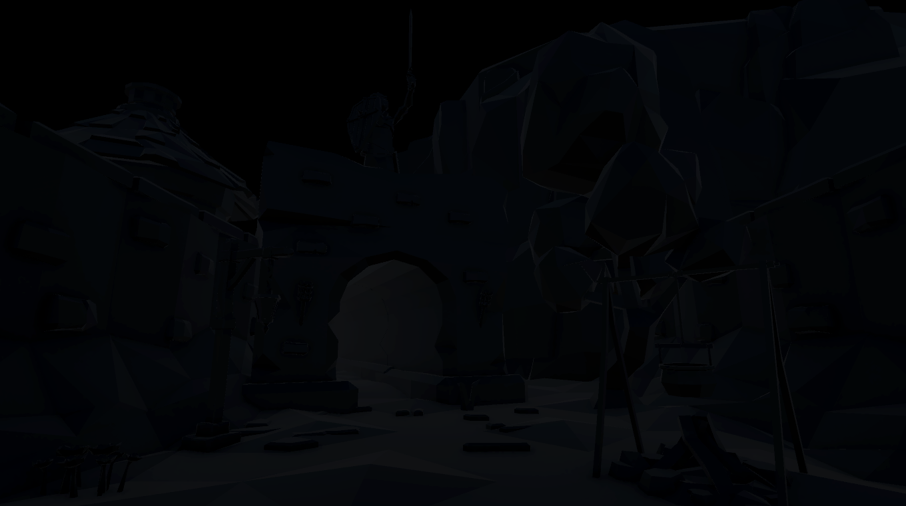{data-zoom-image}
<figcaption>Sans lumière</figcaption>
</figure>

<figure markdown>
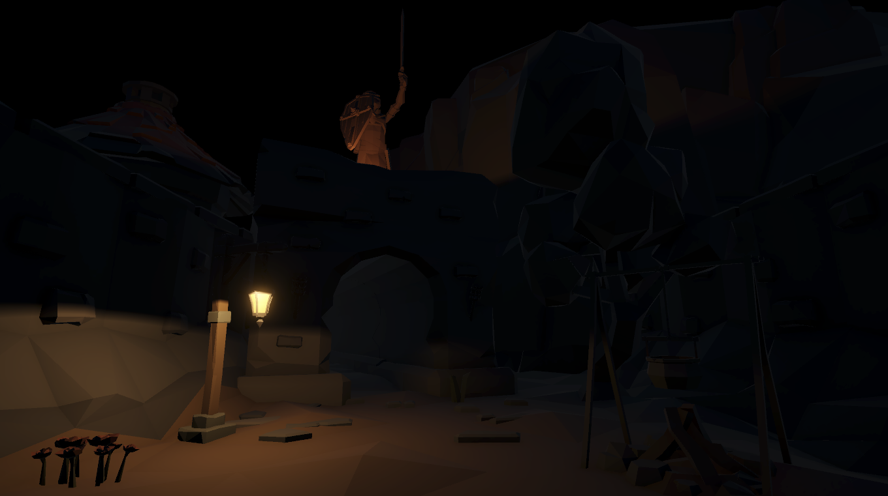{data-zoom-image}
<figcaption>Spot Light</figcaption>
</figure>

<figure markdown>
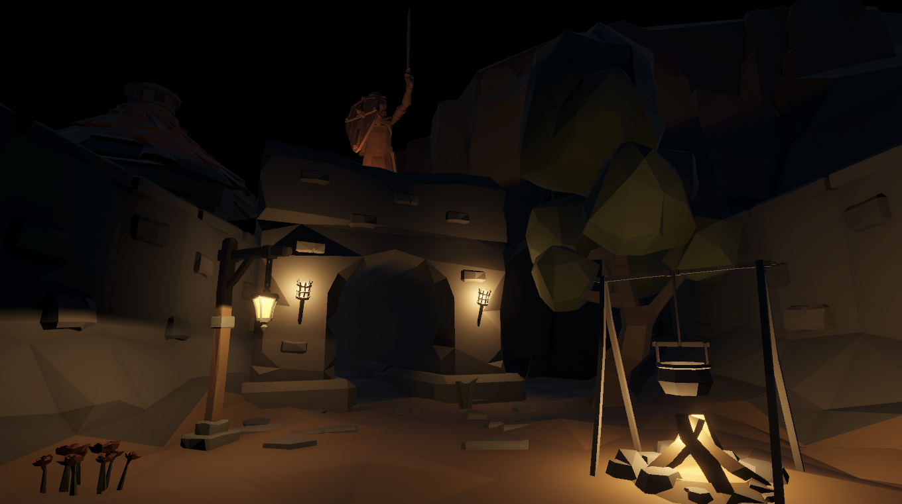{data-zoom-image}
<figcaption>Point Light</figcaption>
</figure>

<figure markdown>
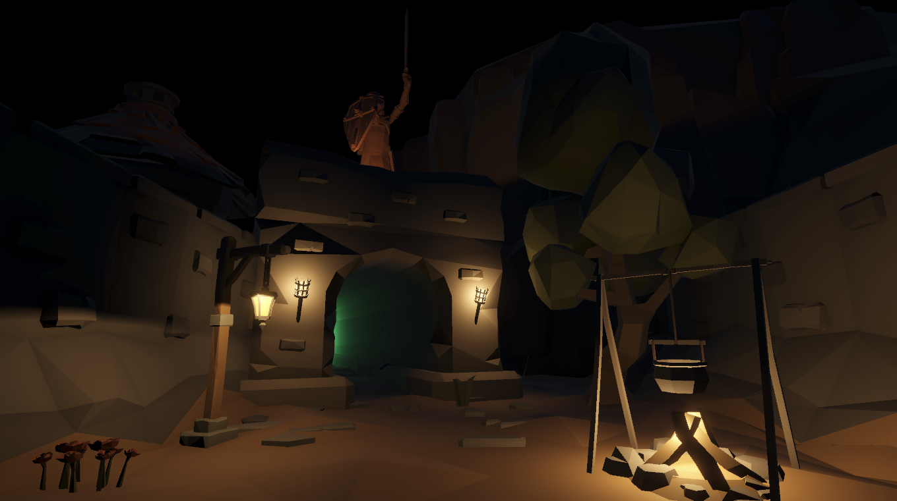{data-zoom-image}
<figcaption>Balisage</figcaption>
</figure>
</div>

### Modes 

Le champ **Mode** de chaque lumière décide quand son éclairage est calculé.

| Mode | Calcul | Avantages | Limites |
|---|---|---|---|
| **Realtime** | À chaque image | Peut bouger, clignoter, changer de couleur | Taxant pour l'ordi. Pas de lumière qui rebondit |
| **Baked** | Une fois, dans l'éditeur | Gratuit en jeu, ombres douces, lumière indirecte | Figée : ne bouge pas, n'éclaire pas les objets mobiles |
| **Mixed** | Les deux | Indirect précalculé + ombres en temps réel | Le plus lourd des trois |

??? quote "Baking"

    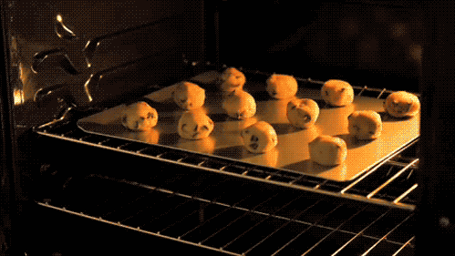

    Le *baking* enregistre l'éclairage dans des textures (*lightmaps*) plaquées sur des objets **statiques**.

    1. Dans la **Hierarchy**, sélectionner le décor qui ne bouge jamais (sol, murs, rochers, bâtiments)
    1. Dans l'**Inspector**, ouvrir la flèche à côté de **Static** et cocher seulement **Contribute GI**<br>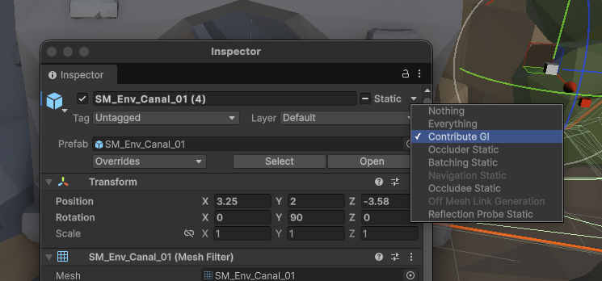{data-zoom-image .w-10}
    1. Régler le **Mode** des lumières du décor à `Baked` (ou `Mixed`)
    1. Ouvrir **Window > Rendering > Lighting**, onglet **Scene** : cliquer **New** sous **Lighting Settings**
    1. Section **Baked Lighting Settings** : **Lightmapper** = `Progressive GPU` (beaucoup plus vite que `CPU`)
    1. Dans la même section, **Lightmap Resolution** : passer de `40` (défaut) à `10` texels environ, pour un calcul rapide quand on développe le jeu
    1. Cliquer **Generate Lighting** (en bas de la fenêtre). La barre de progression est en bas à droite de l'éditeur

    

    Si le bake reste trop long, dans la section **Baked Lighting Settings** :

    | Réglage | Par défaut | Essayez |
    |---|---|---|
    | **Direct Samples** | `32` | `16` |
    | **Indirect Samples** | `512` | `256` |
    | **Environment Samples** | `256` | `128` |
    | **Max Bounces** | `2` | `1` |
    | **Lightmap Parameters** (au bas de la section) | `Default-Medium` | `Default-VeryLowResolution` |

### Combien de lumières par scène ?

- **Baked** : pas de limite
- **Realtime** : 
  - 256 sur PC et console
  - 32 sur mobile
  - 16 en Web 👈👈👈

<!-- https://docs.unity3d.com/Manual/urp/lighting/light-limits-in-urp.html -->

## Ombres

{.h-auto}

Chaque lumière temps réel (mode = realtime) qui projette des ombres recalcule la scène à chaque image et c'est assez lourd pour l'ordinateur à calculer. Voici des recommandations : 

- **Shadow Type** = `No Shadows` sur les lumières décoratives
- Garder les ombres pour la Directional Light et une ou deux lumières clés, pas plus
- Si possible, utilisez "Hard shadow" pour un gain de performance

### Qualité des ombres

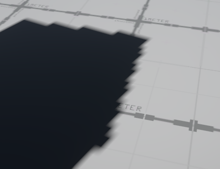{data-zoom-image .w-50}

Des ombres floues, en "escalier" ou qui disparaissent au loin ? Ça se corrige, mais au détriment de la performance.

#### URP Asset

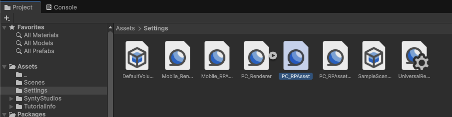{data-zoom-image .w-50}

L'URP Asset gère entre autres les ombres temps réel de tout le projet

1. Ouvrir **Edit > Project Settings > Quality** et repérer le **Render Pipeline Asset** du niveau de qualité actif (ex. : `PC_RPAsset`)
1. Dans le panneau **Project**, sélectionner cet asset (dossier **Assets > Settings**)
1. Dans l'**Inspector** :

| Réglage | Effet | Point de départ |
|---|---|---|
| Lighting : **Main Light > Shadow Resolution** | Netteté des ombres de la _Directional Light_ | `2048`, `4096` au besoin |
| Lighting : **Additional Lights > Shadow Atlas Resolution** | Netteté des ombres des _Point_ et _Spot Lights_ | `2048` |
| Shadows : **Max Distance** | Distance jusqu'où les ombres sont dessinées. Plus courte = plus nette | `50` à `80` m |
| Shadows : **Cascade Count** | Découpe la distance en tranches : plus de détail près de la caméra | `4` |
| Shadows : **Soft Shadows** | Adoucit les bords | Coché, **Quality** `Medium` |

#### Source lumineuse

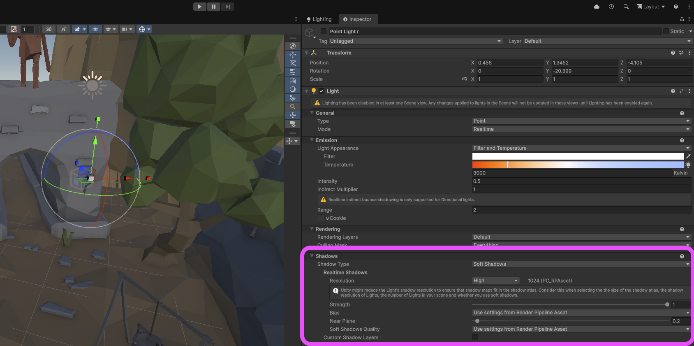{data-zoom-image .w-50}

On peut aussi gérer granulairement l'ombre via la source lumineuse dans son _Inspector_

- **Shadow Type** : `Soft Shadows` (bords doux) ou `Hard Shadows` (bords nets, moins taxant pour l'ordi)
- **Strength** : `1` = ombre plein, `0` = ombre transparent 
- **Bias** à `Custom` pour corriger les éléments suivant : 
  - Rayures sur les surfaces ([*shadow acne*](./assets/img/Shadow-Acne.jpg))
  - Ombre décollée de l'objet ([*peter panning*](./assets/img/3_peter_panning_comparison.png))

<!-- 
!!! quote "Le bake : les ombres précalculées"

    - **Lightmap Resolution** (fenêtre **Lighting**, onglet **Scene**) : plus de texels = ombres plus précises, mais bake plus long
    - Dans l'**Inspector** de la lumière : **Baked Shadow Radius** (Point, Spot) ou **Baked Shadow Angle** (Directional). `0` = bord net; plus haut = pénombre douce

    !!! tip "Voir la lightmap seule"
        Dans le panneau **Scene**, menu du mode d'affichage (en haut à gauche, `Shaded` par défaut) : **Baked Lightmap**. Les ombres en escalier et les taches sautent aux yeux. 
-->


 
<!-- **Règles général :** décor fixe en **Baked**, ce qui bouge ou change pendant le jeu (alarme, lampe de poche, lumière qui s'allume au CES) en **Realtime**. -->


<!-- !!! warning "Ne pas tout cocher Static"
        Cocher la case **Static** coche **tout** (*Everything*), et Unity propose de l'appliquer aux enfants. Un objet animé (porte, plateforme) ou sans intérêt pour l'éclairage alourdit alors le bake pour rien. Pour le bake, seul **Contribute GI** compte.

    **Temps de calcul**

    Un bake peut prendre quelques secondes sur une petite scène, et des heures sur une grosse scène entièrement statique. Pendant les essais, viser des bakes de quelques minutes; monter la qualité (**Lightmap Resolution** `20` à `40`) seulement pour le build officiel. Unity 6 ne recalcule rien automatiquement : il faut relancer **Generate Lighting** après chaque changement.

    **Dépannage**

    - **Voir les lightmaps** : dans le panneau **Scene**, menu du mode d'affichage (`Shaded` par défaut) : **Baked Lightmap**. Un objet en **damier** n'a pas de lightmap (pas encore baké ou pas **Contribute GI**)
    - **Résultat bizarre après un bake annulé ou un objet déplacé** : flèche à côté de **Generate Lighting** > **Clear Baked Data**, puis refaire le bake
    - **Objet lointain** : dans son **Mesh Renderer**, section **Lightmapping**, baisser **Scale In Lightmap** (ex. : `0.5`) : moins de texels, bake plus rapide
    - **Taches noires ou coutures sur un modèle** : dans le panneau **Project**, sélectionner le modèle (FBX), onglet **Model** de l'**Inspector** : cocher **Generate Lightmap UVs**, **Apply**, puis refaire le bake
    - **Retrouver toutes les lumières d'une scène** : **Window > Rendering > Light Explorer** liste les lumières et permet d'en modifier plusieurs à la fois

-->

<!-- ### Les *Light Probes*

Un objet mobile (le personnage, un PNJ, une caisse physique) ne reçoit pas les lightmaps : dans une salle baked, il paraît plat et mal éclairé. Les **Light Probes** échantillonnent la lumière précalculée dans l'espace et la transmettent aux objets mobiles.

1. Dans la **Hierarchy** : clic-droit **Light > Light Probe Group**
1. Dans l'**Inspector**, cliquer **Edit Light Probes**, puis dupliquer et déplacer les sondes dans la **Scene**
1. Placer les sondes **là où le personnage passe** et **là où la lumière change** (seuil d'une porte, bord d'une ombre), à hauteur du sol et à hauteur de tête
1. Refaire **Generate Lighting** -->

### Lumière vacillante

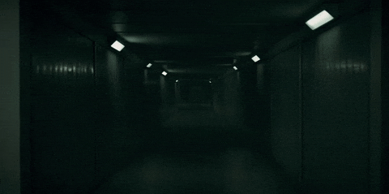{.w-50}

Une lumière dont l'intensité varie sans cesse donne vie à une scène figée (torche, bougie, néon défectueux).

1. Dans la **Hierarchy**, sélectionner la lumière (Point ou Spot); dans l'**Inspector** : **Mode** = `Realtime` (une lumière baked ne peut pas varier), **Shadow Type** = `No Shadows`
1. Dans le panneau **Project**, dossier **Assets > _ > Scripts** : clic-droit **Create > MonoBehaviour Script**, le nommer `LumiereVacillante`, y coller le code ci-dessous
1. Glisser le script sur la lumière, puis régler les valeurs dans l'**Inspector**

```c# title="LumiereVacillante.cs"
using UnityEngine;

[RequireComponent(typeof(Light))]
public class LumiereVacillante : MonoBehaviour
{
    public float intensiteMin = 0.6f;
    public float intensiteMax = 1.4f;
    public float vitesse = 7f;

    Light lumiere;
    float decalage;

    void Start()
    {
        lumiere = GetComponent<Light>();
        decalage = Random.Range(0f, 100f);
    }

    void Update()
    {
        float bruit = Mathf.PerlinNoise(decalage, Time.time * vitesse);
        lumiere.intensity = Mathf.Lerp(intensiteMin, intensiteMax, bruit);
    }
}
```

## Les materials

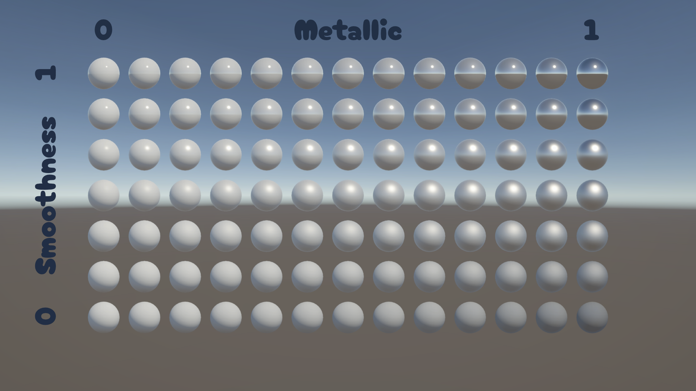{.w-100 data-zoom-image}

Un **material** associe un **shader** (la façon de calculer la surface, ici `Universal Render Pipeline/Lit`) à des réglages.

| Paramètre | Rôle |
|---|---|
| **Base Map** (ou albedo) | Couleur ou texture de la surface |
| **Normal Map** | Une texture violette/bleutée qui simule des creux et des bosses sans modifier la forme 3D |
| **Emission** | La surface émet sa propre lumière |

<figure markdown>
{.w-50 .aspect-4-3}
<figcaption>Emission</figcaption>
</figure>

<!-- Ressources : https://assetstore.unity.com/packages/2d/textures-materials/ultimate-material-library-253722 -->

### Créer un material

1. Dans le panneau **Project**, dossier **Assets > _ > Materials** : clic-droit **Create > Material**, le nommer (ex. : `M_Sang` ou `Sang`)
1. Dans l'**Inspector**, configurer les réglages<br>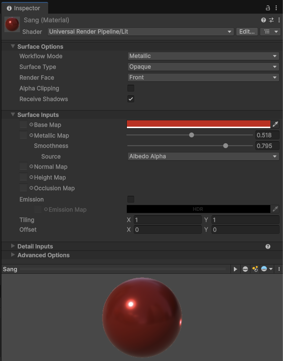{data-zoom-image .w-10}
1. Glisser le material depuis le panneau **Project** sur l'objet dans la **Scene** ou la **Hierarchy**

<!-- 
### Les textures AmbientCG

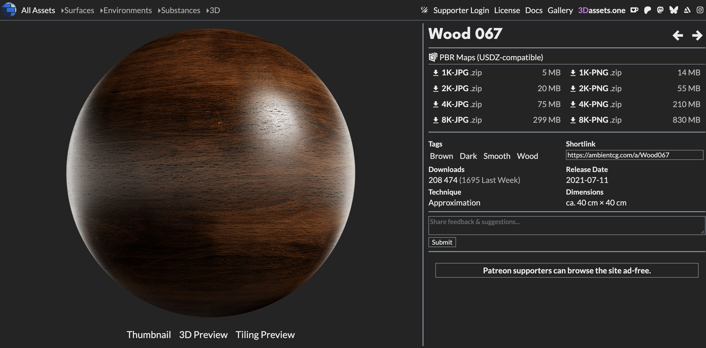{data-zoom-image .w-50}

[AmbientCG](https://ambientcg.com/) offre des textures PBR gratuites qu'on peut ajouter à Unity si c'est cohérent avec le style du jeu (rappelons nous que le photoréalisme n'est pas encouragé dans ce cours).

Deux façons de monter le material :

- **Sans déplacement** : le shader par défaut **URP/Lit**. Simple et léger; le relief est simulé par la lumière, la silhouette reste lisse.
- **Avec déplacement** : le shader fourni [**Custom/Lit Deplacement**](./assets/document/LitDeplacement.shader). La géométrie bouge vraiment (les tuiles dépassent du toit), au prix d'un rendu plus lourd. À réserver aux surfaces vues de près (sol, mur, toit au premier plan).

Exemple avec la surface [RoofingTiles013A](https://ambientcg.com/view?id=RoofingTiles013A). Selon la surface, certains fichiers peuvent manquer ou s'ajouter : l'important est de savoir **quelle image va dans quel champ** du material.

| | Fichier ambientCG | Rôle | Champ dans **URP/Lit** | Champ dans **Custom/Lit Deplacement** |
|---|---|---|---|---|
| 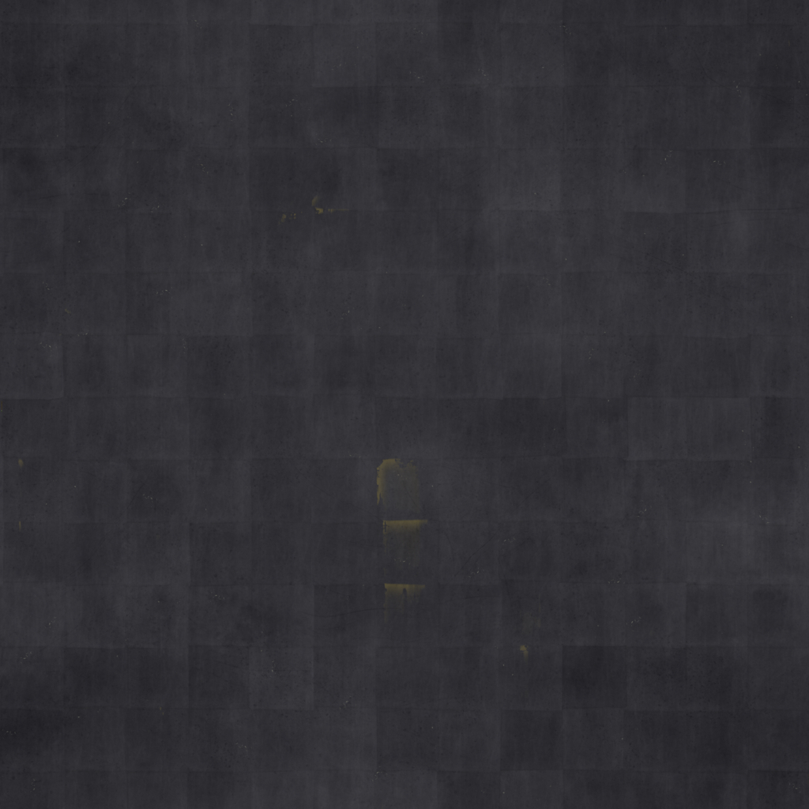{data-zoom-image .w-10} | `_Color` | Couleur de la surface | **Base Map** | **Couleur** |
| 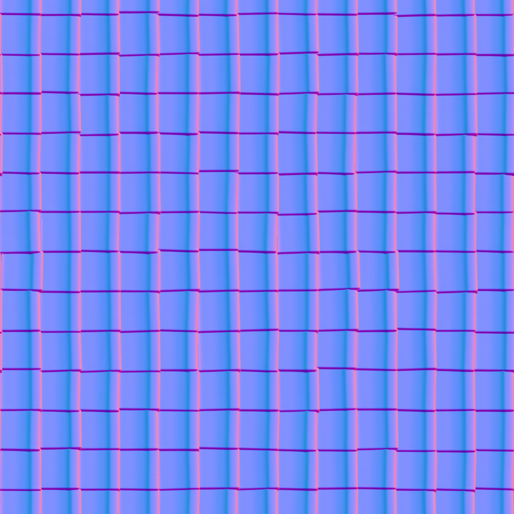{data-zoom-image .w-10} | `_NormalGL` | Faux relief : la lumière accroche les creux et les bosses | **Normal Map** | **Normal Map** |
| 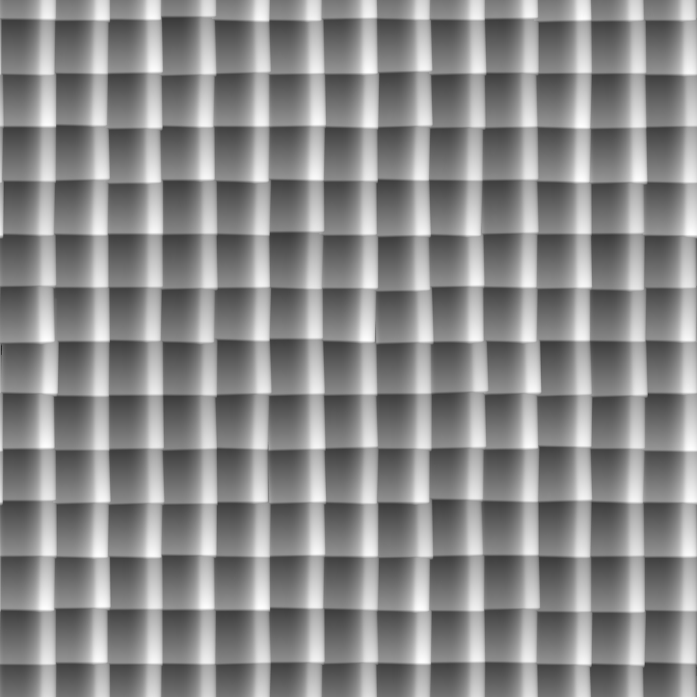{data-zoom-image .w-10} | `_Displacement` | Hauteur de chaque point (blanc = haut) | **Height Map** (illusion seulement) | **Deplacement** |
| 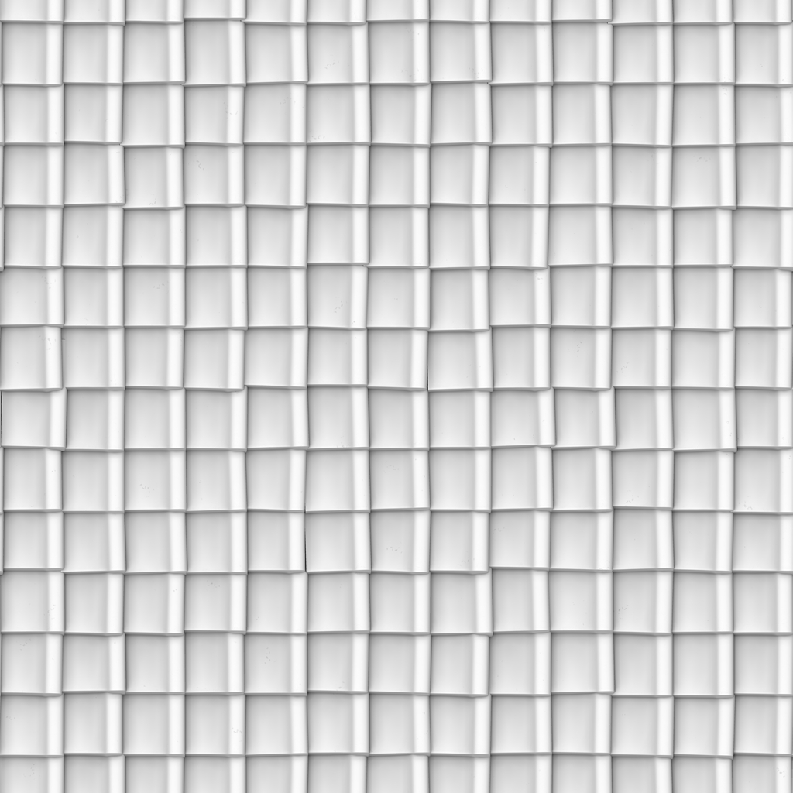{data-zoom-image .w-10} | `_AmbientOcclusion` | Ombre dans les creux | **Occlusion Map** | **Occlusion** |
| 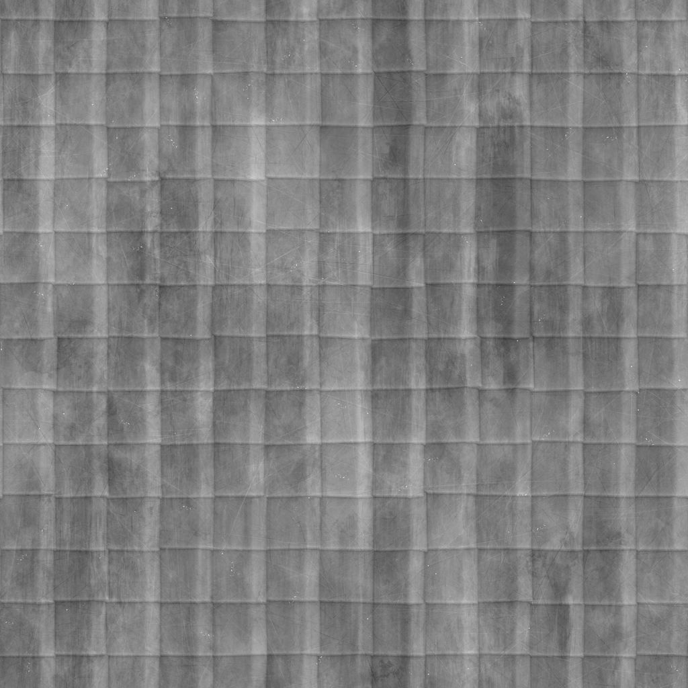{data-zoom-image .w-10} | `_Roughness` | Rugosité : l'inverse du lissage | Aucun : curseur **Smoothness** | **Roughness** |
| — | `_Metalness` | Zones de métal (absent ici : seulement pour les surfaces métalliques) | **Metallic Map** | **Metallic** |
| 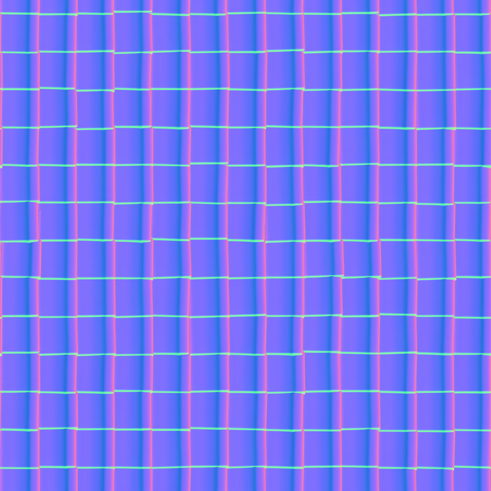{data-zoom-image .w-10} | `_NormalDX`, `.blend`, `.mtlx`, `.usdc`, `.tres` | Versions pour d'autres logiciels | À ignorer | À ignorer |
| 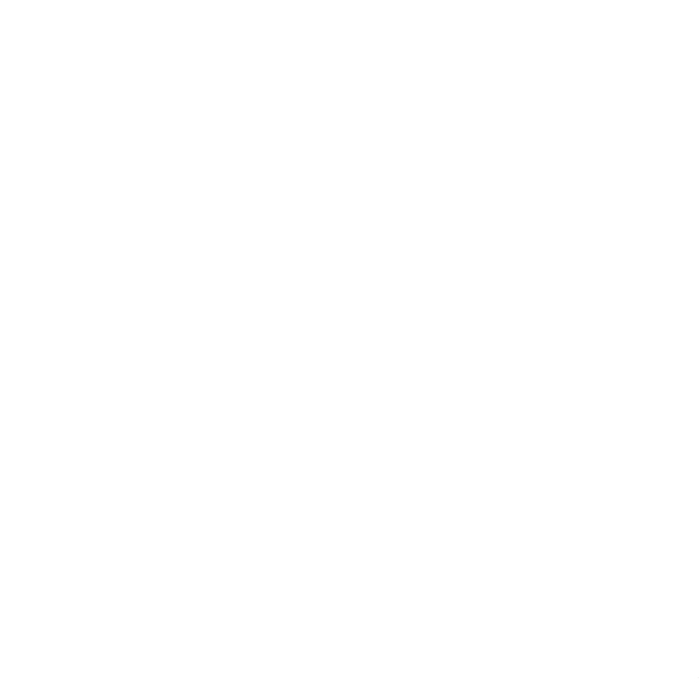{data-zoom-image .w-10} | `_Opacity` | Transparence (tout blanc ici : surface pleine) | À ignorer | À ignorer |

#### Télécharger

1. Sur [ambientCG](https://ambientcg.com/), chercher une surface (ex. : `roof`, `rock`, `planks`)
1. Choisir un asset de type **Material**. Éviter les assets dont le nom contient **Substance** : ils ne sont offerts qu'en `.sbsar`, un format qui exige un plugin Adobe
1. Télécharger le zip **1K-JPG** (ou **2K-JPG** pour une surface vue de près); le **4K** alourdit le build sans gain visible dans un jeu
1. Décompresser le zip

#### Importer et régler les textures

1. Dans le panneau **Project**, créer le dossier **Assets > _ > Textures > NomDeLaSurface** et y glisser les images `_Color`, `_NormalGL`, `_Displacement`, `_AmbientOcclusion`, `_Roughness` (et `_Metalness` s'il y en a une)
1. Sélectionner `_NormalGL`; dans l'**Inspector** : **Texture Type** = `Normal map`, puis **Apply**
1. Sélectionner toutes les autres images **sauf** `_Color`; dans l'**Inspector** : décocher **sRGB (Color Texture)**, puis **Apply**

!!! info "Pourquoi décocher sRGB"
    Ces images ne sont pas des couleurs, mais des **données** (une hauteur, une quantité d'ombre, une rugosité). Avec **sRGB** coché, Unity les corrige comme des couleurs et fausse les valeurs : relief exagéré, creux trop sombres.

!!! warning "`NormalGL`, jamais `NormalDX`"
    Unity suit la convention **OpenGL**. Avec la version **DX**, le relief paraît inversé : les bosses semblent éclairées par le dessous.

#### Créer le material sans déplacement (URP/Lit)

1. Dans le panneau **Project**, dossier **Assets > _ > Materials** : clic-droit **Create > Material**, le nommer (ex. : `M_Tuiles`). Le shader par défaut est déjà **Universal Render Pipeline/Lit**
1. Dans l'**Inspector**, section **Surface Inputs** : cliquer le petit **⊙** à gauche de **Base Map** et choisir `_Color`
1. Même chose pour **Normal Map** (`_NormalGL`); si un bouton **Fix Now** apparaît, cliquer dessus
1. Même chose pour **Occlusion Map** (`_AmbientOcclusion`) et, pour un métal, **Metallic Map** (`_Metalness`)
1. Optionnel : **Height Map** (`_Displacement`), valeur entre `0.02` et `0.05`
1. Régler **Smoothness** à la main : `0.1` à `0.3` pour une surface mate (pierre, tuile, bois brut), plus haut pour une surface polie
1. Ajuster **Tiling** (**X** et **Y**) pour donner la bonne taille à la surface : `3` × `3` répète la texture trois fois dans chaque direction
1. Glisser le material sur l'objet dans la **Scene** ou la **Hierarchy**

!!! info "La Roughness ne se branche pas directement dans URP/Lit"
    URP/Lit attend un **lissage** (*smoothness*), l'inverse de la rugosité, rangé dans le canal alpha de la **Metallic Map** ou de la **Base Map**. Le curseur **Smoothness** suffit dans la grande majorité des cas.

!!! tip "La Height Map d'URP/Lit est une illusion"
    Elle fait de la **parallaxe** : la texture se décale selon l'angle de vue pour simuler la profondeur. La géométrie ne bouge pas : la silhouette de l'objet reste lisse, et l'effet se remarque surtout à angle rasant. Pour un vrai relief, utiliser le shader avec déplacement.

#### Créer le material avec déplacement (Custom/Lit Deplacement)

1. Télécharger [`LitDeplacement.shader`](./assets/document/LitDeplacement.shader) et le glisser dans **Assets > _ > Shaders**
1. Dans le panneau **Project**, dossier **Assets > _ > Materials** : clic-droit **Create > Material**, le nommer (ex. : `M_Tuiles_Relief`)
1. Dans l'**Inspector**, champ **Shader** : choisir **Custom > Lit Deplacement**
1. Assigner chaque image à son champ (voir le tableau) : **Couleur**, **Normal Map**, **Roughness**, **Occlusion**, **Deplacement** et, pour un métal, **Metallic**
1. Pour un métal seulement : monter **Metallic (multiplicateur)** à `1` (il est à `0` par défaut, ce qui ignore la carte)
1. Régler **Amplitude du deplacement** : commencer à `0.05` et monter jusqu'à ce que le relief soit visible sans déformer l'objet (environ `0.15` pour les tuiles)
1. Ajuster le **Tiling** de **Couleur** : il s'applique à toutes les cartes
1. Glisser le material sur l'objet dans la **Scene** ou la **Hierarchy**

!!! info "Les réglages de tessellation"
    Le shader **subdivise** les triangles près de la caméra avant de les déplacer : le relief fonctionne même sur un simple **Plane** ou **Cube**. **Subdivision max** fixe la finesse (plus haut = plus détaillé et plus lourd); entre **Distance pleine subdivision** et **Distance sans subdivision**, le détail diminue avec l'éloignement. **Niveau neutre** = la valeur de gris qui ne bouge pas (`0.5` : le gris moyen reste en place, le blanc sort, le noir rentre).

!!! warning "Coût de rendu"
    La tessellation coûte cher au GPU. Un ou deux materials avec déplacement par scène, sur les surfaces que le joueur voit de près; **URP/Lit** partout ailleurs.

!!! info "Licence"
    Les assets d'ambientCG sont sous licence **CC0** : aucune attribution n'est exigée. Les inscrire quand même dans les crédits du `README` (critère de **Rigueur**).

-->

## L'ambiance

### Skybox procédural

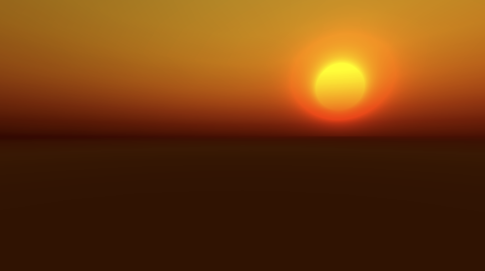{data-zoom-image}

1. Dans le panneau **Project**, dossier **Assets > _ > Materials** : clic-droit **Create > Material**, le nommer `M_Ciel`
1. Dans l'**Inspector**, champ **Shader**, choisir **Skybox > Procedural**
1. Ouvrir **Window > Rendering > Lighting**, onglet **Environment** : glisser `M_Ciel` dans **Skybox Material**
1. Dans l'**Inspector** de `M_Ciel`, ajuster les champs **Sky Tint**, **Ground**, **Atmosphere Thickness** et **Exposure**

<!-- https://ambientcg.com/ -->
<!-- https://polyhaven.com/ -->

??? quote "Skybox HDRI"

    Un **HDRI** est une photo panoramique à 360° qui sert de ciel tout en éclairant la scène de façon crédible.

    1. Sur [Poly Haven](https://polyhaven.com/hdris), menu **Assets > HDRIs** : choisir un ciel, format **HDR**, résolution **2K** (4K pour un ciel très visible; 8K alourdit le build sans gain visible)
    1. Glisser le fichier `.hdr` dans le panneau **Project**, dossier **Assets > _ > Textures**
    1. Sélectionner la texture; dans l'**Inspector** : **Texture Shape** = `Cube`, puis **Apply**
    1. Dans le panneau **Project**, dossier **Assets > _ > Materials** : clic-droit **Create > Material**, le nommer `M_Ciel_HDRI`; dans l'**Inspector**, **Shader** = **Skybox > Cubemap**
    1. Glisser la texture dans le champ **Cubemap (HDR)**; régler **Exposure** et **Rotation** pour placer le soleil de la photo
    1. **Window > Rendering > Lighting**, onglet **Environment** : glisser `M_Ciel_HDRI` dans **Skybox Material**, et **Environment Lighting > Source** = `Skybox`
    1. Dans la **Hierarchy**, orienter la **Directional Light** dans la même direction que le soleil de la photo : sinon les ombres contredisent le ciel
    1. Cliquer **Generate Lighting** pour que la lumière ambiante tienne compte du nouveau ciel

### Brouillard

<div class="grid" markdown>
<figure markdown>
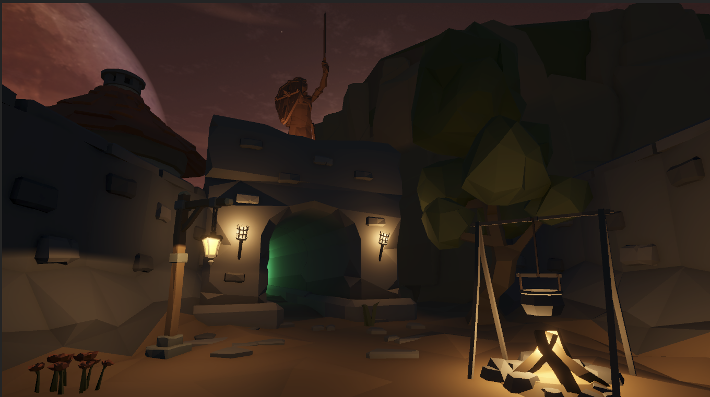{data-zoom-image}
<figcaption>Sans brouillard</figcaption>
</figure>

<figure markdown>
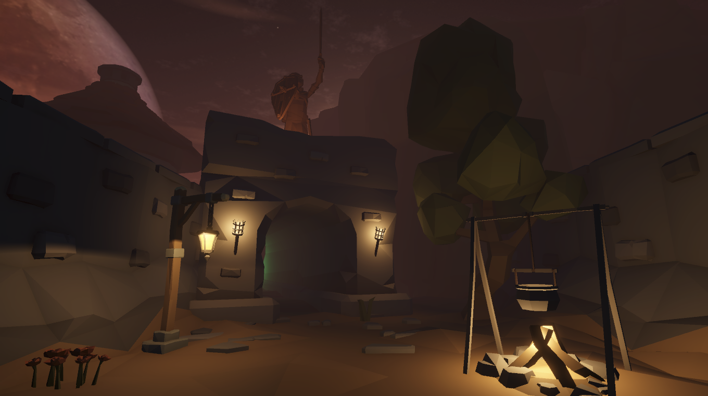{data-zoom-image}
<figcaption>Avec brouillard</figcaption>
</figure>
</div>

Cache le bout du monde, donne de la profondeur. Ajoute un peu de mysterieux à la scène.

- **Window > Rendering > Lighting**, onglet **Environment**
- **Other Settings**, cocher **Fog**

!!! tip "Petit truc"

    Ajuster la couleur pour quelle soit proche de celle de l'horizon du skybox. Ce sera plus convainquant.

## Le post-traitement URP

{.h-auto}

<!-- Post processing : https://www.youtube.com/watch?v=7YzWexOAggc -->

Le **post-traitement** (*post-processing*) applique des effets à l'image entière, après le rendu. Un peu comme un filtre de photo. Attention, car cela peut affecter les performances de votre jeu.

### Le **Volume**

1. Dans la **Hierarchy** : clic-droit **Volume > Global Volume**
1. Dans l'**Inspector**, champ **Profile** : cliquer **New**
1. Cliquer **Add Override > Post-processing** et choisir un effet (ex. : Bloom, Film Grain, etc.)
1. Sélectionner la **Main Camera**; dans l'**Inspector**, section **Rendering** : cocher **Post Processing**

??? tip "Volume local"

    {.h-auto}

    En mode Global, le volume s'applique partout. En mode local, il fonctionne à un endroit précis. Son usage ressemble à celui du CES.

    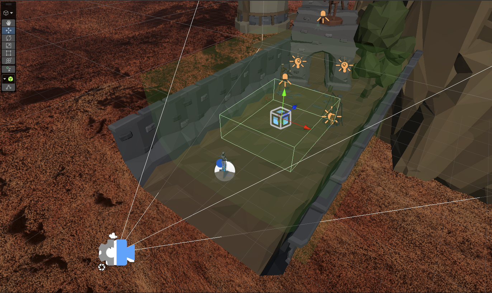{data-zoom-image .w-50}

??? tip "Volume global + animation + CES"

    {.h-auto}

    On peut alors penser à transitionner l'effet d'un volume en modifiant son weight. À 0, l'effet du post-processing est annulé, à 1, il est à 100%.

## Build

Un build est une version du jeu détachée du logiciel Unity.

- File > Build profiles
- Cliquer sur Scene List et ajouter les scènes du jeu
- Cliquer sur Windows, dans la colonne de gauche

  ??? question "Windows n'est pas là ?"

      Si Windows n'est pas disponible dans la colonne de gauche : 
    
      - Cliquer sur Add build Pofile, puis installer Desktop / Windows
      - Redémarrer Unity Hub
      - File > Build profiles, cliquer sur Add build Pofile > Desktop / Windows, puis Add Build Profile

- Cliquer "Build"
- Enregistrer dans un dossier "build" à la racine du projet.

<figure markdown>
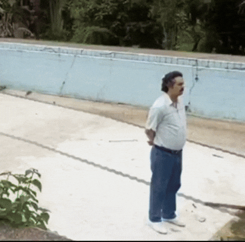{.w-25}
<figcaption>10, 20, 30 minutes ? C'est possible 😅<br>Le premier build est toujours plus long</figcaption>
</figure>

## Trello


* <span class="opacity-50">Semaine 1 </span>
* <span class="opacity-50">Semaine 2 </span>
* <span class="opacity-50">Semaine 3 </span>
* <span class="opacity-50">Semaine 4 </span>
* <span class="opacity-50">Semaine 5 </span>
* <span class="opacity-50">Semaine 6 </span>
* <span class="opacity-50">Semaine 7 | 🏃🏻‍♂️ Sprint 1 : Prototype</span>
* Semaine 8 | 22 octobre ⭐️ Aujourd'hui
* Semaine 9 | 29 octobre 🏃🏻‍♂️ Sprint 2 : Tranche verticale
* <span class="opacity-50">Semaine 10 | 5 novembre</span>
* <span class="opacity-50">Semaine 11 | 12 novembre</span>
* <span class="opacity-50">Semaine 12 | 19 novembre 🏃🏻‍♂️ Sprint 3 : Alpha</span>
* <span class="opacity-50">Semaine 13 | 26 novembre</span>
* <span class="opacity-50">Semaine 14 | 3 décembre 🏃🏻‍♂️ Sprint 4 : Beta</span>
* <span class="opacity-50">Semaine 15 | 10 décembre 🏃🏻‍♂️ Sprint 5 : Oral</span>

Nouvelles cartes :

- `Must` Ajuster la qualité des ombres (URP Asset et/ou lumière clé)
- `Must` Guider vers un objectif, sans flèche, ni texte
- `Must` Ajouter un Global Volume pour un post-traitement simple

- `Should` Ajouter un Volume à une zone qui change d'ambiance
- `Should` Ajouter un brouillard dont la couleur s'accorde à l'horizon du skybox
- `Could` Faire un bake de l'éclairage du décor statique
- `Could` Remplacer le ciel par un HDRI de Poly Haven
- `Could` Ajouter une lumière qui vacille (torche, bougie, néon)

## Devoirs

- Terminer la tranche verticale : la zone 1 habillée, éclairée, animée et sonorisée
- Préparer un **build Windows** qui se lance sans erreur

[STOP]

- Lire l'énoncé du projet final

[Énoncé du projet final](./devoirs/projet-final/index.md){ .md-button .md-button--primary .back}
