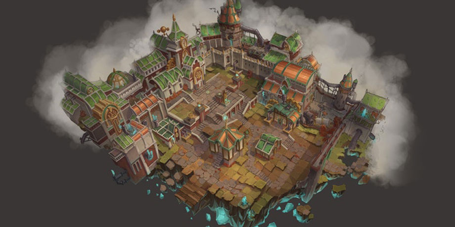
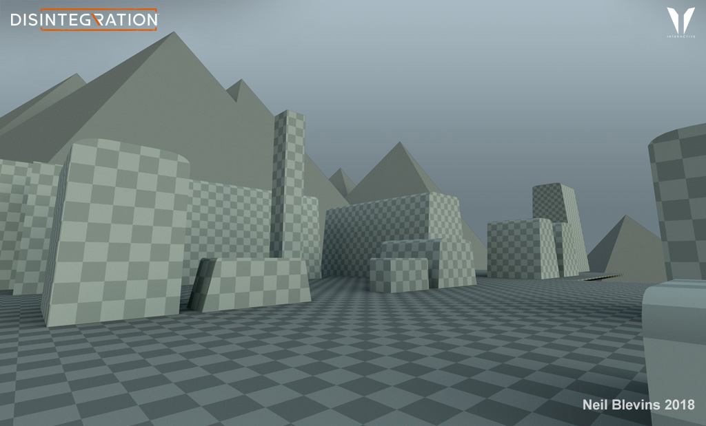
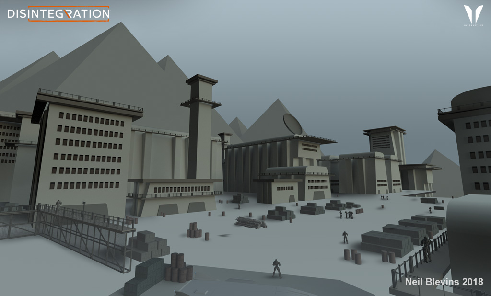
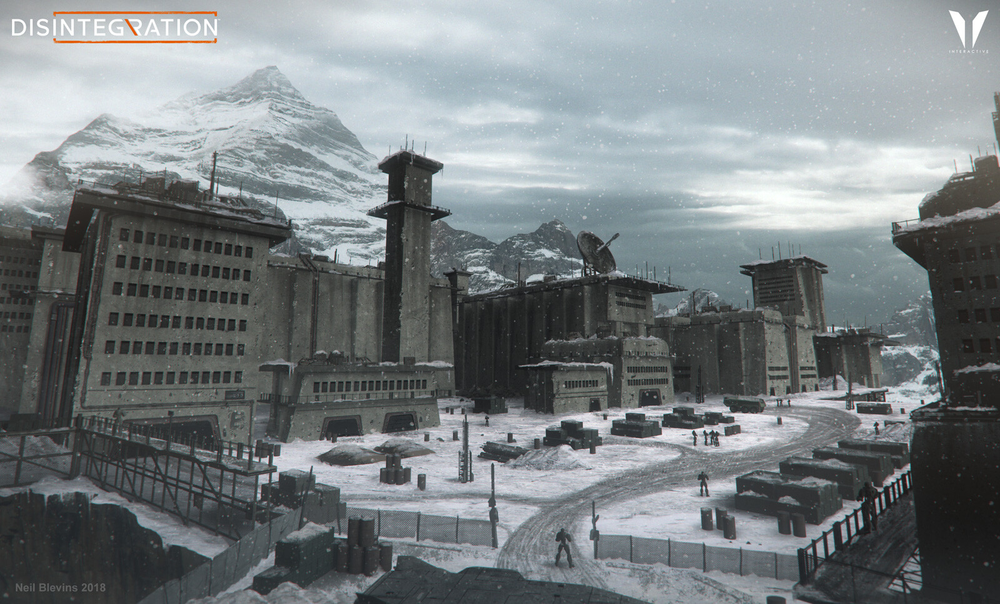
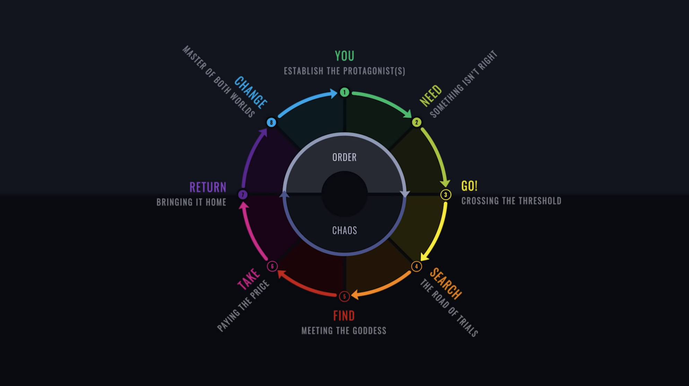
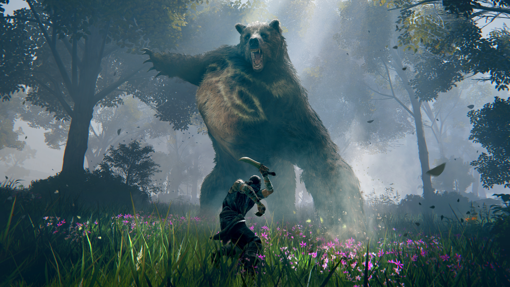
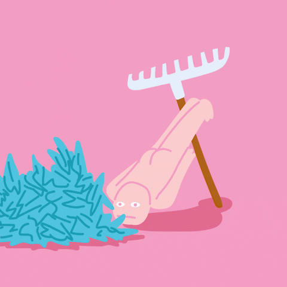

# Cours 8

[STOP]

<!-- ## La tranche verticale

{.w-100} -->

*[albedo]: Le terme « albedo » provient du latin albēdō, qui se traduit par « blancheur ».

## Les materials

{.w-100 data-zoom-image}

Un **material** associe un **shader** (la façon de calculer la surface, ici `Universal Render Pipeline/Lit`) à des réglages.

https://assetstore.unity.com/packages/2d/textures-materials/ultimate-material-library-253722

### Albedo, métallique, lissage, émission

| Paramètre | Rôle | Repères |
|---|---|---|
| **Base Map** (albedo) | Couleur ou texture de la surface, sans ombre ni reflet | Pas de noir pur ni de blanc pur |
| **Metallic** | Métal ou non-métal | `0` : bois, pierre, tissu · `1` : métal nu. Rarement entre les deux |
| **Smoothness** | Lustre de la surface | `0` : mat (craie) · `0.5` : plastique · `0.9` : miroir, flaque |
| **Emission** | La surface émet sa propre lumière | Écran, cristal, lave, néon (voir [L'émission](#lemission)) |

Créer un material :

1. Dans le panneau **Project**, dossier **Assets > _ > Materials** : clic-droit **Create > Material**, le nommer (ex. : `M_Pierre`)
1. Dans l'**Inspector**, régler **Base Map**, **Metallic** et **Smoothness**
1. Glisser le material depuis le panneau **Project** sur l'objet dans la **Scene** ou la **Hierarchy**

### Les variantes de materials Synty

Les modèles Synty partagent presque tous **une seule texture** (un atlas de couleurs) et donc un seul material. Les packs fournissent souvent des déclinaisons de cette texture (ex. : `_01_A`, `_01_B`, `_01_C`) pour changer l'ambiance d'un coup.

Pour une déclinaison sans toucher au material d'origine, créer une **Material Variant** :

1. Dans le panneau **Project**, clic-droit sur le material Synty : **Create > Material Variant**
1. Dans l'**Inspector** de la variante, ne changer que ce qui diffère (ex. : une autre **Base Map**, plus de **Smoothness** pour un décor mouillé)
1. Glisser la variante sur les objets concernés

La variante hérite de tout le reste : une correction faite au parent se propage.

!!! danger "Ne jamais modifier un material d'un pack"
    Modifier directement un material dans le dossier **SyntyStudios** change **tous** les objets qui l'utilisent, et la modification disparaît à la réimportation du pack. Toujours passer par une variante ou une copie rangée dans **Assets > _ > Materials**.

### Un material par usage, pas un par objet

Trente arbres avec chacun leur material : trente manipulations pour changer la couleur du feuillage. Un material partagé : une seule. Un material = un **usage** (`M_Sol`, `M_Interactif`, `M_Danger`), pas un objet.

!!! tip "Hint Material du CES"
    Dans l'**Inspector** d'un **Collider Event**, cocher **Hint Material** et y glisser un material bien visible (ex. : `M_Interactif`, émissif). Il est appliqué à la cible **tant que les conditions ne sont pas remplies**, puis retiré : la porte reste surlignée tant que la clé manque. Pour changer un material à volonté, utiliser l'action **Add Action > Material** (**Apply** ou **Restore Original**).

### Les textures PBR d'ambientCG

[ambientCG](https://ambientcg.com/) offre des centaines de surfaces réalistes (pierre, bois, tuiles, métal, tissu) sous forme de **textures PBR** : une image par paramètre du material, plutôt qu'une seule image de couleur.

| Fichier ambientCG | Rôle | Champ du material **URP/Lit** |
|---|---|---|
| `_Color` | Couleur de la surface | **Base Map** |
| `_NormalGL` | Faux relief : la lumière accroche les creux et les bosses | **Normal Map** |
| `_Displacement` | Hauteur de chaque point (blanc = haut) | **Height Map** |
| `_AmbientOcclusion` | Ombre dans les creux | **Occlusion Map** |
| `_Metalness` | Zones de métal (seulement pour les métaux) | **Metallic Map** |
| `_Roughness` | Rugosité : l'inverse du lissage | Aucun (voir l'étape 6) |
| `_NormalDX`, `_Opacity`, `.blend`, `.mtlx`, `.usdc`, `.tres` | Versions pour d'autres logiciels | À ignorer |

#### Télécharger

1. Sur [ambientCG](https://ambientcg.com/), chercher une surface (ex. : `roof`, `rock`, `planks`)
1. Choisir un asset de type **Material**. Éviter les assets dont le nom contient **Substance** : ils ne sont offerts qu'en `.sbsar`, un format qui exige un plugin Adobe
1. Télécharger le zip **1K-JPG** (ou **2K-JPG** pour une surface vue de près); le **4K** alourdit le build sans gain visible dans un jeu
1. Décompresser le zip

#### Importer et régler les textures

1. Dans le panneau **Project**, créer le dossier **Assets > _ > Textures > NomDeLaSurface** et y glisser les images `_Color`, `_NormalGL`, `_Displacement`, `_AmbientOcclusion` (et `_Metalness` s'il y en a une)
1. Sélectionner `_NormalGL`; dans l'**Inspector** : **Texture Type** = `Normal map`, puis **Apply**
1. Sélectionner `_Displacement` et `_AmbientOcclusion` (et `_Metalness`); dans l'**Inspector** : décocher **sRGB (Color Texture)**, puis **Apply**

!!! info "Pourquoi décocher sRGB"
    Ces images ne sont pas des couleurs, mais des **données** (une hauteur, une quantité d'ombre). Avec **sRGB** coché, Unity les corrige comme des couleurs et fausse les valeurs : relief exagéré, creux trop sombres.

#### Créer le material

1. Dans le panneau **Project**, dossier **Assets > _ > Materials** : clic-droit **Create > Material**, le nommer (ex. : `M_Tuiles`). Le shader par défaut est déjà **Universal Render Pipeline/Lit**
1. Dans l'**Inspector**, section **Surface Inputs** : cliquer le petit **⊙** à gauche de **Base Map** et choisir `_Color`
1. Même chose pour **Normal Map** (`_NormalGL`); si un bouton **Fix Now** apparaît, cliquer dessus
1. Même chose pour **Height Map** (`_Displacement`), puis régler la valeur à côté entre `0.02` et `0.05`
1. Même chose pour **Occlusion Map** (`_AmbientOcclusion`) et, pour un métal, **Metallic Map** (`_Metalness`)
1. Régler **Smoothness** à la main : `0.1` à `0.3` pour une surface mate (pierre, tuile, bois brut), plus haut pour une surface polie
1. Ajuster **Tiling** (**X** et **Y**) pour donner la bonne taille à la surface : `3` × `3` répète la texture trois fois dans chaque direction
1. Glisser le material sur l'objet dans la **Scene** ou la **Hierarchy**

!!! warning "`NormalGL`, jamais `NormalDX`"
    Unity suit la convention **OpenGL**. Avec la version **DX**, le relief paraît inversé : les bosses semblent éclairées par le dessous.

!!! info "La Roughness ne se branche pas directement"
    URP/Lit attend un **lissage** (*smoothness*), l'inverse de la rugosité, rangé dans le canal alpha de la **Metallic Map** ou de la **Base Map**. Le curseur **Smoothness** suffit dans la grande majorité des cas.

!!! tip "La Height Map est une illusion"
    Dans URP/Lit, la **Height Map** fait de la **parallaxe** : la texture se décale selon l'angle de vue pour simuler la profondeur. La géométrie ne bouge pas : la silhouette de l'objet reste lisse, et l'effet se remarque surtout à angle rasant. Un vrai déplacement de la géométrie exige un shader avec **tessellation**, absent d'URP/Lit.

!!! info "Licence"
    Les assets d'ambientCG sont sous licence **CC0** : aucune attribution n'est exigée. Les inscrire quand même dans les crédits du `README` (critère de **Rigueur**).

## L'éclairage

https://www.youtube.com/watch?v=5rxMdiCkQGk

https://www.youtube.com/watch?v=aG8dUWVcLvw

### Partir du noir

Pour juger ce que fait chaque lumière, on éteint d'abord tout ce que Unity allume par défaut :

1. Dans la **Hierarchy**, sélectionner **Directional Light**; dans l'**Inspector**, la désactiver (case à cocher en haut)
1. Ouvrir **Window > Rendering > Lighting**, onglet **Environment** :
    - **Environment Lighting > Intensity Multiplier** à `0`
    - **Environment Reflections > Intensity Multiplier** à `0`
1. La scène est noire : chaque lumière ajoutée ensuite se voit et se juge seule

!!! info "Les materials décident aussi"
    Une même lumière ne rend pas pareil sur deux surfaces : un **Smoothness** élevé donne un reflet net, un **Metallic** à `1` reflète l'environnement (et devient noir si les réflexions sont à `0`), une **Base Map** très foncée absorbe presque tout. Avant de corriger une lumière, vérifier le material (voir [Les materials](#les-materials)).

### Les types de lumières

Dans la **Hierarchy** : clic-droit **Light >** …

| Lumière | Métaphore | Usage |
|---|---|---|
| **Directional Light** | Le soleil : partout, une seule direction | Éclairage global (une seule par scène, déjà présente) |
| **Point Light** | Une ampoule : rayonne dans toutes les directions | Torche, lampadaire, lueur d'un objet important |
| **Spot Light** | Un projecteur : un cône orienté | Mettre l'objectif sous le projecteur |
| **Area Light** | Un panneau lumineux | Fenêtre, néon. **Baked seulement** |

Les réglages qui comptent dans l'**Inspector** : **Color** (chaude = accueil, froide = danger), **Intensity**, **Range** (Point et Spot) et **Shadow Type**.

!!! warning "Les ombres coûtent cher"
    Chaque lumière temps réel qui projette des ombres recalcule la scène à chaque image. **Shadow Type** = `No Shadows` sur les petites lumières décoratives; garder les ombres pour la Directional Light et une ou deux lumières clés.

### La qualité des ombres

Des ombres floues, en escalier ou qui disparaissent au loin se règlent à trois endroits.

**1. L'URP Asset : les ombres temps réel de tout le projet**

1. Ouvrir **Edit > Project Settings > Quality** et repérer le **Render Pipeline Asset** du niveau de qualité actif (ex. : `PC_RPAsset`)
1. Dans le panneau **Project**, sélectionner cet asset (dossier **Assets > Settings**)
1. Dans l'**Inspector** :

| Réglage | Section | Effet | Point de départ |
|---|---|---|---|
| **Main Light > Shadow Resolution** | Lighting | Netteté des ombres de la Directional Light | `2048`, `4096` au besoin |
| **Additional Lights > Shadow Atlas Resolution** | Lighting | Netteté des ombres des Point et Spot Lights | `2048` |
| **Max Distance** | Shadows | Distance jusqu'où les ombres sont dessinées. Plus courte = plus nette | `50` à `80` m |
| **Cascade Count** | Shadows | Découpe la distance en tranches : plus de détail près de la caméra | `4` |
| **Soft Shadows** | Shadows | Adoucit les bords | Coché, **Quality** `Medium` |

**2. La lumière : section Shadows de son Inspector**

- **Shadow Type** : `Soft Shadows` (bords doux) ou `Hard Shadows` (bords nets, moins coûteux)
- **Strength** : `1` = ombre noire; `0.6` à `0.8` pour des ombres moins dures
- **Bias** à `Custom` : des rayures sur les surfaces (*shadow acne*) → monter **Depth**; une ombre décollée de l'objet (*peter panning*) → le baisser

**3. Le bake : les ombres précalculées**

- **Lightmap Resolution** (fenêtre **Lighting**, onglet **Scene**) : plus de texels = ombres plus précises, mais bake plus long
- Dans l'**Inspector** de la lumière : **Baked Shadow Radius** (Point, Spot) ou **Baked Shadow Angle** (Directional). `0` = bord net; plus haut = pénombre douce

!!! tip "Voir la lightmap seule"
    Dans le panneau **Scene**, menu du mode d'affichage (en haut à gauche, `Shaded` par défaut) : **Baked Lightmap**. Les ombres en escalier et les taches sautent aux yeux.

### Temps réel vs *baked*

Le champ **Mode** de chaque lumière décide quand son éclairage est calculé.

| Mode | Calcul | Avantages | Limites |
|---|---|---|---|
| **Realtime** | À chaque image | Peut bouger, clignoter, changer de couleur | Coûteux, pas de lumière qui rebondit |
| **Baked** | Une fois, dans l'éditeur | Gratuit en jeu, ombres douces, lumière indirecte | Figée : ne bouge pas, n'éclaire pas les objets mobiles |
| **Mixed** | Les deux | Indirect précalculé + ombres en temps réel | Le plus lourd des trois |

**Règle pratique :** décor fixe en **Baked**, ce qui bouge ou change pendant le jeu (alarme, lampe de poche, lumière qui s'allume au CES) en **Realtime**.

### Le lightmapping : objets statiques et temps de calcul

Le *baking* enregistre l'éclairage dans des textures, les **lightmaps**, plaquées sur les objets **statiques**.

1. Dans la **Hierarchy**, sélectionner le décor qui ne bouge jamais (sol, murs, rochers, bâtiments)
1. Dans l'**Inspector**, en haut à droite : cocher **Static** (au minimum **Contribute GI**)
1. Régler le **Mode** des lumières du décor à `Baked` (ou `Mixed`)
1. Ouvrir **Window > Rendering > Lighting**, onglet **Scene** : cliquer **New** sous **Lighting Settings**
1. Pendant le travail : **Lightmap Resolution** à `10` texels environ, pour un calcul rapide
1. Cliquer **Generate Lighting** (en bas de la fenêtre). La barre de progression est en bas à droite de l'éditeur

!!! info "Le temps de calcul"
    Un bake peut prendre de quelques secondes à plusieurs minutes. Baisser la résolution pendant les essais, la monter (`20` à `40`) pour le build. **Auto Generate** décoché : on décide quand calculer.

!!! tip "Taches et coutures"
    Des taches noires ou des coutures sur un modèle : dans le panneau **Project**, sélectionner le **modèle** (FBX), onglet **Model** de l'**Inspector**, cocher **Generate Lightmap UVs**, puis **Apply** et refaire le bake.

### Les *Light Probes*

Un objet mobile (le personnage, un PNJ, une caisse physique) ne reçoit pas les lightmaps : dans une salle baked, il paraît plat et mal éclairé. Les **Light Probes** échantillonnent la lumière précalculée dans l'espace et la transmettent aux objets mobiles.

1. Dans la **Hierarchy** : clic-droit **Light > Light Probe Group**
1. Dans l'**Inspector**, cliquer **Edit Light Probes**, puis dupliquer et déplacer les sondes dans la **Scene**
1. Placer les sondes **là où le personnage passe** et **là où la lumière change** (seuil d'une porte, bord d'une ombre), à hauteur du sol et à hauteur de tête
1. Refaire **Generate Lighting**

### Code : une lumière qui vacille

Torche, bougie, néon défectueux : une lumière dont l'intensité varie sans cesse donne vie à une scène figée.

1. Dans la **Hierarchy**, sélectionner la lumière (Point ou Spot); dans l'**Inspector** : **Mode** = `Realtime` (une lumière baked ne peut pas varier), **Shadow Type** = `No Shadows`
1. Dans le panneau **Project**, dossier **Assets > _ > Scripts** : clic-droit **Create > MonoBehaviour Script**, le nommer `LumiereVacillante`, y coller le code ci-dessous
1. Glisser le script sur la lumière, puis régler les valeurs dans l'**Inspector**

```c# title="LumiereVacillante.cs"
using UnityEngine;

[RequireComponent(typeof(Light))]
public class LumiereVacillante : MonoBehaviour
{
    public float intensiteMin = 0.6f;
    public float intensiteMax = 1.4f;

    [Tooltip("1 = bougie calme, 3 = torche, 15 = néon défectueux")]
    public float vitesse = 3f;

    Light lumiere;
    float decalage;

    void Start()
    {
        lumiere = GetComponent<Light>();
        // Un point de départ au hasard : deux torches ne vacillent pas en même temps
        decalage = Random.Range(0f, 100f);
    }

    void Update()
    {
        // Bruit de Perlin : une valeur entre 0 et 1 qui varie en douceur
        float bruit = Mathf.PerlinNoise(decalage, Time.time * vitesse);
        lumiere.intensity = Mathf.Lerp(intensiteMin, intensiteMax, bruit);
    }
}
```

!!! tip "Le bruit de Perlin plutôt que `Random`"
    `Random.Range` à chaque image saute d'une valeur à l'autre : l'effet stroboscope fatigue l'œil. `Mathf.PerlinNoise` passe en douceur d'une valeur à la suivante, comme une vraie flamme.

### Skybox, brouillard, lumière ambiante

Tout se trouve dans **Window > Rendering > Lighting**, onglet **Environment** :

| Réglage | Rôle |
|---|---|
| **Skybox Material** | Le ciel (voir le [cours 3](./cours03.md#skybox)) |
| **Environment Lighting > Source** | La lumière ambiante, qui remplit les ombres : `Skybox`, `Gradient` (ciel / horizon / sol) ou `Color` |
| **Intensity Multiplier** | Baisser pour des ombres plus profondes (grotte, nuit) |
| **Other Settings > Fog** | Brouillard : cache le bout du monde, donne de la profondeur, installe le mystère |

Pour le brouillard : **Mode** `Exponential`, **Density** autour de `0.01` à `0.03`, et une **Color** proche de l'horizon du skybox.

#### Skybox procédural

Un ciel calculé par Unity, sans texture : soleil, couleur du ciel et du sol réglables.

1. Dans le panneau **Project**, dossier **Assets > _ > Materials** : clic-droit **Create > Material**, le nommer `M_Ciel`
1. Dans l'**Inspector**, champ **Shader** : choisir **Skybox > Procedural**
1. Ouvrir **Window > Rendering > Lighting**, onglet **Environment** : glisser `M_Ciel` dans **Skybox Material**
1. Dans l'**Inspector** de `M_Ciel`, régler **Sky Tint**, **Ground**, **Atmosphere Thickness** et **Exposure**
1. Dans la **Hierarchy**, sélectionner la **Directional Light** et la faire pivoter (**Rotation X**) : le soleil du skybox suit la lumière désignée dans le champ **Sun Source** de l'onglet **Environment**. Coucher de soleil : **X** entre `0` et `10`

<!-- https://ambientcg.com/ -->
<!-- https://polyhaven.com/ -->

#### Skybox HDRI (Poly Haven)

Un **HDRI** est une photo panoramique à 360° qui enregistre aussi l'intensité réelle de la lumière : il sert de ciel **et** éclaire la scène de façon crédible.

1. Sur [Poly Haven](https://polyhaven.com/hdris), menu **Assets > HDRIs** : choisir un ciel, format **HDR**, résolution **2K** (4K pour un ciel très visible; 8K alourdit le build sans gain visible)
1. Glisser le fichier `.hdr` dans le panneau **Project**, dossier **Assets > _ > Textures**
1. Sélectionner la texture; dans l'**Inspector** : **Texture Shape** = `Cube`, puis **Apply**
1. Dans le panneau **Project**, dossier **Assets > _ > Materials** : clic-droit **Create > Material**, le nommer `M_Ciel_HDRI`; dans l'**Inspector**, **Shader** = **Skybox > Cubemap**
1. Glisser la texture dans le champ **Cubemap (HDR)**; régler **Exposure** et **Rotation** pour placer le soleil de la photo
1. **Window > Rendering > Lighting**, onglet **Environment** : glisser `M_Ciel_HDRI` dans **Skybox Material**, et **Environment Lighting > Source** = `Skybox`
1. Dans la **Hierarchy**, orienter la **Directional Light** dans la même direction que le soleil de la photo : sinon les ombres contredisent le ciel
1. Cliquer **Generate Lighting** pour que la lumière ambiante tienne compte du nouveau ciel

!!! info "Licence"
    Les assets de Poly Haven sont sous licence **CC0** : aucune attribution n'est exigée. Les inscrire quand même dans les crédits du `README` (critère de **Rigueur**).

<!-- Skybox custom : https://www.youtube.com/watch?v=Yd0xNTYNfss -->
<!-- short https://www.youtube.com/shorts/OGiQ6H0tPLk -->
<!-- Light cookie : https://www.youtube.com/watch?v=n6RFeQfG9mU -->

### L'émission

1. Dans l'**Inspector** du material, cocher **Emission**
1. Cliquer la couleur **Emission Map** et monter l'**Intensity** (`1` à `3`)
1. **Global Illumination** = `Baked` : au prochain bake, la surface éclaire aussi son entourage

Combiné au **Bloom** (voir [Le post-traitement URP](#le-post-traitement-urp)), un material émissif rayonne pour vrai : l'effet le plus spectaculaire du cours pour trente secondes de travail.

## Le post-traitement URP

<!-- Post processing : https://www.youtube.com/watch?v=7YzWexOAggc -->

Le **post-traitement** (*post-processing*) applique des effets à l'image entière, après le rendu : c'est le filtre photo du jeu.

### Le **Volume**

1. Dans la **Hierarchy** : clic-droit **Volume > Global Volume**
1. Dans l'**Inspector**, champ **Profile** : cliquer **New**
1. Cliquer **Add Override > Post-processing** et choisir un effet
1. Sélectionner la **Main Camera**; dans l'**Inspector**, section **Rendering** : cocher **Post Processing**

!!! tip "Un Volume local par zone"
    **Volume > Box Volume** crée un Volume qui ne s'applique qu'à l'intérieur de sa boîte (mode `Local`). **Blend Distance** fait un fondu à l'entrée. Une grotte plus froide, une salle du trésor plus dorée : sans une ligne de code.

### Bloom, vignette, *color adjustments*

| Effet | Rôle | Point de départ |
|---|---|---|
| **Bloom** | Les zones très lumineuses débordent | **Threshold** `1`, **Intensity** `0.5` |
| **Vignette** | Assombrit les bords, concentre le regard | **Intensity** `0.25`, **Smoothness** `0.4` |
| **Color Adjustments** | L'humeur globale : exposition, contraste, saturation, teinte | **Contrast** `+10`, **Saturation** au goût, **Color Filter** léger |

### *Depth of field* et *tonemapping*

| Effet | Rôle | Point de départ |
|---|---|---|
| **Tonemapping** | Ramène les lumières intenses dans une plage affichable, sans blanc brûlé | **Mode** `Neutral` (fidèle) ou `ACES` (plus cinéma, plus contrasté) |
| **Depth of Field** | Floute ce qui est loin ou proche | **Mode** `Gaussian`, réservé aux menus, cinématiques et caméras fixes |

!!! warning "La main légère"
    Le post-traitement est un condiment. Si on voit l'effet avant de voir le jeu, c'est trop. Comparer avec et sans en décochant le Volume dans l'**Inspector**. Un flou de profondeur en jeu à la 3^e^ personne nuit presque toujours à la lisibilité.

## Le level design

Le level design conçoit l'**espace** pour qu'il serve le gameplay. Un bon niveau n'est pas un beau décor : c'est un décor qui **enseigne, guide, dose et récompense**, sans tutoriel.

### L'espace qui raconte la boucle

La boucle du jeu (chercher, obtenir, débloquer) doit se lire dans l'espace : l'objectif se voit, le chemin se devine, l'obstacle se comprend. Si la boucle n'existe que dans le texte d'un panneau, l'espace ne fait pas son travail.

### Le greyboxing : valider l'espace avant de le décorer

<div class="grid" markdown>
{data-zoom-image}

{data-zoom-image}

{data-zoom-image}
</div>

Le **greybox** (ou *blockout*) monte le niveau en cubes gris. On y teste les distances, les sauts, les lignes de vue et le temps de parcours. Déplacer un cube coûte une seconde; déplacer une maison décorée coûte une heure.

**Règle :** une zone n'est décorée que lorsqu'elle est jouable du début à la fin en gris.

### Les métriques : largeur de couloir, hauteur de saut

Dans Unity, **1 unité = 1 mètre**. Le greybox se construit à partir des mesures du personnage (valeurs par défaut des Starter Assets) :

| Mesure | Valeur | Conséquence |
|---|---|---|
| Hauteur du personnage | `1.8` m | Plafond confortable à 3 m et plus |
| **Jump Height** | `1.2` m | Un obstacle à sauter : 1 m max. Un mur infranchissable : 2 m et plus |
| **Step Offset** | `0.25` m | Une marche plus haute bloque le personnage |
| **Slope Limit** | `45°` | Une pente plus raide devient un mur |
| Couloir | `2` à `3` m | Sous 1.5 m, la caméra 3^e^ personne se coince |

!!! tip "Le gabarit"
    Garder dans la scène un cube de 1 × 1.8 × 1 m (un « mannequin ») pour vérifier les proportions d'un coup d'œil pendant le dressing.

### Du greybox au décor : le dressing

Le **dressing** remplace les cubes par les assets Synty, sans changer les dimensions validées.

1. Remplacer d'abord les **grandes masses** (sol, murs, bâtiments), puis les **éléments de gameplay** (portes, objets à ramasser), puis les **détails** (végétation, débris, accessoires)
1. Garder les colliders du greybox au besoin, et désactiver leur **Mesh Renderer**
1. Habiller par grappes : trois rochers de tailles différentes valent mieux que dix rochers identiques alignés
1. Tester au clavier après chaque grappe : un accessoire mal placé bloque le chemin

### Éditer rapidement un prefab avec ProBuilder

Un rocher trop haut, un mur trop court, une porte trop étroite pour le personnage : ProBuilder modifie le mesh d'un prefab directement dans la scène, sans logiciel 3D.

1. Installer ProBuilder si ce n'est pas déjà fait (voir le [cours 5](./cours05.md#probuilder))
1. Glisser le prefab dans la **Scene**, puis clic-droit sur l'objet dans la **Hierarchy** : **Prefab > Unpack Completely**
1. Dans la **Hierarchy**, sélectionner l'objet qui porte le **Mesh Filter** (souvent un enfant du prefab)
1. Dans le panneau **Scene**, barre d'outils de ProBuilder : cliquer **ProBuilderize** (aussi dans **Tools > ProBuilder > Object > Pro Builderize**)
1. Choisir le mode **Vertex**, **Edge** ou **Face**, puis déplacer, extruder (**Shift** + glisser) ou supprimer
1. Tester en jeu : le personnage doit buter sur la nouvelle forme, pas sur l'ancienne

!!! warning "Une copie, pas le modèle d'origine"
    - Le lien avec le prefab est rompu : les autres instances ne changent pas
    - Pour réutiliser l'objet modifié, le glisser depuis la **Hierarchy** vers le panneau **Project**, dossier **Assets > _ > Prefabs** : c'est un nouveau prefab
    - Le FBX du pack Synty n'est pas touché
    - Des taches sur l'objet après un bake : **Tools > ProBuilder > Actions > Generate Lightmap UVs**, puis refaire le bake

### Le rythme : tension et repos

Un bon niveau respire : action → respiration → action plus intense → grande respiration. Tout en tension épuise; tout en repos ennuie.

Tracer la courbe d'intensité de la zone : s'il n'y a pas de vallée, ajouter un moment calme (un point de vue, une salle sûre); s'il n'y a pas de pic avant la sortie, l'arrivée est plate.

### Donner une forme au parcours : le cercle de Dan Harmon

{.w-33 data-zoom-image}

!!! warning "Un outil de **niveau**, pas de scénario"
    Chaque temps du cercle est un **endroit** et une **action**, pas une cinématique ni un dialogue.

[Dan Harmon](https://en.wikipedia.org/wiki/Dan_Harmon) (*Community*, *Rick and Morty*) résume le voyage du héros en huit temps : *un personnage part chercher quelque chose, le paie cher et revient changé.*

| Temps | Dans le niveau |
|---|---|
| 1. **You** | Le point de départ : zone calme et sûre |
| 2. **Need** | L'obstacle (porte, passage bloqué), visible tôt |
| 3. **Go** | Franchir le seuil vers l'inconnu |
| 4. **Search** | Explorer : détours, impasses, premiers échecs |
| 5. **Find** | Obtenir ce qu'on cherchait (la clé) |
| 6. **Take** | **Le prix à payer** : le monde change |
| 7. **Return** | Revenir par le même espace, avec une autre tension |
| 8. **Change** | Le passage s'ouvre : la récompense |

Le temps qui manque presque toujours est **Take** : trouver la clé → ouvrir la porte → gagner, et rien ne coûte rien. Ramasser la clé peut déclencher une alarme (son + lumière rouge), refermer la salle, activer un piège ou éteindre les lumières. Une phrase de design, souvent moins d'une heure au CES.

**Return** a un bonus de production : il réutilise un espace déjà construit.

### Les lumières : l'outil de guidage n° 1

L'œil va vers la clarté. Éclairer la destination et les passages à prendre, laisser les impasses dans la pénombre. La **température** raconte aussi : lumière chaude = sûr, accueillant; lumière froide ou rouge = danger.

### Guider sans flèches

<div class="grid grid-1-2" markdown>
{data-zoom-image}

Dans *Elden Ring*, l'arbre doré est visible de presque partout : un repère absolu, sans aucune flèche.
</div>

| Outil | Principe |
|---|---|
| **Lumière** | L'œil va vers le plus clair |
| **Couleur** | Une tache contrastée dans un décor uniforme attire (la peinture jaune des rebords) |
| **Lignes** | Chemins, clôtures, rangées d'arbres pointent quelque part : les faire pointer au bon endroit |
| **Repères** (*landmarks*) | Un élément visible de partout (tour, arbre géant) : on ne se perd jamais |
| **Son** | Une source 3D attire vers elle (voir le [cours 7](./cours07.md#spatial-blend)) |

Ces indices forment le ***signposting*** : ils dirigent l'attention vers le chemin critique sans texte.

### La lisibilité : si tout brille, rien ne brille

{.w-50}

Ce qui est **interactif** doit se distinguer de ce qui est **décoratif**. Contrat implicite avec le joueur : « ce qui brille, bouge ou contraste me concerne; le reste est du paysage ». Un décor plein d'émission, de particules et d'objets en mouvement rompt ce contrat : le joueur touche à tout, ou à rien.

### Placer l'objectif : visible tôt, atteignable tard

Montrer la destination dès le début, la faire mériter par un détour : l'objectif se comprend en cinq secondes **et** il y a une raison d'explorer.

Corollaire : **récompenser les détours**. Un recoin exploré contient quelque chose (une pièce, un point de vue, un raccourci). Un cul-de-sac vide punit la curiosité pour le reste du jeu.

## Shader Graph

!!! note "Une seule recette"
    On monte **une** recette en direct, du début à la fin — dissolution ou eau — à copier ensuite dans son propre jeu. Pas de théorie des nœuds, pas de mathématiques de shader. Shader Graph est un cours à lui seul; s'y engager ici coûterait la passe d'éclairage, qui rapporte dix fois plus.

### Recette : la dissolution

Un objet qui se désintègre avec un bord lumineux : un ennemi vaincu, un mur magique qui disparaît, un objet ramassé.

**Créer le shader**

1. Dans le panneau **Project**, dossier **Assets > _ > Materials** : clic-droit **Create > Shader Graph > URP > Lit Shader Graph**, le nommer `SG_Dissolution`
1. Double-cliquer : la fenêtre **Shader Graph** s'ouvre
1. Dans le **Graph Inspector** (en haut à droite), onglet **Graph Settings** : cocher **Alpha Clipping**

**Les propriétés** (panneau **Blackboard**, bouton **+**)

| Propriété | Type | Valeur |
|---|---|---|
| `BaseMap` | Texture2D | La texture de l'objet |
| `Dissolve` | Float, **Mode** `Slider` (0 à 1) | `0` |
| `EdgeWidth` | Float | `0.05` |
| `EdgeColor` | Color, **Mode** `HDR` | Orange vif, intensité `3` |

**Les nœuds** (clic-droit dans la grille **Create Node**, puis relier les ports)

1. `BaseMap` → **Sample Texture 2D** → **Base Color** du *Fragment*
1. **Simple Noise** (**Scale** `30`) → **Alpha** du *Fragment*
1. `Dissolve` → **Alpha Clip Threshold** du *Fragment*
1. **Add** (`Dissolve` + `EdgeWidth`) → entrée **Edge** d'un nœud **Step**; **Simple Noise** → entrée **In** du même **Step**
1. **Step** → **One Minus** → **Multiply** avec `EdgeColor` → **Emission** du *Fragment*
1. Cliquer **Save Asset** (en haut à gauche)

**L'utiliser**

1. Dans le panneau **Project**, clic-droit sur `SG_Dissolution` : **Create > Material**
1. Dans l'**Inspector** du material, glisser la texture de l'objet dans **BaseMap**
1. Glisser le material sur l'objet, puis faire glisser **Dissolve** de `0` à `1` pour voir l'effet
1. Pour le déclencher en jeu : animer **Material._Dissolve** dans la fenêtre **Animation** (voir le cours 6), puis lancer l'animation avec le CES

!!! info "Avec un modèle Synty"
    Glisser la texture atlas du pack (ex. : `PolygonAdventure_Texture_01_A`) dans **BaseMap** : l'objet garde ses couleurs.

## Progression entre les niveaux

### Conditions enchaînées

L'objet `Coins` est celui du [HUD dynamique du cours 7](./cours07.md#hud-dynamique).

Le [projet final](./devoirs/projet-final/index.md) exige au moins **deux conditions enchaînées** pour passer d'un niveau à l'autre. Le CES les vérifie avec **Add Condition > Variable**, qui lit des **variables CES**. Chaque script peut tenir une variable CES à jour.

1. Dans le panneau **Project**, dossier **Assets > _ > Variables** : clic-droit **Create > Collider Event System > Variables > Int Variable**, la nommer `Coins`
1. Même chose avec une **Bool Variable** nommée `hasHat`
1. Dans l'**Inspector** de l'objet `Coins` de la **Hierarchy**, glisser la variable `Coins` dans **Variable**
1. Sur le Trigger Cube de l'objet à ramasser (ex. : un chapeau) : **Add Action > Variable** : `hasHat`, **Set**, ✅, avec **After Trigger** = **Destroy Parent**
1. Sur le Trigger Cube de la sortie, deux conditions reliées par **And** :
    1. **Add Condition > Variable** : `Coins` **Greater Than Or Equal** `5`
    1. **Add Condition > Variable** : `hasHat` = ✅
1. Actions : charger le niveau suivant

!!! info "Les règles restent dans le script"

    Une action **Variable** du CES peut aussi modifier `Coins` directement (ex. : **Additive** `-10`). Le script s'en aperçoit et applique quand même ses règles : jamais sous 0, le HUD suit.

### D'un niveau à l'autre

Par défaut, **Reset On Start** est coché : chaque scène repart à neuf (pleine vie, aucune pièce, aucun objet).

Pour que la vie, les pièces ou les objets **suivent le joueur** dans le niveau suivant :

1. Lier une variable CES au script (voir [Conditions enchaînées](#conditions-enchainees))
1. Décocher **Reset On Start** dans l'**Inspector** du script, **dans chaque scène**

!!! danger "Nouvelle partie"

    Une variable CES garde sa valeur tant que le jeu tourne. Au début d'une **nouvelle partie** (bouton Rejouer, retour à l'accueil), la remettre à zéro : dans la scène d'accueil, un Empty Object avec un **Condition Watcher** sans condition, et une action **Variable** **Set** par variable (`HP` = `100`, `Coins` = `0`, `hasHat` = ☐).

## Le menu pause

Mettre le jeu en pause, c'est figer le temps : `Time.timeScale` règle la vitesse à laquelle le temps s'écoule dans Unity.

| Valeur | Effet |
|---|---|
| `1` | Vitesse normale |
| `0.5` | Ralenti |
| `0` | Temps figé : la physique, les animations et tout ce qui dépend de `Time.deltaTime` s'arrêtent |

!!! warning "Ce que `timeScale` n'arrête pas"
  - `Update()` continue d'être appelée : un code qui ne se sert pas de `Time.deltaTime` continue de tourner.
  - L'interface (boutons, survol) reste cliquable, heureusement.
  - Le son continue de jouer. Pour l'étouffer, passer par un snapshot de l'Audio Mixer (voir les [snapshots du cours 7](./cours07.md#snapshots-contextes)); pour le couper, `AudioListener.pause = true;`.
  - Avec les Starter Assets, la caméra suit encore la souris : le mouvement de la souris n'est pas multiplié par `Time.deltaTime`.

#### Monter le menu

1. Dans le **Canvas** du niveau, créer un **Panel** nommé `MenuPause`
1. Y ajouter un titre (TextMeshPro) et deux boutons : **Reprendre** et **Accueil**
1. Désactiver `MenuPause` (case à cocher en haut de l'**Inspector**) : il est caché au démarrage
1. Ajouter le script ci-dessous sur le **Canvas** (pas sur `MenuPause` : un objet désactivé n'exécute pas son `Update`), puis glisser `MenuPause` dans **Menu Pause**
1. **On Click** du bouton Reprendre → `GestionPause.Reprendre`; du bouton Accueil → `GestionPause.RetourAccueil`

```c# title="GestionPause.cs"
using UnityEngine;
using UnityEngine.InputSystem;
using UnityEngine.SceneManagement;

public class GestionPause : MonoBehaviour
{
    public GameObject menuPause;          // Glisser le Panel MenuPause ici
    public string sceneAccueil = "Accueil";

    bool enPause = false;

    void Update()
    {
        // Touche Échap (nouveau Input System, comme les Starter Assets)
        if (Keyboard.current.escapeKey.wasPressedThisFrame)
        {
            if (enPause) Reprendre();
            else Pause();
        }
    }

    public void Pause()
    {
        enPause = true;
        menuPause.SetActive(true);
        Time.timeScale = 0f;
        Cursor.lockState = CursorLockMode.None;
        Cursor.visible = true;
    }

    public void Reprendre()
    {
        enPause = false;
        menuPause.SetActive(false);
        Time.timeScale = 1f;
        Cursor.lockState = CursorLockMode.Locked;
        Cursor.visible = false;
    }

    public void RetourAccueil()
    {
        Time.timeScale = 1f; // Sinon la scène suivante démarre figée !
        SceneManager.LoadScene(sceneAccueil);
    }
}
```

<!-- #### Étouffer le jeu en pause

Le menu pause peut passer lui-même au snapshot `Pause`. Dans `GestionPause.cs`, ajouter :

c# title="GestionPause.cs (ajouts)"
using UnityEngine.Audio;                    // En haut, avec les autres using

public AudioMixerSnapshot snapshotNormal;   // Glisser Normal ici
public AudioMixerSnapshot snapshotPause;    // Glisser Pause ici

// À la fin de Pause() :
snapshotPause.TransitionTo(0.3f);

// À la fin de Reprendre() et de RetourAccueil() :
snapshotNormal.TransitionTo(0.3f);


Dans l'**Inspector** du Canvas, déplier `MixerPrincipal` dans le panneau **Project** et glisser les deux snapshots dans les champs du script.

!!! danger "Snapshot + `Time.timeScale = 0`"

    Par défaut, le mixer avance au rythme du temps du jeu : en pause, la transition ne se fait jamais. Dans le panneau **Project**, sélectionner `MixerPrincipal`; dans l'**Inspector**, régler **Update Mode** à `Unscaled Time`. -->

### Trello

- `Must` Monter le menu pause (Échap, `timeScale`, boutons Reprendre et Quitter)
- `Should` Ajouter un panneau Options au menu pause
- `Could` Créer un snapshot pour le menu pause (son étouffé)

## Pratique

Atelier : la passe d'habillage et d'éclairage de la zone 1.

1. **Greybox validé** : la zone 1 se joue du début à la fin, les métriques sont respectées
1. **Dressing** : grandes masses, éléments de gameplay, puis détails
1. **Materials** : variantes rangées dans **Assets > _ > Materials**, aucun material de pack modifié
1. **Éclairage** : décor en **Static**, lumières du décor en `Baked`, un **Light Probe Group** sur le parcours, **Generate Lighting**
1. **Ambiance** : skybox, lumière ambiante et brouillard réglés
1. **Post-traitement** : un Global Volume avec Bloom, Vignette, Color Adjustments et Tonemapping, réglés avec la main légère
1. **Guidage** : l'objectif est éclairé et visible tôt; les impasses sont dans la pénombre
1. **Test** : faire jouer la zone à un collègue **sans rien dire**. Noter où il hésite, où il se perd, ce qu'il ignore

### Trello : zone 1

- `Must` Valider le greybox de la zone 1 (métriques, parcours complet)
- `Must` Habiller la zone 1 (dressing)
- `Must` Éclairer la zone 1 : bake, Light Probes, skybox, lumière ambiante
- `Must` Ajouter un Global Volume (post-traitement)
- `Must` Guider vers l'objectif sans flèche ni texte (lumière, couleur, repère)
- `Should` Ajouter un temps *Take* au passage de la zone 1
- `Should` Ajouter un Volume local à une zone qui change d'ambiance
- `Could` Remplacer le ciel par un HDRI de Poly Haven
- `Could` Ajouter une lumière qui vacille (torche, bougie, néon)
- `Could` Intégrer la recette Shader Graph de dissolution

## Devoirs

- Terminer la tranche verticale : la zone 1 habillée, éclairée, animée et sonorisée
- Préparer le **jalon 2** : un **build Windows** qui se lance et se termine sans erreur
- Lire l'énoncé du [projet final](./devoirs/projet-final/index.md) et tenir Trello et les crédits du `README` à jour

## Projet final : l'énoncé

L'énoncé du projet final est remis aujourd'hui : [Projet final](./devoirs/projet-final/index.md).

À lire en classe :

- L'échelle de raffinement (absente, fonctionnelle, intégrée, raffinée)
- Les critères de **Rigueur** : gestion dans Trello et crédits complets dans le README, tenus au fil de la session
- La carte de preuves : ce qui n'est pas déclaré n'est pas corrigé
- La grille d'évaluation et le calendrier des jalons

<!-- Savoirs essentiels touchés (note pour l'enseignant) :

-->
