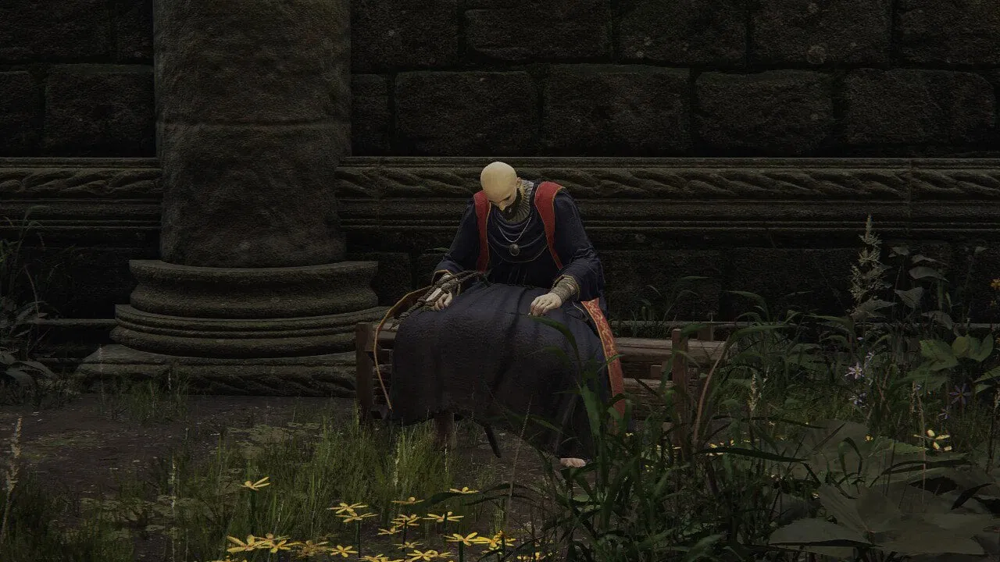
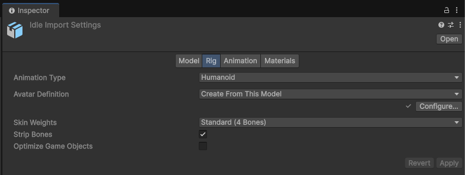
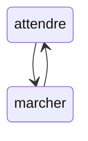
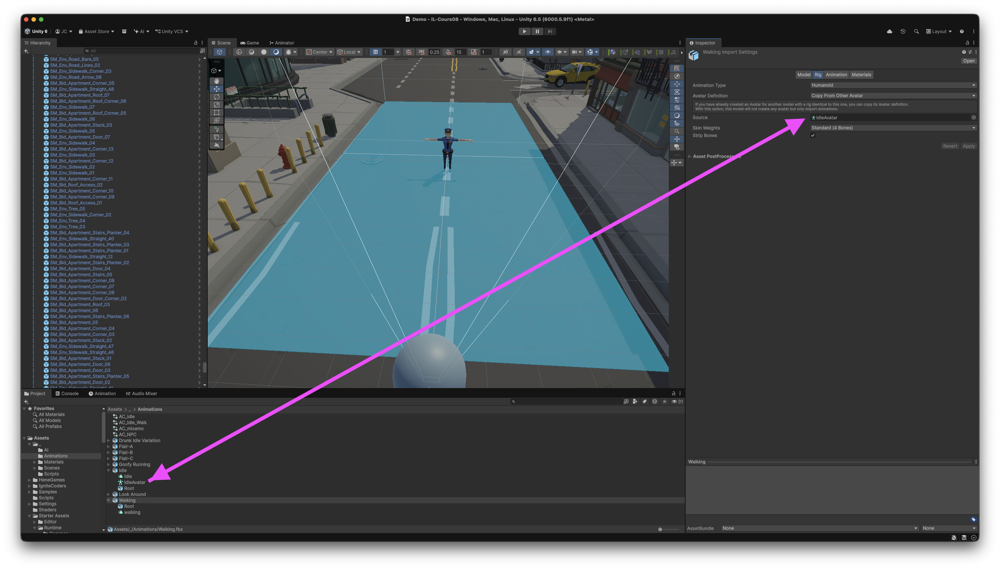

<!--
Piste 
— Package Behavior (Unity 6, Unity Registry)
- Arbres de comportement visuels, nœuds en langage naturel, Blackboard, débogage en temps réel.
- Complète le NavMesh : NavMesh = comment se déplacer, Behavior = quoi faire.
- Hors matière ici (voir l'avertissement « ça suffit ») : à mentionner seulement; démo possible en capsule d'enrichissement au cours 13.
- Limites : package récent, API changeante, peu de tutoriels — vérifier la version installée au labo.
-->

# Cours 9

*[PNJ]: Personnage non-joueur
*[NPC]: Non-Playable Character
*[FSM]: Finite-State Machine

[STOP]

## Divers

{.w-100}

### Interrupteur de tir

{.w-50 .aspect-16-9}

1. Sur le PlayerArmature, décocher le tir dans l'inspecteur
1. Sur un CES, ajouter une action "Invoke Events"
  - Objet = PlayerArmature
  - Fonction = Tir, puis "bool enabled"
  - Cocher la case pour l'activer
 
### Interrupteur de curseur

{.w-50  .aspect-16-9}

Le character controller bloque la souris et ce, à travers toutes les scènes.

1. Créer un Empty object
1. Appliquer ce script sur l'objet :

```c# title="MouseLock.cs"
using UnityEngine;

public class MouseLock : MonoBehaviour
{
    public bool locked = false;

    void Start()
    {
        SetLocked(locked);
    }

    public void SetLocked(bool value)
    {
        locked = value;
        Cursor.lockState = locked ? CursorLockMode.Locked : CursorLockMode.None;
        Cursor.visible = !locked;
    }
}
```

### Event et animation

{.w-50  .aspect-16-9}

Pour déclencher une action après ou pendant une animation, on peut utiliser une "Animation Event".

```c# title="AnimationEventRelay.cs"
using UnityEngine;
using UnityEngine.Events;

public class AnimationEventRelay : MonoBehaviour
{
    public UnityEvent onAnimationEvent;

    public void Trigger()
    {
        onAnimationEvent.Invoke();
    }
}
```

1. Placer le script "AnimationEventRelay.cs" sur l'objet animé
1. Dans le panneau Animation, placer le curseur au moment temporel où déclencher l'événement
1. Cliquer sur l'icône "Add Event"
1. Dans le panneau Inspector, dans Function, choisir `AnimationEventRelay > Methods > Trigger ()`
 

## Tranche verticale

{.w-100}

<!-- behaviour ; https://www.youtube.com/watch?v=DWlZK5mqC6E -->

Phase de test des jeux en classe. (Ne pas expliquer son jeu)

1. Sur GitHub, ouvrir le repo de votre jeu
1. Créer un fichier `tranche-verticale.md` (Add file > Create new file)
1. Cliquer sur "Commit changes..."
1. Cliquer sur `tranche-verticale.md`
1. Cliquer sur le petit crayon en haut à droite et laisser la page ouverte
1. Ouvrir son jeu Unity dans faire play
1. Changer de poste et démarrer le jeu
1. Lorsque vous avez terminé, faire stop sur unity
1. Ouvrir la page du fichier `tranche-verticale.md` et écrire 2 rétroactions :
  - Ce que vous avez aimé
  - Ce qui doit être amélioré

!!! note "Sujets d'analyse"

    - Environnement / HUD
    - Éclairage
    - Prérequis
    - Audio
    - Créativité

## PNJ



Le personnage non joueur (ou NPC) se décrit selon deux axes : 

### Déplacement

- **Statique** (_idle_) : reste en place, animé ou non
- **Errance** (_wander_) : se déplace au hasard dans une zone, avec des pauses
- **Patrouille** (_patrol_) : suit un trajet défini par des points de passage
- **Poursuite** (_follow_ / _chase_) : se déplace vers une cible, comme le joueur
- **Fuite** (_flee_) : s'éloigne d'une cible

### Rôle

- **Décor** : anime le monde, aucune interaction
- **Interactif non hostile** : guide, marchand, dialogue
- **Hostile** : menace le joueur et peut provoquer un échec

> Un PNJ combine donc un mode de déplacement et un rôle.

??? info "Mob"

    Un mob est un PNJ générique et le plus souvent hostile, celui qu’on combat, pas celui avec qui on dialogue.

    |     | Mob | PNJ interactif |
    | --- | --- | --- |
    | Identité | Générique, interchangeable | Souvent unique, nommé |
    | Nombre | Multiple, réapparaît (_spawn_) | Habituellement un seul |
    | Relation au joueur | Obstacle, adversaire | Aide, information, échange |
    | Interaction typique | Combat, évitement | Dialogue, transaction |

## PNJ en attente (_idle_)

{.h-auto}

Un PNJ en attente reste en place. Il peut être animé ou pas.

## Animer un PNJ en attente

{.w-50}

[Mixamo](https://www.mixamo.com) est un service gratuit d'Adobe qui offre une banque de plusieurs animations d'humanoides.

Ça tombe bien, les personnages Synty sont humanoides et ont déjà un squelette prêt à être animé. C'est ce que nous exploiterons.

### Télécharger l'animation

1. Aller sur [mixamo.com](https://www.mixamo.com) et se connecter avec votre compte Adobe
1. Cliquer **Upload Character** et choisir un personnage Polygon en format FBX (ex. : `Models/Characters.fbx`)
1. Choisir une animation sur [mixamo.com](https://www.mixamo.com)
1. Cliquer **Download**, régler les champs ci-dessous, puis cliquer **Download** :

| Champ | Valeur |
|---|---|
| **Frames per Second** | `60` |
| **Pose** *(si affiché)* | `Original Pose` |
| **Skin** *(si affiché)* | `Without Skin` |

<figure markdown>
{data-zoom-image .w-50}
</figure>

??? info "Plusieurs personnages superposés 🤨"

    {data-zoom-image .w-50}

    Le fichier `Characters.fbx` d'un pack Synty contient **tous** les personnages du pack sur un seul squelette. Dans Mixamo, ils apparaissent superposés : c'est normal. Avec **Without Skin**, aucun de ces maillages ne se retrouve dans le fichier téléchargé.

### Configurer le rig

1. Glisser le FBX téléchargé dans **📁 Assets > 📁 _ > 📁 Animations**
1. Dans l'**Inspector**, onglet **Rig** : **Animation Type** = `Humanoid`, puis **Apply**
1. Cliquer **Configure…** et corriger les os que Unity n'arrive pas à associer (tableau ci-dessous), puis **Apply** et **Done**

  | Partie | Os | Valeur |
  |---|---|---|
  | **Head** | Jaw | `None` |
  | **Left Hand** | Tous les *Little ...* | `None` |
  | | Middle Proximal | `Finger_01` |
  | | Middle Intermediate | `Finger_02` |
  | | Middle Distal | `Finger_03` |
  | **Right Hand** | Tous les *Little ...* | `None` |
  | | Middle Proximal | `Finger_011` |
  | | Middle Intermediate | `Finger_021` |
  | | Middle Distal | `Finger_031` |

<figure markdown>
{data-zoom-image .w-50}
</figure>

!!! tip "Configurer une seule fois"

    Pour les animations suivantes, inutile de refaire **Configure…**
    
    Dans l'onglet **Rig**, **Avatar Definition**, choisir `Copy From Other Avatar`, puis choisir l'avatar du premier FBX configuré.

### Configurer le clip

1. Dans l'**Inspector**, onglet **Animation**
1. Renommer le clip (ex. : Idle. Par défaut c'est `mixamo.com`). C'est le champ à droite du triangle turquoise
1. Pour boucler l'animation, cocher **Loop Time**
1. Cocher **Bake Into Pose** dans les trois sections **Root Transform** (Rotation, Position Y, Position XZ)
1. Cliquer sur **Apply**

<figure markdown>
{data-zoom-image .w-50}
</figure>

??? info "Certaines animations se configurent différemment"

    <figure markdown>
    {data-zoom-image .w-50}
    </figure>

    Certaines animations sont faites pour ne jouer qu'une seule fois. Dans ce cas, laisser **Loop Time** décoché.

    D'autres, comme la marche, déplacent le personnage. Pour laisser Unity s'en charger, il faut donc **décocher Bake Into Pose** dans **Root Transform Position (XZ)**.

    Code des couleurs : :green_circle: = boucle propre, :yellow_circle: = léger décalage, :red_circle: = saut visible.

<!-- !!! tip "Lire la vitesse de la marche"
    Avec **Position (XZ) : Bake Into Pose** décoché, l'**Inspector** affiche **Average Velocity** sous l'aperçu du clip. La valeur **Z** est la vitesse de la marche en m/s : c'est la valeur à mettre dans **Speed** du **NavMeshAgent** pour que les pieds ne glissent pas. -->

### Jouer l'animation

{data-zoom-image}

1. Dans **📁 Assets > 📁 _ > 📁 Animations** : clic-droit **Create > Animation > Animator Controller**
1. Clic-droit sur l'Animator Controller et renommer `AC_NPC`
1. Double-cliquer le controller pour ouvrir le panneau **Animator**
1. Clic-droit dans la grille, **Create State > Empty**
1. Sélectionner "New State", dans l'**Inspector**, le renommer (ex. : `Idle`) et choisir le clip dans le champ **Motion**
1. Sélectionner le personnage dans la **Hierarchy**. Dans son composant **Animator** :
  - **Controller** = le controller créé
  - **Avatar** = l'avatar du personnage Synty
  - **Apply Root Motion** décoché : le déplacement est géré par le code ou le **NavMeshAgent**, pas par l'animation

## PNJ en errance (_wander_)

{.h-auto}

Un PNJ en errance se déplace au hasard dans une zone, avec des pauses.

## Animer un PNJ en errence

{.w-50 data-zoom-image}

!!! note "Préallable : PNJ en attente"

### Préparer le terrain

Il faut d'abord créer un zone marchable avec un **NavMesh**.

1. Installer la package **AI Navigation** : **Window > Package Manager > Unity Registry > AI Navigation > Install**
1. Dans la **Hierarchy** : clic-droit **Create Empty**, le nommer `NavMesh`
1. **Add Component > NavMesh Surface**
1. Cliquer **Bake** : la zone marchable apparaît en bleu dans la **Scene**

  ??? quote "Zone spécifique, plutôt que générale"

      {.w-50 data-zoom-image}

      Object Collection > Collect Objects = Volume. Ça va afficher un cube qui sera la zone marchable.

  ??? quote "Exclure une partie du navmesh"

      {data-zoom-image .w-50}

      1. Dans la **Hierarchy** : clic-droit **Create Empty**, le nommer `NavMesh modifier`
      1. **Add Component > NavMesh Modifier Volume**
      1. Sur le NavMesh Surface, changer Default Area à Marchable (créer si absent)
      1. Sur le NavMesh Modifier Volume, changer "Area type" à Non marchabme (créer si absent)
      1. Sur le NavMesh Surface, cliquer sur Bake

Il faut ensuite placer le PNJ sur la zone marchable. Celui-ci deviendra ce qu'on appelle un Agent.

1. Sélectionner le PNJ, puis **Add Component > Nav Mesh Agent**
1. Placer le PNJ **sur une zone bleue** du NavMesh

  {.w-50 data-zoom-image}

  !!! note "Base offset"

      Si le PNJ flotte ou s'enfonce dans le sol, vous pouvez ajuster le champ "Base Offset" sous Nav Mesh Agent.

### Déplacement aléatoire

{.h-auto}

L'errance d'un PNJ repose sur le concept de destinations (_waypoint_) générées aléatoirement.

1. Ajouter le script [`NPCWander.cs`](./extra/NPCWander.cs) dans Assets > _ > Scripts
1. Glisser le script `NPCWander.cs` sur le PNJ

<!-- ### Machine à état (_state machine_) -->

<!--  -->

Pour certains jeux ça peut convenir, mais la plupart du temps, on trouvera qu'il manque une animation de marche. Il faut donc changer l'animation en fonction de l'état : 



### Nouvelle animation de marche

{.w-50}

1. Aller sur [mixamo.com](https://www.mixamo.com) et télécharger une animation de **marche**
1. Configurer son rig
  - Avatar Definition = Copy From Other Avatar
  - Choisir l'avatar d'une animation déjà configurée. Ça évite de travailler en double<br>{data-zoom-image .w-10}
1. Configurer son clip
  - Renommer le clip (ex. : `Marche`. Par défaut c'est `mixamo.com`).
  - **Position (XZ) : Bake Into Pose** décoché. Ce sera géré par le script de déplacement

### Changement d'état

{.w-50}

1. Double cliquer sur `AC_NPC` pour l'ouvrir dans le panneau Animator
1. Onglet **Parameters** du panneau **Animator** : **+ > Bool**, le nommer `walking`<br>{data-zoom-image .w-10}
1. Clic-droit dans la grille, **Create State > Empty**
1. Sélectionner "New State", dans l'**Inspector**, le renommer (ex. : `Walk`) et choisir le clip de marche dans le champ **Motion**
1. Clic-droit sur `Idle` **> Make Transition** vers `Walk`, puis de `Walk` vers `Idle`<br>{data-zoom-image .w-10}
1. Cliquer sur chaque transition (petit flèche blanche) et configurer pour chacune :

  | Réglage | Idle → Marche | Marche → Idle |
  |---|---|---|
  | **Has Exit Time** | décoché | décoché |
  | **Conditions** | `walking` = `true` | `walking` = `false` |

1. Dans Hierarchy, cliquer sur le PNJ
1. Dans l'Inspector, glisser la section "Animator" vers le champ Animator sous "NPC Wander (Script)"

  !!! note "Walk Parameter"

      Notez que la valeur du champ "Walk Parameter" doit être la même que le nom du Parameter dans le paneau Animator<br>{data-zoom-image .w-10}

## PNJ en poursuite (_follow_)

Un PNJ en poursuite se déplace vers une cible (souvent le joueur).

!!! note "Préallable : PNJ en errence"

1. Dans l'Animator, ajouter un autre état nommé "Run"


### PNJ en fuite (_flee_)

** (_flee_) : s'éloigne d'une cible -->


## Trello

### Nouvelles cartes

> Sprint 3 : l'alpha (cours 12)

**Zones 2 et 3**

- `Must` Habiller la zone 2 : aucun objet flottant ni raccord visible
- `Must` Éclairer la zone 2
- `Must` Habiller la zone 3 : aucun objet flottant ni raccord visible
- `Must` Éclairer la zone 3

**PNJ** (facultatif : une initiative possible au critère créativité)

- `Could` Préparer le NavMesh de la zone du PNJ
- `Could` Monter le PNJ : patrouille, détection, réaction
- `Could` Animer le PNJ avec Mixamo : repos et marche
- `Could` Monter un dialogue avec un PNJ (package Dialogue System)

**Assets et crédits**

- `Must` Monter la scène Crédits, accessible depuis le menu titre, à partir de la section `## Crédits` du README


## Devoirs

!!! warning "Premier build WebGL"
    Dépose ton jeu sur une page itch.io **privée** cette semaine. Fonctionnel avant tout, pas beau. Les surprises de build WebGL sont nombreuses et il ne faut pas les découvrir la semaine de la remise finale.

<!-- Savoirs essentiels touchés (note pour l'enseignant) :

-->

<!--
================================================================
NOTES DE RÉDACTION — à supprimer une fois la séance écrite
================================================================
SÉANCE ENTIÈREMENT À ÉCRIRE — aucune source dans l'ancien plan.

Prévoir : exercices/cours09-pnj-et-navmesh.md
Prévoir : un ou deux scripts pour le kit (PatrolAgent, VisionCone).
La rotation F2 occupe l'enseignant pendant l'atelier : le kit doit
permettre d'avancer sans aide.

Dialogue System (HeneGames) — à vérifier au labo sur Unity 6 avant la séance :
  - la lecture du clavier (ancien Input Manager?) : si erreur, Player Settings >
    Active Input Handling = Both
  - TextMeshPro requis ou non; l'emplacement exact du prefab Dialogue UI
  - où se règle la touche « continuer » (objet Continue Button)
  - le déclenchement avec un CharacterController en 3D
================================================================
-->
