# Cours 9

*[PNJ]: Personnage non-joueur
*[NPC]: Non-Playable Character
*[FSM]: Finite-State Machine

## Tranche verticale

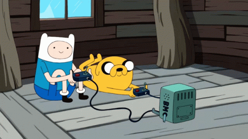{.w-100}

<!-- behaviour ; https://www.youtube.com/watch?v=DWlZK5mqC6E -->

Phase de test des jeux en classe. (Ne pas expliquer son jeu)

1. Sur GitHub, ouvrir le repo de votre jeu
1. Créer un fichier `tranche-verticale.md` (**Add file > Create new file**)
1. Cliquer sur **Commit changes...**
1. Cliquer sur `tranche-verticale.md`
1. Cliquer sur le petit crayon en haut à droite et laisser la page ouverte
1. Ouvrir son jeu dans Unity
1. Régler le bon niveau sonore du jeu
---
1. Changer de poste et démarrer le jeu
1. Lorsque vous avez terminé, faire **Stop** dans Unity
1. Ouvrir la page du fichier `tranche-verticale.md` et écrire 2 rétroactions :
  - Ce que vous avez aimé
  - Ce qui doit être amélioré

!!! note "Sujets d'analyse"

    Environnement, HUD, Affordance, Éclairage, Prérequis, Audio, Créativité

## Divers

??? quote "Activer ou désactiver le tir du « Character Controller »"

    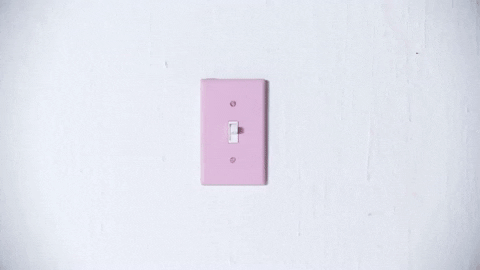{.w-50 .aspect-16-9}

    1. Sur le **PlayerArmature** ou **PlayerCapsule**, décocher le tir dans l'**Inspector**
    1. Sur un CES, ajouter une action **Invoke Events**
      - **Objet** = **PlayerArmature** ou **PlayerCapsule**
      - **Fonction** = **Tir**, puis **bool enabled**
      - Cocher la case pour l'activer

??? quote "Le « Character Controller » bloque la souris, et ce, à travers toutes les scènes"

    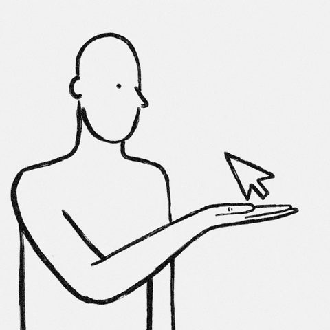{.w-50 .aspect-16-9}

     Le script suivant vous permet, au chargement de la scène ou via une Action CES, d'activer ou désactiver la souris.

    1. Dans la **Hierarchy** : clic-droit **Create Empty**
    1. Appliquer ce script sur l'objet :

    ```c# title="MouseLock.cs"
    using UnityEngine;

    public class MouseLock : MonoBehaviour
    {
       public bool locked = false;

       void Start()
       {
           SetLocked(locked);
       }

       public void SetLocked(bool value)
       {
           locked = value;
           Cursor.lockState = locked ? CursorLockMode.Locked : CursorLockMode.None;
           Cursor.visible = !locked;
       }
    }
    ```

??? quote "Déclencher une action, avant, pendant ou après une animation"

    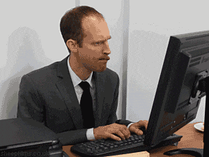{.w-50 .aspect-16-9}

    Utiliser un **Animation Event**.

    1. Placer le script suivant sur le _GameObject_ animé

      ```c# title="AnimationEventRelay.cs"
      using UnityEngine;
      using UnityEngine.Events;

      public class AnimationEventRelay : MonoBehaviour
      {
         public UnityEvent onAnimationEvent;

         public void Trigger()
         {
             onAnimationEvent.Invoke();
         }
      }
      ```
      
    1. Dans le panneau **Animation**, placer le curseur au moment où déclencher l'événement
    1. Cliquer sur l'icône **Add Event**
    1. Dans l'**Inspector**, dans **Function**, choisir **AnimationEventRelay > Methods > Trigger ()**

## PNJ

{.h-auto}

Le personnage non-joueur (PNJ ou NPC) se décrit selon deux axes :

### Déplacement

- **Statique** (_idle_) : reste en place, animé ou non
- **Errance** (_wander_) : se déplace au hasard dans une zone, avec des pauses
- **Patrouille** (_patrol_) : suit un trajet défini par des points de passage
- **Poursuite** (_follow_) : se déplace vers une cible
- **Fuite** (_flee_) : s'éloigne d'une cible

### Rôle

- **Décor** : anime le monde, aucune interaction
- **Interactif non hostile** : guide, marchand, dialogue
- **Hostile** : menace le joueur et peut provoquer un échec

> Un PNJ combine donc un mode de déplacement et un rôle.

## PNJ en attente (_idle_)

{.h-auto}

Un PNJ en attente reste en place. Il peut être animé ou pas.

## Animer un PNJ en attente

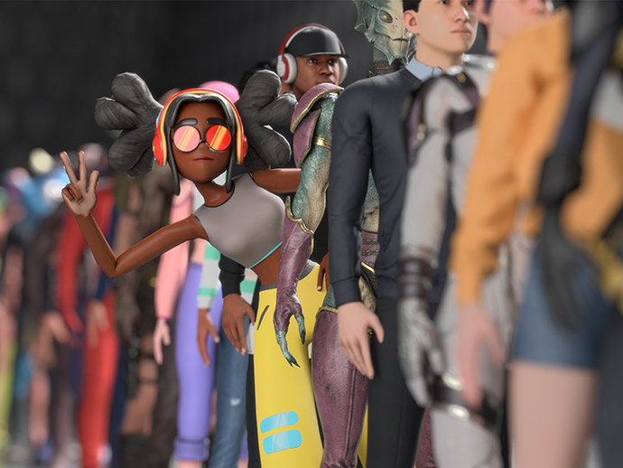{.w-50}

[Mixamo](https://www.mixamo.com) est un service gratuit d'Adobe qui offre une banque de plusieurs animations d'humanoïdes.

Ça tombe bien, les personnages Synty sont humanoïdes et ont déjà un squelette prêt à être animé. C'est ce que nous exploiterons.

### Télécharger l'animation

1. Aller sur [mixamo.com](https://www.mixamo.com) et se connecter avec votre compte Adobe
1. Cliquer sur **Upload Character** et choisir un personnage Polygon en format FBX (ex. : `Models/Characters.fbx`)
1. Choisir une animation sur [mixamo.com](https://www.mixamo.com)
1. Cliquer sur **Download**, régler les champs ci-dessous, puis cliquer sur **Download** :

| Champ | Valeur |
|---|---|
| **Frames per Second** | `60` |
| **Pose** *(si affiché)* | `Original Pose` |
| **Skin** *(si affiché)* | `Without Skin` |

<figure markdown>
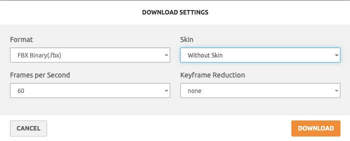{data-zoom-image .w-50}
</figure>

??? info "Plusieurs personnages superposés 🤨"

    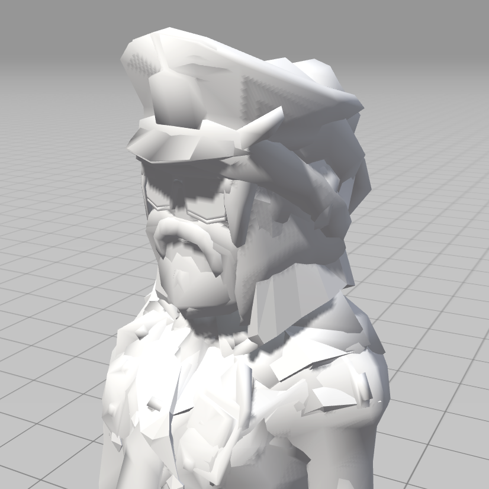{data-zoom-image .w-50}

    Le fichier `Characters.fbx` d'un pack Synty contient **tous** les personnages du pack sur un seul squelette. Dans Mixamo, ils apparaissent superposés : c'est normal. Avec **Without Skin**, aucun de ces maillages ne se retrouve dans le fichier téléchargé.

### Configurer le rig

1. Glisser le FBX téléchargé dans **📁 Assets > 📁 _ > 📁 Animations**
1. Dans l'**Inspector**, onglet **Rig** : **Animation Type** = `Humanoid`, puis **Apply**
1. **Avatar Definition** = `Copy From Other Avatar`
  - **Source** = `CharactersAvatar` (ex. : **📁 SyntyStudios > 📁 PolygonCity > 📁 Models > Characters > CharactersAvatar**)

<figure markdown>
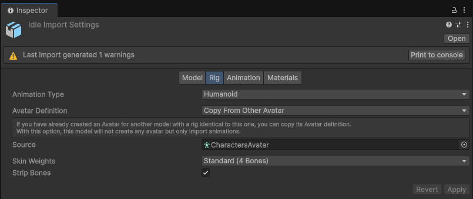{data-zoom-image .w-50}
</figure>

### Configurer le clip

1. Dans l'**Inspector**, onglet **Animation**
1. Renommer le clip (ex. : `Idle`; par défaut, c'est `mixamo.com`). C'est le champ à droite du triangle turquoise
1. Pour boucler l'animation, cocher **Loop Time**
1. Cocher **Bake Into Pose** dans les trois sections **Root Transform** (Rotation, Position Y, Position XZ)
1. Cliquer sur **Apply**

<figure markdown>
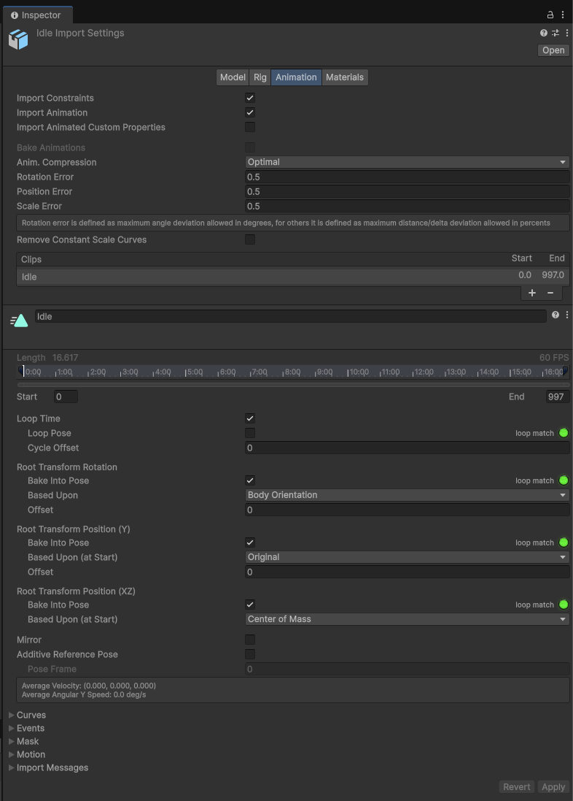{data-zoom-image .w-50}
</figure>

??? info "Certaines animations se configurent différemment"

    <figure markdown>
    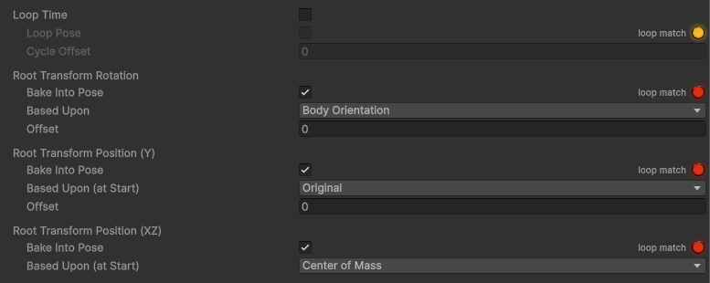{data-zoom-image .w-50}
    </figure>

    Certaines animations sont faites pour ne jouer qu'une seule fois. Dans ce cas, laisser **Loop Time** décoché.

    D'autres, comme la marche, déplacent le personnage. Pour laisser Unity s'en charger, il faut donc décocher **Bake Into Pose** dans **Root Transform Position (XZ)**.

    Code des couleurs : :green_circle: = boucle propre, :yellow_circle: = léger décalage, :red_circle: = saut visible.

### Créer l'_Animator_

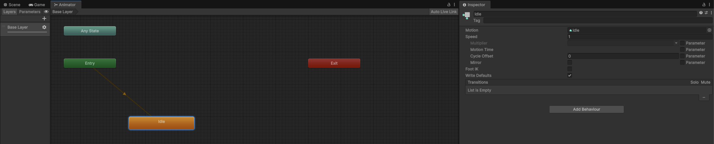{data-zoom-image}

1. Dans **📁 Assets > 📁 _ > 📁 Animations** : clic-droit **Create > Animation > Animator Controller**
1. Clic-droit sur l'**Animator Controller** > **Rename**, le nommer `AC_NPC`
1. Double-cliquer sur `AC_NPC` pour ouvrir le panneau **Animator**
1. Clic-droit dans la grille, **Create State > Empty**
1. Sélectionner `New State` puis, dans l'**Inspector**, le renommer (ex. : `Idle`) et choisir le clip dans le champ **Motion**

### Appliquer l'animation sur un PNJ

1. Sélectionner le personnage dans la **Hierarchy**. Dans son composant **Animator** :
  - **Controller** = le _controller_ créé (`AC_NPC`)
  - **Avatar** = laisser l'avatar par défaut du personnage Synty
  - **Apply Root Motion** = décoché

<figure markdown>
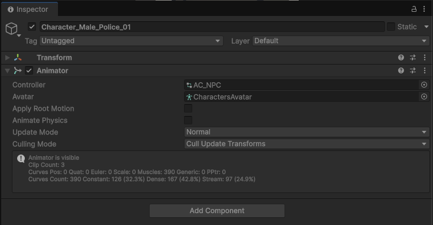{data-zoom-image .w-50}
</figure>

## PNJ en errance (_wander_)

{.h-auto}

Un PNJ en errance se déplace au hasard dans une zone, avec des pauses.

## Animer un PNJ en errance

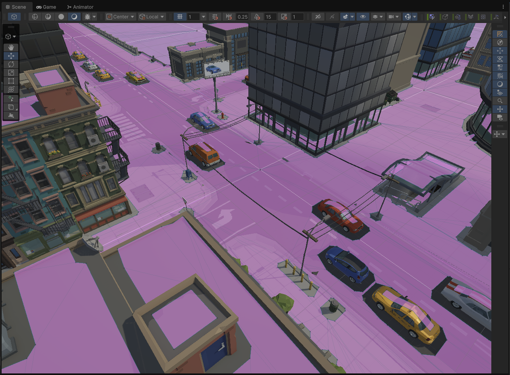{.w-50 data-zoom-image}

### Préparer le terrain

Il faut d'abord créer une zone marchable avec un **NavMesh**.

1. Installer le package **AI Navigation** : **Window > Package Manager > Unity Registry > AI Navigation > Install**
1. Dans la **Hierarchy** : clic-droit **Create Empty**, le nommer `NavMesh`
1. **Add Component > NavMesh Surface**
1. Cliquer sur **Bake** : la zone marchable apparaît en bleu dans la **Scene**

  ??? quote "Zone spécifique, plutôt que générale"

      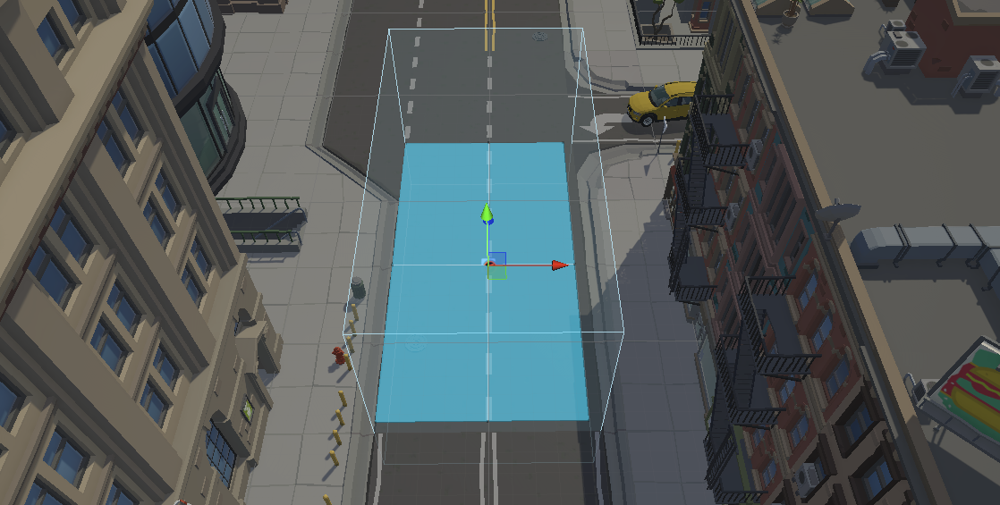{.w-50 data-zoom-image}

      Sur le **NavMesh Surface**, **Object Collection > Collect Objects** = `Volume`. Un cube s'affiche : c'est la zone marchable.

  ??? quote "Exclure une partie du navmesh"

      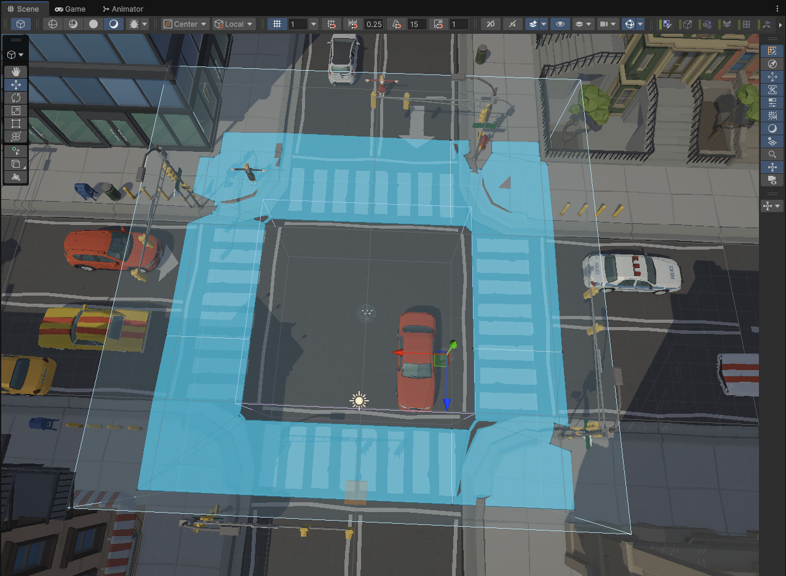{data-zoom-image .w-50}

      1. Dans la **Hierarchy** : clic-droit **Create Empty**, le nommer `NavMesh Modifier`
      1. **Add Component > NavMesh Modifier Volume**
      1. Sur le **NavMesh Surface**, changer **Default Area** à `Marchable` (créer si absent)
      1. Sur le **NavMesh Modifier Volume**, changer **Area Type** à `Non marchable` (créer si absent)
      1. Sur le **NavMesh Surface**, cliquer sur **Bake**

Il faut ensuite placer le PNJ sur la zone marchable. Celui-ci deviendra ce qu'on appelle un _agent_.

1. Sélectionner le PNJ, puis **Add Component > Nav Mesh Agent**
1. Placer le PNJ **sur une zone bleue** du NavMesh

  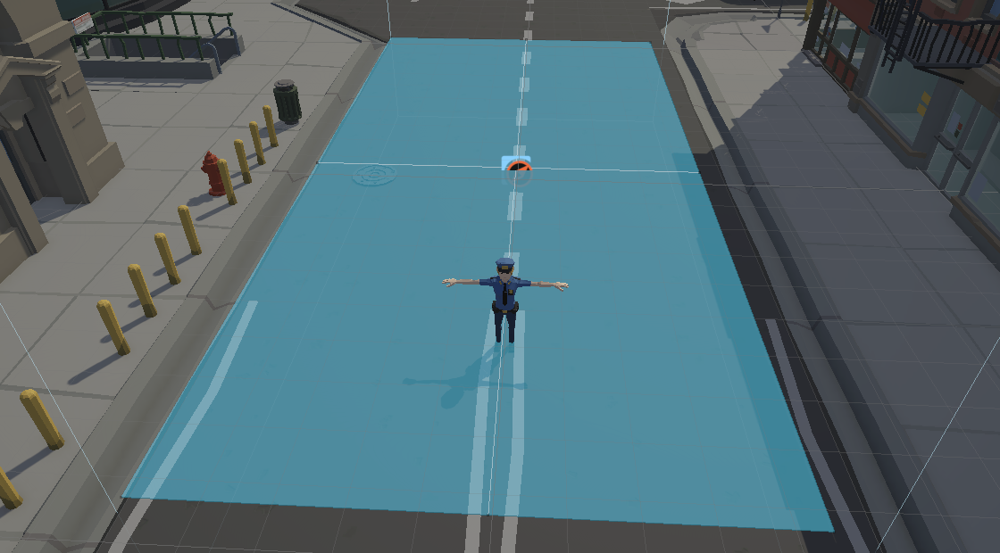{.w-50 data-zoom-image}

  !!! note "Base offset"

      Si le PNJ flotte ou s'enfonce dans le sol, vous pouvez ajuster le champ **Base Offset** sous **Nav Mesh Agent**.

### Déplacement aléatoire

{.h-auto}

L'errance d'un PNJ repose sur le concept de destinations (_waypoint_) générées aléatoirement. Cette opération se fait en code.

1. Ajouter le script [`NPCWander.cs`](./extra/NPCWander.cs) dans **📁 Assets > 📁 _ > 📁 Scripts**
1. Glisser le script `NPCWander.cs` sur le PNJ

<!-- ### Machine à état (_state machine_) -->

<!-- 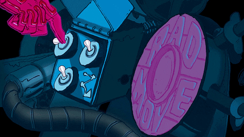 -->

Pour certains jeux, ça peut convenir et on pourrait s'arrêter là. Toutefois, il ne serait pas étonnant de trouver qu'il manque une animation de marche dans l'équation.

Pour ce faire, il faudrait donc changer d'animation en fonction de l'état du PNJ. C'est ce qui s'appelle une machine à états, ou _state machine_.

### Nouvelle animation de marche :material-walk:

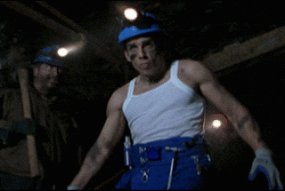{.w-50}

1. Aller sur [mixamo.com](https://www.mixamo.com) et télécharger une animation de **marche**
1. Configurer son rig
1. Configurer son clip
  - Renommer le clip (ex. : `Marche`; par défaut, c'est `mixamo.com`)
  - Cocher **Loop Time**, puis **Bake Into Pose** dans **Root Transform Rotation** et **Root Transform Position (Y)**
  - Garder **Bake Into Pose** décoché dans **Root Transform Position (XZ)** : ce sera géré par le script de déplacement

**Configurer la machine à états**

1. Double-cliquer sur `AC_NPC` pour l'ouvrir dans le panneau **Animator**
1. Onglet **Parameters** du panneau **Animator** : **+ > Bool**, le nommer `walking`<br>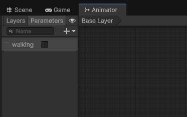{data-zoom-image .w-50}
1. Clic-droit dans la grille, **Create State > Empty**
1. Sélectionner `New State` puis, dans l'**Inspector**, le renommer (ex. : `Walk`) et choisir le clip de marche dans le champ **Motion**
1. Clic-droit sur `Idle` **> Make Transition** vers `Walk`, puis de `Walk` vers `Idle`<br>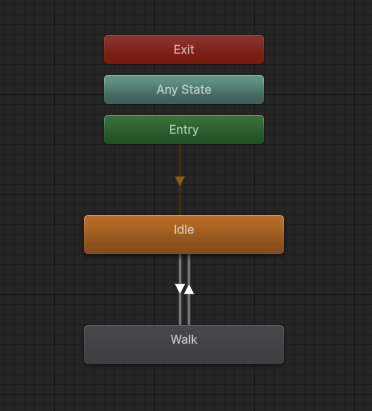{data-zoom-image .w-50}
1. Cliquer sur chaque transition (petite flèche blanche) et configurer pour chacune :

  | Réglage | Idle :material-arrow-right: Walk | Walk :material-arrow-right: Idle |
  |---|---|---|
  | **Has Exit Time** | décoché | décoché |
  | **Conditions** | `walking` = `true` | `walking` = `false` |

### Appliquer la machine à états au PNJ

1. Dans la **Hierarchy**, cliquer sur le PNJ
1. Dans l'**Inspector**, glisser le composant **Animator** vers le champ **Animator** sous **NPC Wander (Script)**

  !!! note "Walk Parameter"

      La valeur du champ **Walk Parameter** doit être identique au nom du paramètre dans le panneau **Animator**<br>{data-zoom-image .w-10}

## PNJ en poursuite (_follow_)

{.h-auto}

Un PNJ en poursuite se déplace vers une cible (souvent le joueur) lorsque celle-ci entre dans sa zone de détection.

### Déplacement du PNJ

{.h-auto}

La poursuite repose sur des zones de détection autour du PNJ. Cette opération se fait en code.

1. Ajouter le script [`NPCFollowerEditor.cs`](./extra/NPCFollowerEditor.cs) dans **📁 Assets > 📁 _ > 📁 Scripts > 📁 Editor**
1. Ajouter le script [`NPCFollower.cs`](./extra/NPCFollower.cs) dans **📁 Assets > 📁 _ > 📁 Scripts**
1. Glisser le script `NPCFollower.cs` sur le PNJ
1. Glisser **PlayerArmature** ou **PlayerCapsule** dans le champ **Target**
1. Pour activer les animations, dans l'**Inspector** du PNJ, glisser le composant **Animator** vers le champ **Animator** sous **NPC Follower (Script)**

### Nouvelle animation de course :material-run-fast:

<!-- 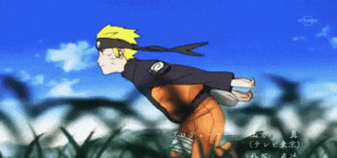{.w-50} -->
{.h-auto}

Bien qu'il ne soit pas obligatoire d'ajouter une animation de course, celle-ci peut s'avérer plus cohérente et convaincante.

1. Aller sur [mixamo.com](https://www.mixamo.com) et télécharger une animation de **course**
1. Configurer son rig
1. Configurer son clip
  - Renommer le clip (ex. : `Course`; par défaut, c'est `mixamo.com`)
  - Cocher **Loop Time**, puis **Bake Into Pose** dans **Root Transform Rotation** et **Root Transform Position (Y)**
  - Garder **Bake Into Pose** décoché dans **Root Transform Position (XZ)** : ce sera géré par le script de déplacement

**Configurer la machine à états**

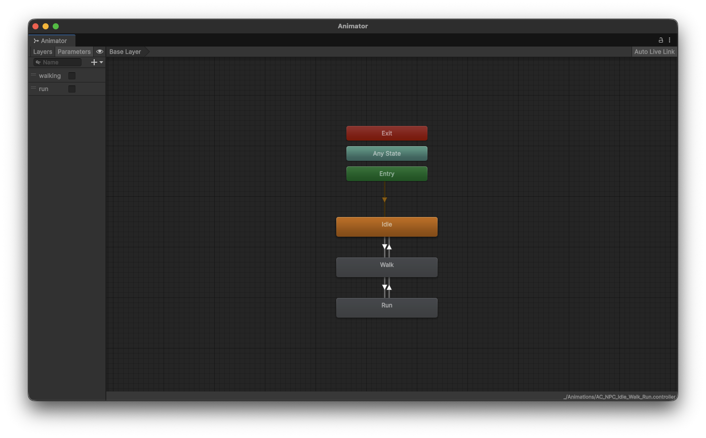{data-zoom-image}

1. Double-cliquer sur `AC_NPC` pour l'ouvrir dans le panneau **Animator**
1. Onglet **Parameters** du panneau **Animator** : **+ > Bool**, le nommer `run`
1. Clic-droit dans la grille, **Create State > Empty**
1. Sélectionner `New State` puis, dans l'**Inspector**, le renommer (ex. : `Run`) et choisir le clip de course dans le champ **Motion**
1. Clic-droit sur `Run` **> Make Transition** vers `Walk`, puis de `Walk` vers `Run`
1. Cliquer sur chaque transition (petite flèche blanche) et configurer pour chacune :

  | Réglage | Walk :material-arrow-right: Run | Run :material-arrow-right: Walk |
  |---|---|---|
  | **Has Exit Time** | décoché | décoché |
  | **Conditions** | `run` = `true` | `run` = `false` |

### Activer la course au PNJ en poursuite

1. Sélectionner le PNJ dans la **Hierarchy**
1. Dans l'**Inspector**, sous **NPC Follower (Script)**, cocher **Run When Chasing**

> Ça va activer la course quand le PNJ poursuit sa cible, mais la gestion d'errance reste là lorsque nécessaire.

## À l'attaque :crossed_swords:

{.h-auto}

Quand le PNJ arrive près de sa cible, on peut s'imaginer qu'il veuille exécuter une action, par exemple, une attaque !

Une attaque corps à corps nécessite une technique qu'on appelle _hitbox_. C'est une zone de collision temporaire.

### Nouvelle animation d'attaque :punch:

{.h-auto}

1. Sur [mixamo.com](https://www.mixamo.com), télécharger une animation de coup (ex. : *Punch*), avec les mêmes réglages que l'animation d'attente
1. Configurer son rig
1. Configurer son clip :
  - Renommer le clip `Attack`
  - **Loop Time** décoché : le coup ne joue qu'une fois
  - **Bake Into Pose** coché dans les trois sections **Root Transform** : le PNJ reste sur place pendant le coup

**Configurer la machine à états**

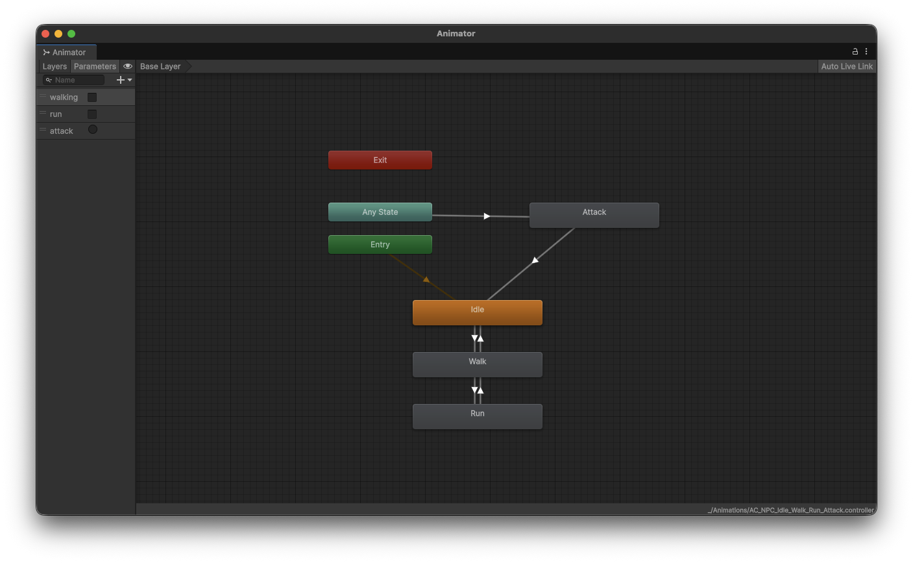{data-zoom-image}

1. Double-cliquer sur `AC_NPC`
1. Onglet **Parameters** : **+ > Trigger**, le nommer `attack`
1. Créer un état nommé **exactement** `Attack` et choisir le clip d'attaque dans **Motion**

   <!-- Pourquoi Attack ? 
   Le nom du Trigger sert seulement à lancer l’attaque. Le script doit aussi savoir quand elle se termine, et l’Animator ne fournit pas cette information. Une fois le Trigger envoyé, le script ne sait pas combien de temps dure le coup ni à quel moment l’Animator en sort. -->

1. Créer les transitions suivantes :

  | Réglage | Any State :material-arrow-right: Attack | Attack :material-arrow-right: Idle |
  |---|---|---|
  | **Has Exit Time** | **décoché** | coché |
  | **Conditions** | `attack` | *(aucune)* |
  | **Can Transition To Self** | décoché | — |

  <!-- Can Transition To Self décoché
  Tant que le PNJ est dans Attack, la transition est ignorée. Le coup se termine avant qu’un nouveau puisse partir. -->

1. Sur le PNJ, dans **NPC Follower** :
  - Cocher **Can Attack**
  - **Attack Trigger** = `attack` (le même nom que le trigger)

### Placer la hitbox

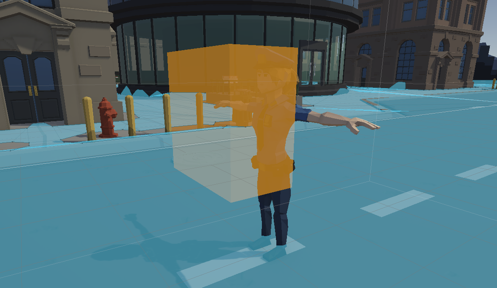{.h-auto}

1. Dans la **Hierarchy**, à l'intérieur du PNJ, ajouter un **Trigger Cube**
1. Dans **Collider Event** :
  - **Required Tags** : `Player`
  - **After Trigger** = `Do Nothing`
  - **Actions** : l'effet du coup (ex. : **Variable** pour retirer une vie, **Audio** pour un son d'impact, etc.)
  - **Actions**, en **dernier** : **Invoke Events**, objet = le PNJ, fonction = **NPCFollower > HitboxOff**

<!-- Pas besoin de désactiver `Hitbox` dans l'**Inspector** : le script l'éteint au démarrage. -->

??? quote "Pour les puristes"

    Si vous tenez à ce que le poing (ou l'épée par exemple) soit le point de contact, vous pouvez placer le **Trigger Cube** comme enfant d'un membre (ex. : `Hand_R`).

### Utiliser la hitbox dans l'animation !

<!-- 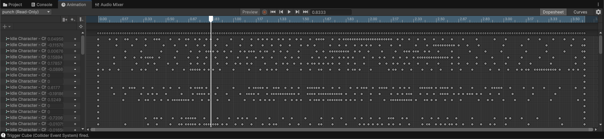{data-zoom-image .w-50}

Un clip qui vient d'un FBX (Mixamo) est en lecture seule (_Read-Only_) dans le panneau **Animation**. Les événements s'ajoutent plutôt dans l'**Inspector** du FBX. -->

1. Dans le panneau **Project**, sélectionner le FBX de l'animation d'attaque
1. Dans l'**Inspector**, onglet **Animation**, déplier la section **Events**
1. Dans l'aperçu au bas de l'**Inspector**, avancer l'animation jusqu'au moment où l'attaque commence
1. Cliquer sur **Add Event** et inscrire `HitboxOn` dans **Function**
1. Avancer jusqu'au moment où l'attaque se termine
1. Cliquer sur **Add Event** et inscrire `HitboxOff` dans **Function**
1. Laisser vides les champs **Float**, **Int**, **String** et **Object**, puis cliquer sur **Apply**

<figure markdown>
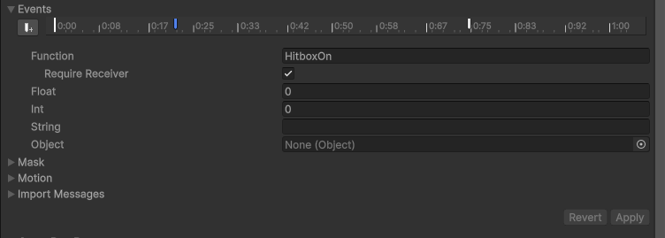{data-zoom-image .w-50}
</figure>

!!! tip "Tester la fenêtre d'impact"

    Le **Contact Radius** de **NPC Follower (Script)** arrête le PNJ pour qu'il ne se superpose pas au joueur. Toutefois, ça peut créer une certaine distance qui empêche la collision d'attaque. Dans ce cas, soit diminuer le **Contact Radius**, soit agrandir le **Trigger Cube** d'attaque.

    <div class="grid" markdown>
    <div markdown>
    {.h-auto}
    </div>
    <div markdown>
    {.h-auto}
    </div>
    </div>

### Tourelle

{.h-auto}

Une tourelle est un objet fixe qui tire des projectiles sur une cible.

1. Ajouter le script [`Turret.cs`](./extra/Turret.cs) dans **📁 Assets > 📁 _ > 📁 Scripts**
1. Dans la **Hierarchy**, cliquer sur le **+** et choisir **Create Empty**
1. Le renommer `Turret`
1. Clic-droit sur `Turret` et choisir **Create Empty**
1. Le renommer `ShootStart`
1. Dans `Turret`, ajouter un modèle (ex. : une tourelle)
1. Glisser le script `Turret.cs` sur le GameObject `Turret`
1. Glisser **PlayerArmature** ou **PlayerCapsule** dans le champ **Target**
1. Glisser un prefab dans le champ **Bullet Prefab**<br>:warning: **IMPORTANT** : ce prefab doit avoir un **Rigidbody**
1. Glisser `ShootStart` dans le champ **Fire Starting Point**

## Trello


* <span class="opacity-50">Semaine 1 </span>
* <span class="opacity-50">Semaine 2 </span>
* <span class="opacity-50">Semaine 3 </span>
* <span class="opacity-50">Semaine 4 </span>
* <span class="opacity-50">Semaine 5 </span>
* <span class="opacity-50">Semaine 6 </span>
* <span class="opacity-50">Semaine 7 | 🏃🏻‍♂️ Sprint 1 : Prototype</span>
* <span class="opacity-50">Semaine 8 | 22 octobre </span>
* Semaine 9 | 29 octobre 🏃🏻‍♂️ Sprint 2 : Tranche verticale 🗓️ Aujourd'hui
* Semaine 10 | 5 novembre
* Semaine 11 | 12 novembre
* Semaine 12 | 19 novembre 🏃🏻‍♂️ Sprint 3 : Alpha
* <span class="opacity-50">Semaine 13 | 26 novembre</span>
* <span class="opacity-50">Semaine 14 | 3 décembre 🏃🏻‍♂️ Sprint 4 : Beta</span>
* <span class="opacity-50">Semaine 15 | 10 décembre 🏃🏻‍♂️ Sprint 5 : Oral</span>

### Version alpha

> Dans une version alpha, le jeu est structurellement jouable du début à la fin et les mécaniques de base sont implémentées.

### Version beta

> Dans une version beta, le jeu est complet. Le développement se concentre sur les bugs, l'optimisation et l'équilibrage du jeu.

### Nouvelles cartes

- `Must` Terminer la zone 1, le cas échéant

- `Must` Habiller la zone 2
- `Must` Éclairer la zone 2
- `Must` Sonoriser la zone 2
- `Must` Prérequis complet pour la zone 2

- `Must` Habiller la zone 3
- `Must` Éclairer la zone 3
- `Must` Sonoriser la zone 3
- `Must` Prérequis complet pour la zone 3

- `Must` Monter la scène Crédits, accessible depuis le menu titre

#### PNJ

- `Could` Préparer le NavMesh
- `Could` Ajouter un ou plusieurs PNJ
- `Could` Appliquer la ou les animations des PNJ
- `Could` Configurer le comportement des PNJ

<!-- Prochain cours, particules et système de dialogue -->

[STOP]

Le cours a été très dense pour eux. La section "PNJ en poursuite" n'a pas été montré en démo. De toutes manières, elle ne concernait que 3 personnes sur 2 classes.
