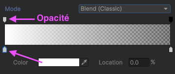
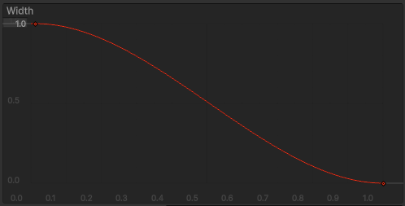
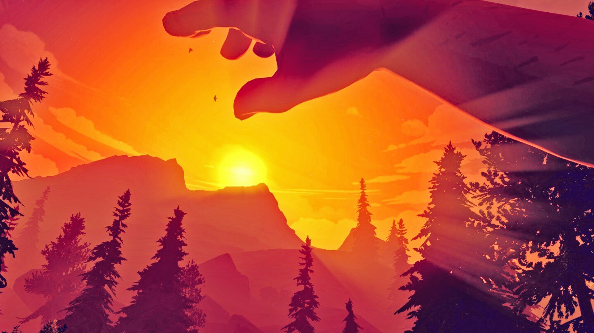
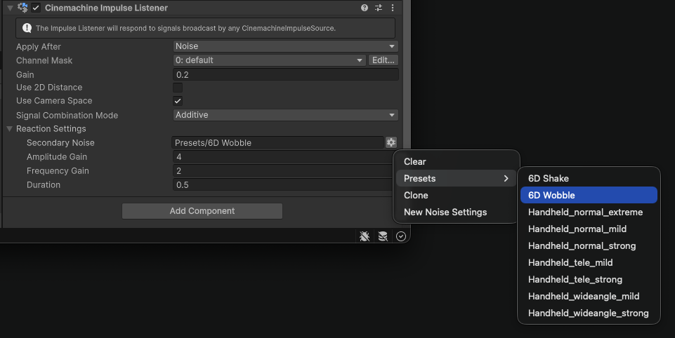
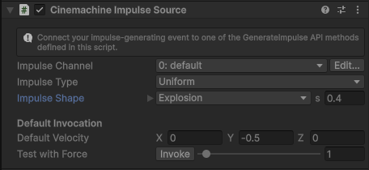
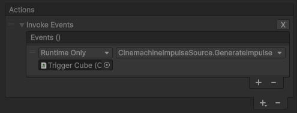
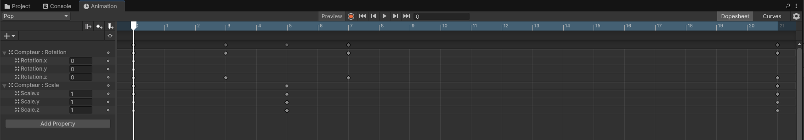
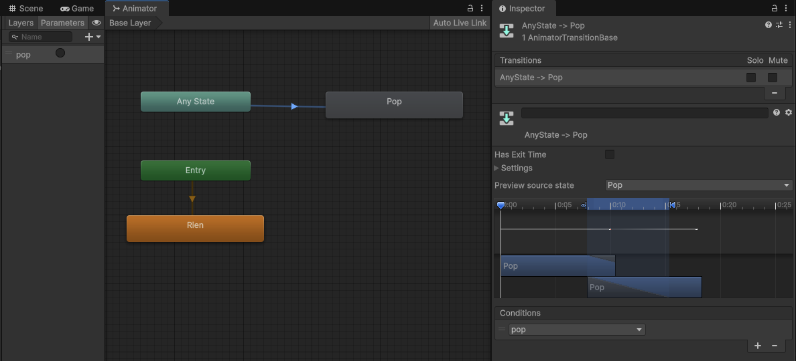

# Cours 10

[STOP]

## Les systèmes de particules

{.h-auto}

Un système de particules, c'est une multitude de petits éléments qui **naissent, bougent, changent et meurent**. Feu, fumée, pluie, poussière, étincelles, magie : tous reposent sur ce principe.

### Créer un Particle System

1. Dans la **Hierarchy** : clic-droit **Visual Effects > Particle System**
1. Dans la **Scene**, l'overlay **Particles** (en bas à droite) permet de rejouer (**Restart**) l'effet sans lancer le jeu
1. Tous les réglages sont dans l'**Inspector**

### Les réglages essentiels

**Module principal**

| Réglage | Rôle |
|---|---|
| **Looping** | Boucle l'émission. (ex. : Coché = fumée, cécoché = explosion |
| **Start Lifetime** | Durée de vie d'une particule, en secondes |
| **Start Speed** | Vitesse d'éjection |
| **Start Size** | Taille |
| **Start Color** | Couleur de départ : l'accorder à l'objet ou à l'événement |
| **Gravity Modifier** | `0` = pas de gravité, `1` = 100% gravité |
| **Simulation Space** | `World` (les particules restent derrière un émetteur qui bouge (ex. : traînée de fumée)), `Local` = les particules suivent l'émetteur |
| **Play On Awake** | Joue dès l'apparition de l'objet |
| **Stop Action** | `Destroy` : une fois la dernière particule morte, le GameObject de l'émetteur se détruit (indispensable pour un effet instancié) |

**Autres modules**

| Module | Rôle |
|---|---|
| **Emission** | Combien : **Rate over Time** (flux continu) ou **Bursts** (rafale, ex. : 20 particules au temps 0) |
| **Shape** | D'où : `Cone`, `Sphere`, `Hemisphere`, `Circle`, `Box`, etc. |
| **Color over Lifetime** | Fondu : dans le dégradé, mettre l'alpha de droite à `0`<br>{data-zoom-image .w-10} |
| **Size over Lifetime** | La particule grandit (fumée) ou rapetisse (étincelle) |
| **Noise** | Turbulence : rend le mouvement organique |
| **Renderer** | Le material et le **Render Mode** (`Billboard` par défaut, `Stretched Billboard` pour des traits) |

!!! tip "Valeurs aléatoires"
    La flèche ▾ à droite de presque tous les champs offre **Random Between Two Constants**. Une taille entre `0.1` et `0.3` paraît naturelle; une taille fixe paraît mécanique.

### Le _material_ de particules

Le material par défaut est neutre, mais on peut personnaliser cela.

1. Dans le panneau **Project**, dossier **Assets > _ > Materials** : clic-droit **Create > Material**, le nommer `M_Particule_Add`
1. Dans l'**Inspector** :
  - **Shader** = `Universal Render Pipeline/Particles/Unlit`
  - **Surface Type** = `Transparent`
  - **Blending Mode** = `Additive` (lueur, feu, magie) ou `Alpha` (fumée, poussière)
  - **Base Map** : une texture ronde et floue sur fond transparent (PNG)
    - <https://kenney.nl/assets/particle-pack> (~15mo)
1. Sur le Particle System, module **Renderer** > **Material** = `M_Particule_Add`

!!! info "Additif ou alpha ?"
    En **additif**, les couleurs s'additionnent : plus les particules se superposent, plus ça brille. Parfait pour la lumière, mais une fumée additive devient blanche. La fumée et la poussière restent en **alpha**.

### Quelques recettes

Points de départ à ajuster. Les valeurs `a` à `b` se règlent en **Random Between Two Constants** (flèche ▾ à droite du champ).

!!! info "Deux réglages qui reviennent"
    - **Le fondu** : module **Color over Lifetime**, le cocher, cliquer sur le dégradé, puis mettre l'alpha de la clé de droite (en haut) à `0`. La particule s'efface au lieu de disparaître d'un coup.
    - **Additif ou alpha** : module **Renderer** > **Material** = `M_Particule_Add` pour la lumière, ou un material en **Blending Mode** `Alpha` pour la fumée et la poussière (ex. : une copie de `M_Particule_Add`, nommée `M_Particule_Alpha`).

#### Ramassage

{.h-auto}

Une gerbe dorée qui jaillit quand on ramasse un objet.

1. Dans la **Hierarchy** : clic-droit **Visual Effects > Particle System**, le nommer `FX_Ramassage`
1. Dans l'**Inspector**, module principal :
  - **Looping** : décoché
  - **Start Lifetime** : `0.5`
  - **Start Speed** : `3` à `5`
  - **Start Size** : `0.1` à `0.2`
  - **Start Color** : doré
  - **Gravity Modifier** : `0.5`
1. **Emission** : **Rate over Time** à `0`, puis **Bursts > +** avec **Count** `20`
1. **Shape** : `Sphere`
1. **Color over Lifetime** : fondu
1. **Renderer** > **Material** : `M_Particule_Add`

#### Poussière de pas

{.h-auto}

Un petit nuage qui se soulève sous les pieds, puis retombe en s'effaçant.

1. Dans la **Hierarchy** : clic-droit **Visual Effects > Particle System**, le nommer `FX_Poussiere`
1. Dans l'**Inspector**, module principal :
  - **Looping** : décoché
  - **Start Lifetime** : `0.6`
  - **Start Speed** : `0.5` à `1`
  - **Start Size** : `0.2` à `0.5`
  - **Start Color** : la couleur du sol (brun, gris, sable)
  - **Simulation Space** : `World`
1. **Emission** : **Rate over Time** à `0`, puis **Bursts > +** avec **Count** `5`
1. **Shape** : `Hemisphere`, **Radius** `0.2`
1. **Size over Lifetime** : le cocher et choisir une courbe qui monte
1. **Color over Lifetime** : fondu
1. **Renderer** > **Material** : un material en `Alpha`

**Appliquer à chaque pas**

1. Dans le panneau **Project**, dossier **Assets > _ > Scripts** : ajouter [PoussierePas.cs](./extra/PoussierePas.cs)
1. Dans la **Hierarchy**, glisser `FX_Poussiere` sous `PlayerArmature`. Dans l'**Inspector** : **Position** `0, 0.05, 0`, **Play On Awake** décoché
1. Sélectionner `PlayerArmature`. Dans l'**Inspector** : **Add Component > Poussiere Pas**, puis glisser `FX_Poussiere` dans **Poussiere**

#### Fumée

{.h-auto}

Une fumée continue qui monte en ondulant, comme une cheminée.

1. Dans la **Hierarchy** : clic-droit **Visual Effects > Particle System**, le nommer `FX_Fumee`
1. Dans l'**Inspector**, module principal :
  - **Looping** : coché
  - **Start Lifetime** : `3` à `4`
  - **Start Speed** : `0.5` à `1`
  - **Start Size** : `1` à `2`
  - **Start Color** : gris
1. **Emission** : **Rate over Time** à `10`
1. **Shape** : `Cone`, **Angle** `10`
1. **Noise** : le cocher, **Strength** `0.3`
1. **Size over Lifetime** : le cocher et choisir une courbe qui monte
1. **Color over Lifetime** : fondu
1. **Renderer** > **Material** : un material en `Alpha`

#### Étincelles

{.h-auto}

Des traits lumineux qui jaillissent et retombent, comme sur une enclume.

1. Dans la **Hierarchy** : clic-droit **Visual Effects > Particle System**, le nommer `FX_Etincelles`
1. Dans l'**Inspector**, module principal :
  - **Looping** : décoché
  - **Start Lifetime** : `0.3`
  - **Start Speed** : `5` à `10`
  - **Start Size** : `0.05`
  - **Start Color** : orangé
  - **Gravity Modifier** : `1`
1. **Emission** : **Rate over Time** à `0`, puis **Bursts > +** avec **Count** `15`
1. **Shape** : `Cone`, **Angle** `25`
1. **Renderer** :
  - **Render Mode** : `Stretched Billboard` (la particule s'étire dans le sens du mouvement)
  - **Material** : `M_Particule_Add`

#### Portail / halo

{.h-auto}

Un anneau de lumière qui tourne sur lui-même.

1. Dans la **Hierarchy** : clic-droit **Visual Effects > Particle System**, le nommer `FX_Portail`
1. Dans l'**Inspector**, **Transform** : **Rotation** `0, 0, 0` pour un anneau vertical
1. Module principal :
  - **Looping** : coché
  - **Start Lifetime** : `2`
  - **Start Speed** : `0`
  - **Start Size** : `0.2`
  - **Start Color** : bleuté
1. **Emission** : **Rate over Time** à `20`
1. **Shape** : `Circle`, **Arc** `360`, **Radius Thickness** `0` (pour que les particules naissent sur le contour)
1. **Velocity over Lifetime** : le cocher, **Orbital Z** `1`
1. **Color over Lifetime** : fondu
1. **Renderer** > **Material** : `M_Particule_Add`

<!-- Le cercle est dans le plan X-Y du Particle System : c'est autour de son axe Z qu'il tourne. -->

#### Libellules (ambiance)

{.h-auto}

Des petites lueurs qui errent dans une zone, en continu. Elles sont juste là pour habiter le décor. Rapides elle évoque la braise, lente le calme.

1. Dans la **Hierarchy** : clic-droit **Visual Effects > Particle System**, le nommer `FX_Libellules`
1. Dans l'**Inspector**, **Transform** : **Rotation** `0, 0, 0`
1. Module principal :
  - **Looping** : coché
  - **Prewarm** : coché (la zone est déjà peuplée au chargement)
  - **Start Lifetime** : `4` à `6`
  - **Start Speed** : `0` à `0.2`
  - **Start Size** : `0.05` à `0.12`
  - **Start Color** : **Random Between Two Colors**, un vert-jaune et un jaune
  - **Simulation Space** : `World`
  - **Max Particles** : `40`
1. **Emission** : **Rate over Time** à `6`
1. **Shape** : `Box`, **Scale** `14, 2, 3` (la zone de vol)
1. **Noise** : le cocher, **Strength** `1`, **Frequency** `0.6`, **Scroll Speed** `0.4`. C'est ce module qui donne le vol erratique.
1. **Color over Lifetime** : le cocher; dans le dégradé, quatre clés d'alpha : `0` au début, `255` à 20 %, `255` à 80 %, `0` à la fin. La lueur apparaît et disparaît en douceur.
1. **Renderer** > **Material** : un material additif à texture ronde

### Déclencher un système de particule

{.h-auto .w-50}

Un effet ponctuel (éclat, poussière, étincelles) devient un **prefab**.

1. Sur le Particle System : **Looping** décoché, **Play On Awake** coché, **Stop Action** = `Destroy`
1. Le glisser de la **Hierarchy** vers **Assets > _ > Prefabs** (préfixe conseillé : `FX_`), puis le supprimer de la **Hierarchy**

#### Avec le CES

1. Dans la **Hierarchy**, sélectionner le Trigger Cube (ex. : celui d'une pièce d'or à ramasser par exemple)
1. Dans l'**Inspector**, composant **Collider Event** > **Actions** : **Add Action > Instantiate Prefab**
1. Glisser le prefab `FX_` depuis le panneau **Project**

Pour un effet qui démarre et s'arrête (fumée d'une machine, halo d'un objectif), laisser le Particle System dans la scène, désactivé, puis l'activer avec l'action CES **GameObject > Enable**.

## Le Trail Renderer

{.h-auto}

Le **Trail Renderer** dessine un ruban derrière un objet en mouvement. Il mémorise les dernières positions de l'objet et les relie par une bande qui s'efface avec le temps. 

1. Sélectionner l'objet qui bouge. Dans l'**Inspector** : **Add Component > Trail Renderer**
1. **Width** : la courbe rouge règle la largeur, du début de la traînée (à gauche, collé à l'objet) jusqu'à sa fin (à droite). Clic-droit sur la ligne rouge > **Add Key** pour ajouter une deuxième clé à droite, puis la tirer vers le bas pour que la traînée s'amincisse jusqu'à rien<br>{data-zoom-image .w-10}
1. **Time** = `0.2` : la durée de vie de chaque point, donc la longueur de la traînée
1. **Min Vertex Distance** = `0.1` : la distance minimale entre deux points du ruban. Plus la valeur est élevée, plus c'est performant, mais moins la courbe est lisse
1. **Materials** : glisser par exemple `M_Particule_Add` créé plus tôt
1. **Color** : clic sur la couleur et configurer un dégradé<br>{data-zoom-image .w-10}

Décocher **Emitting** arrête la traînée sans la faire disparaître d'un coup : le ruban existant finit de s'effacer. Pratique pour une traînée qui n'apparaît que pendant un *dash*.

[How to Create Trail Renderer in Unity | BudGames :simple-youtube:](https://www.youtube.com/watch?v=js2ye2f5iT0)

## Le *game feel*

{data-zoom-image .w-100}

Imagine, deux jeux aux mécaniques identiques : 

- Ramasser une pièce la fait disparaître en silence
- Dans le second, elle éclate en particules, le compteur fait *pop* et un *ding* retentit. 

Même code, même design, mais le second est plus stimulant. Cet écart s'appelle le **game feel**, ou *juice*.

<figure markdown>
{.h-auto .w-50}
</figure>

Le **game feel** c'est les réponses **immédiates, multiples, légèrement exagérées** qui fait que le joueur ne fait pas que *savoir* que l'action a réussi, il le *ressent*.

* [Juice it or lose it | Martin Jonasson & Petri Purho :simple-youtube:](https://www.youtube.com/watch?v=Fy0aCDmgnxg)
* [Secrets of Game Feel | Game Maker's Toolkit :simple-youtube:](https://www.youtube.com/watch?v=216_5nu4aVQ)

### La boîte à outils

| Outil | Effet |
| ----- | ----- |
| **Particules** | Éclat, poussière, étincelles |
| **Traînée** | Le mouvement laisse un sillage |
| **Variation sonore** | Le son répété ne sonne jamais pareil |
| **Screen shake** | Le monde « encaisse » l'impact |
| **Hit stop** | Une micro-pause donne du poids à l'impact |
| **Pop d'échelle** | Un objet ou un chiffre du HUD grossit brièvement |
| **Post-traitement** | Bloom sur un material émissif, vignette au danger |

### Le *screen shake*

<div class="grid" markdown>
<div markdown>
{.h-auto}</div>
<div markdown>
{.h-auto}</div>
</div>

Cinemachine produit la secousse avec deux composants qui communiquent entre eux :

- l'**Impulse Source**, placé sur l'objet qui cause le choc, **émet** une impulsion;
- l'**Impulse Listener**, placé sur la caméra, la **reçoit** et fait trembler l'image.

Aucun lien à faire entre les deux : toute caméra munie d'un listener réagit aux impulsions de toutes les sources de la scène.

**1. La caméra reçoit la secousse**

1. Dans la **Hierarchy**, sélectionner **PlayerFollowCamera**
1. Dans l'**Inspector** : **Add Component > Cinemachine Impulse Listener**
  - **Gain** : `0.2` (le choc ne garde qu'une petite poussée)
1. Déplier **Reaction Settings** :
  - **Secondary Noise** : `6D Wobble`
  - **Amplitude Gain** : `4`
  - **Frequency Gain** : `2`
  - **Duration** : `0.5`

<figure markdown>
{data-zoom-image .w-50}
</figure>

**2. L'objet émet le choc**

1. Dans la **Hierarchy**, sélectionner l'objet qui provoque la secousse (ex. : un Trigger Cube)
1. Dans l'**Inspector** : **Add Component > Cinemachine Impulse Source**
  - **Impulse Type** : `Uniform` (valeur par défaut : la secousse est ressentie partout, peu importe la distance)
  - **Impulse Shape** : `Explosion`, et `0.4` dans le champ **s** à droite (la durée du choc)
  - **Default Velocity** : `0, -0.5, 0` (sa force règle l'intensité de la vibration)

<figure markdown>
{data-zoom-image .w-50}
</figure>

**3. Le déclencheur**

1. Sur le même Trigger Cube, composant **Collider Event** > **Actions** : **Add Action > Invoke Events**, cliquer **+**
1. Glisser l'objet qui porte l'Impulse Source, puis choisir **CinemachineImpulseSource > `GenerateImpulse ()`**<br>{data-zoom-image .w-10}


<figure markdown>
{.h-auto .w-50}
</figure>

### Le *hit stop*

{.h-auto}

Au moment de l'impact, le jeu ralentit presque jusqu'à l'arrêt pendant une fraction de seconde, puis repart. Presqu'imperceptible, l'impact paraît soudain beaucoup plus lourd. 

`Time.timeScale` règle la vitesse à laquelle le temps s'écoule dans Unity (`1` = vitesse normale, `0` = temps figé).

```c# title="HitStop.cs"
using System.Collections;
using UnityEngine;

public class HitStop : MonoBehaviour
{
    public float vitesse = 0.1f; // Vitesse du jeu pendant l'impact (0 = image figée)
    bool enCours = false;

    public void Geler(float duree)
    {
        // Ne rien faire si un gel est déjà en cours ou si le jeu est en pause
        if (enCours || Time.timeScale == 0f) return;
        StartCoroutine(Pause(duree));
    }

    IEnumerator Pause(float duree)
    {
        enCours = true;
        Time.timeScale = vitesse;
        yield return new WaitForSecondsRealtime(duree); // Temps réel : le temps du jeu est ralenti
        Time.timeScale = 1f;
        enCours = false;
    }
}
```

1. Dans la **Hierarchy** : clic-droit **Create Empty**, le nommer `GameFeel`, y ajouter `HitStop`
1. Sur le Trigger Cube, **Actions** : **Add Action > Invoke Events**, cliquer **+**
1. Glisser `GameFeel`, choisir **HitStop > Geler (float)** et entrer par exemple `0.1`

<figure markdown>
{.h-auto .w-50}
</figure>

### Le pop d'échelle

{.h-auto}

**Le clip**

> Un pop efficace est court, part **vite** et ralentit à l'arrivée (*ease out*)

1. Créer un clip d'animation `Pop` sur l'objet ou le texte du HUD
1. Placer les *keyframes* suivantes. La **Scale** grossit d'un coup, la **Rotation Z** oscille comme un ressort :

  ??? quote "Suggestion de configuration"

      | Temps | Scale | Rotation Z |
      |---|---|---|
      | `0` | `1` | `0` |
      | `0.05` | | `-7` |
      | `0.08` | `1.3` | |
      | `0.12` | | `4` |
      | `0.3` | `1` | `0` |
  
      {data-zoom-image}

1. Dans le panneau **Project**, sélectionner le clip `Pop`. Dans l'**Inspector**, décocher **Loop Time**

**La machine à états**

1. Dans l'**Animator** : clic-droit **Create State > Empty**, le nommer `Rien`, puis clic-droit sur `Rien` > **Set as Layer Default State**. Sans cet état vide, le pop jouerait dès le lancement du jeu.
1. Onglet **Parameters** : **+ > Trigger**, le nommer `pop`
1. Clic-droit sur **Any State** > **Make Transition**, puis cliquer sur `Pop`
1. Sélectionner la transition. Dans l'**Inspector** :
  - **Has Exit Time** : décoché
  - Déplier **Settings** : **Transition Duration** à `0`, **Can Transition To Self** coché
  - **Conditions** : **+**, choisir `pop`

À la fin du clip, l'objet reste dans l'état `Pop`, à l'échelle `1`. **Can Transition To Self** permet de relancer le pop à chaque ramassage, même s'il est déjà en cours.

<figure markdown>
{.w-50 data-zoom-image}
</figure>

**Le déclencheur**

1. Sur le Trigger Cube, composant **Collider Event** > **Actions** : **Add Action > Animation**
1. Glisser l'objet animé dans **Target**, puis **Trigger Name** = `pop`

<figure markdown>
{.h-auto .w-50}
</figure>

<!-- https://www.youtube.com/watch?v=aagPe4dvM2M -->


## Trello


* <span class="opacity-50">Semaine 1 </span>
* <span class="opacity-50">Semaine 2 </span>
* <span class="opacity-50">Semaine 3 </span>
* <span class="opacity-50">Semaine 4 </span>
* <span class="opacity-50">Semaine 5 </span>
* <span class="opacity-50">Semaine 6 </span>
* <span class="opacity-50">Semaine 7 | Prototype</span>
* <span class="opacity-50">Semaine 8 </span>
* Semaine 9 | Tranche verticale
* Semaine 10 | 🗓️ Aujourd'hui (après aujourd'hui, il reste 33% du temps)
* Semaine 11 | 12 novembre
* Semaine 12 | 19 novembre 🏃🏻‍♂️ Sprint 3 : Alpha
* <span class="opacity-50">Semaine 13 | 26 novembre</span>
* <span class="opacity-50">Semaine 14 | 3 décembre 🏃🏻‍♂️ Sprint 4 : Beta</span>
* <span class="opacity-50">Semaine 15 | 10 décembre 🏃🏻‍♂️ Sprint 5 : Oral</span>

### Nouvelles cartes

**Rétroaction**

- `Must` Créer le signal de réussite (son, particule, HUD)
- `Must` Créer le signal d'échec (son, particule, HUD)
- `Must` Créer un système de particules lié à un événement du jeu (pas celui d'un asset importé)
- `Must` Ajouter une rétroaction à l'approche des objets interactifs (surbrillance, son ou animation)
- `Should` Appliquer la règle du cumul sur l'action principale du jeu (son + particule + HUD + pop)
- `Should` Ajouter un pop d'échelle à un indicateur du HUD quand sa valeur change

**Ambiance**

- `Should` Ajouter des particules d'ambiance dans au moins une zone (fumée, lucioles, poussière en suspension)

***Game feel***

- `Could` Ajouter un *screen shake* sur un impact important (dégât, chute, explosion)
- `Could` Ajouter un *hit stop* sur un coup donné ou reçu (jeux avec combat)
- `Could` Ajouter une traînée (Trail Renderer) à un objet en mouvement (projectile, *dash*)

**Interface**

- `Must` Remplacer la police par défaut d'Unity par une police personnalisée
- `Must` Intégrer une image configurée en Sprite (2D and UI), dans l'interface ou dans le jeu
