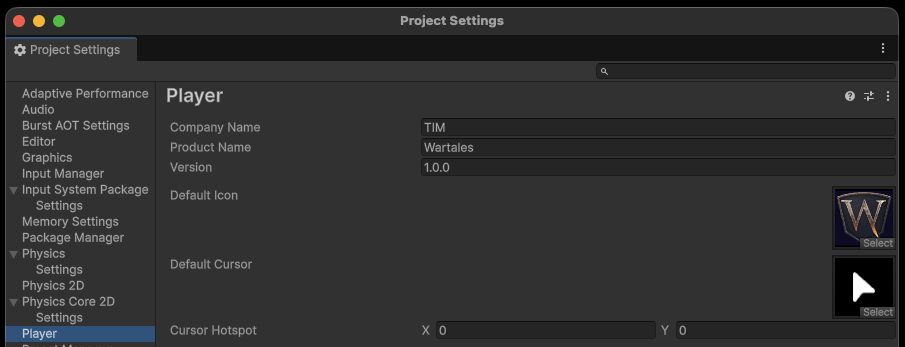
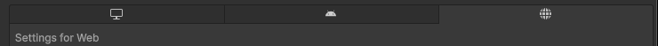
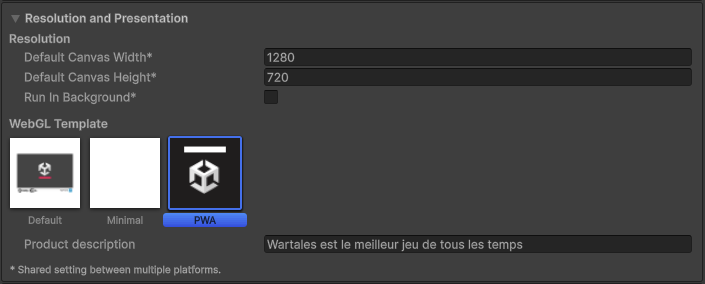
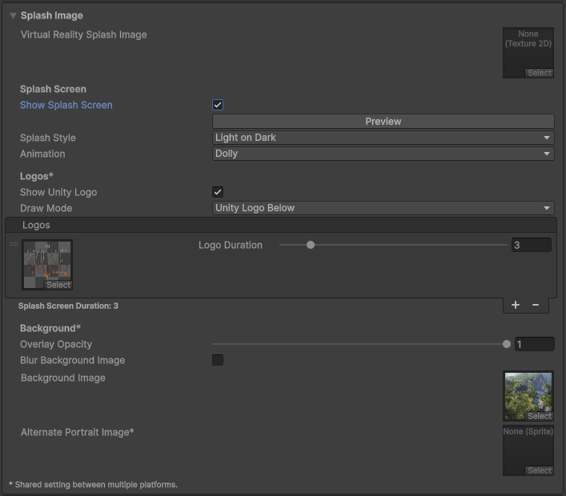
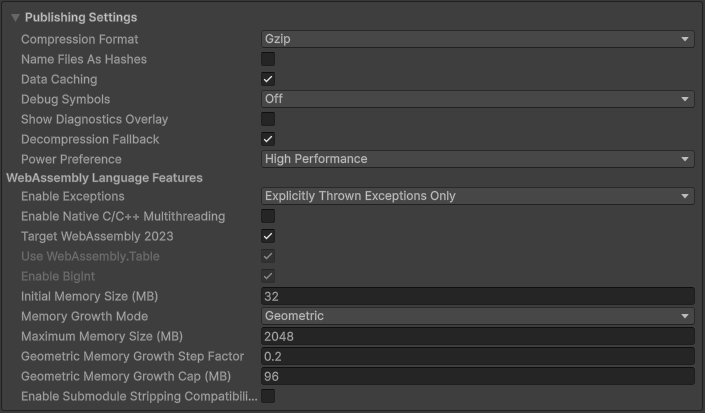
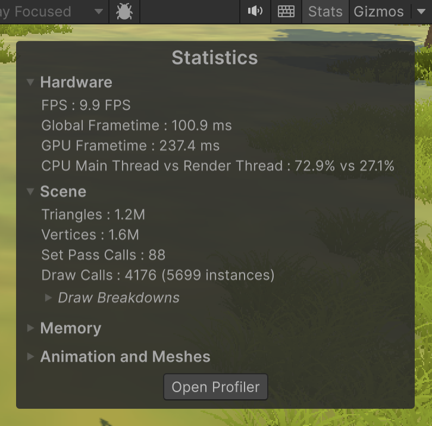
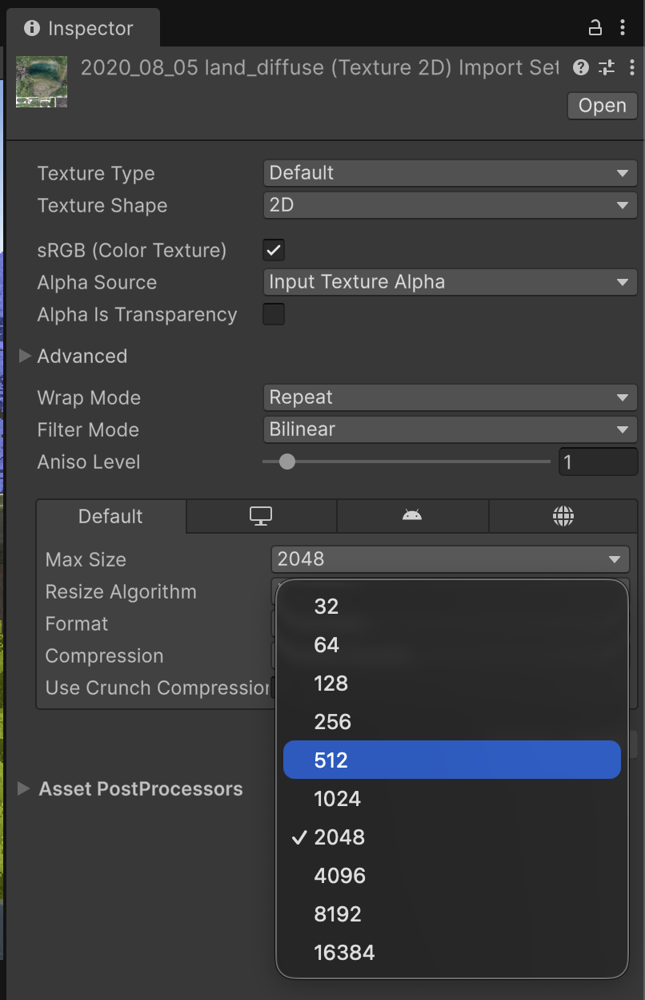
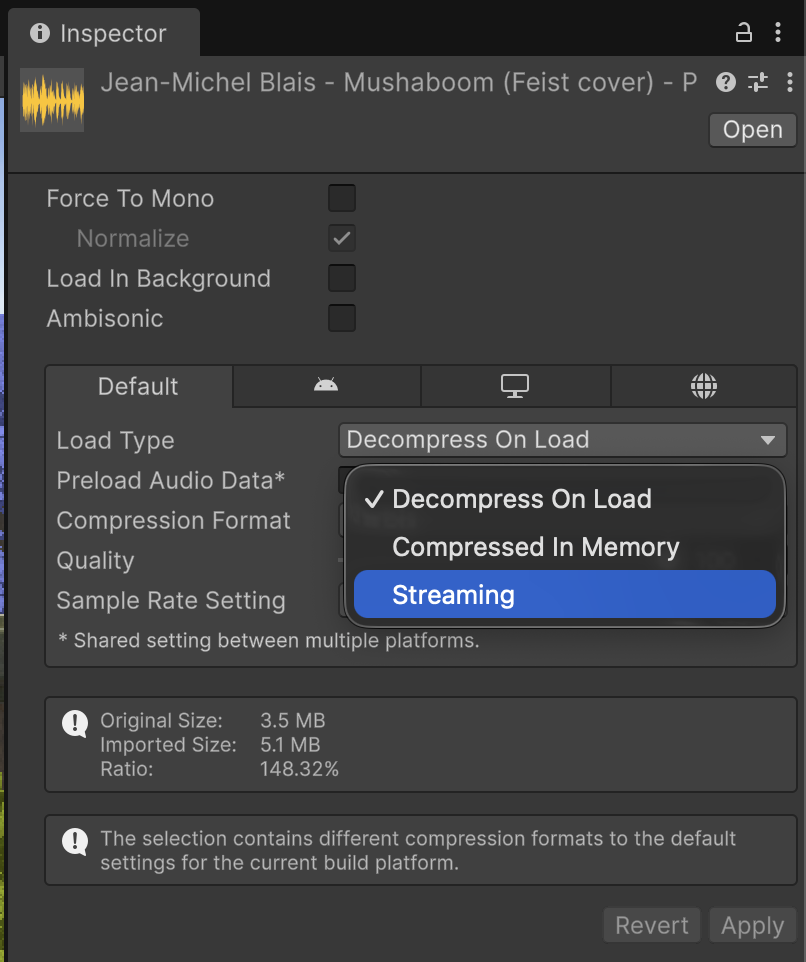
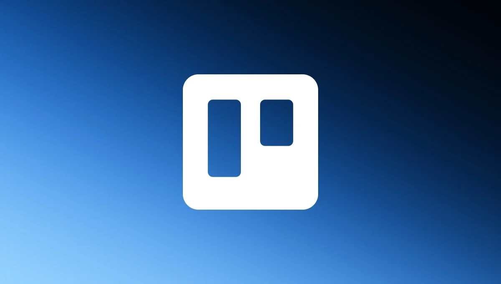

<!--
Piste — Package Recorder (Unity Registry)
- Capture vidéo / GIF directement dans l'éditeur : captures pour la page itch.io, le README et l'oral.
-->

# Cours 11

## Version Alpha (prochain cours)

<figure markdown>
{data-zoom-image}
<figcaption>Exemple d'un parcours complet</figcaption>
</figure>
{data-zoom-image}
{data-zoom-image}
{data-zoom-image}
{data-zoom-image}
{data-zoom-image}

* <span class="opacity-50">Semaine 1 </span>
* <span class="opacity-50">Semaine 2 </span>
* <span class="opacity-50">Semaine 3 </span>
* <span class="opacity-50">Semaine 4 </span>
* <span class="opacity-50">Semaine 5 </span>
* <span class="opacity-50">Semaine 6 </span>
* <span class="opacity-50">Semaine 7 | Prototype</span>
* <span class="opacity-50">Semaine 8 </span>
* <span class="opacity-50">Semaine 9 | Tranche verticale</span>
* <span class="opacity-50">Semaine 10</span>
* Semaine 11 🗓️ Aujourd'hui
* Semaine 12 | 19 novembre 🏃🏻‍♂️ Sprint 3 : Alpha
* <span class="opacity-50">Semaine 13 | 26 novembre</span>
* <span class="opacity-50">Semaine 14 | 3 décembre 🏃🏻‍♂️ Sprint 4 : Beta</span>
* <span class="opacity-50">Semaine 15 | 10 décembre 🏃🏻‍♂️ Sprint 5 : Oral</span>

## Compiler (_build_)

Pour la remise finale, deux _builds_ seront demandés : **Windows** et **Web**. 

> 🌹 Pour la version alpha, seul Web sera requis.

!!! note "Avantages d'une version Web"

    Un des avantages d'un export Web est qu'il est publiable facilement sur des sites comme <itch.io>. Ça contribue à faire rayonner le travail, mais ça rend aussi plus concrètes et tangibles les réalisations qui figureront dans un portfolio.

## Build Profiles

**File > Build Profiles**

{data-zoom-image}


<!-- ??? note "Éléments"

    | Élément | Description |
    |---|---|
    | **Scene List** | Scènes incluses, dans l'ordre : l'accueil en `0` |
    | **Platforms** | La plateforme active porte la mention **Active** |
    | **Switch Platform** | Convertit le projet |
    | **Build** | Compile dans un dossier `Builds/` à la racine du projet, à côté du dossier `Assets` (sera ignoré par le `.gitignore`) |
    | **Player Settings** | Ouvre les réglages avancés | -->

## Player Settings

**Edit > Project Settings > Player**

> Les réglages marqués `*` dans Unity sont partagés entre les plateformes.


### Réglages généraux

{data-zoom-image}

* **Company Name** : Prénom et nom, « TIM » ou un nom de studio inventé<br>
* **Product Name** : Le titre du jeu<br>
* **Version** : `0.1` à l'alpha, mais devra être `1.0` à la remise<br>
* **Default Icon** : `.png` carré de 512×512
* **Default Cursor** :
  1. Trouver un joli curseur (ex. : [Cursor Pack | Kenney.nl](https://kenney.nl/assets/cursor-pack))
  1. Glisser dans **Assets > _ > Sprites**
  1. Clic sur l'image, **Texture Type** = `Cursor`, **Apply**
  1. Glisser dans **Default Cursor**

### Réglages Web

{data-zoom-image .w-50}

#### _Resolution and Presentation_

{data-zoom-image .w-50}

- Résolution = `1280` × `720` (doit être la même chose que sur itch.io)

#### _Splash Image_

{.h-auto}

{data-zoom-image .w-50}

<!-- Le _splash screen_ est facultatif. Décocher **Show Splash Screen** pour le retirer ou décocher seulement **Show Unity Logo** pour n'afficher que son propre logo. -->

- **Logos** > (+) : ajouter un logo
- **Background Image** : ajouter au besoin une image de fond
- Tester rapidement avec le bouton **Preview**

  !!! note "Les champs **Logos** et **Background Image** attendent une image de type **Sprite**"

      1. Sélectionner l'image dans le panneau **Project**
      1. **Texture Type** = `Sprite (2D and UI)`
      1. **Sprite Mode** = `Single`
      1. **Apply**

#### _Other Settings_

Si CES est utilisé avec une condition basée sur des touches précises : 

- **Configuration > Active Input Handling** = Both (redémarrage nécessaire)

#### _Publishing Settings_

{data-zoom-image .w-50}

- **Compression Format** = `Gzip`
- **Decompression Fallback** = Coché

<!-- | **Fullscreen Mode** | Windows > **Resolution and Presentation** | `Fullscreen Window` | -->

## Builds

{.h-auto}

Les builds doivent être sauvegardés dans un dossier `Builds` créé à la racine du projet Unity.

> Grâce au `.gitignore`, les builds ne sont pas commités. C'est normal et souhaité.

Le premier build est toujours super long, c'est la vie.

### Build Windows :fontawesome-brands-windows:

1. **Build Profiles** > **Windows** > **Switch Platform** (si nécessaire)
1. Effectuer les réglages de _Player Settings_
1. Clic **Build** et sauvegarde dans le dossier `Builds/Windows`

!!! warning "Le `.exe` seul ne fonctionne pas"

    Le jeu, c'est **tout le dossier** qui est nécessaire (`.exe`, `_Data`, `UnityPlayer.dll`, etc.).

### Build Web

1. **Build Profiles** > **Web** > **Switch Platform** (si nécessaire)
1. Effectuer les réglages de _Player Settings_
1. Clic **Build** et sauvegarde dans le dossier `Builds/Web`
1. Ouvrir le dossier de build, faire ++ctrl+a++ et désélectionner le dossier DoNotShip avec ++ctrl++ + clic
1. Clic droit, puis Compresser en fichier ZIP (Windows 11) ou Envoyer vers > Dossier compressé (Windows 10). Le zip va servir pour itch.io.

!!! tip "Tester sur son poste"

    Double-cliquer `index.html` ne fonctionne pas (il faut un serveur !). 
    
    Utiliser plutôt **Build And Run**, qui lance un serveur local.

## Bouton quitter

Sur Windows, on veut un bouton Quitter sur l'écran titre.

Par contre, on ne veut pas l'avoir sur l'export Web, car on ne peut pas fermer une fenêtre depuis un site Web. 

L'événement à déclencher au clic serait la fonction `Quitter` :

```c# title="OkBye.cs"
using UnityEngine;
#if UNITY_EDITOR
using UnityEditor;
#endif

public class OkBye : MonoBehaviour
{
    void Awake()
    {
        if (Application.platform == RuntimePlatform.WebGLPlayer)
            gameObject.SetActive(false);
    }

    public void Quitter()
    {
#if UNITY_EDITOR
        EditorApplication.isPlaying = false;
#else
        Application.Quit();
#endif
    }
}
```

## itch.io

À faire :

- Faire un build Web
- Créer un compte sur [itch.io](https://itch.io/)
- Puis, **Dashboard > Create new project**

  !!! warning "Pour l'alpha, pas besoin de faire de zèle : ça viendra à la Beta 😜"

    <!-- Titre, build Web jouable, **commandes** dans la description. Les tests croisés du cours 12 se font à partir de ce lien, sans personne pour expliquer. Couverture, captures et thème viennent après l'alpha. -->

{data-zoom-image}
{data-zoom-image}
{data-zoom-image}
{data-zoom-image}

**Dashboard > Create new project**

| Champ | Valeur |
|---|---|
| **Title** / **Short description** | Le titre / Le pitch en une phrase |
| **Kind of project** | `HTML` |
| **Pricing** | `No payments` |
| **Uploads** | Le `.zip` du build Web, **This file will be played in the browser** coché |
| **Embed options** | `Click to launch in fullscreen` |
| **Frame options** | Tout décoché (*Mobile friendly*, *scrollbars*, *SharedArrayBuffer*) |
| **AI generation disclosure** | Déclarer honnêtement le type de contenu généré |
| **Visibility & access** | `Draft` tant que la page n'est pas prête, puis `Public` |

??? warning "Zip, pas le dossier"

    `index.html` doit être **à la racine** du `.zip`

<!-- ### Après l'alpha : la vitrine

| Élément | Détail |
|---|---|
| **Cover image** | 630 × 500 px, soignée : c'est la vignette partout sur itch.io |
| **Screenshots** | 3 à 5 : les trois niveaux et un moment fort |
| **Genre** et **Tags** | Le genre du GDD, 3 à 5 mots-clés |
| **Edit theme** | Couleurs et police accordées au jeu |

Captures : la vue **Game** suffit. Vidéo ou GIF : package **Recorder** (Unity Registry), **Window > General > Recorder**. -->

<!-- ## Le README et les crédits

!!! warning "Critère de la grille finale"
    Tous les médias externes sont cités : source, auteur, licence. Synty aussi.

Le README est la **source** : la page itch.io reprend son contenu, l'écran Crédits en présente une version courte. La section Crédits est amorcée depuis le [cours 7](./cours07.md#les-credits-des-assets). -->

<!-- markdown title="README.md (et description itch.io)"
# Titre du jeu

Le concept en deux phrases. Ce que le joueur doit accomplir.

**Jouer en ligne :** https://pseudo.itch.io/titre-du-jeu

## Commandes

| Action | Clavier et souris | Manette |
|---|---|---|
| Se déplacer | WASD | Joystick gauche |
| Sauter | Espace | A |
| Pause | Échap ou P | Start |

## Crédits

| Asset | Type | Auteur | Licence | Source |
|---|---|---|---|---|
| POLYGON Sampler Pack | Pack 3D | Synty Studios | ... | ... | -->


## L'écran Crédits

Les crédits sont regroupés par type, sans URL ni licence.

Le détail se trouve dans le README sur GitHub et ira sur la page itch.io.

```text
Prénom Nom
Interactivité ludique | 2026
Techniques d'intégration multimédias
Collège Montmorency

VISUELS                         SON
Synty Studios · Kenney          Pixabay · Freesound

POLICE                          OUTILS
Press Start 2P (CodeMan38)      Unity · Starter Assets · CES
```

!!! info "CC-BY : exige l'auteur **et** la licence"

!!! tip "Si ça déborde"

    - Utiliser plusieurs Panels (`Page1`, `Page2`, ...)
    - Bouton **Suivant** > **On Click** : `Page1` > **GameObject.SetActive** décoché, `Page2` > **SetActive** coché, et ainsi de suite

## Performance

Quelques suggestions : 

- Cliquer sur **Stats** dans le panneau **Game**. Regarder le **FPS** (viser 60, sous 30 ça se sent)<br>{data-zoom-image .w-10}
- Baking des lumières (en dernier recours)
- Une seule lumière avec ombres (le soleil). Les autres : **Shadow Type** `No Shadows`
- Cocher **Static** (en haut de l'**Inspector**) sur le décor immobile
- Textures : **Max Size** `1024`, ou `512` pour les petits objets et icônes<br>{data-zoom-image .w-10}
- Musique : **Load Type** `Streaming`, **Compression** `Vorbis`<br>{data-zoom-image .w-10}
- Post-processing (Bloom, Depth of Field, SSAO) : lourd sur le Web, tester dans le build
- ProBuilder enregistre le mesh de chaque forme directement dans la scène, en grande quantité, ça augmente considérablement le poids des scènes. Garder le graybox dans le jeu final est possible, mais avec ces étapes une fois une forme terminée :
    - Sélectionner la forme dans la **Hierarchy**, puis **Tools > ProBuilder > Export**, format `Asset`, dans **Assets > _ > Meshes** (ou en faire un prefab)
- Retirer les packs inutilisés
- Skybox Series Free est lourd à charger : **Package Manager > My Assets > Skybox Series Free > Remove**, puis dans la fenêtre qui apparaît, décocher seulement les `.mat` et `.hdr` utilisés (ex. : `DarkStorm.mat` et `DarkStorm4K.hdr`).

## Trello



- `Must` Régler les Player Settings
- `Must` Vérifier la Scene List : toutes les scènes, l'accueil en premier
- `Must` Compléter le README : concept, commandes, lien itch.io
- `Must` Compléter les crédits du README (si non terminé)
- `Must` Monter l'écran Crédits : sources regroupées, renvoi au README, bouton Retour
- `Must` Publier le build Web sur itch.io et le tester dans le navigateur, son compris
- `Must` Monter une page itch.io minimale : titre, build Web jouable, commandes
- `Must` Cacher le bouton Quitter dans la version Web
- `Should` Exporter un build Windows et vérifier qu'il se lance
- `Should` Ajuster la performance
