<!--
Piste — Package Recorder (Unity Registry)
- Capture vidéo / GIF directement dans l'éditeur : captures pour la page itch.io, le README et l'oral.
-->

# Cours 11

## Version Alpha (prochain cours)

<figure markdown>
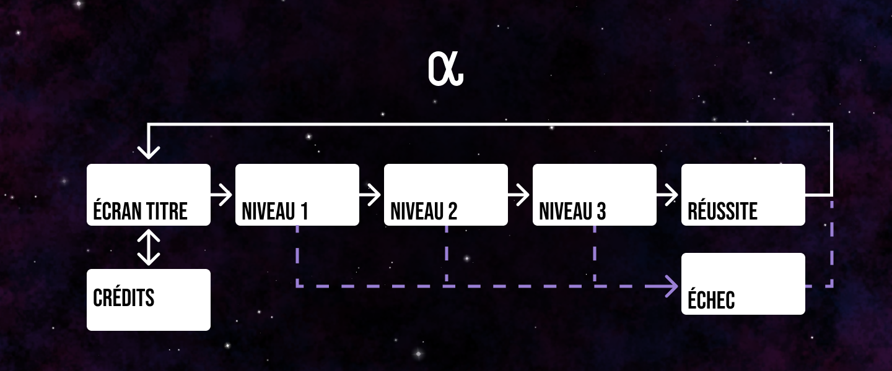{data-zoom-image}
<figcaption>Exemple d'un parcours complet</figcaption>
</figure>
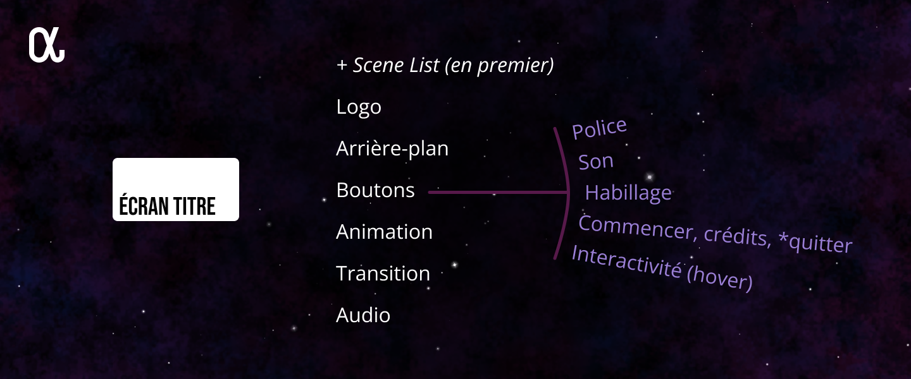{data-zoom-image}
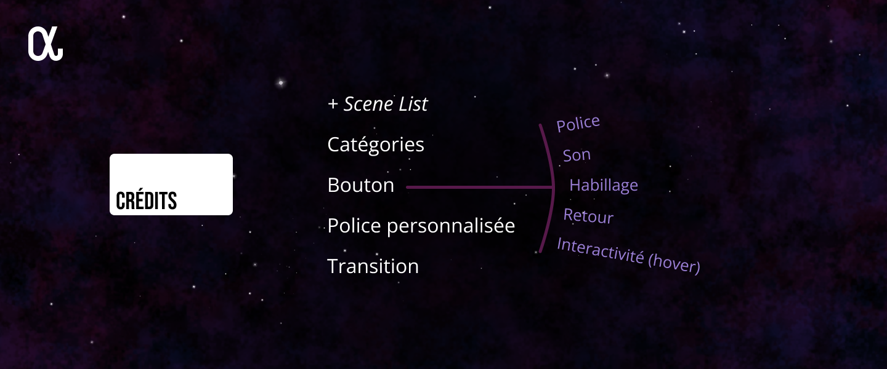{data-zoom-image}
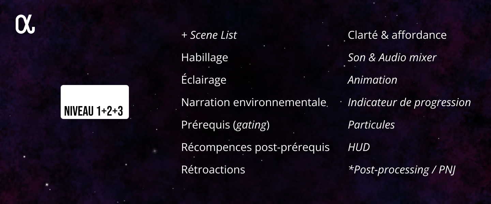{data-zoom-image}
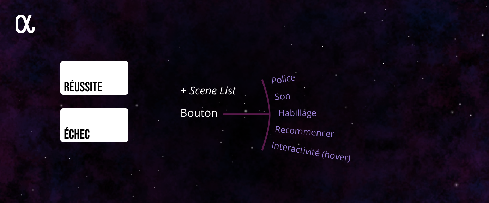{data-zoom-image}
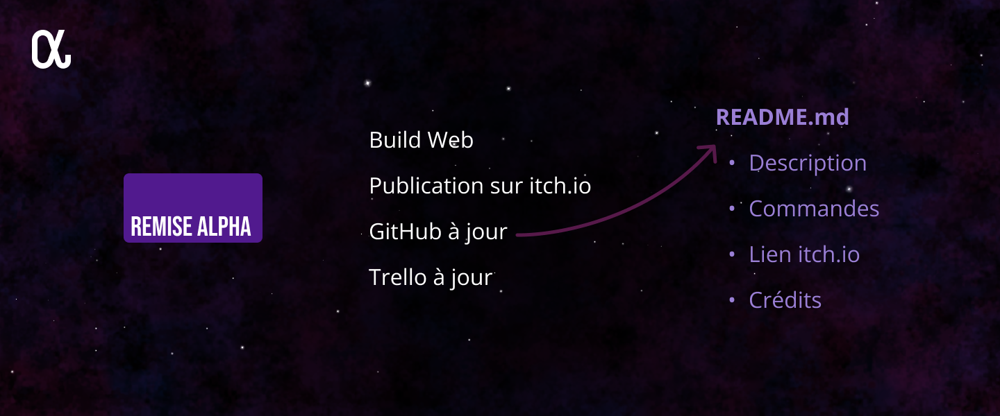{data-zoom-image}

* <span class="opacity-50">Semaine 1 </span>
* <span class="opacity-50">Semaine 2 </span>
* <span class="opacity-50">Semaine 3 </span>
* <span class="opacity-50">Semaine 4 </span>
* <span class="opacity-50">Semaine 5 </span>
* <span class="opacity-50">Semaine 6 </span>
* <span class="opacity-50">Semaine 7 | Prototype</span>
* <span class="opacity-50">Semaine 8 </span>
* <span class="opacity-50">Semaine 9 | Tranche verticale</span>
* <span class="opacity-50">Semaine 10</span>
* Semaine 11 🗓️ Aujourd'hui
* Semaine 12 | 19 novembre 🏃🏻‍♂️ Sprint 3 : Alpha
* <span class="opacity-50">Semaine 13 | 26 novembre</span>
* <span class="opacity-50">Semaine 14 | 3 décembre 🏃🏻‍♂️ Sprint 4 : Beta</span>
* <span class="opacity-50">Semaine 15 | 10 décembre 🏃🏻‍♂️ Sprint 5 : Oral</span>

## Compiler (_build_)

Pour la remise finale, deux _builds_ seront demandés : **Windows** et **Web**. 

> 🌹 Pour la version alpha, seul Web sera requis.

!!! note "Avantages d'une version Web"

    Un des avantages d'un export Web est qu'il est publiable facilement sur des sites comme <itch.io>. Ça contribue à faire rayonner votre travail, mais ça rend aussi plus concret en tangible les réalisations qui figurerons dans votre portfolio.

## Build Profiles

**File > Build Profiles**

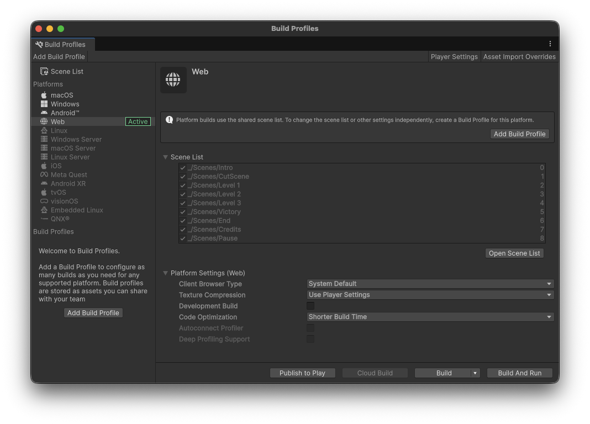{data-zoom-image}

??? note "Éléments"

    | Élément | Description |
    |---|---|
    | **Scene List** | Scènes incluses, dans l'ordre : l'accueil en `0` |
    | **Platforms** | La plateforme active porte la mention **Active** |
    | **Switch Platform** | Convertit le projet |
    | **Build** | Compile dans un dossier `Builds/` à la racine du projet, à côté du dossier `Assets` (sera ignoré par le `.gitignore`) |
    | **Player Settings** | Ouvre les réglages avancés |

## Player Settings

**Edit > Project Settings > Player**. Les réglages marqués `*` dans Unity sont partagés entre les plateformes.

| Réglage | Où | Valeur |
|---|---|---|
| **Company Name** | En haut | Son nom ou un nom de studio |
| **Product Name** | En haut | Le titre du jeu (barre de fenêtre, onglet du navigateur) |
| **Version** | En haut | `0.3` à l'alpha, `1.0` à la remise |
| **Default Icon** | En haut | `.png` carré, 512 × 512 px |
| **Default Canvas Width / Height** | Web > **Resolution and Presentation** | `1280` × `720` |
| **WebGL Template** | Web > **Resolution and Presentation** | `Default` (inclut le bouton plein écran) |
| **Show Splash Screen** | Web > **Splash Image** | Facultatif : logo et fond personnalisables (voir ci-dessous) |
| **Active Input Handling** | Web > **Other Settings** > Configuration | `Both` |
| **Compression Format** | Web > **Publishing Settings** | `Gzip` |
| **Decompression Fallback** | Web > **Publishing Settings** | **Coché** |
| **Fullscreen Mode** | Windows > **Resolution and Presentation** | `Fullscreen Window` |

### Personnaliser l'écran de démarrage (_Made with Unity_)

{.h-auto}

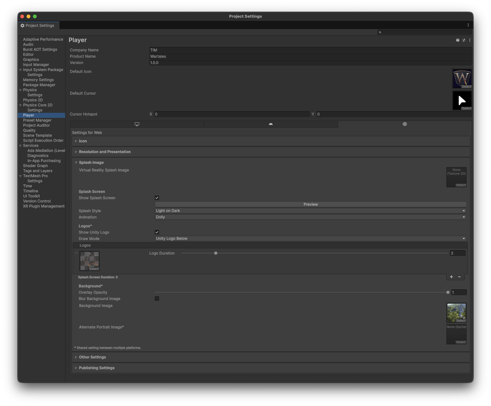{data-zoom-image}

Le _splash screen_ est facultatif. Décocher **Show Splash Screen** pour le retirer ou décocher seulement **Show Unity Logo** pour n'afficher que son propre logo.

**Player Settings** > Web > **Splash Image** : ajouter un logo dans la liste **Logos** (**+**), puis choisir une **Background Color** ou une **Background Image**.

Les champs **Logos** et **Background Image** attendent un **Sprite**. **Default Icon** et **Default Cursor** acceptent une simple texture. 

Pour convertir une image, il faut la sélectionner dans le panneau **Project**, **Texture Type** = `Sprite (2D and UI)`, **Sprite Mode** = `Single`, puis **Apply**.

#### Curseur personnalisé

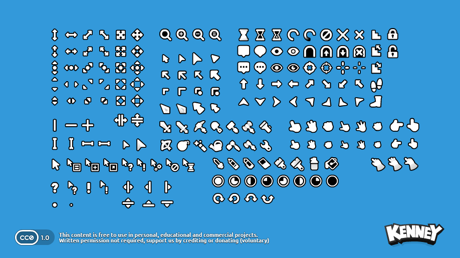{.w-50 data-zoom-image}

**Texture Type** = `Cursor`, **Apply**, puis la glisser dans **Default Cursor**. [Cursor Pack de Kenney](https://kenney.nl/assets/cursor-pack)

## Le build Windows

!!! info "Exigé à la remise finale, recommandé aujourd'hui"
    Mieux vaut découvrir les surprises maintenant que la veille de la remise.

1. **Build Profiles** > **Windows** > **Switch Platform** (si nécessaire) > **Build** dans `Builds/Windows`
1. Lancer le `.exe` et jouer du début à la fin : accueil, trois niveaux, fin, crédits, retour à l'accueil

!!! warning "Le `.exe` seul ne fonctionne pas"
    Le jeu, c'est **tout le dossier** (`.exe`, `_Data`, `UnityPlayer.dll`…). C'est ce dossier qui va dans le `.zip` de remise.

## Le build Web

Le jeu compilé pour le navigateur : un dossier `index.html`, `Build/`, `TemplateData/`. Un lien, et on joue.

1. **Unity Hub** > **Installs** > ⚙️ > **Add modules** > **Web Build Support** (une seule fois)
1. **Build Profiles** > **Web** > **Switch Platform**
1. Vérifier les [Player Settings](#player-settings), puis **Build** dans `Builds/Web`
1. ⏳ 5 à 20 minutes : préparer la page itch.io et le README pendant ce temps

!!! tip "Tester sur son poste"
    Double-cliquer `index.html` ne fonctionne pas (il faut un serveur). **Build And Run** lance un serveur local.

### Les pièges

| Symptôme | Cause | Solution |
|---|---|---|
| Écran figé ou *Unable to parse Build/…* | Compression non lue par le serveur | `Gzip` + **Decompression Fallback** coché, refaire le build |
| `InvalidOperationException` sur `Input` | Ancienne classe `Input` avec **Active Input Handling** à `New` | Passer à `Both` |
| Chargement interminable | Build trop lourd | Voir [La performance](#la-performance) |
| Une scène ne se charge pas | Absente de la **Scene List** | L'ajouter |
| Pas de son au démarrage | Le navigateur attend un clic | Un écran d'accueil avec un bouton **Jouer** |
| HUD coupé | Canvas non adaptatif | **Canvas Scaler** en `Scale With Screen Size` ([cours 5](./cours05.md)) |
| Échap n'ouvre pas la pause | Le navigateur réserve Échap à la souris | Une deuxième touche ([Le menu pause](#le-menu-pause)) |
| Le bouton Quitter ne fait rien | `Application.Quit()` est ignoré sur le Web | Le cacher (script ci-dessous) |

```c# title="CacherSurWeb.cs — sur le bouton Quitter"
using UnityEngine;

public class CacherSurWeb : MonoBehaviour
{
    void Awake()
    {
        if (Application.platform == RuntimePlatform.WebGLPlayer)
            gameObject.SetActive(false);
    }
}
```

## itch.io

!!! warning "Pour l'alpha : une page minimale"
    Titre, build Web jouable, **commandes** dans la description. Les tests croisés du cours 12 se font à partir de ce lien, sans personne pour expliquer. Couverture, captures et thème viennent après l'alpha.

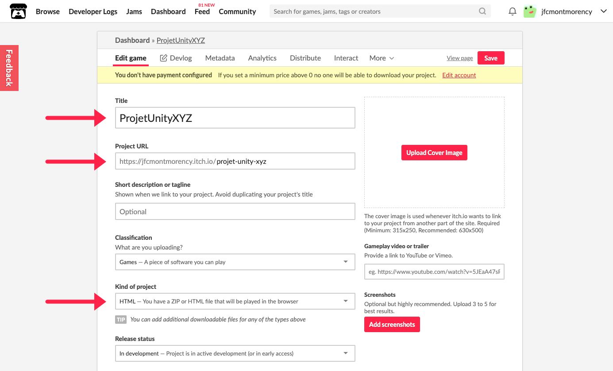{data-zoom-image}
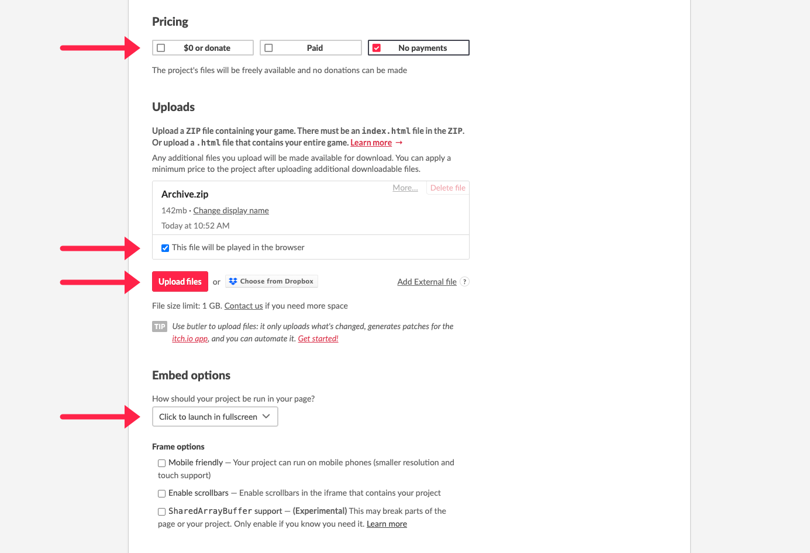{data-zoom-image}
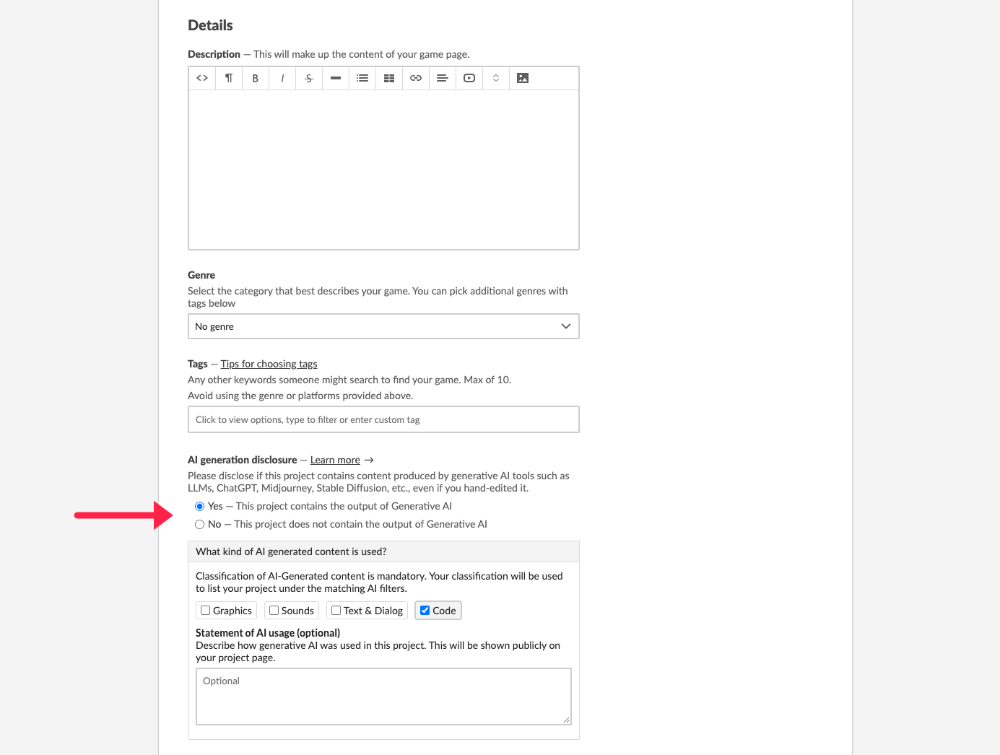{data-zoom-image}
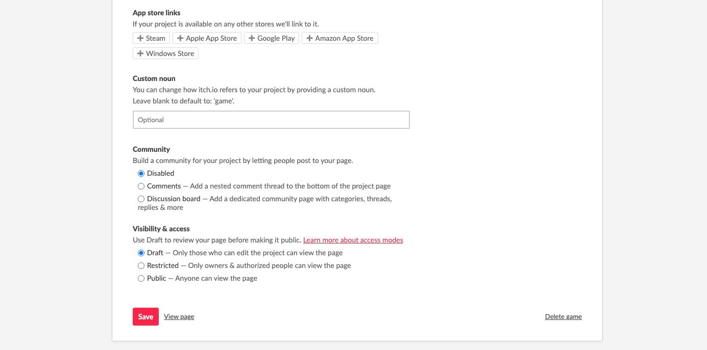{data-zoom-image}

**Dashboard > Create new project**

| Champ | Valeur |
|---|---|
| **Title** / **Short description** | Le titre / le pitch en une phrase |
| **Kind of project** | `HTML` |
| **Pricing** | `No payments` |
| **Uploads** | Le `.zip` du build Web, **This file will be played in the browser** coché |
| **Embed options** | `Click to launch in fullscreen` |
| **Frame options** | Tout décoché (*Mobile friendly*, *scrollbars*, *SharedArrayBuffer*) |
| **AI generation disclosure** | Déclarer honnêtement le type de contenu généré (code, images, sons, texte) |
| **Visibility & access** | `Draft` tant que la page n'est pas prête, puis `Public` |

!!! warning "Zipper le contenu, pas le dossier"
    `index.html` doit être **à la racine** du `.zip` : ouvrir `Builds/Web`, tout sélectionner, **Compresser**. Si itch.io ne trouve pas `index.html`, le `.zip` contient un dossier de trop.

!!! tip "Le build Windows aussi"
    Le `.zip` Windows peut être ajouté sur la même page, avec la case **Windows** cochée.

### Après l'alpha : la vitrine

| Élément | Détail |
|---|---|
| **Cover image** | 630 × 500 px, soignée : c'est la vignette partout sur itch.io |
| **Screenshots** | 3 à 5 : les trois niveaux et un moment fort |
| **Genre** et **Tags** | Le genre du GDD, 3 à 5 mots-clés |
| **Edit theme** | Couleurs et police accordées au jeu |

Captures : la vue **Game** suffit. Vidéo ou GIF : package **Recorder** (Unity Registry), **Window > General > Recorder**.

## Le README et les crédits

!!! warning "Critère de la grille finale"
    Tous les médias externes sont cités : source, auteur, licence. Synty aussi.

Le README est la **source** : la page itch.io reprend son contenu, l'écran Crédits en présente une version courte. La section Crédits est amorcée depuis le [cours 7](./cours07.md#les-credits-des-assets).

```markdown title="README.md (et description itch.io)"
# Titre du jeu

Le concept en deux phrases. Ce que le joueur doit accomplir.

**Jouer en ligne :** https://pseudo.itch.io/titre-du-jeu

## Commandes

| Action | Clavier et souris | Manette |
|---|---|---|
| Se déplacer | WASD | Joystick gauche |
| Sauter | Espace | A |
| Pause | Échap ou P | Start |

## Crédits

| Asset | Type | Auteur | Licence | Source |
|---|---|---|---|---|
| POLYGON Sampler Pack | Pack 3D | Synty Studios | ... | ... |
```

### L'écran Crédits

Un seul écran fixe, regroupé **par source**, sans URL ni licence : le détail reste dans le README.

```text
TITRE DU JEU
Prénom Nom
Interactivité ludique · TIM · Collège Montmorency · 2026

VISUELS                         SON
Synty Studios · Kenney          Pixabay · Freesound

POLICE                          OUTILS
Press Start 2P (CodeMan38)      Unity · Starter Assets · CES

Sources et licences détaillées : README et page itch.io
```

!!! info "CC-BY"
    Seule licence courante qui exige l'auteur **et** la licence, « de façon raisonnable selon le support » : le renvoi au README suffit. CC0, Pixabay et Synty n'exigent aucune mention.

1. Dans le **Canvas** : **UI (Canvas) > Panel**, aux couleurs du jeu
1. Textes **TextMeshPro**; colonnes avec **Add Component > Grid Layout Group** sur le Panel
1. Un bouton **Retour** vers l'accueil

!!! tip "Si ça déborde"
    Deux Panels, `Page1` et `Page2`. Bouton **Suivant** > **On Click** : `Page1` > **GameObject.SetActive** décoché, `Page2` > **SetActive** coché.

| Niveau | Résultat |
|---|---|
| **Fonctionnel** | Texte sur fond uni, bouton Retour fonctionnel |
| **Intégré** | Police, couleurs et sprites du jeu; son au clic |
| **Raffiné** | Scène Synty en arrière-plan, musique continue, fondu (**Canvas Group** > **Alpha** de `0` à `1`) |

## Le menu pause

`Time.timeScale` règle l'écoulement du temps : `1` normal, `0.5` ralenti, `0` figé. C'est l'outil du [*hit stop* du cours 10](./cours10.md#le-hit-stop), tenu à `0`.

!!! warning "Ce que `timeScale = 0` n'arrête pas"
    - `Update()` (seul ce qui utilise `Time.deltaTime` s'arrête)
    - L'interface, qui reste cliquable
    - Le son : `AudioListener.pause = true;` ou un snapshot du mixer ([cours 7](./cours07.md#snapshots-contextes))
    - La caméra des Starter Assets, qui suit encore la souris

!!! warning "Échap dans le navigateur"
    Le navigateur réserve Échap pour libérer la souris : le script accepte aussi **P**. L'indiquer dans les commandes.

1. Dans le **Canvas** du niveau, un **Panel** `MenuPause` avec un titre et deux boutons : **Reprendre** et **Accueil**
1. Désactiver `MenuPause`
1. Ajouter `GestionPause.cs` sur le **Canvas** (un objet désactivé n'exécute pas son `Update`), glisser `MenuPause` dans **Menu Pause**
1. **On Click** : Reprendre → `GestionPause.Reprendre`, Accueil → `GestionPause.RetourAccueil`

```c# title="GestionPause.cs"
using UnityEngine;
using UnityEngine.InputSystem;
using UnityEngine.SceneManagement;

public class GestionPause : MonoBehaviour
{
    public GameObject menuPause;
    public string sceneAccueil = "Accueil";

    bool enPause = false;

    void Update()
    {
        if (Keyboard.current.escapeKey.wasPressedThisFrame || Keyboard.current.pKey.wasPressedThisFrame)
        {
            if (enPause) Reprendre();
            else Pause();
        }
    }

    public void Pause()
    {
        enPause = true;
        menuPause.SetActive(true);
        Time.timeScale = 0f;
        Cursor.lockState = CursorLockMode.None;
        Cursor.visible = true;
    }

    public void Reprendre()
    {
        enPause = false;
        menuPause.SetActive(false);
        Time.timeScale = 1f;
        Cursor.lockState = CursorLockMode.Locked;
        Cursor.visible = false;
    }

    public void RetourAccueil()
    {
        Time.timeScale = 1f; // Sinon la scène suivante démarre figée
        SceneManager.LoadScene(sceneAccueil);
    }
}
```

## Le menu Options : le volume

Facultatif. S'appuie sur `MixerPrincipal` ([cours 7](./cours07.md#laudio-mixer)).

1. Dans `MixerPrincipal`, groupe `Musique` > **Inspector** : clic-droit sur **Volume** > **Expose … to script**
1. **Exposed Parameters** (en haut à droite) : renommer `MyExposedParam` en `VolumeMusique`. Idem pour `SFX` (`VolumeSFX`)
1. **UI (Canvas) > Slider** avec `SliderVolume.cs` : glisser `MixerPrincipal`, **Parametre** = `VolumeMusique`

```c# title="SliderVolume.cs"
using UnityEngine;
using UnityEngine.Audio;
using UnityEngine.UI;

[RequireComponent(typeof(Slider))]
public class SliderVolume : MonoBehaviour
{
    public AudioMixer mixer;
    public string parametre = "VolumeMusique";

    Slider slider;

    void Start()
    {
        slider = GetComponent<Slider>();
        slider.minValue = 0.0001f;            // Jamais 0 : Log10(0) n'existe pas
        slider.maxValue = 1f;
        slider.value = PlayerPrefs.GetFloat(parametre, 1f);
        slider.onValueChanged.AddListener(Changer);
        Changer(slider.value);
    }

    void Changer(float valeur)
    {
        mixer.SetFloat(parametre, Mathf.Log10(valeur) * 20f);  // 0–1 → -80 à 0 dB
        PlayerPrefs.SetFloat(parametre, valeur);
    }
}
```

!!! info "Pourquoi `Log10`?"
    Le mixer compte en décibels et l'oreille perçoit le volume de façon logarithmique. Sans conversion, le curseur ne change presque rien sur 80 % de sa course.

!!! tip "Un son de test"
    Slider `SFX` > **On Value Changed** : une **Audio Source** (groupe `SFX`) > **AudioSource.Play ()**.

## La sauvegarde

La case **Persistent** des Variables du CES (cours 3) utilise déjà `PlayerPrefs`. Dans un script maison, c'est `PlayerPrefs` qu'il faut appeler directement.

`PlayerPrefs` associe une **clé** à une **valeur** (`int`, `float` ou `string`) et survit à la fermeture du jeu. Sur le Web, la sauvegarde reste dans le navigateur; l'éditeur et le build ont chacun la leur.

```c#
PlayerPrefs.SetInt("MeilleurScore", 42);
PlayerPrefs.SetString("DernierNiveau", "Zone2");
PlayerPrefs.Save();                                   // Écrit tout de suite

int record = PlayerPrefs.GetInt("MeilleurScore", 0);  // 0 si la clé n'existe pas
if (PlayerPrefs.HasKey("DernierNiveau")) { /* partie à continuer */ }

PlayerPrefs.DeleteKey("MeilleurScore");
PlayerPrefs.DeleteAll();
```

!!! warning "Trois pièges"
    - Sans `Save()`, un plantage ou un onglet fermé fait tout perdre
    - Une faute de frappe dans une clé ne donne **aucune erreur** : la clé va dans une constante
    - Pour tester comme un nouveau joueur : **Edit > Clear All PlayerPrefs**

### La progression

On sauvegarde le **niveau** atteint : le joueur reprend au début de ce niveau.

```c# title="Progression.cs"
using UnityEngine;
using UnityEngine.SceneManagement;

public class Progression : MonoBehaviour
{
    const string CLE = "DernierNiveau";

    [Tooltip("Coché dans les niveaux, décoché dans l'accueil")]
    public bool enregistrerCetteScene = true;

    [Tooltip("Accueil seulement : caché s'il n'y a pas de sauvegarde")]
    public GameObject boutonContinuer;

    void Start()
    {
        if (enregistrerCetteScene)
        {
            PlayerPrefs.SetString(CLE, SceneManager.GetActiveScene().name);
            PlayerPrefs.Save();
        }

        if (boutonContinuer != null)
            boutonContinuer.SetActive(PlayerPrefs.HasKey(CLE));
    }

    public void Continuer()
    {
        SceneManager.LoadScene(PlayerPrefs.GetString(CLE));
    }

    public void NouvellePartie(string premierNiveau)
    {
        PlayerPrefs.DeleteKey(CLE);
        SceneManager.LoadScene(premierNiveau);
    }
}
```

| Scène | Montage |
|---|---|
| **Chaque niveau** | Objet vide `Progression`, **Enregistrer Cette Scene** coché |
| **Accueil** | Objet vide `Progression`, case décochée, bouton **Continuer** glissé dans le champ. **On Click** : Continuer → `Continuer`, Jouer → `NouvellePartie` (nom de la première scène) |
| **Fin** et **Crédits** | Aucun `Progression` coché |

### Le meilleur score

Le score vient du script `Resource` du [cours 7](./cours07.md#ressources).

```c# title="MeilleurScore.cs"
using UnityEngine;
using UnityEngine.Events;
using TMPro;

public class MeilleurScore : MonoBehaviour
{
    const string CLE = "MeilleurScore";

    public Resource ressource;            // Vide dans l'écran de fin
    public TMP_Text texteRecord;          // Facultatif
    public string format = "Record : {0}";
    public UnityEvent onNouveauRecord;

    void Start() => Afficher();

    // Appelé par le CES (Invoke Events) à la victoire
    public void Comparer()
    {
        int score = ressource.Amount;
        if (score > PlayerPrefs.GetInt(CLE, 0))
        {
            PlayerPrefs.SetInt(CLE, score);
            PlayerPrefs.Save();
            onNouveauRecord.Invoke();
        }
        Afficher();
    }

    void Afficher()
    {
        if (texteRecord != null)
            texteRecord.text = string.Format(format, PlayerPrefs.GetInt(CLE, 0));
    }
}
```

1. Dernier niveau : objet `MeilleurScore`, l'objet `Resource` glissé dans **Ressource**
1. CES de la victoire : **Invoke Events** > **MeilleurScore.Comparer ()**, **avant** le changement de scène
1. Scène **Fin** : un autre `MeilleurScore`, **Ressource** vide, un texte dans **Texte Record**

!!! example "Meilleur temps"
    `GetFloat` / `SetFloat`, défaut `9999f`, et `<` au lieu de `>`.

## La performance

L'objectif : savoir **où regarder** quand le jeu rame, surtout dans le navigateur.

| Outil | Usage |
|---|---|
| **Stats** (vue Game) | **FPS** (viser 60, sous 30 ça se sent), **Batches**, **Tris** |
| **Profiler** (**Window > Analysis**) | Cliquer un pic de **CPU Usage**, trier la **Hierarchy** par **Total** : la ligne du haut coûte le plus cher |
| **Editor Log** (Console > **⋮**) | Chercher `Build Report` : les fichiers les plus lourds du build |

| Levier | Réglage |
|---|---|
| **Batching** | Cocher **Static** sur le décor immobile. Garder le material unique des packs Synty |
| **Lumières** | Une seule lumière avec ombres (le soleil). Les autres : `No Shadows`, ou `Baked` si immobiles ([cours 8](./cours08.md)). **Range** minimale |
| **Textures** | **Max Size** `1024` (objets), `512` (petits objets, icônes), puis **Apply** |
| **Musique, ambiances** | **Load Type** `Streaming`, **Compression** `Vorbis`, **Quality** 50 à 70 |
| **Effets courts** | `Decompress On Load`, `Vorbis` ou `ADPCM` |

## Pratique

Un build Web bloque Unity de longues minutes : tout régler **avant**.

1. **Player Settings** : nom, version, icône, `1280` × `720`, `Gzip` + **Decompression Fallback**, **Active Input Handling** `Both`
1. **Scene List** complète, l'accueil en premier
1. `CacherSurWeb.cs` sur le bouton **Quitter**
1. *Recommandé :* build Windows, jouer du début à la fin
1. Build Web. Pendant ce temps : README (concept, commandes, crédits) et page itch.io minimale
1. Téléverser le `.zip`, jouer dans le navigateur **son compris**
1. Faire tester la page par un voisin, depuis **son** poste
1. Temps restant : menu pause, Options, sauvegarde

## Trello


**Publication**

- `Must` Régler les Player Settings : nom, version, icône, résolution, compression, Input
- `Must` Vérifier la Scene List : toutes les scènes, l'accueil en premier
- `Must` Compléter le README : concept, commandes, lien itch.io
- `Must` Compléter les crédits du README (asset, type, auteur, licence, source)
- `Must` Monter l'écran Crédits : sources regroupées, renvoi au README, bouton Retour
- `Must` Publier le build Web sur itch.io et le tester dans le navigateur, son compris
- `Must` Monter une page itch.io minimale : titre, build Web jouable, commandes
- `Should` Exporter un build Windows et vérifier qu'il se lance
- `Should` Cacher le bouton Quitter dans la version Web

**Performance**

- `Should` Cocher **Static** sur le décor immobile
- `Should` Retirer les ombres des lumières secondaires
- `Should` Passer la musique et les ambiances en `Streaming` / `Vorbis`

**Menus et sauvegarde**

- `Could` Monter le menu pause (Échap ou P, `timeScale`, Reprendre, Accueil)
- `Could` Ajouter un panneau Options (volume)
- `Could` Sauvegarder la progression et ajouter un bouton Continuer
- `Could` Sauvegarder un meilleur score ou un meilleur temps

## Devoirs

- Terminer les cartes `Must` : **la semaine prochaine, c'est l'alpha**. Mécaniques du GDD branchées, trois niveaux parcourables du début à la fin
- Page itch.io en ligne avec un build Web **à jour** au début du cours 12 : les tests croisés se font à partir de ce lien
- Lien itch.io dans le README du répertoire

<!-- Savoirs essentiels touchés (note pour l'enseignant) :
Objectif 1 : Compilation de l'application (builds Windows et Web) · Classement des fichiers et des médias (README, crédits, dossier Builds hors Assets) · Intégration de médias sonores (réglages d'import audio, volume)
Objectif 2 : Fonctionnement d'une interface virtuelle (menu pause, menu Options, bouton Continuer) · Progression en fonction de la réussite d'une action (sauvegarde de la progression, meilleur score)
-->
