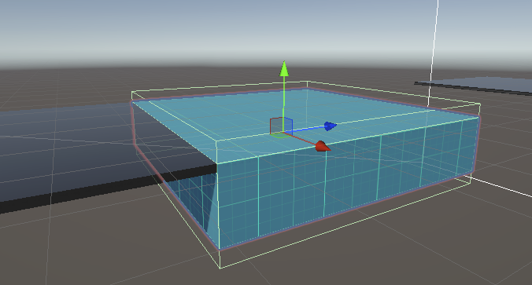
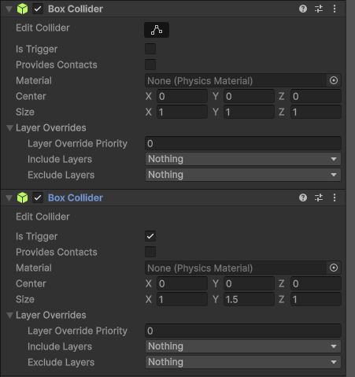
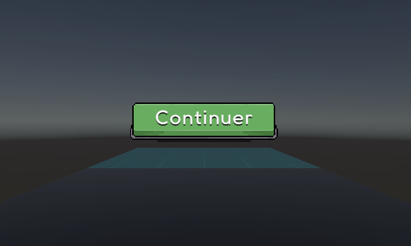
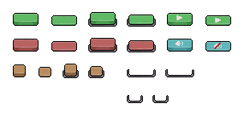
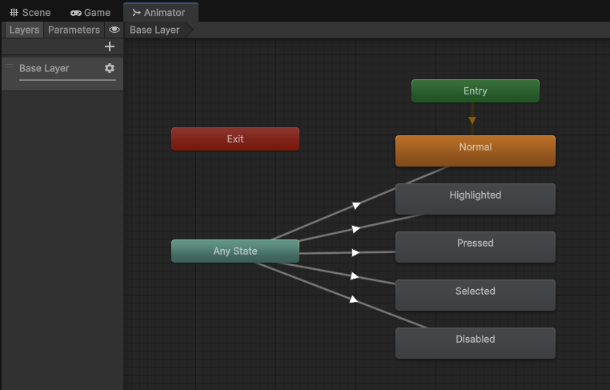

# Cours 12

## La plateforme mobile

Le personnage jouable et les structures en mouvements sont traditionnellement problématiques.

<figure markdown>
{.h-auto .aspect-16-9}
<figcaption>La plateforme se déplace, mais le personnage reste à la même place dans le monde.</figcaption>
</figure>
<figure markdown>
{.h-auto .aspect-16-9}
<figcaption markdown>La plateforme monte et entre **dans** le personnage, sans le pousser. L'ajustement répété créé une saccade.</figcaption>
</figure>

Il faut donc un script ajouté sur la plateforme qui va mesurer, à chaque frame, de combien la plateforme a bougé et ajouter ce déplacement au personnage, tant qu’il se tient dessus.

1. Placer [MovingPlatform.cs](./extra/MovingPlatform.cs) dans **Assets > _ > Scripts**
1. Sur la plateforme, garder le collider existant et ajouter un deuxième _collider_ (ex. : ***Box Collider***) : 
  1. Cocher **Is Trigger**
  1. Régler le scale du trigger pour qu'il couvre la surface et déborde d'environ `0.5` vers le haut (ex. : **Size Y** légèrement augmenté) {data-zoom-image .w-10} {data-zoom-image .w-10}
1. Ajouter le composant **MovingPlatform** sur la plateforme
1. Animer la plateforme

<figure markdown>
{.h-auto}
</figure>
<figure markdown>
{.h-auto}
</figure>

## Bouton habillé

{data-zoom-image .w-100}

### Préparer le sprite

Sélectionner l'image du ou des boutons dans **Project**, puis dans l'**Inspector** :

- **Texture Type** = `Sprite (2D and UI)` (au besoin, **Install 2D Sprite Package**)
- **Mesh Type** = `Full Rect`
- Pour un bouton « Pixel art » : **Filter Mode** = `Point (no filter)` et **Compression** = `None`

=== "Image simple"

    <figure markdown>{.w-10}</figure>

    1. **Sprite Mode** = `Single` > **Apply**
    
    Pour avoir une variante par état (survol, enfoncé), répéter les mêmes étapes.

=== "Spritesheet"

    <figure markdown>{data-zoom-image .w-50 style="image-rendering: pixelated"}</figure>

    1. **Sprite Mode** = `Multiple` > **Apply**
    1. **Open Sprite Editor** > **Slice** > **Type** = `Automatic` > **Slice**
    1. Cliquer sur chaque sprite
      - Les variantes d'un même bouton doivent avoir la même taille
      - Donner un nom clair à chaque variante (ex. : `Vert-UP`, `Vert-DOWN`)
      - Cliquer **Apply**

<!-- 
!!! warning "Des variantes de même taille"

    Les variantes d'un même bouton doivent avoir exactement la même **W** et **H** dans le Sprite Editor. Une variante plus mince (bouton enfoncé) garde un espace transparent au-dessus d'elle. Sinon, elle est étirée pour remplir le bouton. Si la feuille suit une grille régulière : **Slice** > **Grid By Cell Size**.
-->

---

### États de bouton

{.h-auto}

Créer d'abord le bouton : 

1. **Hierarchy** : clic droit sur le Canvas > **UI > Button - TextMeshPro**
1. **Inspector**, composant **Image** : glisser le sprite normal dans **Source Image**, **Image Type** = `Sliced`
1. Agrandir avec **Width** et **Height**, pas avec **Scale**. Bordures trop épaisses ou trop minces : **Pixels Per Unit Multiplier**

Pour configurer les états : 

1. Composant **Button** : **Transition** = `Animation` > **Auto Generate Animation**, enregistrer dans **Assets > _ > Animations** {data-zoom-image .w-10}
1. **Window > Animation > Animation**, choisir un clip, activer l'enregistrement (bouton rouge), puis :
  - **Inspector** du bouton : glisser le sprite de l'état dans **Source Image** s'il doit être différent du _default_
  - **Hierarchy** : sélectionner le texte enfant et ajuster **Pos Y** au besoin
1. Arrêter l'enregistrement, puis refaire pour chaque état

  ??? quote "Différents états"

      | Clip | Moment | Contenu |
      |---|---|---|
      | **Normal** | Au repos | Sprite et position du texte de départ |
      | **Highlighted** | Survol | Variante du survol |
      | **Pressed** | Clic | Variante enfoncée |
      | **Selected** | Focus clavier ou manette, et après un clic | Comme **Highlighted** |
      | **Disabled** | Bouton désactivé | Au besoin |

  ??? tip "Animation instantanée"

      Souvent, on a besoin de passer d'un état à l'autre instantanément.

      - Dans **Window > Animation > Animator** : cliquer une flèche qui part de **Any State**.
      - Dans **Inspector** > **Settings** > **Transition Duration** (`0` = instantané).

### Le son d'un bouton

1. **Hierarchy** : clic droit sur le Canvas > **Create Empty**, le renommer `SonsUI`
1. **Inspector** : 
  - **Add Component** > **Audio Source**
  - **AudioClip** laissé vide
  - **Play On Awake** décoché
  - **Output** = groupe `SFX` (Pour l'audio mixer)

Pour le clic : 

- Champ **On Click ()** du bouton > **+**, glisser `SonsUI`, **AudioSource > PlayOneShot (AudioClip)**, glisser le son désiré

Pour le hover : 

- **Add Component** > **Event Trigger** > **Add New Event Type** > **PointerEnter**, même chose que le clic

## Le menu pause

{.h-auto}

1. **Hierarchy** > **UI (Canvas) > Canvas**, le renommer `CanvasPause`
  1. Dans l'**Inspector** du **Canvas**, **Sort Order** = `10`
  1. Régler le **Canvas Scaler** comme celui du HUD (ex. : **Scale With Screen Size**)
1. Dans `CanvasPause`, ajouter un **Panel** `MenuPause` avec un titre et un bouton **Reprendre**. `SonsUI` va directement sous `CanvasPause`, hors de `MenuPause`
1. Désactiver `MenuPause`
1. Ajouter [`PauseMenu.cs`](./extra/PauseMenu.cs) dans le **Inspector** de `CanvasPause`, glisser `MenuPause` dans le champ **Menu Panel**
1. **On Click** du bouton : `PauseMenu.Resume` ferme le menu pause

Ouvrir le menu pause :

* Sur `CanvasPause`, **Add Component** > **Condition Watcher** : 
  - pour la condition : touche **Escape**
  - pour l'action : **Invoke Events** > `CanvasPause` > **PauseMenu > Toggle ()**

!!! tip "Prefab pause"

    Faire un **prefab** du menu pause permet de le monter une seule fois et de l'utiliser à tous les niveaux.

    1. Glisser `CanvasPause` de la **Hierarchy** vers **Assets > _ > Prefabs** : il devient un prefab
    1. Glisser le prefab `CanvasPause` dans chacun des niveaux

## Couper le son

{.h-auto .w-33}

On peut ajouter un bouton "Toggle" qui coupe/active le son.

1. Placer [MuteToggle.cs](./extra/MuteToggle.cs) dans **Assets > _ > Scripts**
1. **Hierarchy** : dans `MenuPause`, clic droit > **UI (Canvas) > Toggle**, le renommer `ToggleSon`. Supprimer son enfant `Label`
1. `ToggleSon > Background` : **Inspector** > **Image** > **Source Image** = icône haut-parleur (son actif)
1. `ToggleSon > Background > Checkmark` : **Source Image** = icône barrée (son coupé). **Rect Transform** : ancrage **stretch** et marges à `0`, pour qu'elle recouvre exactement le fond
1. Sur `ToggleSon`, **Add Component** > **Mute Toggle**
