# Cours 13

## itch.io

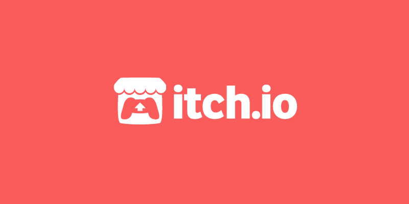

### Finaliser la configuration

!!! tip "Tout doit être rédigé en français"

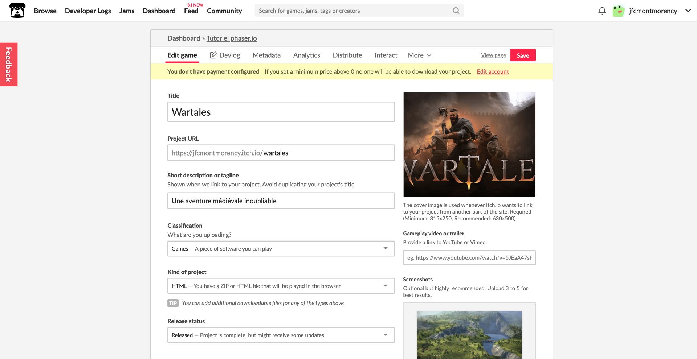{data-zoom-image}

- [ ] **Title**
- [ ] **Project URL**
- [ ] **Short description or tagline**
- [ ] **Classification** = Games
- [ ] **Kind of project** = HTML
- [ ] **Release status** = In development
- [ ] **Cover image**
- [ ] **Screenshots**

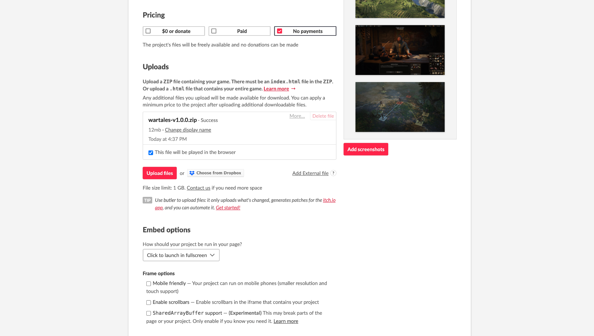{data-zoom-image}

- [ ] **Pricing** = No payments
- [ ] **Uploads** = `.zip` du build Web
- [ ] **This file will be played in the browser** = Cocher
- [ ] **Embed options** = Click to launch in fullscreen
- [ ] **Frame options** = Rien de coché

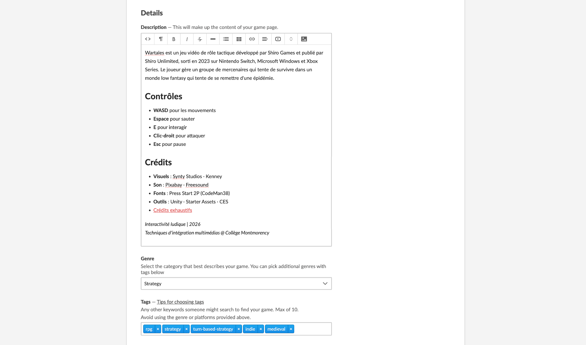{data-zoom-image}

- [ ] **Description** = Un court paragraphe
  - [ ] Ajouter une section **Contrôles**
  - [ ] Ajouter une section **Crédits**
  - [ ] Ajouter un lien vers votre dépot GitHub
- [ ] **Genre** = Choisir un genre
- [ ] **Tags** = minimum 5

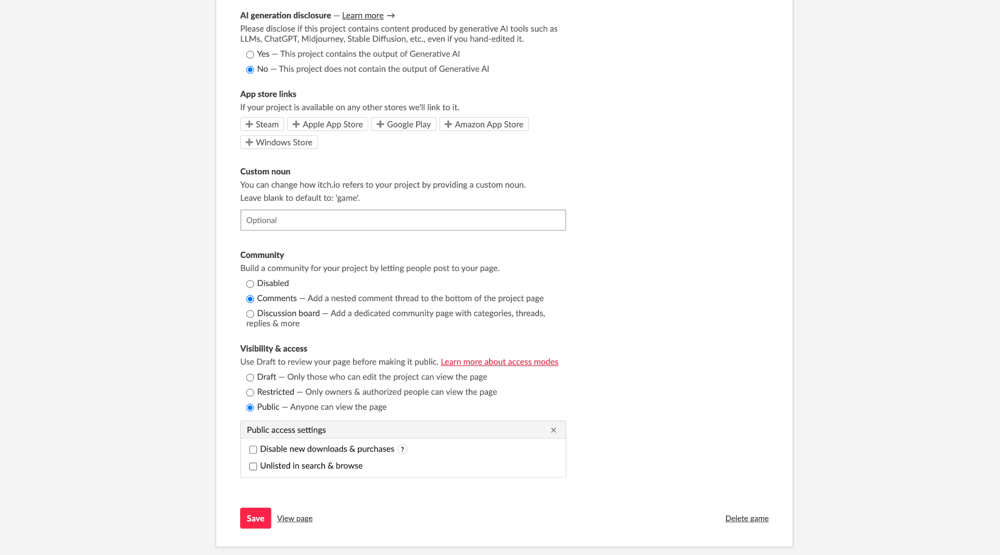{data-zoom-image}

- [ ] **AI generation disclosure**
- [ ] **Community** = Comments
- [ ] **Visibility & access** = Public
- [ ] Cliquer sur **Save**

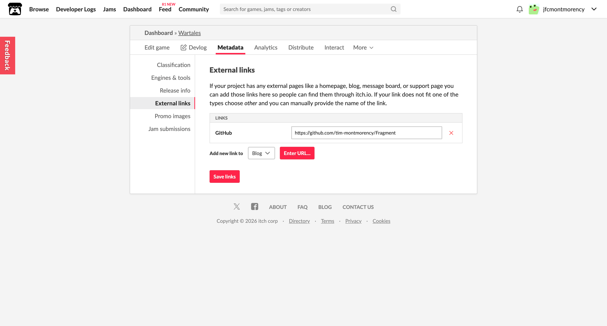{data-zoom-image}

- [ ] **Metadata > External links** > _Add new link to_ = **GitHub**
- [ ] Coller l'URL du dépot GitHub de votre jeu
- [ ] Cliquer sur **Save links**

  ??? note "Web 3"

      Pour celles et ceux qui ont le cours Web 3, vous pourrez aussi ajouter un lien de type "Homepage" avec l'URL de votre page Web.

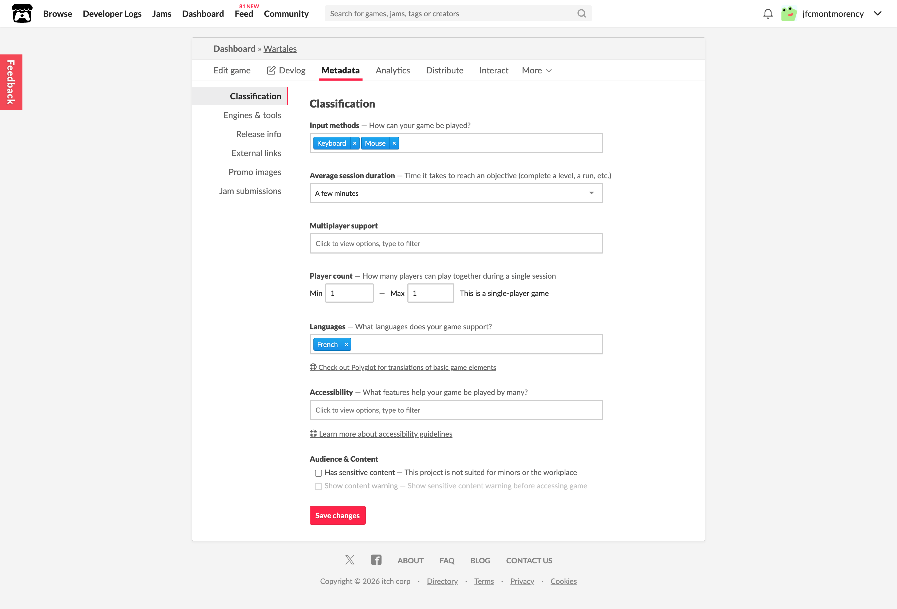{data-zoom-image}

- [ ] **Metadata > Classification** > Input methods
- [ ] **Average session duration**
- [ ] **Player count**
- [ ] **Languages** = French
- [ ] Cliquer sur **Save changes**

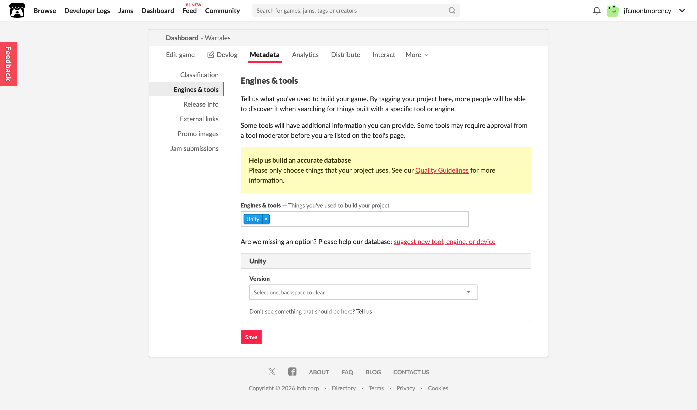{data-zoom-image}

- [ ] **Metadata > Engines & tools** : Unity  _Laisser la version vide_
- [ ] Cliquer sur **Save**

### Intégrer le jeu dans un site Web

L'onglet **Distribute** génère le code pour afficher le jeu dans un autre site Web (utile pour le cours de Web 3 😜) :

- **Embed game** : le jeu lui-même, dans un `iframe`, avec un lien direct
- **Widget** : une carte de présentation (couverture, titre, courte description) avec un bouton vers la page itch.io

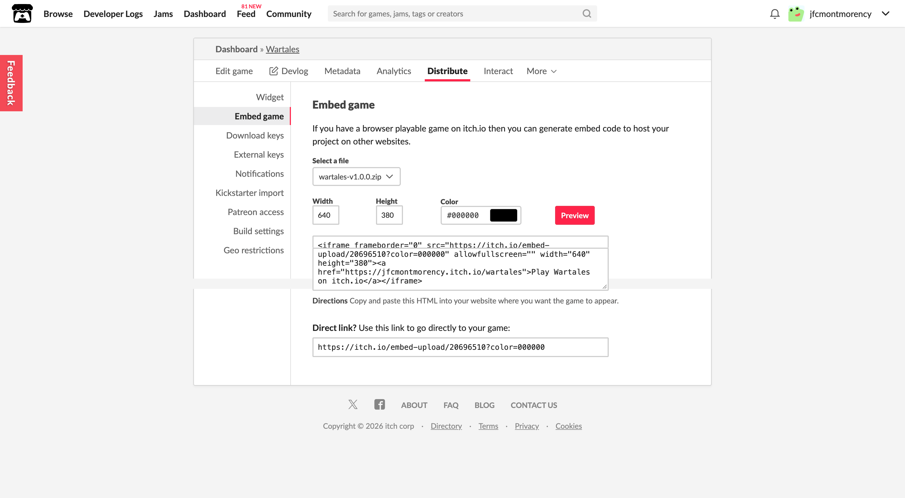{data-zoom-image}

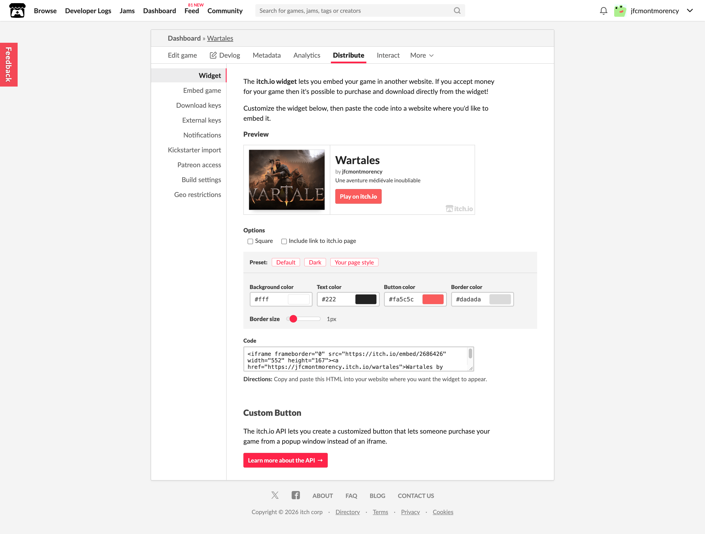{data-zoom-image}

### Ajuster le look de la page

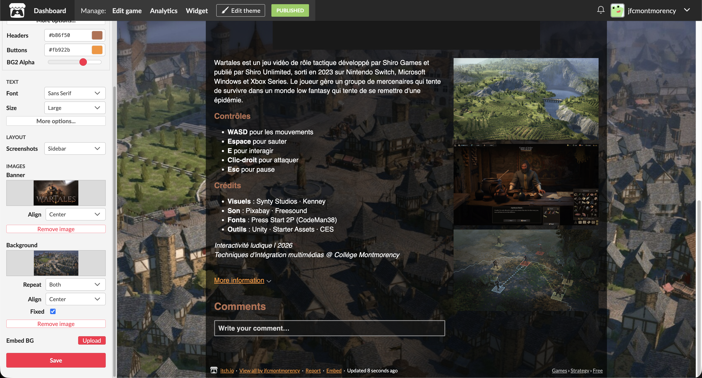{data-zoom-image}

Aller sur la page publique de votre jeu et cliquez sur **Edit theme**

- [ ] Configurer la page aux couleurs et images de votre jeu
- [ ] Cliquer sur **Save** 👈👈👈👈👈👈👈👈👈
