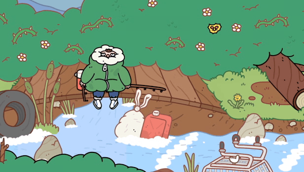

# Projet final

{.w-100}

*[GDD]: Game Design Document
*[CES]: Collider Event System
*[PNJ]: Personnage non joueur

L'objectif est de concevoir et réaliser une expérience ludique en **trois niveaux**, dans laquelle l'interacteur progresse en accomplissant des actions.

**80% de la note finale**

## Exigences

Vous devrez intégrer au jeu la plupart des techniques vues en cours. Toutefois, l'évaluation portera davantage sur la **qualité de leur implémentation** que sur leur simple présence.

| Critère            | Description |
| ------------------ | ----------- |
| **Absent** ❌      | La technique n'apparaît pas, ou ne fonctionne pas |
| **Fonctionnel** 👍 | La technique est présente |
| **Intégré** 👌     | Son usage est cohérent ou comble les attentes |
| **Raffiné** 🤯     | Son usage est complet ou dépasse les attentes |

Chaque élément est évalué sur cette échelle qualitative :level_slider: (0 à 3) ou en « fait » / « pas fait » :material-circle-half-full:

??? example "Exemple"

    Un bouton sur le menu principal : 

    * **Absent**
    * **Fonctionnel :** un bouton Unity blanc de base qui fait ce qu'il doit faire
    * **Intégré :** un bouton aux couleurs, à la police et aux sprites de l'univers
    * **Raffiné :** il est intégré et en plus, il réagit au survol et au clic, émet un son et le menu apparaît par une transition

### 3 zones en 3 scènes

On ne change de scène que lorsqu'on a accompli une suite d'actions qu'on appelle des prérequis ou _gating_ (voir [Cours 1](../../cours01.md#types-de-gating)).

Pour chaque zone, ces critères seront évalués :

- [ ] :level_slider: **Environnement** : 
  - Construit avec les assets Synty (ou autres assets validés)
  - Rien en magenta
  - On ne traverse pas le décor 
  - On ne tombe pas éternellement
  - Aucun objet flottant ni raccord visible (fente entre deux prefabs, surfaces qui scintillent, texture étirée)
- [ ] :level_slider: **Éclairage** : 
  - Éclairage propre à la zone
  - La lumière guide le regard vers ce qui est important
- [ ] :level_slider: **Prérequis** : Les prérequis de la zone font partie du système de _gating_ du jeu et contribuent au plaisir de jouer
- [ ] :material-circle-half-full: **Récompense** : L'accomplissement du prérequis est récompensé
- [ ] :material-circle-half-full: **Clarté** : L'interacteur sait quoi faire
- [ ] :material-circle-half-full: **Transition** : Le changement vers la scène suivante se fait sans erreur
- [ ] :level_slider: **Créativité**

### Structure et progression

- [ ] :level_slider: **Accueil** : Écran titre qui lance le jeu et donne accès aux crédits
- [ ] :level_slider: **Fin** : Écran de fin, avec la possibilité de recommencer sans relancer le jeu
- [ ] :level_slider: **Crédits** : Écran des crédits et retour à l'accueil

### Personnage et interactions

- [ ] :level_slider: **Contrôle et caméra** : Personnage contrôlable et usage efficace de la caméra
- [ ] :level_slider: **Rétroactions** : surbrillance à l'approche, son, animation
- [ ] :level_slider: **Affordance** : On comprend où aller et sur quoi agir
- [ ] :material-circle-half-full: **CES** : Les interactions sont montées avec le Collider Event System vu en classe

### Rétroaction et interface

- [ ] :level_slider: **Réussite et échec** : Chaque action réussie et chaque effet néfaste produisent un signal visuel et sonore approprié
- [ ] :material-circle-half-full: **HUD** : Au moins un indicateur de progression
- [ ] :material-circle-half-full: **HUD** : Le positionnement des éléments résiste bien à un changement de résolution
- [ ] :material-circle-half-full: **Police** : Une police personnalisée remplace la police par défaut de Unity

### Médias visuels

- [ ] :level_slider: **Images intégrées** : Au moins une image ajoutée au projet et configurée en **Sprite (2D and UI)** dans le HUD
- [ ] :level_slider: **Animation** : Au moins un élément du jeu animé manuellement avec un **Animator**
- [ ] :level_slider: **Particules** : Au moins un système de particules créé et lié à un événement du jeu

### Son

- [ ] :level_slider: **Ambiances** : Une ambiance sonore par zone
- [ ] :level_slider: **Effets sonores** : Au moins cinq sons déclenchés par des événements. Une variation des sons répétitifs est configurée
- [ ] :level_slider: **Sons d'interface** : Les boutons des menus produisent un son au clic. Sons cohérents avec le thème
- [ ] :level_slider: **Volume** : 
  - Usage de l'Audio Mixer et des groupes
  - Volumes des sources audio équilibrés (ni trop forts, ni trop faibles)

### Rigueur et finition

#### Unity

- [ ] :level_slider: **Arborescence** : Le contenu propre au projet est classé dans le dossier `Assets/_/`, réparti en sous-dossiers (prefab, audio, font, etc.); les packages importés restent hors de `_`. Le classement est tenu tout au long de la session
- [ ] :material-circle-half-full: **Build Windows** : Le build Windows se lance et le jeu se joue du début à la fin sans erreur

#### Gestion de projet

- [ ] :level_slider: **Trello** : Gestion du projet tenue dans Trello tout au long de la session

#### Github

- [ ] :level_slider: **README** : Description, commandes et lien vers la page itch.io
- [ ] :level_slider: **README** : Crédits complets (nom des _assets_, type, URL et licence pour chacun)

#### Itch.io

- [ ] :level_slider: **itch.io** : Jeu publié en WebGL sur itch.io, jouable dans le navigateur. La page est soignée : captures d'écran, description et commandes

### Oral (_post mortem_)

- [ ] :level_slider: **Concept** : Le concept et la boucle de jeu sont présentés clairement
- [ ] :level_slider: **Tâches reçues** : Les tâches reçues en cours de session et ce qui en a été fait
- [ ] :level_slider: **Difficulté technique** : Une difficulté technique rencontrée et sa résolution
- [ ] :level_slider: **Recul** : Ce qui serait fait autrement

## Remise

À remettre la veille du Cours 15

Un seul fichier `.zip`, nommé et organisé ainsi :

```txt
NOMDEFAMILLE-final-IL.zip
 ├── 📁 build-windows        Dossier du build Windows
 └── 📄 liens.txt            Lien du repo GitHub (public) + lien itch.io
```

Remplacer `NOMDEFAMILLE` par son propre nom de famille (ex. : `TREMBLAY-final-IL.zip`).

[Dossier de remise](https://cmontmorency365-my.sharepoint.com/:f:/g/personal/jfcartier_cmontmorency_qc_ca/IgBd2_u8Wb4hRpJRkhFM4MfuARrNUq45PoiRrtrpLlB4QfM?e=Zpinwg){ .md-button .md-button--primary }