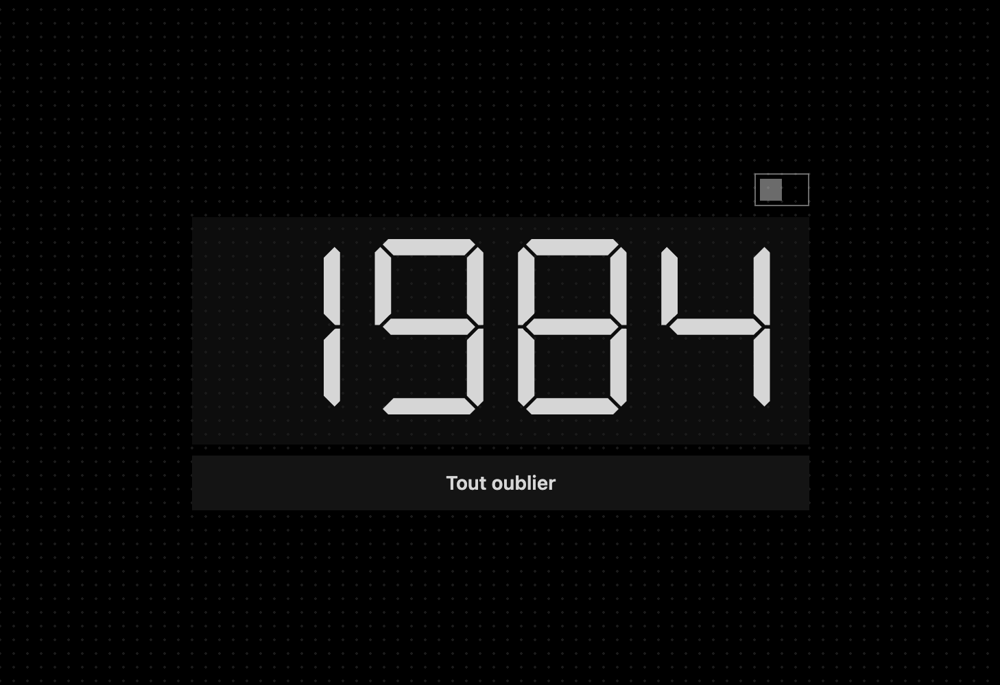

---
tags:
  - Exercice
  - Sauvegarde
---

# 1984

L'objectif de cet exercice est de **sauvegarder des informations dans le navigateur** avec `localStorage`, pour qu'elles survivent au rechargement de la page.

## Résultat attendu

* Un interrupteur qui passe du thème sombre au thème clair. Après un rechargement de la page, le thème choisi persiste.
* Un compteur qui affiche le nombre de visites et augmente de 1 à chaque chargement.

[Site Web](https://tim-w3.github.io/1984-solution/){ .md-button .md-button--primary }

## Petits rappels

| Besoin | Fonctionnalité liée |
| --- | --- |
| Écrire une valeur | `localStorage.setItem("allo", valeur)` |
| Lire une valeur | `localStorage.getItem("allo")`, qui retourne `null` si la clé n'existe pas |
| Effacer une valeur | `localStorage.removeItem("allo")` |
| Transformer du texte en nombre | `Number("3")` |

Le `localStorage` ne garde que du **texte**. Un nombre sauvegardé revient sous forme de texte : `"3"` et non `3`. Pour calculer avec, il faut idéalement le transformer avec `Number()`.

## Consignes

- [ ] [Accepter le devoir Classroom 50](https://classroom50.org/tim-w3/web-3/assignments/1984/accept)
- [ ] Cloner le dépôt avec GitHub Desktop
- [ ] Ouvrir le dossier cloné dans VS Code, puis lancer `npm install`

### Le thème

- [ ] Lancer `npx vite`, puis activer le thème clair
- [ ] Recharger la page et observer que la sélection du thème n'est pas conservée
- [ ] Au changement de l'interrupteur (événement `change`), sauvegarder `"wireframe"` (le thème clair) si l'interrupteur est coché, sinon `"black"` (le thème sombre)
- [ ] Au chargement de la page, lire la valeur sauvegardée. Si elle vaut `"wireframe"`, cocher l'interrupteur (`interrupteur.checked = true`)
- [ ] Recharger la page. Le thème choisi devrait maintenant être conservé

### Le compteur de visites

- [ ] Au chargement de la page, lire le nombre de visites sauvegardé et le transformer en nombre avec `Number()`
- [ ] Ajouter 1 à ce nombre, puis le sauvegarder
- [ ] Afficher le nombre dans `#visites` avec `textContent` (ou `innerHTML`)

<!-- !!! question "Observation"

    À la toute première visite, la clé n'existe pas encore : `getItem()` retourne `null`. Que donne `Number(null)` ? Pourquoi le compteur fonctionne-t-il quand même ? -->

### La vérification

- [ ] DevTools > onglet **Application** > **Local Storage**. Vous devriez voir les deux clés et leur valeur

### Défi

- [ ] **Remise à zéro** : ajouter sous le compteur un bouton « Tout oublier » qui efface les deux clés avec `removeItem()`, puis recharge la page avec `location.reload()`
