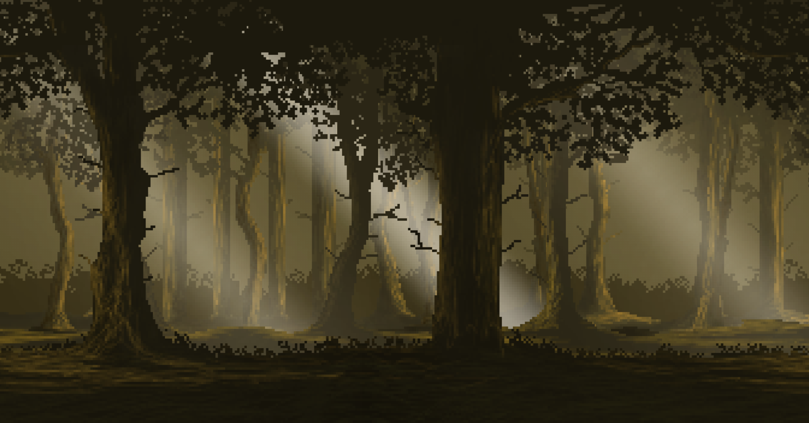

---
tags:
  - Exercice
  - Vite
  - GSAP
---

# Forêt



L'objectif de cet exercice est de créer de la **profondeur** avec GSAP. Avec la même forêt, on anime de 4 façons différentes. 

D'abord une forêt qui **défile toute seule**, puis trois effets au défilement en parallaxe **verticale**, **zoom** et **horizontale**.

> Ce qui est loin bouge lentement, ce qui est proche bouge vite.

## Consignes

### Préparation

- [ ] [Accepter le devoir Classroom 50](https://classroom50.org/tim-w3/web-3/assignments/foret/accept)
- [ ] Cloner le répertoire avec GitHub Desktop
- [ ] Ouvrir le dossier cloné dans VSCode
- [ ] Dans le terminal, installer les dépendances, puis lancer le projet Vite.

### Exploration du projet

Tout le HTML et le CSS sont déjà faits. Avant d'animer, prendre quelques minutes pour comprendre comment la forêt est construite.

- [ ] Ouvrir `index.html` et repérer les couches à l'intérieur de `#foret`

??? question "Comment les couches sont-elles empilées&nbsp;?"

    Toutes les couches sont en `position: absolute`, au même endroit. Le titre, pour sa part, est glissé entre les couches.

??? question "Pourquoi des `` et des `<div>`&nbsp;?"

    * Les **couches de décor** (`<div>`) utilisent le concept de `background-image`, car elles doivent se répéter horizontalement à l'infini.
    * Les **couches d'ambiance** (``) sont toujours fixes et n'ont pas besoin de répétition.

- [ ] Repérer les identifiants. Ce sont les cibles des animations&nbsp;:

    | Identifiant | Distance |
    | :--- | :--- |
    | `#buissons` | Très loin |
    | `#arbres-loin` | Loin |
    | `#arbres-milieu` | Au milieu |
    | `#rayons` | Rayons de lumière |
    | `#titre` | Le titre « La forêt » |
    | `#arbres-proches` | Proche |
    | `#lumiere` | Lumière |
    | `#avant-plan` | Tout devant |

- [ ] Ouvrir `src/gsap.js`. Tout le code de l'exercice sera écrit dans la fonction `gsapAnimations()`.

### Installer la police 🚨

Le titre doit utiliser la police **Caprasimo** tiré de [Fontsource](https://fontsource.org/) (cours 4).

- [ ] Installer la fonte avec `npm`
- [ ] Ajouter la fonte dans le fichier `src/style.css`, juste sous `@import "tailwindcss";`
- [ ] Déclarer Caprasimo comme police par défaut de Tailwind (`--font-sans`, dans `@theme`)
- [ ] Commit + push

### Étape 1 - La forêt qui défile

{.h-auto}

Pour que la forêt avance **toute seule**, chaque couche de décor fait défiler son image sans fin, à sa propre vitesse.

- [ ] Pour chaque couche de décor, créer un tween `to()` qui anime `backgroundPositionX`, avec ces paramètres&nbsp;:
  - [ ] Animation de 1 seconde
  - [ ] Lissage linéaire
  - [ ] Répétition à l'infini
  - [ ] `repeatRefresh: true`
  - [ ] `backgroundPositionX`

    | Cible | Valeur |
    | :--- | :--- |
    | `#buissons` | `"-=50px"` |
    | `#arbres-loin` | `"-=100px"` |
    | `#arbres-milieu` | `"-=175px"` |
    | `#arbres-proches` | `"-=250px"` |
    | `#avant-plan` | `"-=400px"` |

- [ ] Commit + push

### Activer ScrollTrigger

Les 3 étapes suivantes se jouent au **défilement de la page**.

- [ ] Sous la ligne `import gsap from "gsap"`, importer `ScrollTrigger`, puis l'activer

### Étape 2 - Parallaxe verticale

{.h-auto}

Quand on défile, la page monte. Les couches lointaines vont **descendre** un peu, pour « contrer » le défilement. Elles paraissent lentes, donc loin.

- [ ] Mettre l'animation de l'étape 1 en commentaire.
- [ ] Créer une timeline avec :
  - [ ] Un lissage linéaire par défaut
  - [ ] Un `scrollTrigger` qui surveille `#foret`
    - [ ] Débute à `"top top"` (dès le haut de la page)
    - [ ] Fini à `"bottom top"` (quand la forêt sort de l'écran)
    - [ ] scrub à `true`

  ??? info "`defaults` : des réglages pour tous les `.to()`"

      Ce qui est placé dans `defaults` s'applique à **tous** les `.to()` de la timeline. Plutôt que d'écrire `ease: "none"` dans chaque `.to()`, on l'écrit une seule fois.

  ??? tip "Indice : la structure"

      ```js
      gsap.timeline({
        defaults: { ease: "none" },
        scrollTrigger: {
          // les paramètres ici
        }
      })
        .to("#buissons", { /* ... */ })
        .to("#arbres-loin", { /* ... */ }, "<")
      ```

      Attention&nbsp;: pas de point-virgule entre les `.to()`

- [ ] Ajouter un `.to()` par couche, avec ces valeurs de `yPercent`&nbsp;:

    | Cible | `yPercent` |
    | :--- | :--- |
    | `#buissons` | `70` |
    | `#arbres-loin` | `60` |
    | `#arbres-milieu` | `45` |
    | `#rayons` | `35` |
    | `#arbres-proches` | `25` |
    | `#lumiere` | `15` |

- [ ] À partir du deuxième `.to()`, ajouter `"<"` après l'accolade, pour que toutes les couches bougent **en même temps**
- [ ] Ajouter un dernier `.to()` pour le titre&nbsp;: il descend (`yPercent: 50`) et disparaît (`autoAlpha: 0`)
- [ ] `#avant-plan` ne bouge pas&nbsp;: pas de `.to()` pour lui

  ??? question "Pourquoi `ease: "none"`&nbsp;?"

      Pour une parallaxe, les couches doivent suivre la molette à vitesse constante. Avec une autre courbe, elles accéléreraient et ralentiraient en cours de route, et l'illusion serait brisée.

  ??? quote "Observation"

      Mettre temporairement **toutes** les valeurs à `50`. La forêt devient plate&nbsp;: c'est bien la **différence** entre les vitesses qui crée la profondeur. Remettre ensuite les bonnes valeurs.

- [ ] Commit + push

### Étape 3 - Zoom

{.h-auto}

Cette fois, la forêt reste **figée** à l'écran et chaque couche **grossit**. Plus une couche est proche, plus elle grossit&nbsp;: on a l'impression d'avancer dans la forêt.

- [ ] Mettre la timeline de l'étape 2 en commentaire
- [ ] Créer une nouvelle timeline avec&nbsp;:
    - [ ] Des réglages communs&nbsp;: `defaults: { ease: "power1.out" }`
    - [ ] Un `scrollTrigger`&nbsp;:
        - [ ] Déclencheur&nbsp;: `#foret`
        - [ ] Début&nbsp;: `"top top"`
        - [ ] Fin&nbsp;: `"+=3000"` (l'animation dure 3000 pixels de défilement)
        - [ ] `pin: true`
        - [ ] `scrub: 1`

  ??? question "À quoi sert `pin`&nbsp;?"

      Sans `pin`, la forêt continuerait de monter pendant le zoom et sortirait de l'écran avant la fin. Avec `pin`, elle reste figée tant que l'animation n'est pas terminée.

  ??? question "Pourquoi `scrub: 1` plutôt que `scrub: true`&nbsp;?"

      `scrub: 1` laisse 1 seconde à l'animation pour rattraper le défilement. Ça adoucit les bonds de la molette, très visibles quand la scène est figée.

  ??? question "Pourquoi `power1.out` et pas `"none"`&nbsp;?"

      Ici, on ne fait plus une parallaxe collée au défilement&nbsp;: on **avance** dans la forêt. Avec `power1.out`, l'avancée est rapide au début et ralentit à la fin, comme quand on arrive quelque part. Essayer avec `"none"` pour comparer.

- [ ] Ajouter un `.to()` par couche, avec ces valeurs de `scale`&nbsp;:

    | Cible | `scale` |
    | :--- | :--- |
    | `#buissons` | `1.1` |
    | `#arbres-loin` | `1.3` |
    | `#arbres-milieu` | `1.6` |
    | `#rayons` | `1.5` |
    | `#arbres-proches` | `1.8` |
    | `#lumiere` | `1.8` |
    | `#avant-plan` | `2.5` |

- [ ] Comme à l'étape 2&nbsp;: `"<"` à partir du deuxième `.to()`
- [ ] Ajouter un dernier `.to()` pour le titre&nbsp;: il grossit (`scale: 3`) et disparaît

  ??? info "Vers où les couches grossissent-elles&nbsp;?"

      Vers le centre de l'écran. C'est réglé dans `src/style.css` avec la propriété `transform-origin`.

- [ ] Commit + push

### Étape 4 - Promenade horizontale

{.h-auto}

On défile vers le bas, mais on marche vers la droite&nbsp;: les couches **glissent vers la gauche**. Plus une couche est proche, plus elle va loin.

- [ ] Mettre la timeline de l'étape 3 en commentaire
- [ ] Créer une nouvelle timeline, comme à l'étape 3, sauf&nbsp;:
    - [ ] Réglages communs&nbsp;: `defaults: { ease: "power2.out" }`
    - [ ] Fin&nbsp;: `"+=2000"`
- [ ] Ajouter un `.to()` par couche, avec ces valeurs de `xPercent`&nbsp;:

    | Cible | `xPercent` |
    | :--- | :--- |
    | `#buissons` | `-10` |
    | `#arbres-loin` | `-20` |
    | `#arbres-milieu` | `-35` |
    | `#arbres-proches` | `-50` |
    | `#avant-plan` | `-75` |

- [ ] Comme aux étapes précédentes&nbsp;: `"<"` à partir du deuxième `.to()`
- [ ] Ajouter un dernier `.to()` pour le titre&nbsp;: il glisse vers la gauche (`xPercent: -100`) et disparaît
- [ ] `#rayons` et `#lumiere` ne bougent pas&nbsp;: la lumière vient du ciel, elle reste en place pendant qu'on marche

  ??? question "Pourquoi n'y a-t-il jamais de trou à droite&nbsp;?"

      Ouvrir `src/style.css`&nbsp;: les couches de décor (classe `.bande`) font **4 fois la largeur de l'écran**, et leur image s'y répète. La partie qui dépasse est cachée (`overflow: hidden` sur `#foret`), et elle apparaît quand la couche glisse vers la gauche.

      Comme la bande se mesure en largeurs d'écran, et non en pixels d'image, la forêt couvre toujours l'écran, même sur un écran très large.

  ??? question "Étape 1 et étape 4 : quelle différence&nbsp;?"

      À l'étape 1, l'**image** défile à l'intérieur de la couche (`backgroundPositionX`)&nbsp;: elle ne finit jamais. À l'étape 4, c'est la **couche entière** qui glisse (`xPercent`)&nbsp;: elle s'arrête au bout de sa bande.

- [ ] Commit + push

## Défis

- [ ] Réactiver l'étape 1 en même temps que l'étape 4&nbsp;: la forêt continue de défiler toute seule pendant la promenade
- [ ] Combiner le zoom et la promenade dans une même timeline&nbsp;: chaque couche grossit **et** glisse en même temps (un `.to()` peut animer `scale` et `xPercent` à la fois)
- [ ] Commit + push
