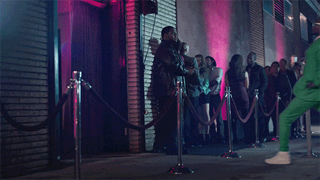

# K.. go !

{.w-100}

L'objectif ici est de démarrer le projet final.

## Consignes

### Créer le dépôt GitHub

- [ ] Sur GitHub, créer le dépôt pour le code du projet final (ex. : `w3-final-src`), **sans** README, ni `.gitignore`, rien !
- [ ] Le cloner avec GitHub Desktop, puis ouvrir le dossier cloné dans VS Code
- [ ] Dans VS Code, ouvrir un terminal **Git Bash** 
<!-- : menu *Terminal* > *New Terminal*, puis choisir Git Bash dans la flèche à côté du **+** -->

### Créer le projet

- [ ] Dans le terminal, à la racine du dossier cloné, créer le projet Vite Vanilla/JavaScript avec la commande suivante (le point est important 👇) :

    ```bash
    npm create vite@latest .
    ```

- [ ] Avec npm, installer Tailwind, daisyUI et GSAP
- [ ] Installer aussi une police [Fontsource](https://fontsource.org/) qui rappelle l'ambiance du jeu
- [ ] Créer `src/gsap.js` et l'importer dans `main.js`
- [ ] Faire 2 copies de `index.html` et les renommer `jeu.html` et `contact.html`
- [ ] Dans `vite.config.js`, ajouter `base: './'` et déclarer les trois pages sous `build.rolldownOptions.input`. Au besoin, retourner dans les notes de cours.
- [ ] Lancer `npx vite build`. Si tout est beau, il devrait y avoir les trois fichiers HTML dans `dist/`

### Un squelette commun

- [ ] Dans chaque page, mettre en place la structure `<header>`, `<main>` et `<footer>`
- [ ] Dans le header, ajouter le logo, une navbar daisyUI avec les liens vers les trois pages, un `theme-controller` daisyUI et un bouton pour activer/désactiver le son
- [ ] Dans le footer, ajouter cette mention en remplaçant « Prénom Nom » par votre nom (le prénom seul est permis si vous ne voulez pas mettre votre nom de famille sur internet) :

  > Projet étudiant réalisé par Prénom Nom.<br>
  > Techniques d'intégration multimédia, Collège Montmorency.<br>
  > Non affilié aux titulaires des droits.

### Les médias

- [ ] Créer les dossiers `src/assets/images/`, `src/assets/videos/` et `src/assets/audio/`
- [ ] Y placer le logo du jeu et les médias déjà prêts

  !!! info "Les dossiers vides"

      Git ne garde pas un dossier vide. Un dossier sans média n'apparaîtra donc pas dans le dépôt GitHub.

### Le code sur GitHub

L'installation de Vite crée par défaut un `.gitignore` qui exclut `node_modules` et `dist`, donc c'est super.

- [ ] Avec GitHub Desktop, faire un premier _commit_, puis un _push_

### La mise en ligne

- [ ] Lancer `npx vite build`

- [ ] Sur GitHub, créer un second dépôt pour le site officiel (ex. : `nom-du-jeu`)
- [ ] Y placer **le contenu** du dossier `dist/` (pas le dossier lui-même)
- [ ] Configurer GitHub Pages pour le mettre en ligne

- [ ] En ligne, vous devriez être capable de visiter toutes les pages à partir de n'importe laquelle via la navbar. 

  !!! question "Un peu laborieux ?"

      Évidemment, on ne fait pas cette étape toutes les 2 minutes. Vous aurez probablement à le refaire une seule autre fois, pour la remise.

### Un peu de professionnalisme

- [ ] Remplacer le favicon de Vite par le logo du jeu (`public/favicon.svg`)

<figure markdown>
{.w-50}
</figure>