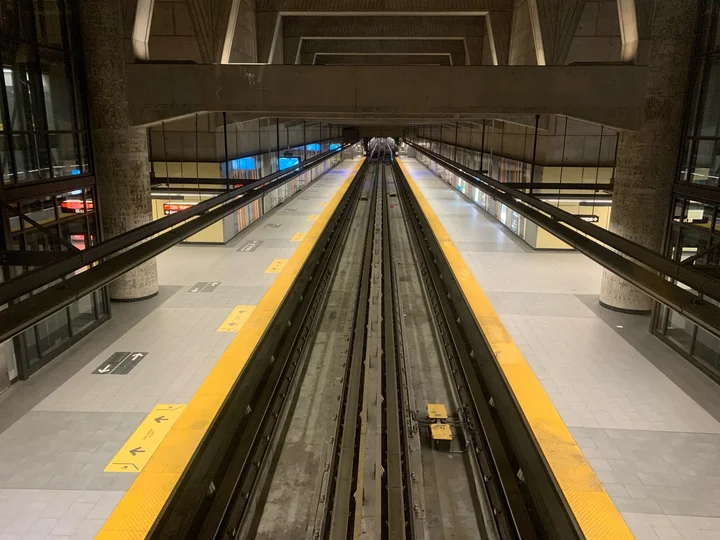

---
tags:
  - Exercice
  - Vite
  - GSAP
---

# Ligne orange

{.w-100 .aspect-16-9}

L'objectif de cet exercice est de mettre en pratique la notion de défilement GSAP avec les concept de `pin`, `scrub`, `snap` et `labels`.

<!--
Notions mises en pratique :

* Une timeline pilotée par le défilement (pin, scrub)
* Avec scrub, les durées deviennent des proportions
* addLabel() : poser des étiquettes dans une timeline
* snap: "labels" : aimanter le défilement sur les étiquettes
-->

## Consignes

### Préparation

- [ ] [Accepter le devoir Classroom 50](https://classroom50.org/tim-w3/web-3/assignments/ligne-orange/accept)
- [ ] Cloner le répertoire avec GitHub Desktop
- [ ] Ouvrir le dossier cloné dans VSCode
- [ ] Dans le terminal, installer les dépendances, puis lancer le projet Vite.

### Exploration du projet

Tout le HTML et le CSS sont déjà faits. Avant d'animer, prendre quelques minutes pour comprendre comment la ligne est construite.

- [ ] Ouvrir `index.html` et repérer les 4 stations à l'intérieur de `#piste`. Leur position est donnée par `top`&nbsp;:

    | Station | Position (`top`) |
    | :--- | :--- |
    | Montmorency | `0%` |
    | De la Concorde | `30%` |
    | Cartier | `55%` |
    | Henri-Bourassa | `100%` |

- [ ] Repérer `#train` et `#wagon` à l'intérieur

??? question "Pourquoi le wagon est-il dans un cadre&nbsp;?"

    Le cadre `#train` est transparent et fait **exactement la hauteur de la piste**. Le wagon est placé en haut de ce cadre.

- [ ] Ouvrir `src/gsap.js`. Tout le code de l'exercice devra être écrit dans la fonction `gsapAnimations()`.

### Activer ScrollTrigger

- [ ] Sous la ligne `import gsap from "gsap"`, importer ScrollTrigger, puis l'activer

### Étape 1 - Le trajet

{.h-auto}

- [ ] Créer une timeline :
  - [ ] Lissage par défaut de `power1.inOut`
  - [ ] Un `scrollTrigger` qui surveille `#ligne`
    - [ ] Débute à `"top top"`
    - [ ] Fini à `"+=3000"` (l'animation dure 3000 pixels de défilement)
    - [ ] pin à `true`
    - [ ] scrub à `1`
- [ ] Ajouter un `.to()` sur `#train` pour chaque trajet&nbsp;:

  | Trajet | `yPercent` | `duration` |
  | :--- | :--- | :--- |
  | Montmorency → De la Concorde | `30` | `30` |
  | De la Concorde → Cartier | `55` | `25` |
  | Cartier → Henri-Bourassa | `100` | `45` |

  ??? question "Pourquoi ces durées&nbsp;?"

      Avec `scrub`, les durées ne sont plus des secondes&nbsp;: elles deviennent des **proportions** du défilement (voir les notes de cours). Ici, la durée de chaque trajet est la distance entre ses deux stations&nbsp;: `30 - 0`, `55 - 30` et `100 - 55`. Chaque bout de piste demande donc autant de défilement, et le train garde le même rythme d'un bout à l'autre.

  ??? quote "Observation"

      Mettre temporairement toutes les durées à `1`. Le dernier trajet, le plus long, se fait alors aussi vite que les autres&nbsp;: le train semble accélérer. Remettre ensuite les bonnes durées.

- [ ] Commit + push

### Étape 2 - Les arrêts

{.h-auto}

Pour l'instant, le train s'arrête n'importe où entre deux stations. On va poser une étiquette à chaque station, puis aimanter le défilement sur ces étiquettes.

- [ ] Poser une étiquette avec `.addLabel()`&nbsp;:
  - [ ] Au tout début de la timeline&nbsp;: `"Montmorency"`
  - [ ] Puis, après chaque `.to()`&nbsp;: le nom de la station d'arrivée

  ??? info "`.addLabel()`"

      `.addLabel("Cartier")` pose une étiquette à l'endroit où la timeline est rendue&nbsp;: ici, à la fin du trajet qui arrive à Cartier. Une étiquette ne fait rien bouger&nbsp;; c'est seulement un **repère** dans la timeline.

- [ ] Dans le `scrollTrigger`, ajouter `snap: "labels"`
- [ ] Commit + push

## Défis

- [ ] Remplacer `"labels"` par `"labelsDirectional"`. Le train va maintenant à la station **suivante** dans le sens du défilement, même si on s'arrête juste après une station.
- [ ] Ajouter la station **Sauvé** après Henri-Bourassa&nbsp;: placer les 5 stations à de nouvelles positions (par exemple `0%`, `25%`, `45%`, `80%` et `100%`), puis ajuster les `yPercent`, les durées et les étiquettes
- [ ] Commit + push
