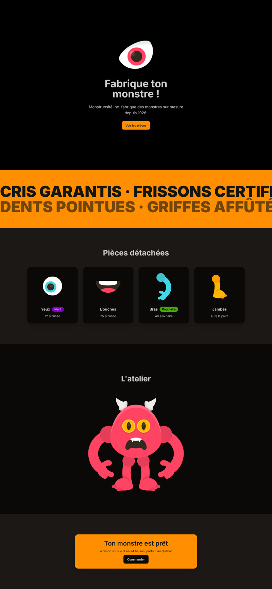

---
tags:
  - Exercice
  - Vite
  - DaisyUI
  - GSAP
---

# Monstruosité Inc.

{.h-auto}

L'objectif de cet exercice est de **fabriquer son propre monstre**, puis d'animer la page **section par section** avec ScrollTrigger.

<!--
Notions mises en pratique :

* DaisyUI : thème et composante card
* scrollTrigger dans un tween : trigger, start, markers
* toggleActions : apparitions déclenchées
* Timeline déclenchée (sans scrub) vs timeline pilotée (scrub)
* fromTo() avec scrub
* Positionnement absolu et z-index : assemblage du monstre
* pin + scrub + from() : animation de l'assemblage
-->

## Consignes

### Préparation

- [ ] [Accepter le devoir Classroom 50](https://classroom50.org/tim-w3/web-3/assignments/monstre/accept)
- [ ] Cloner le répertoire avec GitHub Desktop
- [ ] Ouvrir le dossier cloné dans VSCode
- [ ] Dans le terminal, installer les dépendances, puis lancer le projet Vite.

### Exploration du projet

Le projet est déjà monté avec Vite, Tailwind, DaisyUI et GSAP. La page est presque complète&nbsp;: il reste à fabriquer le monstre, puis à tout animer.

- [ ] Ouvrir `index.html` et repérer les sections et leurs identifiants. Ce sont les cibles des animations&nbsp;:

  | Section | Identifiants |
  | :--- | :--- |
  | 1. Accueil | `#accueil` |
  | 2. Slogans | `#slogans`, `#slogan-1`, `#slogan-2` |
  | 3. Catalogue | `#catalogue`, `#piece-1` à `#piece-4` |
  | 4. Atelier | `#atelier`, `#monstre`, `#corps` |
  | 5. Commander | `#commander` |

- [ ] Ouvrir `public/images/pieces`&nbsp;: ce sont toutes les « pièces » disponibles pour fabriquer le monstre. _Elles proviennent du [Monster Builder Pack de Kenney](https://kenney.nl/assets/monster-builder-pack)._
- [ ] Ouvrir `src/style.css`. Le corps du monstre (`#corps`) est déjà placé.

??? question "Pourquoi des pièces `-miroir`&nbsp;?"

    Les bras, les jambes, les cornes, les antennes, les oreilles et les sourcils ne pointent que d'un seul côté. Chacune de ces pièces existe donc en deux versions&nbsp;: l'originale et sa version `-miroir`, retournée. Par exemple, `arm_redC.png` va à **droite** de l'écran, et `arm_redC-miroir.png` à **gauche**.

### Étape 1 - Les finitions DaisyUI

{.w-50}

- [ ] Activer un thème DaisyUI sombre dans `src/style.css` (par exemple `halloween`)
- [ ] Dans la section `#commander`, construire une carte d'appel à l'action avec les [composantes DaisyUI](https://daisyui.com/components/) `card` et `btn`&nbsp;:
  - [ ] ID = `commande`
  - [ ] Titre 2 : « Ton monstre est prêt »
  - [ ] Un paragraphe : « Livraison sous le lit en 24 heures, partout au Québec. »
  - [ ] Un bouton « Commander » qui mène vers [cette page](https://www.youtube.com/watch?v=xvFZjo5PgG0)&nbsp;: une balise `<a>` avec la classe `btn`
- [ ] Commit + push

### Activer ScrollTrigger

À partir d'ici, tout le code d'animation est écrit dans la fonction `gsapAnimations()` de `src/gsap.js`, une section à la fois.

- [ ] Sous la ligne `import gsap from "gsap"`, importer `ScrollTrigger`, puis l'activer

### Étape 2 - Les slogans

Les deux lignes glissent **en sens inverse**, au rythme du défilement.

- [ ] Animer `#slogan-1` avec un `to()`&nbsp;:
  - [ ] `xPercent: -50`
  - [ ] Lissage linéaire
  - [ ] Un `scrollTrigger` qui surveille `#slogans`, de `"top bottom"` à `"bottom top"`, avec `scrub: true`
- [ ] Animer `#slogan-2` avec un `fromTo()`, de `xPercent: -50` à `xPercent: 0`, avec les mêmes réglages
- [ ] Commit + push

### Étape 3 - Le catalogue

Les cartes apparaissent quand elles entrent à l'écran. Pas de `scrub` ici. Le défilement déclenche l'animation, c'est tout.

#### Une première apparition

- [ ] Animer `#piece-1` avec un `from()` :
  - [ ] Part de `y: 100` et est invisible (`autoAlpha: 0`)
  - [ ] L'animation dure `0.8` seconde
  - [ ] Un `scrollTrigger` qui surveille la carte elle-même (`#piece-1`), avec `start: "top 80%"` et `markers: true` pour tester ça.
- [ ] Défiler lentement et observer les repères

  ??? quote "Observation"

      Essayer `start: "top 50%"`, puis `start: "top bottom"` et observer où les repères se déplacent. Revenir ensuite à `"top 80%"`.

#### `toggleActions`

Pour l'instant, la carte apparaît une fois et ne disparaît plus jamais.

- [ ] Ajouter `toggleActions` au `scrollTrigger` et essayer ces trois valeurs en défilant vers le bas, puis vers le haut&nbsp;:

    | `toggleActions` | Comportement |
    | :--- | :--- |
    | `"play none none none"` | _(à observer)_ |
    | `"restart none none none"` | _(à observer)_ |
    | `"play none none reverse"` | _(à observer)_ |

  ??? tip "Rappel des 4 moments"

      ```js
      toggleActions: "play    none    none        reverse"
      //              ↑       ↑       ↑           ↑
      //              onEnter onLeave onEnterBack onLeaveBack
      ```

#### Toutes les cartes, en séquence

Les quatre cartes vont maintenant apparaître **l'une après l'autre**.

- [ ] Mettre l'animation de `#piece-1` en commentaire
- [ ] Créer une timeline avec :
  - [ ] Des réglages communs : `defaults: { duration: 0.5, ease: "back.out" }`
  - [ ] Un `scrollTrigger` qui surveille `#catalogue`, avec `start: "top 60%"` et `toggleActions: "play none none reverse"`
- [ ] Ajouter un `.from()` par carte (`#piece-1` à `#piece-4`), à partir de `scale: 0` et `autoAlpha: 0`
- [ ] Chaque carte commence `0.3` seconde avant la fin de la précédente

  ??? tip "Indice"

      Le paramètre de position serait donc `"-=0.3"`

  ??? quote "Observation : déclenchée ou pilotée&nbsp;?"

      Ajouter temporairement `scrub: true` au `scrollTrigger`. La séquence ne se joue plus d'elle-même&nbsp; et suit maintenant la molette de la souris. Retirer ensuite `scrub`.

      * **Déclenchée** (`toggleActions`)&nbsp;: le défilement donne le signal de départ, l'animation a sa propre durée.
      * **Pilotée** (`scrub`)&nbsp;: le défilement **est** la ligne du temps.

- [ ] Commit + push

### Étape 4 - Fabriquer le monstre 🧟

Le corps est en place. Il reste à le changer, puis à lui ajouter des membres&nbsp;!

- [ ] Remplacer le corps rouge par un **autre corps** (`body_…` dans `public/images/pieces`), puis ajuster au besoin la règle `#corps` dans `src/style.css`

!!! warning "Un monstre original"

    Le monstre doit être **différent** de celui du résultat attendu. Donc pas les mêmes membres, ni les mêmes quantités 😜. Soyez CRÉATIVES et CRÉATIFS 🎨 

- [ ] Choisir des pièces dans `public/images/pieces`. Le monstre doit avoir au minimum&nbsp;:
  - [ ] 2 bras
  - [ ] 2 jambes
  - [ ] 1 oeil
  - [ ] 1 bouche
  - [ ] 1 extra (cornes, antennes, nez, etc.)
- [ ] Ajouter chaque pièce dans `#monstre`, avec un identifiant clair&nbsp;:

  ```html title="Exemple"
  
  ```

- [ ] Dans `src/style.css`, placer chaque pièce avec `width`, `left` et `top`

  ```css title="Exemple"
  #bras-gauche { width: 135px; left: -45px; top: 170px; z-index: 1; }
  ```

  ??? tip "Ajuster facilement"

      Dans les DevTools du navigateur, sélectionner une pièce, puis modifier ses valeurs `left` et `top` avec les flèches du clavier. Une fois la position trouvée, la recopier dans `style.css`.

- [ ] Commit + push

### Étape 5 - L'atelier

Le monstre s'assemble maintenant pièce par pièce, pendant que l'atelier reste **épinglé** à l'écran.

Le CSS place déjà chaque pièce à sa position finale. Avec `from()`, chaque pièce **part d'ailleurs** et revient à sa place.

- [ ] Créer une timeline avec un `scrollTrigger`&nbsp;:
  - [ ] Déclencheur&nbsp;: `#atelier`
  - [ ] Début&nbsp;: `"top top"`
  - [ ] Fin&nbsp;: `"+=3000"`
  - [ ] `pin: true`
  - [ ] `scrub: 1`
- [ ] Ajouter le corps, qui apparaît en fondu&nbsp;:

  ```js
  .from("#corps", { autoAlpha: 0 })
  ```

- [ ] Ajouter un `.from()` pour chaque autre pièce. Les pièces symétriques (ex: bras, jambes) arrivent **en même temps**.
- [ ] Les valeurs de départ sont **libres**&nbsp;: `x`, `y`, `rotation`, `scale`, `autoAlpha`. Chaque sorte de pièce doit arriver d'une façon différente.
- [ ] Commit + push

### Étape 6 - Commander

- [ ] Faire apparaître la carte `#commande` quand la section `#commander` arrive à l'écran. L'animation est **au choix**, mais doit utiliser `toggleActions`.
- [ ] Commit + push
