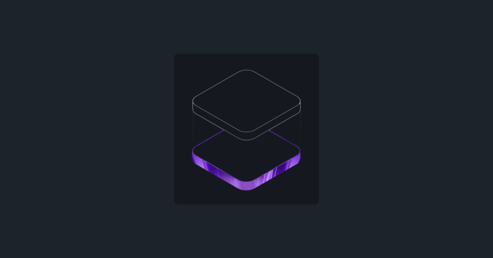
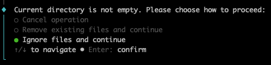

---
tags:
  - Exercice
  - Vite
---

# Vite Vanille

{data-zoom-image}

L'objectif de cet exercice est d'introduire la méthode d'installation d'un projet Vite **Vanille** en JavaScript, puis d'y ajouter Tailwind et DaisyUI.

## Résultat attendu

{data-zoom-image}

> Bon, c'est pas super impressionnant, j'en convient, mais l'exercice est surtout fait pour pratiquer l'installation

## Consignes

- [ ] [Accepter le devoir Classroom 50](https://classroom50.org/tim-w3/web-3/assignments/vite/accept)
- [ ] Cloner le répertoire avec GitHub Desktop
- [ ] Ouvrir le dossier cloné dans VSCode

### Départ

- [ ] Dans le terminal, à la racine du répertoire cloné, créer le projet Vite **dans le dossier courant** :
    ```bash
    npm create vite@latest .
    ```

  ??? question "Current directory is not empty ?"

      Quand on installe Vite dans un projet non vide, il affiche un formulaire. C'est tout à fait normal, Vite ne veut pas écraser par inadvertance les fichiers existants. C'est gentil de sa part, mais dans le cadre de l'exercice, on va l'ignorer 😅

      

- [ ] Répondre aux questions suivantes :
    - Framework : **Vanilla**
    - Variante : **JavaScript**
    - Install with npm and start now&nbsp;? **Yes**
- [ ] Confirmer que la page par défaut de Vite s'affiche dans le navigateur

### Le ménage 🧹

> Le projet de base contient du code de démonstration qui ne nous servira pas.

- [ ] Supprimer le fichier `src/counter.js`
- [ ] Vider complètement le contenu du fichier `src/style.css`
- [ ] Dans `src/main.js`&nbsp;:
  - [ ] Conserver seulement les imports de `style.css` et de `hero.png`
  - [ ] Retirer les imports de `javascript.svg`, de `vite.svg` et de `counter.js`
  - [ ] Retirer tout le HTML de démonstration à l'intérieur de `innerHTML`
  - [ ] Retirer aussi l'appel à `setupCounter(...)` à la fin du fichier<br>{.w-20}
- [ ] Sauvegarder et confirmer que la page est vide, sans erreur dans la console
- [ ] Commit + push

### Tailwind et DaisyUI 

- [ ] Installer Tailwind et DaisyUI avec des commandes `npm` : 
    ```bash
    npm install tailwindcss @tailwindcss/vite
    ```
    ```bash
    npm install daisyui
    ```
- [ ] À la racine du projet, créer le fichier `vite.config.js` :
    ```js title="vite.config.js"
    import { defineConfig } from 'vite'
    import tailwindcss from '@tailwindcss/vite'

    export default defineConfig({
      plugins: [
        tailwindcss(),
      ],
    })
    ```
- [ ] Dans `src/style.css`, ajouter :
    ```css title="src/style.css"
    @import "tailwindcss";
    @plugin "daisyui";
    ```
- [ ] Arrêter le serveur et le redémarrer (nécessaire pour que vite reconnaisse `vite.config.js`)
- [ ] Commit + push

### L'exercice

- [ ] Dans `src/main.js`, à l'intérieur de `innerHTML`, reproduire le résultat attendu :
  - [ ] Une `<section>` qui occupe au moins la hauteur de l'écran et qui centre son contenu en flexant ses biceps 💪 <br>{.w-20}
  - [ ] Dans la section, une `<div>` aux coins arrondis, avec du _padding_ et une couleur de fond DaisyUI (base-300)
  - [ ] L'image `hero.png` à l'intérieur de la `<div>`
- [ ] Commit + push

??? tip "Indices"

    - L'image est déjà importée dans la variable `heroImg`. Pour l'utiliser, vous pouvez faire ça : ``
    - Centrer avec Flexbox : `min-h-screen`, `flex`, `items-center`, `justify-center`
    - La `<div>` : `rounded-xl`, `p-10` et la [couleur DaisyUI](https://daisyui.com/docs/colors/) `bg-base-300`
