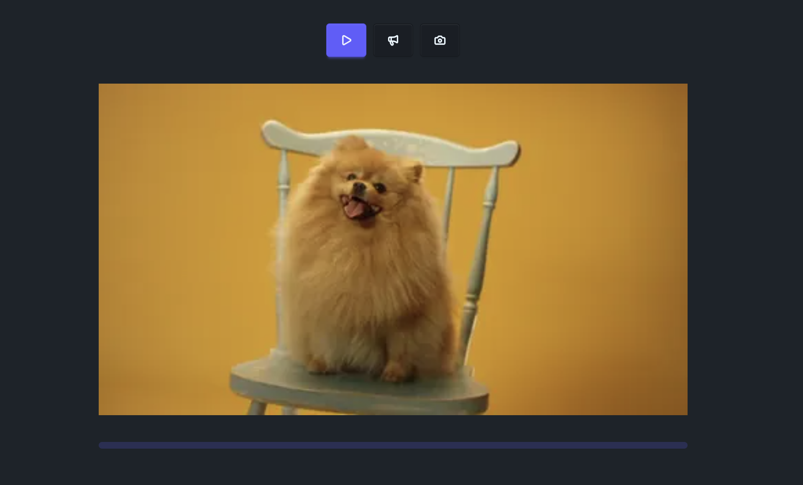

---
tags:
  - Exercice
  - Médias
---

# Woof

{.h-auto}

L'objectif de cet exercice est de **contrôler des médias audio et vidéo en JavaScript**, sans passer par les contrôles natifs du navigateur.

Il sera question de lancer et arrêter une lecture, faire jouer un son en boucle et rejouer un son depuis le début.

## Résultat attendu

{data-zoom-image}

[Site Web](https://tim-w3.github.io/woof-solution){ .md-button .md-button--primary }

## Médias fournis

Le dossier de départ contient déjà les médias, classés dans `src/assets/` :

| Fichier | Rôle |
| --- | --- |
| :material-video: `videos/chien.webm` | La vidéo |
| :material-image: `images/chien-poster.webp` | Une image d'aperçu de la vidéo (pour le défi *Image d'attente*) |
| :material-cast-audio: `audio/musique-jeu.mp3` | La musique en boucle |
| :material-cast-audio: `audio/klaxon.mp3` | Le klaxon |
| :material-cast-audio: `audio/photo.mp3` | L'obturateur de l'appareil photo |

??? question "Pourquoi `src/assets/` ici et `public/` ailleurs ?"

    * **`src/assets/`** : Vite **traite** le fichier au *build*. Il vérifie qu'il existe (le *build* échoue si le chemin est mauvais) et le renomme avec une empreinte (ex. : `chien-BQ4KQKhM.webm`), pour que le navigateur télécharge toujours la dernière version. C'est le bon choix pour les médias écrits dans une balise HTML standard (``, `<video>`, `<audio>`), comme dans cet exercice.
    * **`public/`** : Vite **copie** le fichier tel quel dans `dist/`, sans le vérifier ni le renommer. C'est le bon choix quand Vite ne peut pas voir le chemin : un attribut d'une balise qu'il ne connaît pas (le `src` de `<model-viewer>`) ou un chemin écrit dans une chaîne de caractères en JavaScript.

## Petits rappels

| Contrôle | Fonctionnalitées liées |
| --- | --- |
| Bouton de lecture d'un média | `paused`, `play()`, `pause()` |
| Lecture en boucle | l'attribut `loop` |
| Son qui recommence à chaque clic | `currentTime = 0`, puis `play()` |
| Flash blanc | GSAP, avec la propriété `autoAlpha` |

## Consignes

### Les médias avec leurs contrôles natifs

- [ ] Intégrer la vidéo avec les attributs `src` et `controls`
- [ ] Sous la vidéo, intégrer la musique avec les attributs `src` et `controls`
- [ ] Lancer `npx vite` et tester les deux lecteurs

  ??? quote "Observations"

      * Que permettent les contrôles natifs de la vidéo et de l'audio ?
      * Comparer leur apparence dans Chrome et dans Firefox. Ressemblent-ils au reste de la page ?
      * Peut-on lancer la vidéo et la musique **en même temps**, d'un seul clic ?

### Retrait des contrôles natifs

- [ ] Retirer l'attribut `controls` des deux balises `video` et `audio`
- [ ] Ajouter l'attribut `loop` à la vidéo **et** à la musique

  ??? quote "Observations"

    Sans `controls`, la vidéo n'affiche plus que sa première image, et la balise `<audio>` devient complètement **invisible**. 
    
    Les médias sont toujours là, mais plus rien ne permet de les démarrer. C'est là que le JavaScript entre en scène.

### HTML

Boutons

- [ ] Ajouter trois boutons HTML ayant un style de bouton DaisyUI.
- [ ] Pour chaque bouton, ajouter une icône (Lucide est déjà installé) :
    - le bouton play : ``
    - le bouton du klaxon : ``
    - le bouton de l'appareil photo : ``
- [ ] Pour placer les trois boutons côte à côte et les centrer, les entourer d'une `
` avec des classes Tailwind

Audio

- [ ] Ajouter les audio manquants : klaxon et appareil photo (toujours **sans** `controls`)

Autre 

- [ ] Ajouter une `
` qui couvrira tout l'écran en blanc. Ajouter ces classes Tailwind : 
  - `fixed`
  - `inset-0` : équivalent de `top: 0` + `left: 0` + `right: 0` + `bottom: 0`
  - `bg-white`
  - `invisible` : caché au chargement de la page
  - `pointer-events-none` : la souris ignore le div
- [ ] Donner à chaque élément l'`id` utilisé dans `src/main.js`, qui sélectionne déjà tous les éléments de la page : `film`, `musique`, `klaxon`, `photo`, `btn-lecture`, `btn-klaxon` et `btn-photo`

### Le bouton play (`src/main.js`)

- [ ] Au clic sur le bouton play, si `video.paused` lancer la vidéo **et** la musique avec `play()`. Sinon, mettre les deux en pause avec `pause()`
- [ ] Changer l'icône du bouton selon l'état, en remplaçant son contenu avec `innerHTML`. Pause = `''` Play = `''`
- [ ] Régler le `volume` de la musique autour de `0.4`

### Le klaxon et l'appareil photo (`src/main.js`)

- [ ] **Klaxon** : au clic, remettre `currentTime` à `0`, puis appeler `play()`. Cliquer plusieurs fois rapidement : le son doit repartir du début à chaque fois
- [ ] **Appareil photo** : même principe que le klaxon pour le son, puis déclencher le flash

### Le flash (`src/gsap.js`)

GSAP est déjà installé dans le dossier de départ.

- [ ] Dans `src/gsap.js`, compléter la fonction `flash()` en animant `#flash` de `autoAlpha: 1` à `autoAlpha: 0` en environ `0.6` seconde avec `gsap.fromTo()`
- [ ] Dans `main.js`, appeler `flash()` quand on clic sur le bouton de l'appareil photo.

## Défis

Pour aller plus loin, une fois l'exercice fonctionnel :

- [ ] **Image d'attente** : ajouter l'attribut `poster` à la vidéo, avec l'image `chien-poster.webp` fournie. Elle s'affiche tant que la vidéo n'a pas démarré
- [ ] **Raccourci clavier** : la barre d'espacement lance ou met en pause la vidéo et la musique, comme le bouton play
