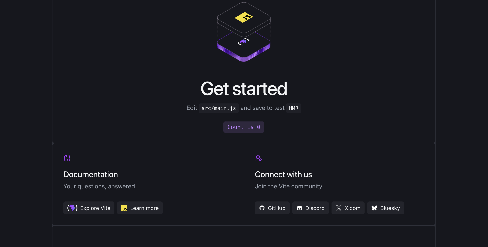
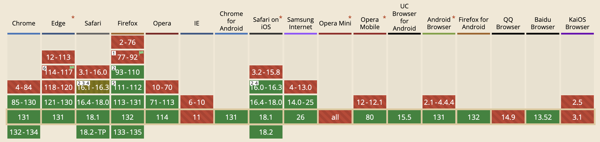
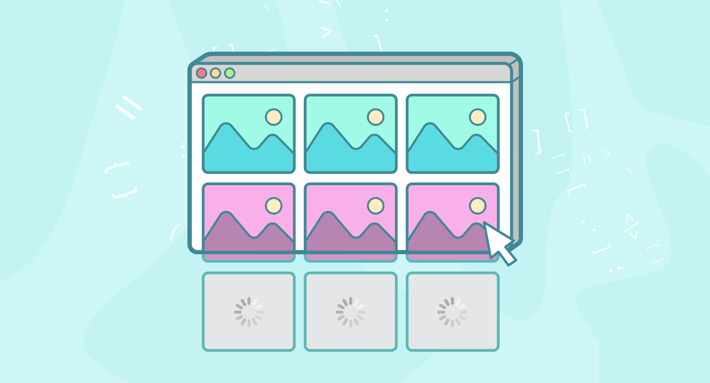
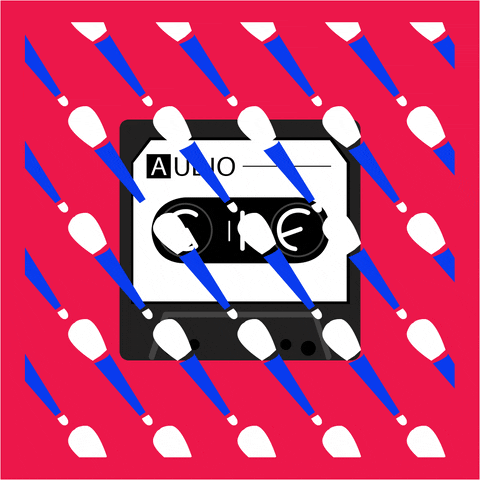

# Cours 8

*[GSAP]: GreenSock Animation Platform
*[npm]: Node Package Manager

## Vite

{.w-100}

Jusqu'à aujourd'hui nous avons utilisé, d'une manière un peu détournée, Vite pour compiler notre CSS. Étant donné qu'on amorce la portion JavaScript du cours, nous pourrons maintenant utiliser la manière plus conventionnelle.

### La vrai installation 😅

L'installation normale fonctionne avec une logique de Javascript par défaut qu'on a évité volontairement jusqu'à présent pour se concentrer sur le CSS.

Quand on va sur [vite.dev](https://vite.dev/), il est dailleurs indiqué d'installer vite avec la commande suivante : 

<div class="grid align-items-top" markdown>
```bash title="Installe vite dans un dossier « timmomo »"
npm create vite@latest timmomo
```

```bash title="Installe vite dans le dossier en cours"
npm create vite@latest .
```
</div>

Une série de questions vous sera posé. Choisir les options suivantes : 

* Select a framework : **Vanilla** 👈
* Select a variant : **JavaScript** 👈
* Install with npm and start now ? **Yes**

Le serveur Vite parti, vous devriez voir ceci dans le navigateur : 

{data-zoom-image}

### Structure d'un projet Vite

```txt
📁 timmomo
├── 📁 node_modules
├── 📁 public
│    ├── 🎆 favicon.svg
│    └── 🎆 icons.svg
├── 📁 src    
│    ├── 📁 assets
│    │    ├── 🎆 hero.png
│    │    ├── 🎆 javascript.svg
│    │    └── 🎆 vite.svg
│    ├── 📄 counter.js
│    ├── 📄 main.js
│    └── 📄 style.css
├── 📄 index.html
├── 📄 package.json
└── 📄 package-lock.json
```

!!! example "DEMO | Le nouveau paradigme 🧠"

    1. Regardons ensemble ce qui se passe dans le code initial et retirons ce qui ne nous intéresse pas
    1. Installons Taiwind et DaisyUi dans ce nouveau contexte.
      - Nouveauté 1 : `vite.config.js` et non `vite.config.mjs`
      - Nouveauté 2 : fichier css est chargé en javascript 🤯

<div class="grid grid-1-2" markdown>
  {.aspect-4-3}

  <small>Exercice - Vite</small><br>
  **[Vite Vanille](./activite/vite-default/index.md){.stretched-link .back}**
</div>

## Optimiser les médias 🎬

{.w-100}

En Web, si on ne prépare pas les médias, ceux-ci rendent la page lente et font fuir les visiteurs.

### Les formats d'image

Chaque format a son usage. La règle d'or&nbsp;: **le plus léger qui fait le travail**.

| Format | Idéal pour | Notes |
| :--- | :--- | :--- |
| `JPEG` | Photos | Compression avec pertes, pas de transparence |
| `PNG` | Images nettes, transparence | Plus lourd |
| `WebP` | **Remplace JPEG et PNG** | ~30 % plus léger, transparence, largement supporté |
| `AVIF` | Photos, encore plus léger | Le plus performant, support quasi universel en 2026 |
| `SVG` | Logos, icônes, formes | Vectoriel&nbsp;: net à toute taille |

[CanIUse.com<br>{data-zoom-image .w-50}](https://caniuse.com/?search=AVIF)

### Compresser, dimensionner et convertir les images

1. **Compresser** afin d'obtenir une version le plus allégée possible, sans grande perte de qualité
  - [Squoosh](https://squoosh.app/)
  - [TinyPng](https://tinypng.com/)
2. **Redimensionner** pour le contexte d'affichage. Ne servez jamais une image de 4000&nbsp;px pour l'afficher à 400&nbsp;px. Ça ralenti le chargement du site et prends du data inutilement sur les téléphones
  - Figma
  - Photoshop
  - [image-resizer](https://web-toolbox.dev/en/tools/image-resizer)
3. **Convertir** lorsqu'on veut optimiser la page Web
  - [ezgif : gif à webp](https://ezgif.com/gif-to-webp)
  - [ezgif : jpg à avif](https://ezgif.com/jpg-to-avif)
  - [ezgif : png à avif](https://ezgif.com/apng-to-avif)

### Chargement « paresseux » d'une image

{.w-50 data-zoom-image}

L'attribut `loading="lazy"` diffère le chargement des images **hors écran** jusqu'à ce qu'on approche par le défilement. Gratuit et efficace.

```html

```

### La vidéo

{.w-50}

**MP4** et **WebM** sont les deux standards Web. 

À des fins de compatibilité, on peut donner plusieurs choix au navigateur et celui-ci choisi en premier ce qu'il sait lire. Par exemple :

```html
<video controls poster="./assets/images/apercu.webp" width="640">
  <source src="./assets/videos/demo.webm" type="video/webm">
  <source src="./assets/videos/demo.mp4" type="video/mp4">
  Votre navigateur ne supporte pas la vidéo.
</video>
```

!!! warning "L'autoplay exige le silence"

    Pour garantir le démarrage automatique d'un fond vidéo sur tous les appareils (ordinateur et mobile), il faut combiner les attributs `muted` et `playsinline` pour répondre aux restrictions des navigateurs et d'Apple. 

    ```html
    <video autoplay loop muted playsinline>
      <source src="demo.webm" type="video/webm">
    </video>

    ```

#### Compresser et convertir une vidéo

Une vidéo sortie d'un téléphone ou d'un logiciel de montage pèse souvent plusieurs centaines de Mo. Pour le Web, une vidéo de fond de 10 à 20 secondes devrait peser **moins de 5 Mo**.

1. **Compresser et redimensionner**
  - [HandBrake](https://handbrake.fr/)
  - [DaVinci Resolve](https://www.blackmagicdesign.com/products/davinciresolve)
  - [ezgif : vidéo vers WebM](https://ezgif.com/video-to-webm)
2. **Choisir le bon format**
  - **MP4** (codec H.264)&nbsp;: lu partout, y compris sur les vieux appareils.
  - **WebM** (codec VP9)&nbsp;: plus léger, lu par tous les navigateurs modernes.
  - Pour les curieux&nbsp;: le codec **AV1**, encore plus efficace, peut remplacer VP9 dans un WebM
3. **Retirer le son** d'une vidéo de fond (`muted`)&nbsp;: c'est du poids inutile

!!! tip "Vidéos d'une minute et +"

    Mieux vaut intégrer la vidéo depuis **YouTube** ou **Vimeo** avec un `<iframe>`. Ces plateformes adaptent la qualité à la connexion de chaque visiteur et n'utilise pas la bande passante de votre serveur.

### L'audio

{.w-50}

Mêmes principes&nbsp;: **MP3** (universel) et **OGG/Opus** ou **WebM** (plus légers). On peut aussi offrir plusieurs sources.

```html
<audio controls>
  <source src="./assets/audio/theme.webm" type="audio/webm">
  <source src="./assets/audio/theme.mp3" type="audio/mpeg">
</audio>
```

### Classement et nommage

| Bonne pratique | Exemple |
| :--- | :--- |
| Un dossier par type | `images/`, `videos/`, `audio/` |
| Minuscules, tirets | `hero-accueil.webp` (pas `Hero Accueil.PNG`) |
| Pas d'accents ni d'espaces | `plan-cegep.svg` (pas `plán cégep.svg`) |
| Noms descriptifs | `equipe-2026.webp` (pas `IMG_2381.jpg`) |

---

<div class="grid grid-1-2" markdown>
  {.aspect-4-3}

  <small>Exercice - Vite et médias</small><br>
  **[Momo](./activite/momo/index.md){.stretched-link .back}**
</div>

## GSAP

{.h-auto}

**[GSAP](https://gsap.com/)** est une bibliothèque JavaScript dédiée à l'animation Web. 

### Animer, mais animer quoi ?

GSAP peut animer presque n'importe quelle propriété CSS :

| Propriété GSAP | Effet |
| :--- | :--- |
| `x`, `y` | Déplacement horizontal / vertical (via `transform`) |
| `rotation` | Rotation en degrés |
| `scale` | Mise à l'échelle |
| `opacity` | Transparence |
| `backgroundColor` | Couleur de fond |
| `width` / `height` | Dimensions |

??? question "`x` plutôt que `left` ?"

    Oui. Pour déplacer un élément, c'est mieux `x`/`y` (qui utilisent `transform`) que `left`/`top` pour la fluidité et la performance.

### Comment animer ?

Avec ce qu'on appelle un **_tween_** (vient de « be **tween** »). C'est une animation qui calcule toutes les valeurs **entre** deux points.

| Méthode | Autrement dit |
| --- | --- |
| [`gsap.to()`](https://gsap.com/docs/v3/GSAP/gsap.to()) | « va vers là » |
| [`gsap.from()`](https://gsap.com/docs/v3/GSAP/gsap.from()) | « viens de là » |
| [`gsap.fromTo()`](https://gsap.com/docs/v3/GSAP/gsap.fromTo()) | « de là à là » |

<p class="codepen" data-theme-id="50173" data-height="300" data-pen-title="gsap.to()" data-version="2" data-default-tab="result" data-slug-hash="ZYeRMag" data-user="tim-momo" style="height: 300px; box-sizing: border-box; display: flex; align-items: center; justify-content: center; border: 2px solid; margin: 1em 0; padding: 1em;">
  <span>See the Pen <a href="https://codepen.io/editor/tim-momo/pen/01a16019-91ca-7bbc-936d-0c10c14f71f9">
  gsap.to()</a> by TIM Montmorency (<a href="https://codepen.io/tim-momo">@tim-momo</a>)
  on <a href="https://codepen.io">CodePen</a>.</span>
</p>
<script async src="https://public.codepenassets.com/embed/index.js"></script>

```js title="Anatomie d'un tween"
gsap.to(".boite", {   
  x: 200,             
  rotation: 90,
  duration: 1.5         
})
```

## Installation

```bash title="Terminal"
npm install gsap
```

Créer le fichier suivant : 

```js title="src/gsap.js"
import gsap from "gsap"

export function lancerAnimations() {

  // Code GSAP ici

  // Exemple : 
  // gsap.from(".boite", { x: 200, rotation: 90, duration: 1.5 })
  
}
```

Importer notre fichier gsap dans le main :

```js title="src/main.js"
import "./style.css"
import { lancerAnimations } from "./gsap.js"

lancerAnimations()
```

Le HTML à animer, lui, peut aller soit dans `index.html` ou dans `main.js` (avec `innerHTML`, comme dans le projet de départ de Vite). Ça revient au même.

=== "⭐️ src/main.js"

    ```js title="src/main.js"
    import "./style.css"
    import { lancerAnimations } from "./gsap.js"

    document.querySelector('#app').innerHTML = `
    <div class="boite"></div>
    `

    lancerAnimations()
    ```

=== "index.html (fonctionne aussi)"

    ```html title="index.html"
    <body>
      <div class="boite"></div>
      <script type="module" src="/src/main.js"></script>
    </body>
    ```

## `from()`, `fromTo()` et `set()`

`to()` part de l'état actuel de l'élément. Les autres méthodes changent le point de départ.

### `from()`

Les propriétés **commencent** à la valeur indiquée, puis reviennent vers leur état final (tel qu'il est dans le CSS). Idéal pour faire **apparaître** un élément.

<div class="grid" markdown>
```js title="Syntaxe"
gsap.from(".rond", {
  x: -300,
  duration: 1
})
```

<iframe class="aspect-3-2" height="300" style="width: 100%;" scrolling="no" title="GSAP - from()" src="https://codepen.io/tim-momo/embed/WNVOoLK/087c8d54f40078d64a89bf64eade1d2f?default-tab=result&theme-id=50173" frameborder="no" loading="lazy" allowtransparency="true" allowfullscreen="true">
  See the Pen <a href="https://codepen.io/tim-momo/pen/WNVOoLK/087c8d54f40078d64a89bf64eade1d2f">
  GSAP - from()</a> by TIM Montmorency (<a href="https://codepen.io/tim-momo">@tim-momo</a>)
  on <a href="https://codepen.io">CodePen</a>.
</iframe>
</div>

### `fromTo()`

On définit **les deux** extrémités&nbsp;: un premier objet pour le départ, un second pour l'arrivée (c'est aussi lui qui reçoit `duration`, `ease`, etc.).

<div class="grid" markdown>
```js title="Syntaxe"
gsap.fromTo(".barre",
  { x: 0, rotation: 0 },              // départ
  { x: 300, rotation: 90, duration: 2 } // arrivée
)
```

<iframe class="aspect-3-2" height="300" style="width: 100%;" scrolling="no" title="GSAP - fromTo()" src="https://codepen.io/tim-momo/embed/ExqXNrx/7f1f9010b174671e88f5f671802891a4?default-tab=result&theme-id=50173" frameborder="no" loading="lazy" allowtransparency="true" allowfullscreen="true">
  See the Pen <a href="https://codepen.io/tim-momo/pen/ExqXNrx/7f1f9010b174671e88f5f671802891a4">
  GSAP - fromTo()</a> by TIM Montmorency (<a href="https://codepen.io/tim-momo">@tim-momo</a>)
  on <a href="https://codepen.io">CodePen</a>.
</iframe>
</div>

### [`set()`](https://gsap.com/docs/v3/GSAP/gsap.set())

Un `to()` **instantané**, sans animation 😜. Pratique pour placer un élément avant de l'animer.

```js
gsap.set(".voiture", { x: -400 })
```

!!! info "Les unités"

    Un nombre (`x: 400`) est interprété en **pixels**. Pour une autre unité, on utilise une chaîne de caractères&nbsp;: `x: "50%"`, `rotation: "1turn"`, `width: "20vw"`.

## Les paramètres d'un tween

Le deuxième argument est un **objet de configuration** (du JavaScript, comme ceux vus dans le camp d'entraînement 😉). En plus des propriétés animées, il accepte des paramètres&nbsp;:

| Paramètre | Rôle |
| :--- | :--- |
| `duration` | Durée en secondes (`0.5` par défaut) |
| `delay` | Attente avant de démarrer |
| `repeat` | Nombre de répétitions (`-1` = infini) |
| `repeatDelay` | Pause entre chaque répétition |
| `yoyo` | Repart en sens inverse à chaque répétition |
| `ease` | Courbe d'accélération (voir plus bas) |
| `onComplete` | Fonction appelée à la fin |

```js title="Exemple complet"
gsap.to(".carte", {
  // Propriétés animées
  y: -20,
  rotation: 5,

  // Paramètres
  duration: 0.6,
  delay: 1,
  repeat: -1,
  yoyo: true,
  ease: "power1.inOut",

  // Fonction de rappel
  onComplete: () => console.log("Terminé !")
})
```

??? question "Pourquoi le `onComplete` ne s'affiche jamais ici ?"

    Avec `repeat: -1`, l'animation ne se termine… jamais. Le `onComplete` n'est donc jamais appelé.

## Les courbes d'accélération

Le lissage (_ease_) décrit **comment** l'animation accélère et ralentit. C'est ce qui distingue une animation robotique d'une animation vivante.

<iframe class="aspect-1-1" height="300" style="width: 100%;" scrolling="no" title="GSAP - ease" src="https://codepen.io/tim-momo/embed/QWeOrgo/9db303ae98b0cef97b5d8e699930c6e6?default-tab=result&editable=true&theme-id=50173" frameborder="no" loading="lazy" allowtransparency="true" allowfullscreen="true">
  See the Pen <a href="https://codepen.io/tim-momo/pen/QWeOrgo/9db303ae98b0cef97b5d8e699930c6e6">
  GSAP - ease</a> by TIM Montmorency (<a href="https://codepen.io/tim-momo">@tim-momo</a>)
  on <a href="https://codepen.io">CodePen</a>.
</iframe>

[GSAP | Easing tool](https://gsap.com/docs/v3/Eases)

<!-- !!! tip "Une boucle sans à-coups"

    Pour un mouvement qui tourne en boucle à vitesse régulière (une roue, un défilement continu), utilisez `ease: "none"`. Sinon, l'élément ralentit et repart à chaque répétition. -->

## Exercices

<!-- <div class="grid grid-1-2" markdown>
  {.aspect-4-3}

  <small>Exercice - GSAP</small><br>
  **[Automobile jaune](./exercices/gsap-auto1.md){.stretched-link .back}**
</div>

<div class="grid grid-1-2" markdown>
  {.aspect-4-3}

  <small>Exercice - GSAP</small><br>
  **[Automobile turquoise](./exercices/gsap-auto2.md){.stretched-link .back}**
</div> -->


<div class="grid grid-1-2" markdown>
  {.aspect-4-3}

  <small>Exercice - GSAP</small><br>
  **[Truck](./exercices/monster-truck/index.md){.stretched-link .back}**
</div>
