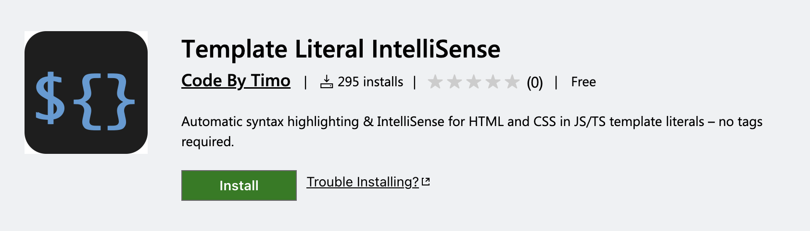
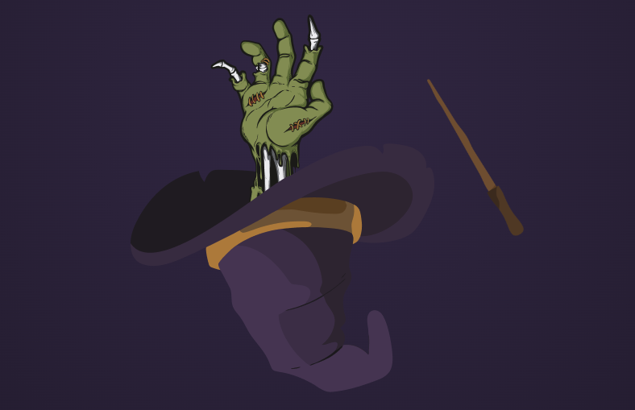

# Cours 9

## Retour sur les exercices

**HTML > HTML** vs. **JS > HTML**

---

<figure markdown>
[{.w-66}](https://marketplace.visualstudio.com/items?itemName=CodeByTimo.template-literals)

<figcaption>Surlignage automatique de la syntaxe et IntelliSense pour HTML et CSS dans les littéraux de modèle JavaScript</figcaption>
</figure>

## GSAP

{.h-auto}

**[GSAP](https://gsap.com/)** est une bibliothèque JavaScript dédiée à l'animation Web. 

### Animer, mais animer quoi ?

GSAP peut animer presque n'importe quelles propriétés CSS :

| Propriété GSAP | Effet |
| :--- | :--- |
| `x`, `y` | Déplacement horizontal / vertical (via `transform`) |
| `rotation` | Rotation en degrés |
| `scale` | Mise à l'échelle |
| `opacity` | Transparence |
| `backgroundColor` | Couleur de fond |
| `width` / `height` | Dimensions |

??? note "Quelques raccourcis de transformation supplémentaires"

    | Propriété GSAP | Équivalent CSS |
    | :--- | :--- |
    | `xPercent: 50` | `transform: translateX(50%)` |
    | `yPercent: 50` | `transform: translateY(50%)` |
    | `scaleX: 2` / `scaleY: 2` | `transform: scaleX(2)` / `scaleY(2)` |
    | `skew: 30` | `transform: skew(30deg)` |
    | `transformOrigin: "center 40%"` | `transform-origin: center 40%` |
    | `autoAlpha: 0` | `opacity: 0` **et** `visibility: hidden` |

<!-- !!! tip "`autoAlpha` plutôt qu'`opacity`"

    Un élément à `opacity: 0` est invisible, mais toujours cliquable. `autoAlpha` ajoute `visibility: hidden` lorsque la valeur atteint `0`, puis le remet à `visible` dès que la valeur remonte. C'est le bon choix pour faire apparaître ou disparaître un élément. -->

!!! info "Les propriétés CSS s'écrivent en _camelCase_"

    En JavaScript, le trait d'union est interdit dans un nom de propriété. On retire donc le `-` et on met la lettre suivante en majuscule&nbsp;: `background-color` devient `backgroundColor`, `border-radius` devient `borderRadius`, `font-size` devient `fontSize`.

<!-- ??? question "`x` plutôt que `left` ?"

    Oui. Pour déplacer un élément, c'est mieux `x`/`y` (qui utilisent `transform`) que `left`/`top` pour la fluidité et la performance. -->

### Comment animer ?

Avec ce qu'on appelle un **_tween_** (vient de « be **tween** »). C'est une animation qui calcule toutes les valeurs **entre** deux points.

<p class="codepen" data-theme-id="50173" data-height="300" data-pen-title="gsap.to()" data-version="2" data-default-tab="result" data-slug-hash="ZYeRMag" data-user="tim-momo" style="height: 300px; box-sizing: border-box; display: flex; align-items: center; justify-content: center; border: 2px solid; margin: 1em 0; padding: 1em;">
  <span>See the Pen <a href="https://codepen.io/editor/tim-momo/pen/01a16019-91ca-7bbc-936d-0c10c14f71f9">
  gsap.to()</a> by TIM Montmorency (<a href="https://codepen.io/tim-momo">@tim-momo</a>)
  on <a href="https://codepen.io">CodePen</a>.</span>
</p>
<script async src="https://public.codepenassets.com/embed/index.js"></script>

```js title="Anatomie d'un tween"
gsap.to(".boite", {   
  x: 200,             
  rotation: 90,
  duration: 1.5         
})
```

### Installation

```bash title="Terminal"
npm install gsap
```

On pourrait écrire directement dans `src/main.js`, mais afin de bien structurer notre code il est préférable créer un nouveau fichier `src/gsap.js`.

```js title="src/gsap.js"
import gsap from "gsap"

export function gsapAnimations() {

  // Code GSAP ici. Exemple :

  // gsap.from(".boite", { 
  //   x: 200, 
  //   rotation: 90, 
  //   duration: 1.5 
  // })
  
}
```

Importer notre fichier gsap dans `main.js` :

``` js title="src/main.js"
import "./style.css"
import { gsapAnimations } from "./gsap.js"

gsapAnimations()
```

Le HTML à animer, lui, peut aller soit dans `index.html` ou dans `main.js` (avec `innerHTML`, comme dans le projet de départ de Vite). Ça revient au même.

=== "HTML > JavsScript"

    ``` js title="src/main.js" hl_lines="4-6"
    import "./style.css"
    import { gsapAnimations } from "./gsap.js"

    document.querySelector('#app').innerHTML = `
    <div class="boite"></div>
    `;

    gsapAnimations();
    ```

=== "HTML > HTML"

    ``` html title="index.html" hl_lines="2"
    <body>
      <div class="boite"></div>
      <script type="module" src="/src/main.js"></script>
    </body>
    ```

### Les Tweens

| Méthode | Simplement dit |
| --- | --- |
| [`gsap.to()`](https://gsap.com/docs/v3/GSAP/gsap.to()) | « va vers là » |
| [`gsap.from()`](https://gsap.com/docs/v3/GSAP/gsap.from()) | « viens de là » |
| [`gsap.fromTo()`](https://gsap.com/docs/v3/GSAP/gsap.fromTo()) | « de là à là » |
| [`gsap.set()`](https://gsap.com/docs/v3/GSAP/gsap.set()) | « va là, sans animation » |

#### `to()`

De l'état initial aux valeurs spécifiées

<iframe src="https://tim-montmorency.com/Fragment/v/?ex=gsap-to-copie&onglets=js,resultat&modifiable=1&disposition=cote&boutons=rejouer" class="aspect-3-1" style="width:100%;border:0" loading="lazy"></iframe>

<!-- <div class="grid" markdown>

gsap.to(".rond", {
  x: 300,
  duration: 1
})


<p class="codepen" data-theme-id="50173" data-height="300" data-pen-title="GSAP - to()" data-default-tab="result" data-slug-hash="zYgzoEX" data-user="tim-momo" data-token="89bb58bd6ed29bc7a703a1ce460ff161" style="height: 300px; box-sizing: border-box; display: flex; align-items: center; justify-content: center; border: 2px solid; margin: 1em 0; padding: 1em;">
  <span>See the Pen <a href="https://codepen.io/tim-momo/pen/zYgzoEX/89bb58bd6ed29bc7a703a1ce460ff161">
  GSAP - to()</a> by TIM Montmorency (<a href="https://codepen.io/tim-momo">@tim-momo</a>)
  on <a href="https://codepen.io">CodePen</a>.</span>
</p>
<script async src="https://public.codepenassets.com/embed/index.js"></script>
</div> -->

#### `from()`

Garde en mémoire l'état initial, mais commence aux valeurs spécifiées vers l'état initial

<iframe src="https://tim-montmorency.com/Fragment/v/?ex=gsap-from&onglets=js,resultat&modifiable=1&disposition=cote&boutons=rejouer" class="aspect-3-1" style="width:100%;border:0" loading="lazy"></iframe>

<!-- <div class="grid" markdown>

gsap.from(".rond", {
  x: -300,
  duration: 1
})


<iframe class="aspect-3-2" height="300" style="width: 100%;" scrolling="no" title="GSAP - from()" src="https://codepen.io/tim-momo/embed/WNVOoLK/087c8d54f40078d64a89bf64eade1d2f?default-tab=result&theme-id=50173" frameborder="no" loading="lazy" allowtransparency="true" allowfullscreen="true">
  See the Pen <a href="https://codepen.io/tim-momo/pen/WNVOoLK/087c8d54f40078d64a89bf64eade1d2f">
  GSAP - from()</a> by TIM Montmorency (<a href="https://codepen.io/tim-momo">@tim-momo</a>)
  on <a href="https://codepen.io">CodePen</a>.
</iframe>
</div> -->

#### `fromTo()`

On définit l'état initial et la destination dans la même commande. 

<iframe src="https://tim-montmorency.com/Fragment/v/?ex=gsap-fromto&onglets=js,resultat&modifiable=1&disposition=cote" class="aspect-2-1" style="width:100%;border:0" loading="lazy"></iframe>

<!-- gsap.fromTo(".barre",
  { x: 0, rotation: 0 },                // départ
  { x: 300, rotation: 90, duration: 2 } // arrivée
)

<iframe class="aspect-3-2" height="300" style="width: 100%;" scrolling="no" title="GSAP - fromTo()" src="https://codepen.io/tim-momo/embed/ExqXNrx/7f1f9010b174671e88f5f671802891a4?default-tab=result&theme-id=50173" frameborder="no" loading="lazy" allowtransparency="true" allowfullscreen="true">
  See the Pen <a href="https://codepen.io/tim-momo/pen/ExqXNrx/7f1f9010b174671e88f5f671802891a4">
  GSAP - fromTo()</a> by TIM Montmorency (<a href="https://codepen.io/tim-momo">@tim-momo</a>)
  on <a href="https://codepen.io">CodePen</a>.
</iframe> -->


#### [`set()`](https://gsap.com/docs/v3/GSAP/gsap.set())

Équivalent à un `to()`, mais instantané.

<iframe src="https://tim-montmorency.com/Fragment/v/?ex=gsap-set&onglets=js,resultat&modifiable=1&disposition=cote&boutons=rejouer" class="aspect-3-1" style="width:100%;border:0" loading="lazy"></iframe>

### Les unités

Par défaut, GSAP utilise les pixels (px) et les degrés pour les transformations, mais vous pouvez utiliser d'autres unités comme le `vw`, les radians, etc.

``` js
x: 200,       // Place l'élément précisément à 200px du côté gauche
x: "+=200"    // Place l'élément à 200px de plus que sa position
x: '50vw'     // Place l'élément au milieu de l'écran
  
rotation: 360       // Utilise les degrés pour la rotation
rotation: "1.25rad" // Utilise les radians pour la rotation (2pi = 360 degrés)
```

### Le point de pivot

{.w-50 .h-auto}

Une rotation (ou une mise à l'échelle) se fait toujours autour d'un **point de pivot**. Par défaut, ce point est le **centre** de l'élément. 

Le point de pivot se règle avec la propriété CSS `transform-origin`, ou avec son équivalent GSAP `transformOrigin`.

```js
gsap.to(".aiguille", {
  //...
  transformOrigin: "left center",  
})
```

### Propriétés spéciales

| Paramètre     | Rôle |
| :------------ | :--- |
| `duration`    | Durée en secondes |
| `delay`       | Attente avant de démarrer |
| `repeat`      | Nombre de répétitions (`-1` = infini) |
| `repeatDelay` | Pause entre chaque répétition |
| `yoyo`        | Repart en sens inverse à chaque répétition |
| `ease`        | Courbe d'accélération (voir plus bas) |

```js title="Exemple complet"
gsap.to(".carte", {
  // Propriétés animées
  y: -20,
  rotation: 5,

  // Paramètres
  duration: 0.6,
  delay: 1,
  repeat: -1,
  repeatDelay: 1,
  yoyo: true
})
```

[GSAP Cheat Sheet](https://gsap.com/cheatsheet)

## Les courbes d'accélération

Le lissage (_ease_) décrit **comment** l'animation accélère et ralentit. C'est ce qui distingue une animation robotique d'une animation vivante. [GSAP | Ease Visualizer](https://gsap.com/docs/v3/Eases)

<iframe class="aspect-1-1" height="300" style="width: 100%;" scrolling="no" title="GSAP - ease" src="https://codepen.io/tim-momo/embed/QWeOrgo/9db303ae98b0cef97b5d8e699930c6e6?default-tab=result&editable=true&theme-id=50173" frameborder="no" loading="lazy" allowtransparency="true" allowfullscreen="true">
  See the Pen <a href="https://codepen.io/tim-momo/pen/QWeOrgo/9db303ae98b0cef97b5d8e699930c6e6">
  GSAP - ease</a> by TIM Montmorency (<a href="https://codepen.io/tim-momo">@tim-momo</a>)
  on <a href="https://codepen.io">CodePen</a>.
</iframe>

## Exercices Tween

<div class="grid grid-1-2" markdown>
  {.aspect-4-3}

  <small>Exercice - GSAP</small><br>
  **[Zombi](./activite/zombi/index.md){.stretched-link .back}**
</div>

<div class="grid grid-1-2" markdown>
  {.aspect-4-3}

  <small>Exercice - GSAP</small><br>
  **[J'en ai mon truck](./activite/truck/index.md){.stretched-link .back}**
</div>

## Les _timelines_

Un tween anime une chose. Une **[timeline](https://gsap.com/docs/v3/GSAP/Timeline)** enchaîne **plusieurs** tweens, comme un scénario. Par défaut, chaque tween attend la fin du précédent.

```js
gsap.timeline()
  .to(".boite", { x: 100, duration: 1 })        // démarre à 0 s
  .to(".boite", { rotation: 360, duration: 1 }) // démarre après le premier
  .to(".boite", { y: 100, duration: 1 })        // démarre après le deuxième
```

### Le paramètre de position

Un 3<sup>e</sup> argument ajuste le moment où un tween démarre dans la timeline&nbsp;:

| Position | Signifie |
| :--- | :--- |
| _(rien)_ | À la suite du tween précédent |
| `"+=0.5"` | 0,5 s **après** la fin du précédent |
| `"-=0.5"` | 0,5 s **avant** la fin du précédent (chevauchement) |
| `"<"` | En même temps que le **début** du précédent |

```js
gsap.timeline()
  .to(".boite", { x: 100, duration: 1 })
  .to(".boite", { rotation: 360, duration: 1 }, "-=0.5")
  .to(".ombre", { opacity: 0, duration: 1 }, "<")
  .to(".boite", { y: 100, duration: 1 }, "+=0.2")
```

## Exercice Timeline

<div class="grid grid-1-2" markdown>
  {.aspect-4-3}

  <small>Exercice - GSAP</small><br>
  **[Magie 🪄](./activite/magie/index.md){.stretched-link .back}**
</div>
