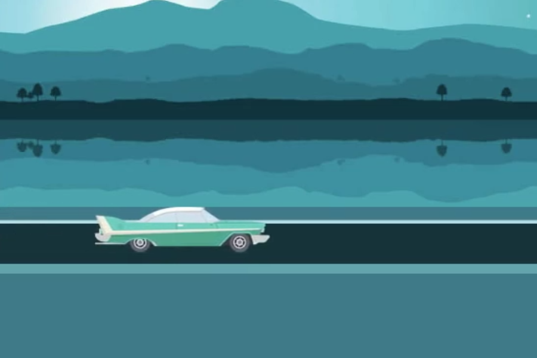

# Cours 9

[STOP]

## Retour sur les exercices

* Note sur le HTML dans le HTML, ca marche, mais ça ne permet pas d'ajouter des variables

## GSAP

{.h-auto}

**[GSAP](https://gsap.com/)** est une bibliothèque JavaScript dédiée à l'animation Web. 

### Animer, mais animer quoi ?

GSAP peut animer presque n'importe quelle propriété CSS :

| Propriété GSAP | Effet |
| :--- | :--- |
| `x`, `y` | Déplacement horizontal / vertical (via `transform`) |
| `rotation` | Rotation en degrés |
| `scale` | Mise à l'échelle |
| `opacity` | Transparence |
| `backgroundColor` | Couleur de fond |
| `width` / `height` | Dimensions |

??? question "`x` plutôt que `left` ?"

    Oui. Pour déplacer un élément, c'est mieux `x`/`y` (qui utilisent `transform`) que `left`/`top` pour la fluidité et la performance.

### Comment animer ?

Avec ce qu'on appelle un **_tween_** (vient de « be **tween** »). C'est une animation qui calcule toutes les valeurs **entre** deux points.

| Méthode | Autrement dit |
| --- | --- |
| [`gsap.to()`](https://gsap.com/docs/v3/GSAP/gsap.to()) | « va vers là » |
| [`gsap.from()`](https://gsap.com/docs/v3/GSAP/gsap.from()) | « viens de là » |
| [`gsap.fromTo()`](https://gsap.com/docs/v3/GSAP/gsap.fromTo()) | « de là à là » |

<p class="codepen" data-theme-id="50173" data-height="300" data-pen-title="gsap.to()" data-version="2" data-default-tab="result" data-slug-hash="ZYeRMag" data-user="tim-momo" style="height: 300px; box-sizing: border-box; display: flex; align-items: center; justify-content: center; border: 2px solid; margin: 1em 0; padding: 1em;">
  <span>See the Pen <a href="https://codepen.io/editor/tim-momo/pen/01a16019-91ca-7bbc-936d-0c10c14f71f9">
  gsap.to()</a> by TIM Montmorency (<a href="https://codepen.io/tim-momo">@tim-momo</a>)
  on <a href="https://codepen.io">CodePen</a>.</span>
</p>
<script async src="https://public.codepenassets.com/embed/index.js"></script>

```js title="Anatomie d'un tween"
gsap.to(".boite", {   
  x: 200,             
  rotation: 90,
  duration: 1.5         
})
```

## Installation

```bash title="Terminal"
npm install gsap
```

Créer le fichier suivant : 

```js title="src/gsap.js"
import gsap from "gsap"

export function lancerAnimations() {

  // Code GSAP ici

  // Exemple : 
  // gsap.from(".boite", { x: 200, rotation: 90, duration: 1.5 })
  
}
```

Importer notre fichier gsap dans le main :

```js title="src/main.js"
import "./style.css"
import { lancerAnimations } from "./gsap.js"

lancerAnimations()
```

Le HTML à animer, lui, peut aller soit dans `index.html` ou dans `main.js` (avec `innerHTML`, comme dans le projet de départ de Vite). Ça revient au même.

=== "⭐️ src/main.js"

    ```js title="src/main.js"
    import "./style.css"
    import { lancerAnimations } from "./gsap.js"

    document.querySelector('#app').innerHTML = `
    <div class="boite"></div>
    `

    lancerAnimations()
    ```

=== "index.html (fonctionne aussi)"

    ```html title="index.html"
    <body>
      <div class="boite"></div>
      <script type="module" src="/src/main.js"></script>
    </body>
    ```

## `from()`, `fromTo()` et `set()`

`to()` part de l'état actuel de l'élément. Les autres méthodes changent le point de départ.

### `from()`

Les propriétés **commencent** à la valeur indiquée, puis reviennent vers leur état final (tel qu'il est dans le CSS). Idéal pour faire **apparaître** un élément.

<div class="grid" markdown>
```js title="Syntaxe"
gsap.from(".rond", {
  x: -300,
  duration: 1
})
```

<iframe class="aspect-3-2" height="300" style="width: 100%;" scrolling="no" title="GSAP - from()" src="https://codepen.io/tim-momo/embed/WNVOoLK/087c8d54f40078d64a89bf64eade1d2f?default-tab=result&theme-id=50173" frameborder="no" loading="lazy" allowtransparency="true" allowfullscreen="true">
  See the Pen <a href="https://codepen.io/tim-momo/pen/WNVOoLK/087c8d54f40078d64a89bf64eade1d2f">
  GSAP - from()</a> by TIM Montmorency (<a href="https://codepen.io/tim-momo">@tim-momo</a>)
  on <a href="https://codepen.io">CodePen</a>.
</iframe>
</div>

### `fromTo()`

On définit **les deux** extrémités&nbsp;: un premier objet pour le départ, un second pour l'arrivée (c'est aussi lui qui reçoit `duration`, `ease`, etc.).

<div class="grid" markdown>
```js title="Syntaxe"
gsap.fromTo(".barre",
  { x: 0, rotation: 0 },              // départ
  { x: 300, rotation: 90, duration: 2 } // arrivée
)
```

<iframe class="aspect-3-2" height="300" style="width: 100%;" scrolling="no" title="GSAP - fromTo()" src="https://codepen.io/tim-momo/embed/ExqXNrx/7f1f9010b174671e88f5f671802891a4?default-tab=result&theme-id=50173" frameborder="no" loading="lazy" allowtransparency="true" allowfullscreen="true">
  See the Pen <a href="https://codepen.io/tim-momo/pen/ExqXNrx/7f1f9010b174671e88f5f671802891a4">
  GSAP - fromTo()</a> by TIM Montmorency (<a href="https://codepen.io/tim-momo">@tim-momo</a>)
  on <a href="https://codepen.io">CodePen</a>.
</iframe>
</div>

### [`set()`](https://gsap.com/docs/v3/GSAP/gsap.set())

Un `to()` **instantané**, sans animation 😜. Pratique pour placer un élément avant de l'animer.

```js
gsap.set(".voiture", { x: -400 })
```

!!! info "Les unités"

    Un nombre (`x: 400`) est interprété en **pixels**. Pour une autre unité, on utilise une chaîne de caractères&nbsp;: `x: "50%"`, `rotation: "1turn"`, `width: "20vw"`.

## Les paramètres d'un tween

Le deuxième argument est un **objet de configuration** (du JavaScript, comme ceux vus dans le camp d'entraînement 😉). En plus des propriétés animées, il accepte des paramètres&nbsp;:

| Paramètre | Rôle |
| :--- | :--- |
| `duration` | Durée en secondes (`0.5` par défaut) |
| `delay` | Attente avant de démarrer |
| `repeat` | Nombre de répétitions (`-1` = infini) |
| `repeatDelay` | Pause entre chaque répétition |
| `yoyo` | Repart en sens inverse à chaque répétition |
| `ease` | Courbe d'accélération (voir plus bas) |
| `onComplete` | Fonction appelée à la fin |

```js title="Exemple complet"
gsap.to(".carte", {
  // Propriétés animées
  y: -20,
  rotation: 5,

  // Paramètres
  duration: 0.6,
  delay: 1,
  repeat: -1,
  yoyo: true,
  ease: "power1.inOut",

  // Fonction de rappel
  onComplete: () => console.log("Terminé !")
})
```

??? question "Pourquoi le `onComplete` ne s'affiche jamais ici ?"

    Avec `repeat: -1`, l'animation ne se termine… jamais. Le `onComplete` n'est donc jamais appelé.

## Les courbes d'accélération

Le lissage (_ease_) décrit **comment** l'animation accélère et ralentit. C'est ce qui distingue une animation robotique d'une animation vivante.

<iframe class="aspect-1-1" height="300" style="width: 100%;" scrolling="no" title="GSAP - ease" src="https://codepen.io/tim-momo/embed/QWeOrgo/9db303ae98b0cef97b5d8e699930c6e6?default-tab=result&editable=true&theme-id=50173" frameborder="no" loading="lazy" allowtransparency="true" allowfullscreen="true">
  See the Pen <a href="https://codepen.io/tim-momo/pen/QWeOrgo/9db303ae98b0cef97b5d8e699930c6e6">
  GSAP - ease</a> by TIM Montmorency (<a href="https://codepen.io/tim-momo">@tim-momo</a>)
  on <a href="https://codepen.io">CodePen</a>.
</iframe>

[GSAP | Easing tool](https://gsap.com/docs/v3/Eases)

<!-- !!! tip "Une boucle sans à-coups"

    Pour un mouvement qui tourne en boucle à vitesse régulière (une roue, un défilement continu), utilisez `ease: "none"`. Sinon, l'élément ralentit et repart à chaque répétition. -->

## Exercices

<!-- <div class="grid grid-1-2" markdown>
  {.aspect-4-3}

  <small>Exercice - GSAP</small><br>
  **[Automobile jaune](./exercices/gsap-auto1.md){.stretched-link .back}**
</div>

<div class="grid grid-1-2" markdown>
  {.aspect-4-3}

  <small>Exercice - GSAP</small><br>
  **[Automobile turquoise](./exercices/gsap-auto2.md){.stretched-link .back}**
</div> -->


<div class="grid grid-1-2" markdown>
  {.aspect-4-3}

  <small>Exercice - GSAP</small><br>
  **[Truck](./exercices/monster-truck/index.md){.stretched-link .back}**
</div>

<!-- **Savoirs :** #10 Programmation événementielle · #16 Animation via librairie · #17 Réactivité -->

*[GSAP]: GreenSock Animation Platform

{.w-100}

Au dernier cours, vos animations se lançaient au chargement de la page. Aujourd'hui, on les déclenche **au défilement** - l'effet vedette des sites modernes - grâce au plugin **[ScrollTrigger](https://gsap.com/docs/v3/Plugins/ScrollTrigger/)**, puis on enchaînera plusieurs tweens avec les **timelines**. On terminera avec l'**animation de sprite** et le **responsive**.

## Activer un plugin

ScrollTrigger est un **plugin** de GSAP. Il faut l'importer et l'**enregistrer** une fois.

```js title="src/main.js"
import gsap from "gsap"
import { ScrollTrigger } from "gsap/ScrollTrigger"

gsap.registerPlugin(ScrollTrigger)
```

!!! warning "Le piège du `registerPlugin`"

    Sans `gsap.registerPlugin(ScrollTrigger)`, rien ne fonctionne (et avec un build comme Vite, le plugin peut même être supprimé du code final). On l'enregistre **une seule fois**, au démarrage.

## Premier déclenchement au défilement

On ajoute simplement une clé `scrollTrigger` dans la config d'un tween&nbsp;:

```js
gsap.from(".carte", {
  y: 100,
  opacity: 0,
  duration: 1,
  scrollTrigger: {
    trigger: ".carte",   // l'élément qui déclenche
    start: "top 80%",    // quand le haut de .carte atteint 80% du bas de l'écran
    markers: true        // repères visuels (à retirer en production)
  }
})
```

<!-- CODEPEN: reveal au défilement (fade + montée) -->

## Les options de ScrollTrigger

| Option | Rôle |
| :--- | :--- |
| `trigger` | L'élément observé |
| `start` | Point de départ (`"top 80%"`, `"center center"`…) |
| `end` | Point de fin (`"bottom top"`, `"+=500"`…) |
| `toggleActions` | Que faire aux 4 moments clés |
| `scrub` | Lie la progression de l'animation au défilement |
| `pin` | Épingle l'élément pendant le défilement (cours 10) |
| `markers` | Affiche des repères de débogage |

### Comprendre `start` et `end`

La valeur se lit **« point de l'élément » « point de l'écran »**.

```txt
start: "top 80%"
        │    └── 80% de la hauteur de la fenêtre (bas de l'écran)
        └─────── le haut de l'élément déclencheur
```

Autrement dit&nbsp;: « déclenche quand le **haut de l'élément** croise la ligne située à **80&nbsp;% de l'écran** ». Activez `markers: true` pour **voir** ces lignes - c'est le meilleur outil pour comprendre.

### `toggleActions`

Définit le comportement à quatre moments&nbsp;: `onEnter onLeave onEnterBack onLeaveBack`.

```js
toggleActions: "play none none reverse"
//              ↑     ↑    ↑    ↑
//         onEnter onLeave onEnterBack onLeaveBack
```

Chaque valeur peut être `play`, `pause`, `resume`, `reverse`, `restart` ou `none`. L'exemple ci-dessus joue l'animation en entrant, et la joue à l'envers en remontant.

### `scrub` - animer AVEC le défilement

Avec `scrub`, l'animation n'est plus « déclenchée »&nbsp;: sa progression **suit exactement** la molette. On rembobine en remontant.

| Valeur | Effet |
| :--- | :--- |
| `scrub: true` | Suit le défilement à l'instant |
| `scrub: 1` | Suit avec 1 s de rattrapage en douceur (plus fluide) |

```js
gsap.to(".barre", {
  scaleX: 1,
  scrollTrigger: {
    trigger: ".section",
    start: "top top",
    end: "bottom bottom",
    scrub: 1
  }
})
```

<!-- CODEPEN: barre de progression liée au scroll (scrub) -->

## Les _timelines_

Un tween anime une chose. Une **[timeline](https://gsap.com/docs/v3/GSAP/Timeline)** enchaîne **plusieurs** tweens, comme un scénario. Par défaut, chaque tween attend la fin du précédent.

```js
gsap.timeline()
  .to(".boite", { x: 100, duration: 1 })        // démarre à 0 s
  .to(".boite", { rotation: 360, duration: 1 }) // démarre après le premier
  .to(".boite", { y: 100, duration: 1 })        // démarre après le deuxième
```

### Le paramètre de position

Un 3<sup>e</sup> argument ajuste le moment où un tween démarre dans la timeline&nbsp;:

| Position | Signifie |
| :--- | :--- |
| _(rien)_ | À la suite du tween précédent |
| `"+=0.5"` | 0,5 s **après** la fin du précédent |
| `"-=0.5"` | 0,5 s **avant** la fin du précédent (chevauchement) |
| `"<"` | En même temps que le **début** du précédent |

```js
gsap.timeline()
  .to(".boite", { x: 100, duration: 1 })
  .to(".boite", { rotation: 360, duration: 1 }, "-=0.5")
  .to(".ombre", { opacity: 0, duration: 1 }, "<")
  .to(".boite", { y: 100, duration: 1 }, "+=0.2")
```

### Une timeline pilotée par le défilement

C'est ici que les deux notions se rejoignent&nbsp;: le `scrollTrigger` se place **sur la timeline** plutôt que sur chaque tween. Avec `scrub`, le défilement fait avancer **toute la séquence**.

```js
gsap.timeline({
  scrollTrigger: {
    trigger: ".scene",
    start: "top top",
    end: "+=1000",   // la séquence s'étale sur 1000 px de défilement
    scrub: 1,
    markers: true
  }
})
  .to(".boite", { x: 300 })
  .to(".cercle", { scale: 2 }, "<")   // en même temps que la boîte
  .to(".triangle", { rotation: 360 }) // ensuite
```

!!! info "La durée devient relative"

    Avec `scrub`, ce n'est plus le temps qui fait avancer l'animation, mais le défilement. Les `duration` servent alors à définir les **proportions** entre les tweens&nbsp;: un tween de `duration: 2` occupe deux fois plus de défilement qu'un tween de `duration: 1`.

<!-- CODEPEN: timeline + scrollTrigger + scrub -->

## Animation de sprite

Un **sprite** (ou feuille de sprites) est une seule image contenant plusieurs poses côte à côte. En décalant la `background-position` par bonds, on obtient une animation image par image - comme un dessin animé 🎞️.

L'astuce&nbsp;: l'ease **`steps()`** avance par paliers nets plutôt qu'en continu.

```js
gsap.to(".perso", {
  backgroundPosition: "-2400px 0px",  // largeur totale de la feuille
  duration: 1,
  ease: "steps(8)",                    // 8 images
  repeat: -1
})
```

!!! tip "Calculer le déplacement"

    Si votre personnage fait 300&nbsp;px de large et que la feuille contient 8 poses, la position finale est `8 × 300 = 2400 px`, et l'ease est `steps(8)`.

<div class="grid grid-1-2" markdown>
  {.aspect-4-3}

  <small>Exercice - GSAP</small><br>
  **[Animation avec un sprite responsive](./exercices/gsap-sprite-scrolltrigger.md){.stretched-link .back}**
</div>

## Rendre le tout responsive : `matchMedia()`

Une animation belle sur grand écran peut être cassée sur mobile. [`gsap.matchMedia()`](https://gsap.com/docs/v3/GSAP/gsap.matchMedia()) permet de définir des animations **différentes selon la taille de l'écran**, et GSAP fait le ménage automatiquement quand on change de _breakpoint_.

```js
let mm = gsap.matchMedia()

mm.add("(min-width: 768px)", () => {
  // Animations pour écran large seulement
  gsap.to(".hero", { x: 400, scrollTrigger: { /* … */ } })
})

mm.add("(max-width: 767px)", () => {
  // Version allégée pour mobile
  gsap.to(".hero", { opacity: 1 })
})
```

<!-- CODEPEN: matchMedia (animation différente desktop vs mobile) -->

!!! success "À retenir"

    ScrollTrigger repose sur 3 idées&nbsp;: **quand** (`start`/`end`), **quoi faire** (`toggleActions` ou `scrub`), et **débogage** (`markers`). Maîtrisez `markers` en premier&nbsp;: voir les lignes, c'est tout comprendre.

## Exercices

<div class="grid grid-1-2" markdown>
  {.aspect-4-3}

  <small>Exercice - GSAP</small><br>
  **[Scène animée réactive (ScrollTrigger)](./exercices/gsap-scrolltrigger-intermediaire.md){.stretched-link .back}**
</div>
