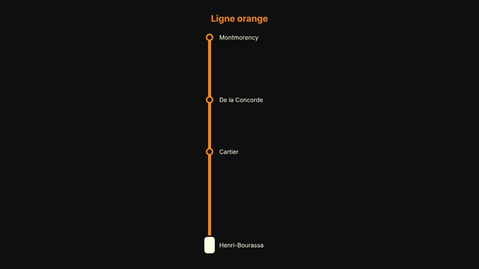
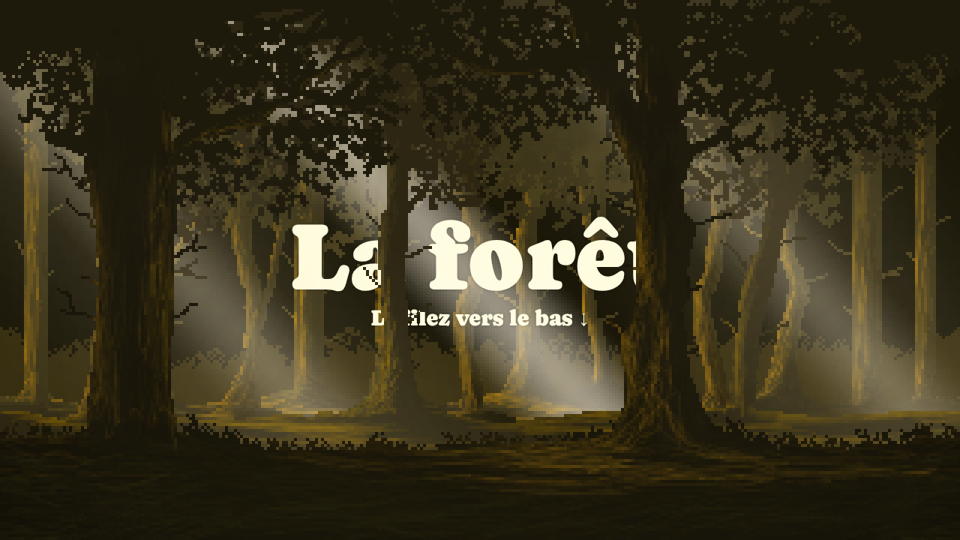

# Cours 10

*[GSAP]: GreenSock Animation Platform
*[SVG]: Scalable Vector Graphics

{.w-100}

## Plugin GSAP

Un plugin ajoute des fonctionnalités supplémentaires aux fonctionnalités d'animation de base GSAP (tween).

### Activer un plugin

Pour activer un plugin, par exemple ***ScrollTrigger*** on doit d'abord l'importer, ensuite spécifier sont usage avec `registerPlugin` : 

```js title="src/gsap.js" hl_lines="2 4"
import gsap from "gsap"
import { ScrollTrigger } from "gsap/ScrollTrigger"

gsap.registerPlugin(ScrollTrigger)

export function gsapAnimations() {
  
  // Code GSAP ici 🔥

}
```

## Plugin : ScrollTrigger

En GSAP, le déclenchement au défilement s'appelle `scrollTrigger` et il s'ajoute directement dans la config d'un tween :

```js
gsap.from(".carte", {
  y: 50,
  opacity: 0,
  duration: 1,

  scrollTrigger: {
    trigger: ".carte",   // QUOI : l'élément qui déclenche
    start: "top 60%",    // QUAND : lorsque le haut de .carte atteint 60% du viewport
    markers: true        // DEBUG : repères visuels pour tester
  }
})
```

!!! note "Comprendre `start` :green_square:"

    ```txt
    start: "top 60%"
            │    └── 60% de la hauteur de la fenêtre
            └─────── le haut du trigger
    ```

    Autrement dit, exécute le tween quand le haut du trigger rencontre la position 60vh (60% du viewport verticalement)

<iframe src="https://tim-montmorency.com/Fragment/v/?f=gsap-scrolltrigger&actif=resultat&modifiable=1&disposition=onglets&numeros=1" class="aspect-4-3" style="width:100%;border:0" loading="lazy"></iframe>

### Les paramètres de ScrollTrigger

| Option | Rôle |
| :--- | :--- |
| `trigger` | L'élément observé |
| :green_square: `start` | Point de départ (`"top 80%"`, `"center center"`…) |
| :red_square: `end` | Point de fin (`"bottom top"`, `"+=500"`…) |
| `toggleActions` | Que faire aux 4 moments clés : `onEnter`, `onLeave`, `onEnterBack` et `onLeaveBack` |
| `scrub` | Lie la progression de l'animation au défilement |
| `pin` | Épingle l'élément pendant le défilement (voir plus bas) |
| `markers` | Affiche des repères de débogage |

### Le défilement qui joue l'animation : `scrub`

Avec `scrub`, l'animation n'est plus « déclenchée »&nbsp;: sa progression **suit exactement** la molette. On rembobine en remontant.

| Valeur | Effet |
| :--- | :--- |
| `scrub: true` | Suit le défilement à l'instant |
| `scrub: 1` | Suit avec 1 s de rattrapage en douceur (plus fluide) |

<iframe src="https://tim-montmorency.com/Fragment/v/?f=gsap-scrolltrigger-scrub&actif=resultat&modifiable=1&disposition=onglets&numeros=1" class="aspect-4-3" style="width:100%;border:0" loading="lazy"></iframe>

<iframe src="https://tim-montmorency.com/Fragment/v/?f=gsap-scrolltrigger-scrub-alt&actif=resultat&modifiable=1&disposition=onglets&numeros=1" class="aspect-4-3" style="width:100%;border:0" loading="lazy"></iframe>

### États : `toggleActions`

Définit le comportement à quatre moments&nbsp;: `onEnter onLeave onEnterBack onLeaveBack`.

```js
toggleActions: "play    none    none        reverse"
//              ↑       ↑       ↑           ↑
//              onEnter onLeave onEnterBack onLeaveBack
```

Chaque valeur peut être `play`, `pause`, `resume`, `reverse`, `restart` ou `none`. 

<iframe src="https://tim-montmorency.com/Fragment/v/?f=gsap-scrolltrigger-toggle-actions&actif=js&modifiable=1&disposition=cote&numeros=1" class="aspect-16-9" style="width:100%;border:0" loading="lazy"></iframe>

!!! info "À essayer"
    
    * `play reverse play reverse` : la carte n'est visible que dans la zone, entre start et end
    * `restart none restart none` : l'animation rejoue à chaque entrée dans la zone
    * `play none none none` : l'animation joue une seule fois, puis la carte reste

### Épingler : `pin`

L'option `pin` **fige** un élément à l'écran pendant que le reste de la page continue de défiler.

```js
gsap.to(".contenu", {
  xPercent: -75,
  ease: "none",
  scrollTrigger: {
    trigger: ".section",
    start: "top top",
    end: "+=3333", // l'animation termine quand 3333px ont été scrollé
    pin: true,
    scrub: 1,
    markers: true,
  },
});
```

<iframe src="https://tim-montmorency.com/Fragment/v/?f=gsap-scrolltrigger-pin&actif=js&modifiable=1&disposition=cote&numeros=1" class="aspect-16-9" style="width:100%;border:0" loading="lazy"></iframe>

!!! tip "`pin` + `scrub` = défilement horizontal"

    Combiner `pin` (fige) et `scrub` (lie au défilement) est la recette classique du **défilement horizontal** ou des scènes qui se déroulent sur place.

### Une timeline pilotée par le défilement

Le `scrollTrigger` peut aussi se placer **sur une timeline** plutôt que sur chaque tween. Avec `scrub`, le défilement fait avancer **toute la séquence** 🤯

```js
let maTL = gsap.timeline({
  defaults: { ease: "none" }, // 👈 Lissage général du timeline
  scrollTrigger: {
    trigger: ".scene",
    start: "top top",
    end: "+=1000",   // la séquence s'étale sur 1000 px de défilement
    scrub: 1,
    markers: true
  }
});

maTL.to(".boite", { x: 300 })
maTL.to(".cercle", { scale: 2 }, "<")   // en même temps que la boîte
maTL.to(".triangle", { rotation: 360 }) // ensuite
```

!!! tip "`defaults` : des réglages pour tous les `.to()`"

    Ce qui est placé dans `defaults` s'applique à **tous** les `.to()` de la timeline. On écrit `ease: "none"` une seule fois, au lieu de le répéter dans chaque `.to()`. Un `.to()` peut quand même avoir sa propre valeur&nbsp;: elle remplace alors celle de `defaults`.

!!! note "Avec scrub, les durées deviennent des proportions"

<iframe src="https://tim-montmorency.com/Fragment/v/?f=gsap-scrolltrigger-timeline-scrub&actif=js&modifiable=1&disposition=cote&numeros=1" class="aspect-16-9" style="width:100%;border:0" loading="lazy"></iframe>

### Aimanter : `snap`

L'option `snap` « aimante » le défilement&nbsp;: quand on arrête de défiler, ScrollTrigger termine lui-même le mouvement jusqu'au point d'arrêt le plus proche. 

Les points d'arrêt se donnent en **progression** de la zone de défilement, de `0` (au `start`) à `1` (au `end`)&nbsp;:

```js
snap: 0.25   // arrêts à 0, 0.25, 0.5, 0.75 et 1
```

<iframe src="https://tim-montmorency.com/Fragment/v/?f=gsap-scrolltrigger-snap&actif=js&modifiable=1&disposition=cote&numeros=1" class="aspect-16-9" style="width:100%;border:0" loading="lazy"></iframe>

#### Aimanter sur des étiquettes

Un nombre comme `0.25` place les arrêts à intervalles **réguliers**. Quand les arrêts ne sont pas espacés également, on pose plutôt des **étiquettes** dans la timeline avec `.addLabel()`, puis on aimante le défilement sur ces étiquettes avec `snap: "labels"`.

```js
gsap.timeline({
  scrollTrigger: {
    trigger: ".scene",
    start: "top top",
    end: "+=2000",
    pin: true,
    scrub: 1,
    snap: "labels"   // 👈 s'aimante à l'étiquette la plus proche
  }
})
  .addLabel("départ")                       // une étiquette au début
  .to(".boite", { x: 100, duration: 1 })
  .addLabel("arrêt 1")                      // une étiquette après chaque arrêt
  .to(".boite", { x: 400, duration: 3 })    // un trajet 3 fois plus long
  .addLabel("arrivée")
```

<iframe src="https://tim-montmorency.com/Fragment/v/?f=gsap-scrolltrigger-snap-tag&actif=js&modifiable=1&disposition=cote&numeros=1" class="aspect-16-9" style="width:100%;border:0" loading="lazy"></iframe>

<div class="grid grid-1-2" markdown>
  {.aspect-4-3}

  <small>Exercice - GSAP</small><br>
  **[Ligne orange](./activite/ligne-orange/index.md){.stretched-link .back}**
</div>

## La parallaxe

La **parallaxe**, c'est l'illusion de profondeur créée quand les plans lointains bougent **plus lentement** que les plans proches.

<iframe class="aspect-4-3" height="300" style="width: 100%;" scrolling="no" title="Walt Disney's MultiPlane Camera" src="https://codepen.io/tim-momo/embed/GRVYzaZ?default-tab=result&theme-id=50173" frameborder="no" loading="lazy" allowtransparency="true" allowfullscreen="true">
  See the Pen <a href="https://codepen.io/tim-momo/pen/GRVYzaZ">
  Walt Disney's MultiPlane Camera</a> by TIM Montmorency (<a href="https://codepen.io/tim-momo">@tim-momo</a>)
  on <a href="https://codepen.io">CodePen</a>.
</iframe>

Exemples de sites

* [Firewatch](https://www.firewatchgame.com/) (axe des Y)
* [Goonies](https://the-goonies.webflow.io/) (axe des Z)
* [Longshot](https://longshotfeatures.com/) (axe des X)

Avec ScrollTrigger, il suffit de donner à chaque couche une amplitude de déplacement différente, en `scrub`.

```js
// L'arrière-plan descend beaucoup : il « résiste » au défilement et paraît lent (lointain)
gsap.to(".fond", {
  y: 400,
  ease: "none",
  scrollTrigger: { 
    trigger: ".scene", 
    start: "top bottom", 
    end: "bottom top", 
    scrub: true 
  }
})

// Le premier plan descend peu : il suit presque le défilement et paraît rapide (proche)
gsap.to(".avant-plan", {
  y: 100,
  ease: "none",
  scrollTrigger: { 
    trigger: ".scene", 
    start: "top bottom", 
    end: "bottom top", 
    scrub: true 
  }
})
```

!!! note "Le secret : `ease: none` + `scrub`"

    Pour une parallaxe crédible, le mouvement doit être **linéaire** (`ease: "none"`) et **lié au défilement** (`scrub`). Ce sont les différences d'amplitude (`y: 400` vs `y: 100`) qui créent la profondeur&nbsp;: **loin = descend beaucoup, proche = descend peu**.

### Une parallaxe qui défile toute seule

On peut simplement utiliser une image de fond qui se répète en CSS (`background-repeat: repeat-x`). Ensuite, on anime son `background-position-x`.

```js
gsap.to(".layer123", {
  backgroundPositionX: "-=100px", // l'image recule de 100 px...
  duration: 1,                    // ... par seconde
  ease: "none",
  repeat: -1,                     
  repeatRefresh: true             // 👈 chaque tour repart de là où le précédent s'est arrêté
})
```

<div class="grid grid-1-2" markdown>
  {.aspect-4-3}

  <small>Exercice - GSAP</small><br>
  **[Forêt](./activite/foret/index.md){.stretched-link .back}**
</div>


<!-- ## Exercices

<div class="grid grid-1-2" markdown>
  {.aspect-4-3}

  <small>Exercice - GSAP</small><br>
  **[Labyrinthe](./exercices/gsap-maze.md){.stretched-link .back}**
</div>

!!! success "Fin du bloc GSAP"

    Vous savez maintenant animer (tweens, timelines), déclencher au défilement (ScrollTrigger), créer de la profondeur (parallaxe) et exploiter des plugins (MotionPath, DrawSVG). De quoi donner vie à n'importe quelle interface 🚀. -->
