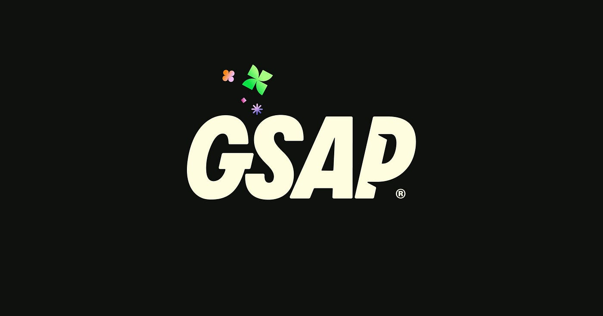
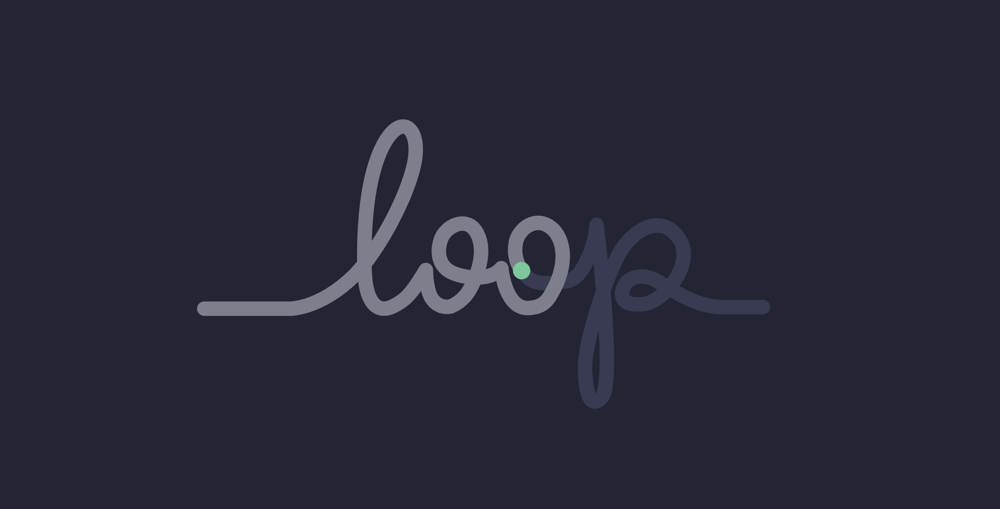
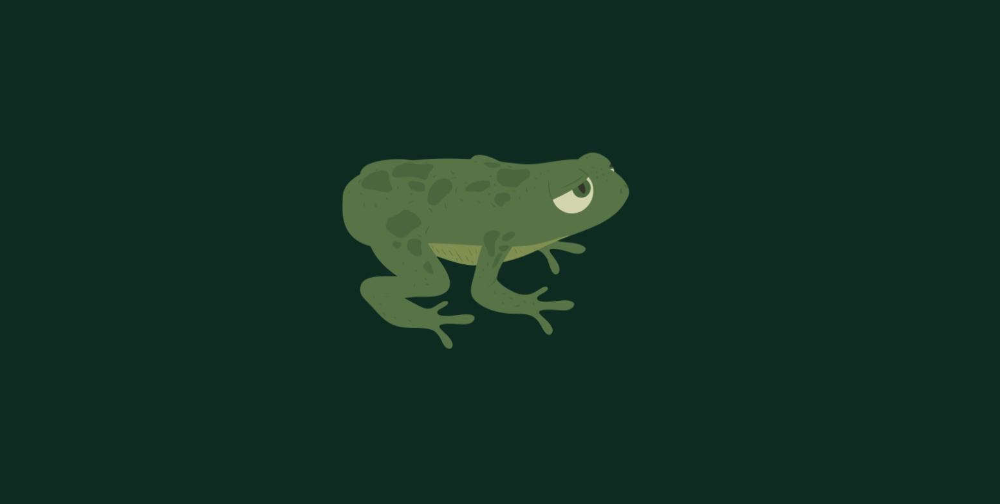

# Cours 11

*[GSAP]: GreenSock Animation Platform
*[SVG]: Scalable Vector Graphics

[STOP]

{.w-100}

## Retour sur les exercices

## Activer plusieurs plugin GSAP

Voici un EXEMPLE :

```js title="src/gsap.js" hl_lines="2-4 6"
import gsap from "gsap"
import { ScrollTrigger } from "gsap/ScrollTrigger"
import { SplitText } from "gsap/SplitText"
import { DrawSVGPlugin } from "gsap/DrawSVGPlugin"

gsap.registerPlugin(ScrollTrigger, SplitText, DrawSVGPlugin)

export function gsapAnimations() {

  // Code GSAP ici 🔥

}
```

## Le texte

### SplitText

<iframe src="https://tim-montmorency.com/Fragment/v/?f=gsap-splittext&actif=resultat&modifiable=1&disposition=onglets&numeros=1" class="aspect-16-9" style="width:100%;border:0" loading="lazy"></iframe>

[SplitText](https://gsap.com/docs/v3/Plugins/SplitText/) enveloppe chaque lettre, chaque mot ou chaque ligne dans sa propre balise. On anime ensuite ces morceaux avec un `stagger`.

```js title="src/gsap.js"
import gsap from "gsap"
import { SplitText } from "gsap/SplitText"

gsap.registerPlugin(SplitText)

export function gsapAnimations() {
  const txt = SplitText.create("#titre", { type: "chars" })

  gsap.from(txt.chars, {
    y: -100,
    opacity: 0,
    duration: 0.8,
    ease: "back.out(2)",
    stagger: 0.05     // 👈 une lettre après l'autre
  })
}
```

| `type` | Produit | Pour animer… |
| :--- | :--- | :--- |
| `"chars"` | `titre.chars` | Chaque lettre |
| `"words"` | `titre.words` | Chaque mot |
| `"words, chars"` | les deux | Combiner (les lettres restent groupées par mot) |

??? tip "Pour le fun"
    
    Essayez `rotation: "random(-120, 120)"`

<!-- 
!!! note "Accessibilité"

    Un lecteur d'écran qui lirait chaque lettre séparément serait pénible à écouter. SplitText ajoute automatiquement un `aria-label` avec le texte complet&nbsp;: rien à faire de plus. -->

### ScrambleTextPlugin

<iframe src="https://tim-montmorency.com/Fragment/v/?f=gsap-scrambletextplugin&actif=resultat&modifiable=1&disposition=onglets&numeros=1" class="aspect-16-9" style="width:100%;border:0" loading="lazy"></iframe>

[ScrambleTextPlugin](https://gsap.com/docs/v3/Plugins/ScrambleTextPlugin/) remplace un texte par des caractères aléatoires qui se **stabilisent** peu à peu.

```js
import { ScrambleTextPlugin } from "gsap/ScrambleTextPlugin"

gsap.registerPlugin(ScrambleTextPlugin)

gsap.to("#slogan", {
  duration: 1.5,
  scrambleText: {
    text: "Appuyez sur Start",  // le texte final
    chars: "upperCase",         // les caractères de brouillage
    revealDelay: 0.5            // brouille 0,5 s avant de commencer à révéler
  }
})
```

| Option | Rôle |
| :--- | :--- |
| `text` | Le texte à afficher à la fin |
| `chars` | `"upperCase"`, `"lowerCase"`, `"upperAndLowerCase"`, ou une chaîne maison (`"01"`, `"!?#$%"`) |
| `revealDelay` | Délai avant le début de la révélation |
| `speed` | Vitesse du brouillage (`1` par défaut) |

### TextPlugin

<iframe src="https://tim-montmorency.com/Fragment/v/?f=gsap-textplugin&actif=resultat&modifiable=1&disposition=onglets&numeros=1" class="aspect-16-9" style="width:100%;border:0" loading="lazy"></iframe>

[TextPlugin](https://gsap.com/docs/v3/Plugins/TextPlugin/) remplace le texte d'un élément **caractère par caractère**. 

> Avec `ease: "none"`, on obtient un effet de machine à écrire, un peu comme Typed.js dans l'exercice Momo.

```js
import { TextPlugin } from "gsap/TextPlugin"

gsap.registerPlugin(TextPlugin)

gsap.to("#dialogue", {
  duration: 3,
  text: "Un brouillard étrange recouvre l'archipel...",
  ease: "none"
})
```

## Animations SVG

{.w-100 .h-auto}

Les trois plugins suivants travaillent sur du **SVG intégré directement dans le HTML** (`<svg></svg>`) et non sur un SVG chargé dans une balise ``. GSAP doit pouvoir atteindre les `<path>` à l'intérieur.

**Trouver un svg**

* [allsvgicons.com](https://allsvgicons.com/)
* [svgrepo.com](https://www.svgrepo.com/)

**Nettoyer un svg**

* [svgomg.net](https://svgomg.net/)
* Figma ! (on ouvre et on exporte en svg)

Suggestion : spécifier une taille responsive en css. Par exemple : `width: 50vw;`

**Préparer un SVG**

Un SVG exporté de Figma ou d'Illustrator se colle tel quel dans le HTML. Donnez ensuite un `id` aux formes à animer pour pouvoir les cibler.

```html hl_lines="3"
<svg xmlns="http://www.w3.org/2000/svg" viewBox="0 0 512 512">
  <path
    id="catToDraw"
    stroke="#fff"
    stroke-width="1"
    d="M504.3 195.6c-10......"
  />
</svg>
```

### DrawSVGPlugin

<iframe src="https://tim-montmorency.com/Fragment/v/?f=gsap-drawsvgplugin&actif=resultat&modifiable=1&disposition=onglets&numeros=1" class="aspect-16-9" style="width:100%;border:0" loading="lazy"></iframe>

[DrawSVGPlugin](https://gsap.com/docs/v3/Plugins/DrawSVGPlugin/) anime le **tracé** d'un SVG, comme si un stylo le dessinait en direct.

<!-- DrawSVG anime le **contour** (`stroke`) d'un `<path>`, `<line>`, `<circle>`. -->

```js
import { DrawSVGPlugin } from "gsap/DrawSVGPlugin"

gsap.registerPlugin(DrawSVGPlugin)

gsap.from("#signature path", {
  drawSVG: "0%", // part d'un tracé invisible
  duration: 2,
  stagger: 0.2
})
```

| Valeur | Résultat |
| :--- | :--- |
| `drawSVG: "0%"` | Rien n'est dessiné |
| `drawSVG: "100%"` | Le tracé complet |
| `drawSVG: "40% 60%"` | Seulement le segment entre 40&nbsp;% et 60&nbsp;% |

??? example "Pour le fun"

    ```js
    gsap.set("#catToDraw", { drawSVG: "0%", visibility: "visible" });

    gsap.timeline()
    .to(
      "#catToDraw",
      { drawSVG: "100%", duration: 3, ease: "power1.inOut" },
    )
    .to(
      "#catToDraw",
      { drawSVG: "100% 100%", duration: 3, ease: "power1.inOut" }
    )
    ```

#### Dessiner au défilement

Combiné à ScrollTrigger et `scrub`, le tracé avance avec la molette&nbsp;: parfait pour une route sur une carte ou une ligne du temps.

<iframe src="https://tim-montmorency.com/Fragment/v/?f=gsap-drawsvgplugin-scrolltrigger&actif=resultat&modifiable=1&disposition=onglets&numeros=1" class="aspect-16-9" style="width:100%;border:0" loading="lazy"></iframe>

??? example "Pour le fun"

    `drawSVG: "80% 100%"`

### MorphSVGPlugin

<iframe src="https://tim-montmorency.com/Fragment/v/?f=gsap-morphsvg&actif=resultat&modifiable=1&disposition=onglets&numeros=1" class="aspect-16-9" style="width:100%;border:0" loading="lazy"></iframe>

[MorphSVGPlugin](https://gsap.com/docs/v3/Plugins/MorphSVGPlugin/) transforme une forme (`<path>`) en une autre, même si elles n'ont pas le même nombre de points.

```html
<svg viewBox="0 0 100 100">
  <path id="lecture" d="M30,20 L80,50 L30,80 Z" />
  <defs>
    <path id="pause" d="M25,20 H45 V80 H25 Z M55,20 H75 V80 H55 Z" style="visibility: hidden" />
  </defs>
</svg>
```

!!! note "`defs`"

    La balise defs dans un SVG n'affiche pas son contenu. C'est parfait pour MorphSVG qui n'a besoin que tu code pour effectuer la transformation.

```js
import { MorphSVGPlugin } from "gsap/MorphSVGPlugin"

gsap.registerPlugin(MorphSVGPlugin)

gsap.to("#lecture", { morphSVG: "#pause", duration: 0.4 })

gsap.to("#lecture", { morphSVG: "#lecture", duration: 0.4 }) // 👈 Retourne à l'état initial
```

??? warning "`<circle>` et `<rect>`"

    MorphSVG anime des `<path>`. Pour un cercle ou un rectangle, on le convertit d'abord&nbsp;:

    ```js
    MorphSVGPlugin.convertToPath("#bouclier, #epee")
    ```

### MotionPathPlugin

<iframe src="https://tim-montmorency.com/Fragment/v/?f=gsap-motionpath&actif=resultat&modifiable=1&disposition=onglets&numeros=1" class="aspect-16-9" style="width:100%;border:0" loading="lazy"></iframe>

[MotionPathPlugin](https://gsap.com/docs/v3/Plugins/MotionPathPlugin/) fait voyager un élément le long d'un **chemin**, souvent un tracé SVG. Idéal pour un bateau sur la mer, un vaisseau dans l'espace, un point sur une carte.

```html
<svg>
  <path id="route" d="M5 40.3168C8.73535 ..." />
</svg>

```

```js
import { MotionPathPlugin } from "gsap/MotionPathPlugin"

gsap.registerPlugin(MotionPathPlugin)

gsap.to("#car", {
  duration: 10,
  ease: "none",
  repeat: -1,
  motionPath: {
    path: "#route",        // un <path> SVG
    align: "#route",       // place l'élément sur le tracé
    alignOrigin: [0.5, 1], // le transformOrigin de l'auto posé sur le tracé
    autoRotate: true,      // oriente l'élément selon la direction
  },
});
```

On peut aussi très bien cacher le tracé avec `stroke="none"` sur le path du motionPath

??? example "Pour le fun"

    On peut utiliser DrawSVG avec MotionPath ! Il suffit d'animer les deux simultanément avec une timeline.

    <iframe src="https://tim-montmorency.com/Fragment/v/?f=gsap-motionpath-drawsvg&actif=resultat&modifiable=1&disposition=onglets&numeros=1" class="aspect-16-9" style="width:100%;border:0" loading="lazy"></iframe>


<div class="grid grid-1-2" markdown>
  {.aspect-4-3}

  <small>Exercice - GSAP</small><br>
  **[Loop](./activite/loop/index.md){.stretched-link .back}**
</div>

## Lissage personnalisé

[CustomEase](https://gsap.com/docs/v3/Eases/CustomEase/) permet de **dessiner** sa propre courbe de lissage.

```js
import { CustomEase } from "gsap/CustomEase"

gsap.registerPlugin(CustomEase)

CustomEase.create("impact", "M0,0 C0.1,0.9 0.2,1.2 0.35,1 0.5,0.9 0.7,1 1,1")

gsap.from(".carte-boss", { y: -300, duration: 1, ease: "impact" })
```

## Interactions

### Draggable

<iframe src="https://tim-montmorency.com/Fragment/v/?f=gsap-draggable-inertiaplugin&actif=resultat&modifiable=1&disposition=onglets&numeros=1" class="aspect-16-9" style="width:100%;border:0" loading="lazy"></iframe>

[Draggable](https://gsap.com/docs/v3/Plugins/Draggable/) rend n'importe quel élément **déplaçable** à la souris ou au doigt.

```js
import { Draggable } from "gsap/Draggable"
import { InertiaPlugin } from "gsap/InertiaPlugin"

gsap.registerPlugin(Draggable, InertiaPlugin)

Draggable.create("#abc", {
  type: "x,y",           // options : "x", "y" et ou "rotation"
  bounds: "#xyz",        // ne sort pas de cette zone
  inertia: true          // glisse un peu après le lâcher (InertiaPlugin)
})
```

#### `onDragEnd() + hitTest()`

<iframe src="https://tim-montmorency.com/Fragment/v/?f=gsap-draggable-callback&actif=resultat&modifiable=1&disposition=onglets&numeros=1" class="aspect-16-9" style="width:100%;border:0" loading="lazy"></iframe>

Pour savoir **où** l'élément a été déposé, on utilise `hitTest()` dans `onDragEnd`&nbsp;:

```js
Draggable.create("#abc", {
  type: "x,y",
  onDragEnd() {
    // S'il y a 60% de chevauchement
    if (this.hitTest("#xyz", "60%")) {         
      // Animation A
    } else {
      // Animation B
    }
  }
})
```

<!-- !!! info "`this` dans `onDragEnd`"

    Dans `onDragEnd`, `this` est l'objet Draggable&nbsp;: `this.target` est l'élément déplacé, `this.hitTest()` vérifie le chevauchement. C'est pourquoi on écrit `onDragEnd() { … }` et non une fonction fléchée. -->

<!-- !!! tip "Le type `rotation`"

    `type: "rotation"` transforme un élément en **bouton rotatif**&nbsp;: un volant, une roue de sélection, un cadran de coffre-fort. -->

### ScrollToPlugin

<iframe src="https://tim-montmorency.com/Fragment/v/?f=gsap-scrolltoplugin&actif=resultat&modifiable=1&disposition=onglets&numeros=1" class="aspect-16-9" style="width:100%;border:0" loading="lazy"></iframe>

[ScrollToPlugin](https://gsap.com/docs/v3/Plugins/ScrollToPlugin/) fait défiler la page jusqu'à une cible.

```js
import { ScrollToPlugin } from "gsap/ScrollToPlugin"

gsap.registerPlugin(ScrollToPlugin)

document.querySelector("#bouton-decouvrir").addEventListener("click", () => {
  gsap.to(window, {
    duration: 1,
    ease: "power2.inOut",
    scrollTo: { y: "#concept", offsetY: 80 }   // 80 px pour laisser la place à la navbar
  })
})
```

<!-- ??? question "Y'a pas déjà `scroll-behavior: smooth` en CSS ?"

    Le CSS sait aussi faire défiler en douceur, mais sans contrôle de la durée ni de la courbe, et sans `offsetY`. Avec ScrollTo, le défilement fait partie de l'animation du site. -->

## Responsive et `matchMedia()`

[`gsap.matchMedia()`](https://gsap.com/docs/v3/GSAP/gsap.matchMedia()) permet de définir des animations **différentes selon la taille de l'écran**.

```js hl_lines="9-11 23-24"
let mm = gsap.matchMedia()

// Écran large
mm.add("(min-width: 768px)", () => {
  gsap.from("#abc", {
    drawSVG: "0%",
    scrollTrigger: { 
      trigger: "#xyz", 
      start: "top top", 
      end: "+=2000", 
      pin: true, 
      scrub: 1 
    }
  })
})

// Mobile
mm.add("(max-width: 767px)", () => {
  gsap.from("#abc", {
    drawSVG: "0%",
    scrollTrigger: { 
      trigger: "#xyz", 
      start: "top 70%",
      end: "bottom 30%", 
      scrub: 1 
    }
  })
})
```

<!-- FRAGMENT: gsap-matchmedia (animation différente bureau / mobile) -->

!!! note "Idéalement, utiliser les [breakpoints de Tailwind](https://tailwindcss.com/docs/responsive-design)"

??? tip "Respecter « réduire les animations »"

    Certaines personnes demandent à leur système de réduire les animations (par exemple pour ceux qui vivent du vertige ou même de l'épilepsie).
    
    ```js
    mm.add("(prefers-reduced-motion: no-preference)", () => {
      // les animations décoratives seulement ici
    })
    ```

    <iframe src="https://tim-montmorency.com/Fragment/v/?f=w5-gsap-reduced-motion&actif=resultat&modifiable=1&disposition=onglets&numeros=1" class="aspect-16-9" style="width:100%;border:0" loading="lazy"></iframe>

## Exercice

<div class="grid grid-1-2" markdown>
  {.aspect-4-3}

  <small>Exercice - GSAP</small><br>
  **[La potion magique](./activite/potion/index.md){.stretched-link .back}**
</div>

<!-- ## Projet final

L'énoncé du projet final est présenté aujourd'hui&nbsp;: le **microsite de lancement** d'un jeu vidéo. Par défaut, c'est le jeu développé en **Interactivité ludique**&nbsp;; pour les personnes qui ne suivent pas ce cours, un jeu existant ou fictif, avec **les mêmes exigences**. Les plugins vus aujourd'hui y trouvent directement leur place.

[Énoncé du projet final](./devoir/projet-final.md){ .md-button .md-button--primary }

### D'ici le cours 12

- [ ] Choisir son **volet** (A&nbsp;: mon jeu d'Interactivité ludique&nbsp;; B&nbsp;: un jeu existant ou fictif, à faire approuver)
- [ ] Rassembler les **médias**&nbsp;: logo, captures d'écran, une séquence vidéo, musique et effets sonores
- [ ] Commencer le fichier `CREDITS.md`&nbsp;: chaque média, sa source, sa licence
- [ ] Repérer les **plugins** qui serviront le mieux le jeu, et où (titre, carte, galerie…) -->
