# Cours 12

*[DOM]: Document Object Model
*[npm]: Node Package Manager
*[API]: Application Programming Interface
*[AR]: Augmented Reality (réalité augmentée)
*[glTF]: GL Transmission Format
*[GLB]: glTF Binary
*[JS]: JavaScript

[STOP]

<div class="grid grid-1-4" markdown>
  <div markdown>:material-play-circle:</div>
   
   Audio et vidéo : API native et effets sonores
</div>

<div class="grid grid-1-4" markdown>
  <div markdown>:material-cube-outline:</div>
   
  **Partie 2** - De Maya au navigateur : exporter et optimiser un modèle
</div>

<div class="grid grid-1-4" markdown>
  <div markdown>:material-rotate-3d-variant:</div>
   
   **Partie 3** - `<model-viewer>` : une vitrine 3D en une balise HTML
</div>

<div class="grid grid-1-4" markdown>
  <div markdown>:material-content-save-outline:</div>
   
   **Partie 4** - Personnaliser et **mémoriser** les choix du visiteur avec `localStorage`
</div>

<div class="grid grid-1-4" markdown>
  <div markdown>:material-chart-line:</div>
   
   **Partie 5** - Mesurer la fréquentation du site avec Google Analytics
</div>

<div class="grid grid-1-4" markdown>
  <div markdown>:material-star-plus:</div>
   
   **Bonus** - Tone.js (musique générée) et Chart.js (graphiques)
</div>

---

## Médias et JavaScript

<iframe src="https://tim-montmorency.com/Fragment/v/?f=lecteur-video&onglets=html,resultat&actif=resultat&modifiable=1&disposition=onglets&numeros=1" class="aspect-4-3" style="width:100%;border:0" loading="lazy"></iframe>

Les balises `<video>` et `<audio>` viennent avec plusieurs fonctionnalités contrôlables en JavaScript (**propriétés**, **méthodes** et **événements**). 

```html title="HTML"
<video id="film">
  <source src="miaw.webm" type="video/webm" />
</video>
```

```js title="Sélectionner la vidéo"
const media = document.querySelector("#film");
```

---

<div class="grid align-items-top" markdown>
```js title="Lancer la lecture"
/* Set */
media.play();
```

```js title="Pause"
/* Set */
media.pause();

/* Get (false ou true) */
console.log( media.paused );
```
</div>

```js title="Régler le volume"
/* Set : 0 = muet, 1 = max */
media.volume = 0.5;

/* Set */
media.muted = true;
```

```js title="Tête de lecture"
/* Set (va à 12.34 secondes)*/
media.currentTime = 12.34;

/* Set : vitesse de lecture. 2 = vite, 0.5 = ralenti */
media.playbackRate = 2;

/* Get */
console.log( media.currentTime );

/* Get : durée totale. À utiliser avec loadedmetadata 👇 */
console.log( media.duration );
```

```js title="Événements"
/* Attend que le navigateur lise les métadonnées du fichier */
media.addEventListener("loadedmetadata", () => {
  // ...
});

/* Pendant la lecture (se déclenche ~4x / seconde)  */
media.addEventListener("timeupdate", () => {
  // ... 
});

/* Quand la lecture est terminée */
media.addEventListener("ended", () => {
  // ...
});
```

### Un lecteur vidéo personnalisé

Les contrôles natifs de `<video>` fonctionnent, mais ils ne ressemblent jamais au reste du site. En combinant quelques-uns des morceaux ci-dessus, on peut fabriquer son **propre lecteur** :

| Contrôle maison | Morceaux de l'API utilisés |
| --- | --- |
| Bouton lecture / pause | `paused`, `play()`, `pause()` |
| Temps écoulé / durée totale | `currentTime`, `duration`, `loadedmetadata`, `timeupdate` |
| Barre de progression | `currentTime`, `duration`, `timeupdate` |
| Bouton sourdine | `muted` |
| Retour au bouton « lecture » à la fin | `ended` |

C'est exactement ce que demande l'exercice **[Salle de projection](./exercices/medias-salle-projection.md)**, à la fin de cette partie.

!!! tip "La recette"

    Pour chaque contrôle : **sélectionner** l'élément HTML, **écouter** le bon événement, puis **lire ou modifier** la bonne propriété de la vidéo.

### Les effets sonores

Un effet sonore se pilote exactement comme la vidéo : une balise `<audio>`, **sans** l'attribut `controls` pour qu'elle reste invisible, puis les mêmes méthodes en JavaScript.

```html title="HTML"
<audio id="clic" src="./sons/clic.mp3"></audio>
<button id="bouton">Cliquer</button>
```

```js title="Jouer un effet sonore au clic"
const son = document.querySelector("#clic");
const bouton = document.querySelector("#bouton");

bouton.addEventListener("click", () => {
  son.play();
});
```

```js title="Une ambiance sonore en boucle"
const ambiance = document.querySelector("#ambiance");
ambiance.loop = true;
ambiance.volume = 0.3;
```

!!! warning "Autoplay bloqué"

    Les navigateurs refusent de jouer du son avant une **première interaction** de l'utilisateur. Un son se déclenche donc toujours depuis un clic, jamais au chargement de la page.

### Déboguer : les DevTools

Quand un média ne réagit pas, ouvrez les **DevTools** (++f12++) :

- la **Console** affiche les erreurs et vos `console.log(...)` ;
- l'onglet **Réseau** montre si le fichier média se charge (ou renvoie une erreur 404) ;
- un **point d'arrêt** (_breakpoint_) met le code en pause pour l'inspecter ligne par ligne.

```js
console.log("durée :", video.duration)   // vérifier une valeur au vol
```

### Exercice - Médias

<div class="grid grid-1-2" markdown>
  {.aspect-4-3}

  <small>Exercice - Médias</small><br>
  **[Salle de projection](./exercices/medias-salle-projection.md){.stretched-link .back}**
</div>

## 3D

### Format Web

Le format 3D en Web s'appelle [**glTF**](https://threejsresources.com/3d-models-for-websites). Il existe sous deux formes. 

| Format | Description |
| :--- | :--- |
| `.gltf` | Plus lourd, mais déboguable  |
| `.glb` | Fichier binaire optimisé 👌 |

??? question "`.fbx` et `.obj`"

    Ce sont des formats d'**échange** entre logiciels 3D, pas des formats de diffusion.

    - `.obj` n'enregistre que les mesh
    - `.fbx` est propriétaire (Autodesk)
    - `.glb` est _open source_

### Export et optimisation

Maya n'offre pas d'export glTF natif. Le chemin le plus simple et gratuit passe par **Blender**, qui servira ici de convertisseur :

#### Maya :simple-autodeskmaya:

- **Centrer** le modèle à l'origine, pivot à la base
-  **Delete History** (_Edit > Delete by Type > History_) et **Freeze Transformations** (_Modify > Freeze Transformations_) sur les objets à exporter
- Utiliser des textures en `.png` ou `.jpg` (fichiers images, pas de textures procédurales) et les garder dans le dossier `sourceimages` du projet

  ??? warning "Une texture procédurale ou autres textures"

      * Si le modèle a une texture procédurale, elle ne s'exporte malheureusement pas dans un fichier `.fbx`. Il faut donc la convertir en image. Dans l'**Hypershade**, sélectionner le matériau puis le modèle et choisir *Edit > Convert to File Texture (Maya Software)* avec une résolution de 1024×1024.
      * Pour les formats d'image autres que `.png` ou `.jpg` (ex. : `.tga`, `.tif`, `.psd`, `.exr`), il faut les réenregistrer en `.png` ou en `.jpg`, puis rebrancher le noeud `file` sur la nouvelle image. La liste des images de la scène se trouve dans *Windows > General Editors > File Path Editor*.

##### Export FBX

- **File > Export Selection** > **FBX export**.
  - Cocher **Smoothing Groups**
  - Cocher **Embed Media** (textures incluses)
  - Décocher **Animation** (si le modèle est statique)

#### Blender :simple-blender:

1. **File > Import > FBX (.fbx)**

  !!! warning "Les matériaux de Maya ne survivent pas toujours au voyage"
  
      Le matériau par défaut de Maya (**OpenPBR Surface**) est mal reconnu par l'importateur FBX de Blender.

      Vérifier les matériaux dans l'onglet **Shading** :
      
      - chacun doit utiliser un noeud **Principled BSDF**
      - les textures branchées au bon endroit (couleur = *Base Color*, normales = *Normal* via un noeud *Normal Map*) et reconnecter ce qui manque au besoin
      - ajuster **Roughness** et **Metallic** à l'oeil

1. **File > Export > glTF 2.0 (.glb/.gltf)** avec :
  * **Format** : _glTF Binary (.glb)_
  * **Include > Limit to** : _Selected Objects_ (si la scène contient autre chose)

### Optimiser

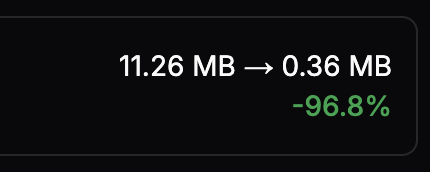{data-zoom-image}

- Passer votre objet dans **[optimizeglb.com](https://optimizeglb.com/dashboard)**.

### Positionner le fichier

Dans un projet Vite, les modèles vont dans `public/`, classés comme les autres médias :

```txt
public/
└── modeles/
    └── shining-sword.glb
```

!!! info "Pas de modèle sous la main ?"

    - <https://app.cinevva.com/game-assets/free-3d-character-models>
    - <https://www.opensource3dassets.com/en/gallery?avatar=sakura01-art>


### Mise en ligne

**[`<model-viewer>`](https://modelviewer.dev/)** (Google) affiche un modèle 3D interactif avec **une balise HTML** 🤯.

### Installation

```bash title="Terminal"
npm install @google/model-viewer three
```

```js title="src/main.js"
import "@google/model-viewer"
```

```html title="index.html"
<model-viewer
  id="vitrine"
  src="/modeles/epee.glb"
  loading="lazy"
  camera-controls
  class="w-full h-[60vh]"
  alt="Le héros du jeu, tenant son épée">
</model-viewer>
```

??? info "Attributs"

    | Attribut | Rôle |
    | :--- | :--- |
    | `camera-controls` | Permet de tourner autour du modèle (souris ou doigt) |
    | `disable-zoom` | Désactive le zoom à la molette |
    | `auto-rotate` | Rotation automatique lente |
    | `camera-orbit` | Angle de la caméra : _theta_, _phi_ et _radius_ (ex.: `"45deg 75deg 105%"`) |
    | `shadow-intensity` | Ombre portée au sol (`0` à `1`) |
    | `exposure` | Luminosité générale |
    | `environment-image` | Éclairage d'ambiance (`"neutral"` ou une image HDR) |
    | `poster` | Image affichée pendant le chargement |

    Tous les attributs sont documentés, avec exemples interactifs, sur **[modelviewer.dev](https://modelviewer.dev/docs/)**.

### `<model-viewer>` + GSAP

GSAP ne modifie pas juste du CSS, on peut aussi le faire modifier `<model-viewer>` !

Par exemple, la propriété `cameraOrbit` de `<model-viewer>` contrôle l'angle de la caméra. 

Animons ça avec GSAP.

```html title="index.html"
<section class="scene-3d h-screen">
  <model-viewer
    id="mon-epee"
    src="/modeles/epee.glb"
    class="w-full h-full">
  </model-viewer>
</section>
```

```js title="src/main.js"
import gsap from "gsap"
import { ScrollTrigger } from "gsap/ScrollTrigger"
import "@google/model-viewer"

gsap.registerPlugin(ScrollTrigger)

const monEpee = document.querySelector("#mon-epee")
const maCamera = { monTheta: 0 }

gsap.to(maCamera, {
  monTheta: 360,
  duration: 3,
  loop: -1,
  onUpdate: () => {
    monEpee.cameraOrbit = `${maCamera.monTheta}deg 75deg 105%`
  }
})
```

!!! tip "Facile maintenant de s'imaginer utiliser **ScrollTrigger**"

## Savegarde en Web

Saviez-vous ? On peut savegarder plein de choses dans le navigateur grace à `localStorage` en JavaScript. C'est très semblable à la notion de cookie.

Voyez ça comme une variable de texte. On peut la sauvegarder comme une variable (clé) et le nagivateur s'en souviendra, même après l'avoir fermé.

```js
// Écrire
localStorage.setItem("couleur-perso", "#e63946")

// Lire (null si la clé n'existe pas)
const couleur = localStorage.getItem("couleur-perso")

// Effacer
localStorage.removeItem("couleur-perso")
```

!!! tip "Voir le contenu du `localStorage`"

    DevTools > onglet **Application** > **Local Storage**. On y voit chaque clé, on peut les modifier ou les supprimer à la main pour tester.

### `localStorage` et DaisyUI

Vous vous souvenez du `theme-controller` de daisyUI ? Ça changeait le thème, mais ça « oubliait » sa sélection au rechargement de page. On peut maintenant y remédier.

```html title="index.html"
<input type="checkbox" value="dark" class="toggle theme-controller" />
```

```js title="src/main.js"
const interrupteur = document.querySelector(".theme-controller")

// Au chargement, on vérifie le contenu du localstorage
// et on coche le theme controller selon la condition
if (localStorage.getItem('theme') === 'light') {
  controller.checked = true
}

// Au changement, on sauvegarde
interrupteur.addEventListener("change", () => {
  if (interrupteur.checked) {
    localStorage.setItem('theme', 'light')
  } else {
    localStorage.setItem('theme', 'dark')
  }
})
```

!!! tip "Même principe si on a un bouton qui fait jouer de l'audio"

## Statistiques de consultation

Une fois le site en ligne, une question se pose : **est-ce que quelqu'un le visite ?**

Pour le savoir, on install un analyseur de visite, souvent [Google Analytics](https://analytics.google.com/).

1. Se connecter à [analytics.google.com](https://analytics.google.com/) avec un compte Google
1. Créer un **compte** (ex. : le nom du studio), puis une **propriété** (ex. : le nom du jeu)
1. Choisir la plateforme **Web** et créer un **flux de données** avec l'adresse du site en ligne
1. Copier l'**ID de mesure**, de la forme `G-XXXXXXXXXX`

### Connecter à son site

Google fournit un court code à coller dans le `<head>`, juste après la balise `<title>` :

```html title="index.html"
<!-- Google Analytics -->
<script async src="https://www.googletagmanager.com/gtag/js?id=G-XXXXXXXXXX"></script>
<script>
  window.dataLayer = window.dataLayer || [];
  function gtag() { dataLayer.push(arguments); }
  gtag("js", new Date());
  gtag("config", "G-XXXXXXXXXX");
</script>
```

Remplacer les **deux** occurrences de `G-XXXXXXXXXX` par l'ID de mesure de la propriété.

!!! warning "Un site de plusieurs pages"

    Le code doit être collé dans le `<head>` de **chaque** fichier HTML (`index.html`, `jeu.html`, `contact.html`, etc.).

### Vérifier que ça fonctionne

1. Mettre le site en ligne (`npm run build`, puis déploiement)
1. Visiter le site en ligne
1. Dans Google Analytics : **Rapports → Temps réel**. La visite apparaît en moins d'une minute.

!!! tip "Rien n'apparaît ?"

    Les **bloqueurs de publicité**, ou même le navigateur Brave, bloquent Google Analytics. Pour tester, désactiver le bloqueur ou utiliser un autre navigateur.

### Mesurer un clic précis

Par défaut, Google Analytics compte les pages vues. Pour savoir combien de visiteurs cliquent sur le bouton d'appel à l'action, on envoie un **événement** personnalisé :

```js title="src/main.js"
const boutonItch = document.querySelector("#bouton-itch");

boutonItch.addEventListener("click", () => {
  gtag("event", "clic_itchio");
});
```

L'événement `clic_itchio` apparaît ensuite dans **Rapports → Engagement → Événements**.

### Le consentement des visiteurs

Google Analytics dépose des **témoins** (_cookies_) qui suivent le visiteur. Au Québec, la **Loi 25** encadre ce type de suivi : un site public devrait informer le visiteur et obtenir son consentement, d'où les bandeaux « Accepter / Refuser » présents sur la plupart des sites.

Dans le cadre du cours, l'objectif est de comprendre l'outil ; la mise en place d'un bandeau de consentement complet dépasse le contenu de Web 3. Pour un vrai site en production, cette étape n'est pas facultative.

---

## Bonus 1 - Tone.js (touche supplémentaire)

!!! info "Ma touche supplémentaire"

    Tone.js est l'une des options de la **touche supplémentaire** du projet final, avec `<model-viewer>`, Chart.js et Swup. L'exercice *Boîte à musique* est à faire si Tone.js est la touche retenue.

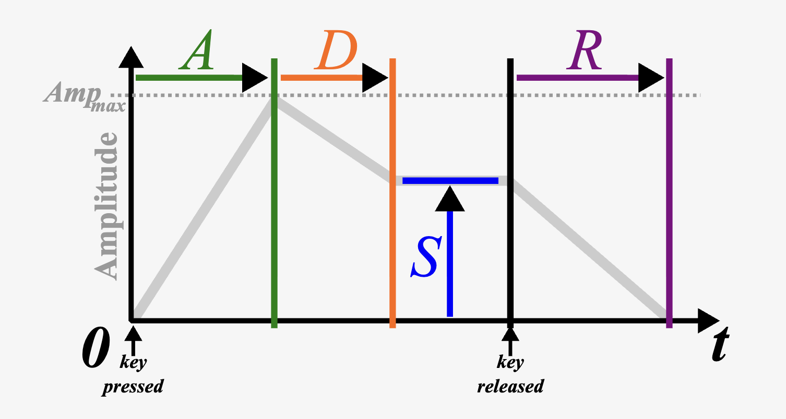{data-zoom-image .w-75}

**[Tone.js](https://tonejs.github.io/)** est un cadre audio pour **créer du son et de la musique** dans le navigateur. Pour un site de jeu, c'est parfait : une ambiance sonore, un thème musical, ou des effets aux interactions.

### Installation

```bash
npm install tone
```

```js title="src/main.js"
import * as Tone from "tone"
```

!!! danger "Le son exige un clic d'abord"

    Les navigateurs **bloquent** tout son tant que l'utilisateur n'a pas interagi avec la page. Il faut donc appeler **`Tone.start()`** depuis un événement déclenché par l'utilisateur (un clic), sinon : silence.

    ```js
    document.querySelector("#demarrer").addEventListener("click", async () => {
      await Tone.start()   // débloque l'audio
      // … le son peut jouer maintenant …
    })
    ```

### Jouer une note

L'objet de base est le **synthétiseur**. On le crée, on le branche aux haut-parleurs avec `.toDestination()`, puis on joue une note.

```js
const synth = new Tone.Synth().toDestination()

// note "Do 4", tenue pendant une croche ("8n")
synth.triggerAttackRelease("C4", "8n")
```

| Argument | Signifie |
| :--- | :--- |
| `"C4"` | La note (nom + octave), ou une fréquence en Hz (`440`) |
| `"8n"` | La durée : `"4n"` = noire, `"8n"` = croche, `"1m"` = une mesure |

### Enchaîner des notes

Le 3ᵉ argument planifie **quand** jouer, en secondes à partir de maintenant (`Tone.now()`).

```js
const synth = new Tone.Synth().toDestination()
const t = Tone.now()

synth.triggerAttackRelease("C4", "8n", t)
synth.triggerAttackRelease("E4", "8n", t + 0.5)
synth.triggerAttackRelease("G4", "8n", t + 1)
```

### Jouer un fichier audio

Pour une **musique** ou un effet à partir d'un fichier, on utilise `Tone.Player`.

```js
const musique = new Tone.Player({
  url: "./assets/audio/theme.mp3",
  loop: true,
  autostart: false
}).toDestination()

// après Tone.start() :
musique.start()
```

!!! tip "Idées pour votre site de jeu"

    Un thème musical en boucle dans le hero, un « bip » à chaque survol de bouton, un son de validation à l'envoi du formulaire… petit détail, grande immersion 🎧.

<!-- CODEPEN: clavier de quelques notes + bouton Tone.start() -->

### Exercice bonus - Tone.js

<div class="grid grid-1-2" markdown>
  {.aspect-4-3}

  <small>Exercice - Tone.js</small><br>
  **[Boîte à musique](./exercices/tonejs-boite-a-musique.md){.stretched-link .back}**
</div>

---

## Bonus 2 - Chart.js (optionnel)

!!! info "Pour les curieux - non obligatoire"

    Chart.js ne fait pas partie de la remise *Exercices 02*. Il reste admissible comme **librairie supplémentaire** dans le projet final.

**[Chart.js](https://www.chartjs.org/)** transforme des données en **graphiques** clairs et animés, dessinés dans une balise `<canvas>`. C'est la librairie de visualisation la plus populaire : simple, responsive et gratuite.

### Installation

```bash
npm install chart.js
```

```js title="src/main.js"
import Chart from 'chart.js/auto'
```

!!! note "`chart.js/auto`"

    L'import `chart.js/auto` enregistre automatiquement tous les types de graphiques. Pratique pour apprendre ; en production, on peut n'importer que ce qu'on utilise pour alléger le _build_.

### Un conteneur `<canvas>`

Chart.js **dessine** le graphique ; il lui faut donc une toile. On lui réserve un `<canvas>` avec un identifiant.

```html
<canvas id="monGraphique"></canvas>
```

### Premier graphique

On crée une instance avec `new Chart(cible, configuration)`. La configuration est un objet à trois clés : **`type`**, **`data`** et **`options`**.

```js
const ctx = document.querySelector("#monGraphique")

new Chart(ctx, {
  type: "bar",                       // 1. le type de graphique
  data: {                            // 2. les données
    labels: ["Lun", "Mar", "Mer", "Jeu", "Ven"],
    datasets: [{
      label: "Ventes",
      data: [12, 19, 7, 15, 22]
    }]
  },
  options: {                         // 3. les réglages
    responsive: true
  }
})
```

<!-- CODEPEN: premier graphique Chart.js (barres) -->

#### Anatomie des données

C'est le coeur de Chart.js. Deux notions :

| Clé | Rôle |
| :--- | :--- |
| `labels` | Les étiquettes de l'axe (ex. : les jours) |
| `datasets` | Un ou plusieurs **jeux de données** à tracer |
| `datasets[].label` | Le nom du jeu (affiché dans la légende) |
| `datasets[].data` | Les valeurs, **alignées** sur les `labels` |

!!! warning "Aligner `data` et `labels`"

    Le tableau `data` doit avoir **autant de valeurs** que `labels` a d'étiquettes. 5 jours → 5 valeurs. Sinon, le graphique sera décalé ou incomplet.

### Les types de graphiques

Il suffit de changer la clé `type` pour obtenir un rendu complètement différent :

<div class="grid" markdown>
<figure markdown>
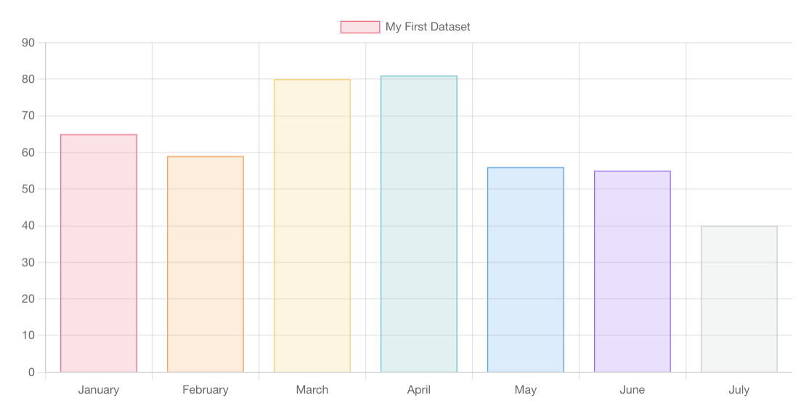{data-zoom-image}
<figcaption>`bar`</figcaption>
</figure>
<figure markdown>
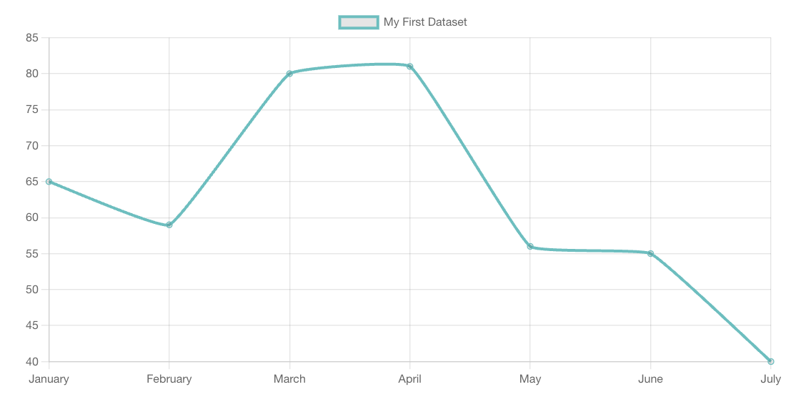{data-zoom-image}
<figcaption>`line`</figcaption>
</figure>
<figure markdown>
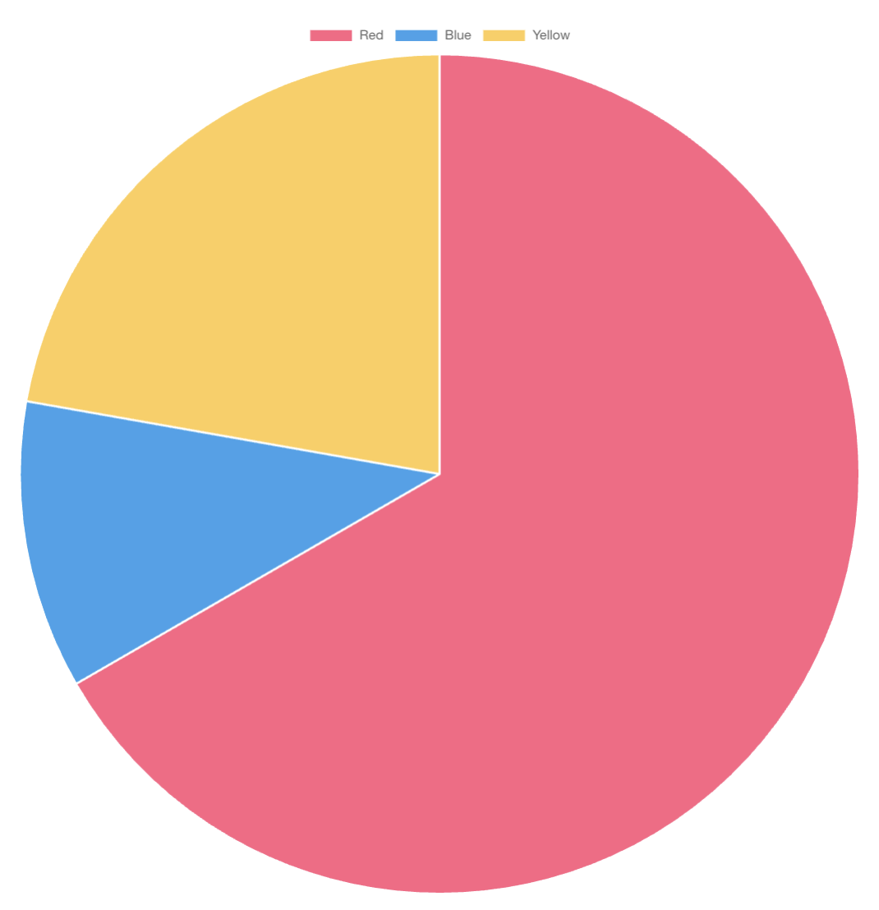{data-zoom-image}
<figcaption>`pie`</figcaption>
</figure>
<figure markdown>
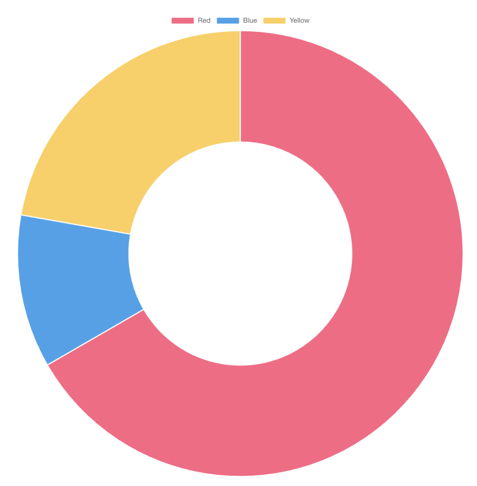{data-zoom-image}
<figcaption>`doughnut`</figcaption>
</figure>
<figure markdown>
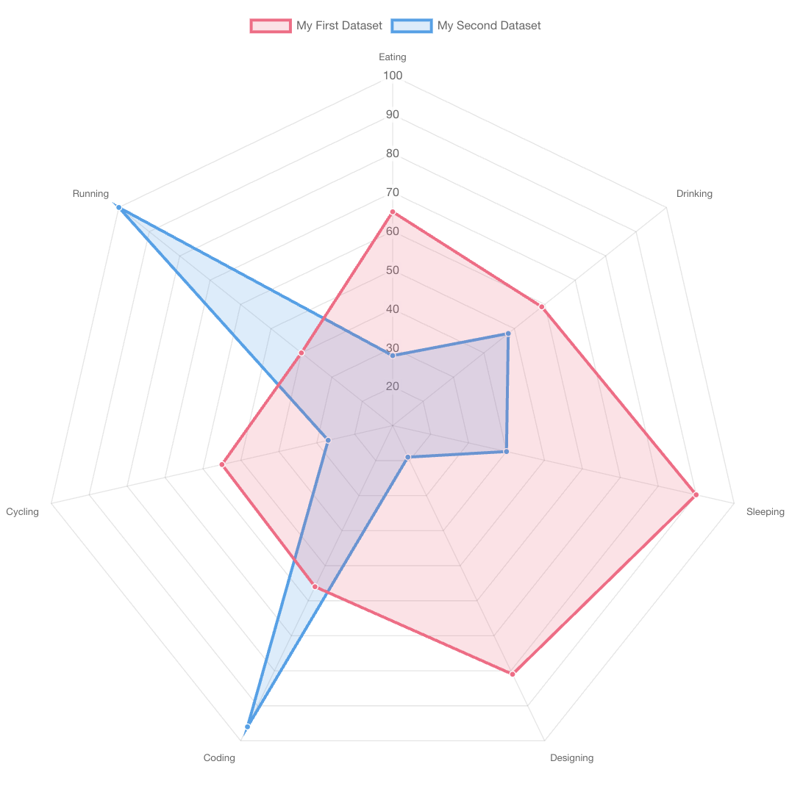{data-zoom-image}
<figcaption>`radar`</figcaption>
</figure>
<figure markdown>
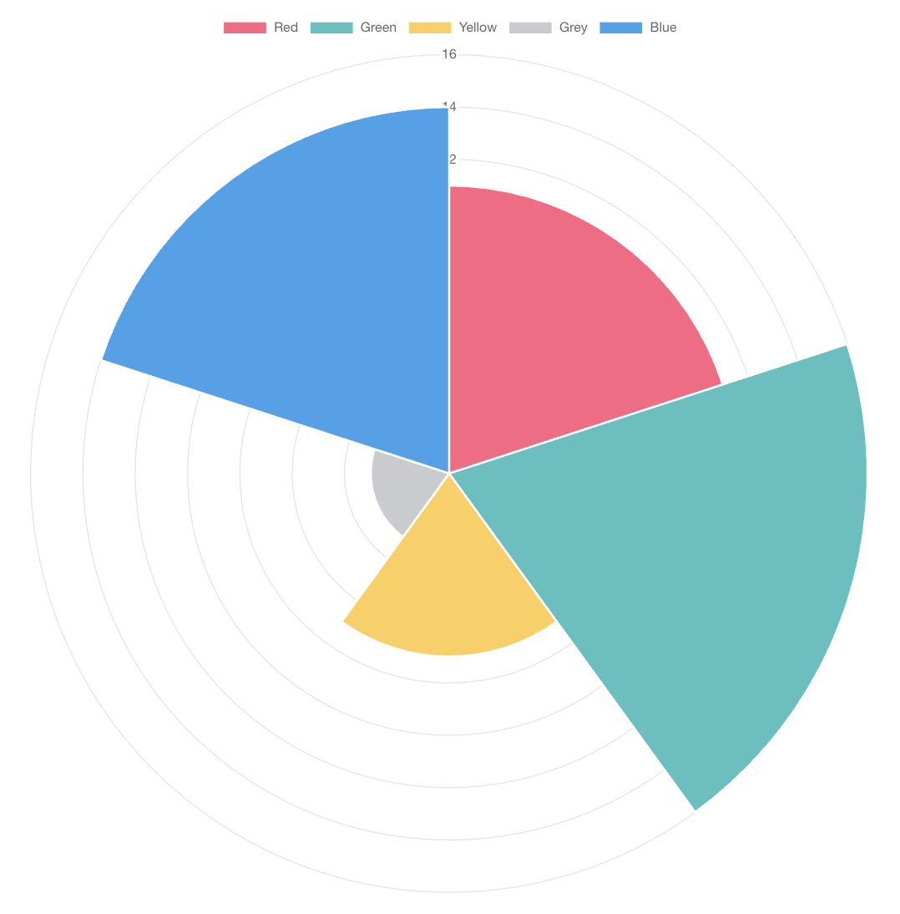{data-zoom-image}
<figcaption>`polarArea`</figcaption>
</figure>
<figure markdown>
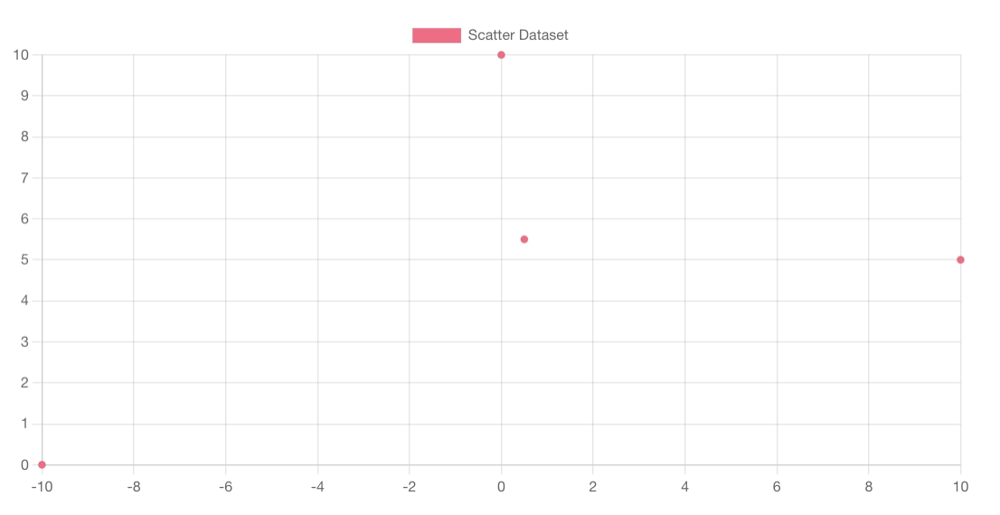{data-zoom-image}
<figcaption>`scatter`</figcaption>
</figure>
<figure markdown>
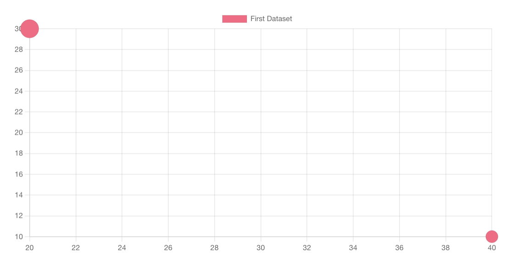{data-zoom-image}
<figcaption>`bubble`</figcaption>
</figure>
</div>

### Quelques options utiles

Les `options` personnalisent le comportement et l'apparence. Toutes sont dans la [documentation](https://www.chartjs.org/docs/latest/).

```js
options: {
  responsive: true,
  plugins: {
    legend: { position: "top" },
    title: { display: true, text: "Ventes de la semaine" }
  },
  scales: {
    y: { beginAtZero: true }
  }
}
```

| Option | Effet |
| :--- | :--- |
| `responsive: true` | Le graphique s'adapte à la taille de son conteneur |
| `plugins.legend` | Position/affichage de la légende |
| `plugins.title` | Titre du graphique |
| `scales.y.beginAtZero` | Force l'axe vertical à démarrer à 0 |

!!! tip "Responsive : encadrez le canvas"

    Pour maîtriser la taille, placez le `<canvas>` dans une `<div>` conteneur de dimensions fixes (ex. : `class="w-full max-w-xl"`) plutôt que de dimensionner le canvas directement.

<!-- CODEPEN: changer le type et les options d'un même jeu de données -->

### Exercice bonus - Chart.js

<div class="grid grid-1-2" markdown>
  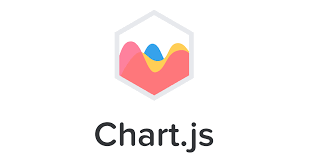{.aspect-4-3}

  <small>Exercice - Chart.js (bonus)</small><br>
  **[Bulletin de saison](./exercices/chartjs-bulletin.md){.stretched-link .back}**
</div>

---

!!! success "Ce qu'il faut retenir"

    Chaque librairie suit le même rituel : **installer → préparer un conteneur (`<canvas>` ou `<div>`) → appeler la librairie avec une configuration**. Une fois ce réflexe acquis, vous pouvez apprivoiser **n'importe quelle** nouvelle librairie à partir de sa documentation. C'est l'autonomie visée par le cours 🎓.


---

## Remise Exercices 02

[Énoncé de la remise Exercices 02](./devoir/exercices-02.md){ .md-button .md-button--primary }
