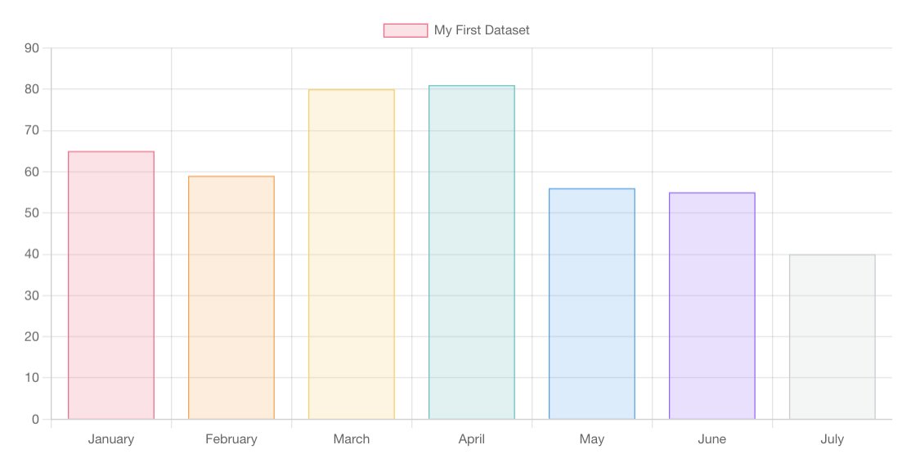
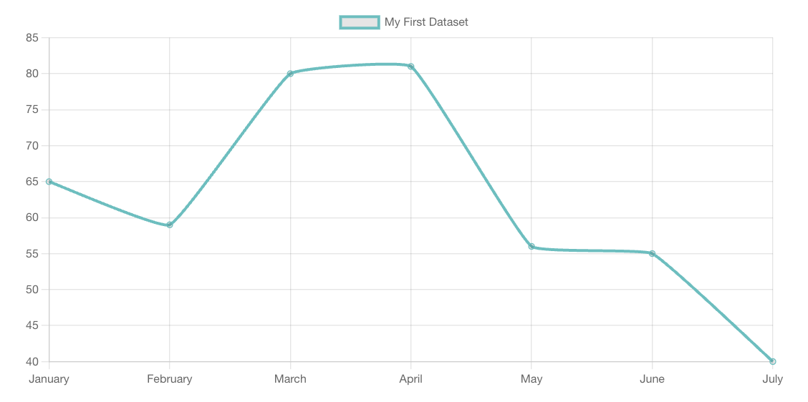
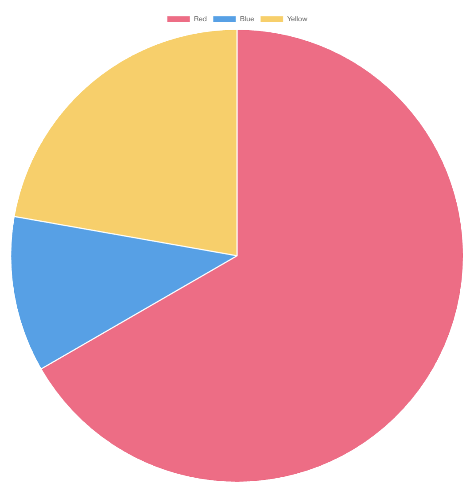
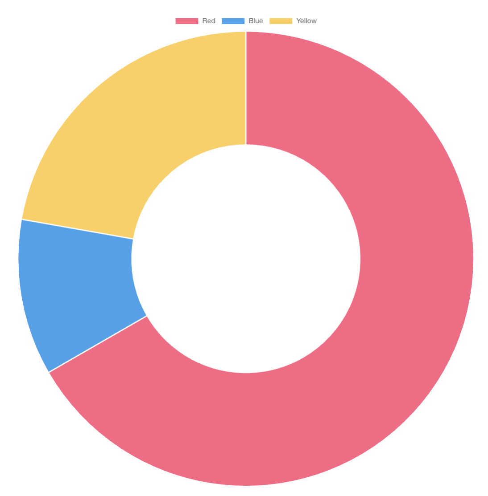
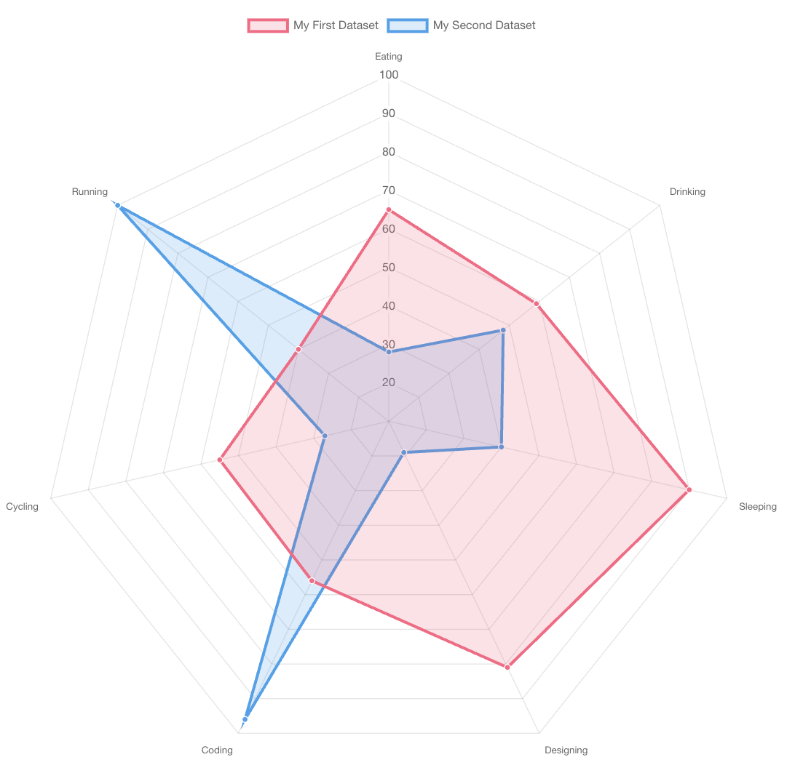
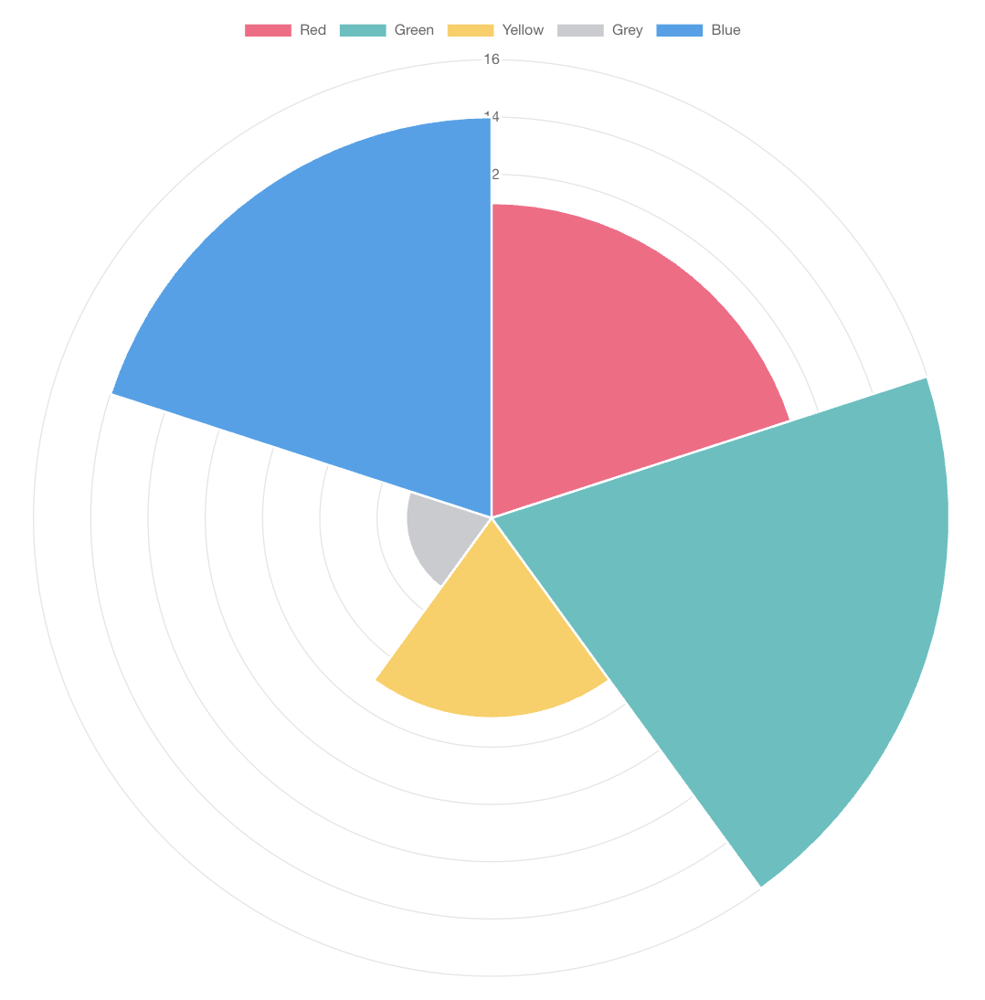
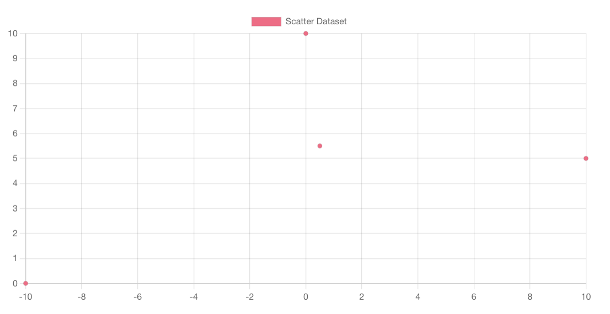
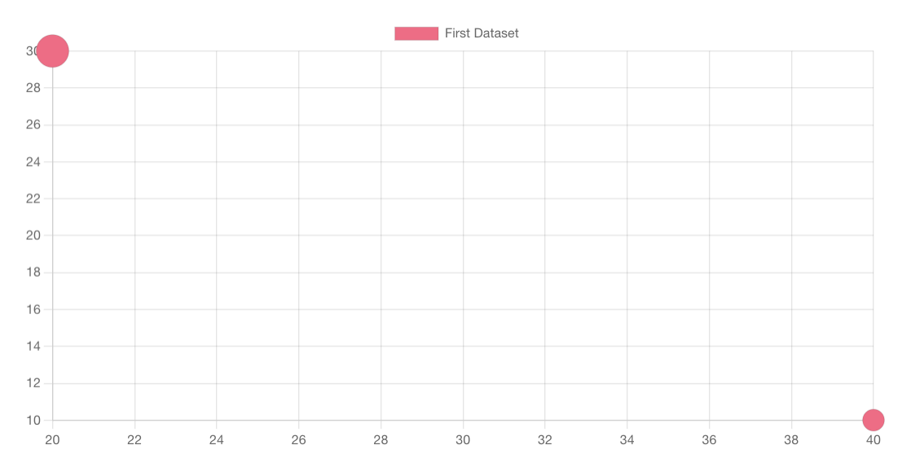
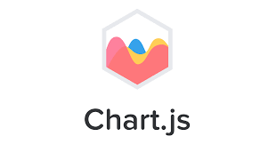

# Cours 12 | 3D sur le Web et sauvegarde côté client

[STOP]

<!-- **Savoirs :** #1 Programmation fonctionnelle · #11 Sauvegarde côté client · #15 Interactivité · Intégration, classement et optimisation des médias · #16 Visualisation via librairie (bonus) -->

*[DOM]: Document Object Model
*[npm]: Node Package Manager
*[AR]: Augmented Reality (réalité augmentée)
*[glTF]: GL Transmission Format
*[GLB]: glTF Binary

Vos modèles Maya méritent mieux qu'un rendu figé&nbsp;: aujourd'hui, ils entrent **dans le navigateur**, en 3D temps réel, manipulables à la souris et même posables dans votre salon en réalité augmentée 🪄. Au menu&nbsp;:

<div class="grid grid-1-4" markdown>
  :material-cube-outline: **Partie 1** - De Maya au navigateur&nbsp;: exporter et optimiser un modèle
</div>

<div class="grid grid-1-4" markdown>
  :material-rotate-3d-variant: **Partie 2** - `<model-viewer>`&nbsp;: une vitrine 3D en une balise HTML
</div>

<div class="grid grid-1-4" markdown>
  :material-content-save-outline: **Partie 3** - Personnaliser et **mémoriser** les choix du visiteur avec `localStorage`
</div>

<div class="grid grid-1-4" markdown>
  :material-star-plus: **Bonus** - Chart.js (graphiques) et Three.js (3D sur mesure)
</div>

---

# Partie 1 - De Maya au navigateur

## Le format de la 3D sur le Web : glTF

Le Web a ses formats d'image (JPEG, WebP, AVIF). Pour la 3D, le standard s'appelle **glTF**, surnommé le «&nbsp;JPEG de la 3D&nbsp;». Il existe en deux saveurs&nbsp;:

| Format | Contenu | Usage |
| :--- | :--- | :--- |
| `.gltf` | Un fichier texte (JSON) + des fichiers séparés (géométrie `.bin`, textures `.png`/`.jpg`) | Pratique pour inspecter ou modifier |
| `.glb` | **Tout** dans un seul fichier binaire | ⭐️ Le format à utiliser sur un site |

Un `.glb` contient la géométrie, les matériaux (PBR), les textures et même les **animations**. Un seul fichier à placer dans le projet, comme une image.

!!! question "Et le `.fbx` ou le `.obj` ?"

    Ce sont des formats d'**échange** entre logiciels 3D, pas des formats de diffusion. Ils sont lourds, et les navigateurs ne les lisent pas directement. Sur le Web, on livre du `.glb`.

## Le pipeline : Maya → FBX → Blender → GLB

Maya n'offre pas (encore) d'export glTF natif. Le chemin le plus simple et gratuit passe par **Blender**, qui sert ici de convertisseur&nbsp;:

```txt
Maya ──(FBX)──▶ Blender ──(glTF 2.0)──▶ .glb ──(optimisation)──▶ .glb léger ──▶ site Vite
```

### 1. Préparer la scène dans Maya

Quelques minutes de ménage évitent bien des surprises à l'arrivée&nbsp;:

- [ ] **Centrer** le modèle à l'origine, pivot à la base (les pieds d'un personnage, le dessous d'un objet)
- [ ] **Freeze Transformations** et **Delete History** sur les objets à exporter
- [ ] Vérifier les **normales** (faces inversées = trous dans le modèle)
- [ ] Utiliser des matériaux **Standard Surface** plutôt que Lambert / Phong, et des textures en `.png` ou `.jpg`
- [ ] Animations&nbsp;: **cuire** (_bake_) les clés, et ne garder que les animations utiles

### 2. Exporter en FBX

**File → Export Selection…** → type **FBX export**. Dans les options&nbsp;: cocher **Smoothing Groups**, **Embed Media** (textures incluses) et, s'il y a lieu, **Animation**.

### 3. Convertir dans Blender

1. **File → Import → FBX (.fbx)**, puis vérifier visuellement le modèle (échelle, matériaux, textures).
2. Si une texture manque, la reconnecter dans l'onglet **Shading**.
3. **File → Export → glTF 2.0 (.glb/.gltf)** avec&nbsp;:
    * **Format**&nbsp;: _glTF Binary (.glb)_
    * **Include → Limit to**&nbsp;: _Selected Objects_ (si la scène contient autre chose)
    * **Animation**&nbsp;: cochée si le modèle est animé

!!! warning "L'échelle"

    Maya travaille en **centimètres**, glTF en **mètres**. Un personnage peut arriver 100 fois trop grand. Pour une simple vitrine, ce n'est pas grave (la caméra s'ajuste toute seule), mais en **réalité augmentée**, l'objet apparaîtra à cette échelle dans la pièce. Vérifiez les dimensions dans Blender avant l'export.

## Optimiser le modèle

Comme pour les images et les vidéos du cours 7, un modèle 3D se **compresse**. Un `.glb` de 40&nbsp;Mo, c'est une page qui charge pendant de longues secondes sur un cellulaire.

**[gltf.report](https://gltf.report/)** permet de glisser-déposer un `.glb` pour l'inspecter&nbsp;: poids, nombre de triangles, taille des textures. C'est le réflexe de base pour comprendre **ce qui pèse**.

Pour compresser, l'outil en ligne de commande **gltf-transform** fait tout en une passe&nbsp;:

```bash title="Terminal"
npx @gltf-transform/cli optimize perso.glb perso-opt.glb --compress draco --texture-compress webp --texture-size 1024
```

| Option | Effet |
| :--- | :--- |
| `--compress draco` | Compresse la **géométrie** |
| `--texture-compress webp` | Convertit les textures en **WebP** |
| `--texture-size 1024` | Limite les textures à 1024&nbsp;×&nbsp;1024&nbsp;px |

!!! tip "Repères de poids"

    Pour un modèle vedette sur une page d'accueil, visez **quelques mégaoctets au maximum**. Ce sont presque toujours les **textures** qui pèsent le plus&nbsp;: une texture 4096&nbsp;px est rarement justifiée sur un écran de cellulaire.

## Où placer le fichier ?

Dans un projet Vite, les modèles vont dans `public/`, classés comme les autres médias&nbsp;:

```txt
public/
└── modeles/
    ├── perso.glb
    └── perso-poster.webp
```

Le fichier est alors accessible à l'adresse `/modeles/perso.glb`.

!!! info "Pas de modèle sous la main ?"

    Le répertoire **[glTF Sample Assets](https://github.com/KhronosGroup/glTF-Sample-Assets)** de Khronos offre des dizaines de modèles d'exemple libres, animés ou non, pour tester en attendant.

---

# Partie 2 - Une vitrine 3D avec `<model-viewer>`

**[`<model-viewer>`](https://modelviewer.dev/)**, développé par Google, affiche un modèle 3D interactif avec **une seule balise HTML**. Rotation à la souris, éclairage réaliste, animations, réalité augmentée&nbsp;: tout est inclus.

!!! note "Une composante Web"

    `<model-viewer>` n'est pas une balise standard du HTML&nbsp;: c'est une **composante Web** (_Web Component_), une balise «&nbsp;maison&nbsp;» créée en JavaScript. Une fois la librairie importée, elle s'écrit dans `index.html` comme n'importe quelle autre balise, avec l'autocomplétion habituelle pour son contenu.

## Installation

```bash title="Terminal"
npm install @google/model-viewer three
```

```js title="src/main.js"
import "./style.css"
import "@google/model-viewer"
```

C'est tout. L'import enregistre la balise `<model-viewer>` dans le navigateur.

## Premier modèle

```html title="index.html"
<model-viewer
  src="/modeles/perso.glb"
  alt="Le héros du jeu, tenant son épée"
  camera-controls
  auto-rotate
  shadow-intensity="1"
  class="w-full h-[60vh]">
</model-viewer>
```

!!! warning "Donner une taille"

    Par défaut, `<model-viewer>` est minuscule (300&nbsp;×&nbsp;150&nbsp;px). Il faut **toujours** lui donner une largeur et une hauteur, ici avec Tailwind (`w-full h-[60vh]`).

!!! tip "L'attribut `alt`"

    Comme pour une image, `alt` décrit le modèle pour les lecteurs d'écran. Sans lui, un visiteur non voyant ne sait pas ce que la vitrine présente.

## Les attributs essentiels

| Attribut | Rôle |
| :--- | :--- |
| `src` | Le fichier `.glb` |
| `alt` | Description pour l'accessibilité |
| `camera-controls` | Permet de tourner autour du modèle (souris, doigt) |
| `disable-zoom` | Désactive le zoom à la molette |
| `auto-rotate` | Rotation automatique lente |
| `camera-orbit` | Angle de départ de la caméra (`"45deg 75deg 105%"`) |
| `shadow-intensity` | Ombre portée au sol (`0` à `1`) |
| `exposure` | Luminosité générale |
| `environment-image` | Éclairage d'ambiance (`"neutral"` ou une image HDR) |
| `poster` | Image affichée pendant le chargement |
| `autoplay` | Joue l'animation au chargement |
| `animation-name` | Choisit **quelle** animation jouer |
| `ar` | Active le bouton de réalité augmentée |

Tous les attributs sont documentés, avec exemples interactifs, sur **[modelviewer.dev](https://modelviewer.dev/docs/)**.

!!! warning "`camera-controls` et défilement"

    Sur une page qui défile (scrollytelling, ScrollTrigger), la molette risque de **zoomer** dans le modèle au lieu de faire défiler la page. Ajoutez `disable-zoom` dans ce cas.

## Une vitrine soignée : `poster` et chargement

Un modèle 3D prend un moment à charger. Une image `poster` (une capture du modèle, en WebP) s'affiche en attendant, comme le `poster` d'une `<video>`&nbsp;:

```html
<model-viewer
  src="/modeles/perso.glb"
  poster="/modeles/perso-poster.webp"
  loading="lazy"
  alt="Le héros du jeu"
  camera-controls
  class="w-full h-[60vh]">
</model-viewer>
```

`loading="lazy"` attend que le modèle approche de l'écran pour le télécharger, exactement comme pour les images.

## Jouer les animations de Maya

Si le `.glb` contient des animations, `autoplay` lance la première. `animation-name` permet de choisir laquelle&nbsp;:

```html
<model-viewer src="/modeles/perso.glb" autoplay animation-name="Idle" camera-controls></model-viewer>
```

Pour connaître le nom des animations disponibles, on peut les afficher en console une fois le modèle chargé&nbsp;:

```js
const vitrine = document.querySelector("model-viewer")

vitrine.addEventListener("load", () => {
  console.log(vitrine.availableAnimations) // ["Idle", "Run", "Attack"]
})
```

## Les points d'intérêt (_hotspots_)

Un point d'intérêt est un élément HTML **accroché** à un endroit précis du modèle. Il suit le modèle quand on le fait tourner. Parfait pour présenter l'équipement d'un personnage ou les détails d'un objet.

```html
<model-viewer src="/modeles/perso.glb" camera-controls class="w-full h-[60vh]">

  <button class="badge badge-primary"
          slot="hotspot-epee"
          data-position="0.35 1.1 0.1"
          data-normal="0 0 1">
    Épée légendaire
  </button>

</model-viewer>
```

| Attribut | Rôle |
| :--- | :--- |
| `slot="hotspot-…"` | Déclare l'élément comme point d'intérêt (le nom après `hotspot-` est libre) |
| `data-position` | Coordonnées x y z sur le modèle |
| `data-normal` | Direction de la surface (sert à masquer le point quand il passe derrière) |

!!! tip "Trouver les coordonnées sans calcul"

    L'**[éditeur de model-viewer](https://modelviewer.dev/editor/)** permet de glisser son `.glb`, de cliquer sur le modèle pour placer un point d'intérêt, puis de copier le code généré.

Et comme le point d'intérêt est un élément HTML ordinaire, il se stylise avec Tailwind et DaisyUI (`badge`, `tooltip`, `btn`…).

## La réalité augmentée

Trois attributs suffisent pour qu'un bouton «&nbsp;Voir dans votre espace&nbsp;» apparaisse sur cellulaire&nbsp;:

```html
<model-viewer src="/modeles/perso.glb" ar ar-modes="webxr scene-viewer quick-look" camera-controls></model-viewer>
```

Sur Android comme sur iPhone, le visiteur peut alors poser le modèle dans la pièce, à travers la caméra 📱. Sur ordinateur, le bouton n'apparaît tout simplement pas.

!!! info "Tester la réalité augmentée"

    L'AR exige un **vrai cellulaire** et une page servie en **HTTPS**. Le plus simple&nbsp;: tester sur la version en ligne du site (GitHub Pages ou cPanel, cours 5).

## Animer la vitrine avec GSAP

`<model-viewer>` se pilote aussi en JavaScript. Sa propriété `cameraOrbit` contrôle l'angle de la caméra&nbsp;: en la liant au défilement avec ScrollTrigger, le modèle **tourne sur lui-même pendant qu'on fait défiler la page**.

```js title="src/main.js"
import gsap from "gsap"
import { ScrollTrigger } from "gsap/ScrollTrigger"
import "@google/model-viewer"

gsap.registerPlugin(ScrollTrigger)

const vitrine = document.querySelector("#vitrine")
const camera = { angle: 0 }

gsap.to(camera, {
  angle: 360,
  ease: "none",
  scrollTrigger: {
    trigger: ".scene-3d",
    start: "top top",
    end: "+=1500",
    pin: true,
    scrub: 1
  },
  onUpdate: () => {
    vitrine.cameraOrbit = `${camera.angle}deg 75deg 105%`
  }
})
```

!!! note "Animer un objet ordinaire"

    GSAP n'anime pas seulement du CSS&nbsp;: il peut animer **n'importe quelle propriété d'un objet JavaScript** (ici `camera.angle`). À chaque image, `onUpdate` recopie la valeur dans le modèle. Cette astuce fonctionne avec presque toutes les librairies.

---

# Partie 3 - Personnaliser et mémoriser avec `localStorage`

## Changer la couleur d'un matériau

Une fois le modèle chargé, ses matériaux sont accessibles en JavaScript. On peut en changer la couleur à la volée, pour créer un petit **configurateur**&nbsp;: couleur d'armure, variante d'un objet, édition spéciale...

```html title="index.html"
<model-viewer id="vitrine" src="/modeles/perso.glb" camera-controls class="w-full h-[60vh]"></model-viewer>

<div class="flex gap-2">
  <button class="btn btn-circle bg-[#e63946]" data-couleur="#e63946" aria-label="Rouge"></button>
  <button class="btn btn-circle bg-[#2a9d8f]" data-couleur="#2a9d8f" aria-label="Turquoise"></button>
  <button class="btn btn-circle bg-[#f4a261]" data-couleur="#f4a261" aria-label="Orange"></button>
</div>
```

```js title="src/main.js"
const vitrine = document.querySelector("#vitrine")
const pastilles = document.querySelectorAll("[data-couleur]")

vitrine.addEventListener("load", () => {
  const materiau = vitrine.model.materials[0]

  pastilles.forEach((pastille) => {
    pastille.addEventListener("click", () => {
      materiau.pbrMetallicRoughness.setBaseColorFactor(pastille.dataset.couleur)
    })
  })
})
```

!!! info "Matériau texturé"

    Si le matériau a une texture de couleur, `setBaseColorFactor` la **teinte** au lieu de la remplacer (la couleur est multipliée par la texture). Pour un changement franc, prévoir dans Maya un matériau sans texture de couleur pour la partie personnalisable.

!!! tip "Trouver le bon matériau"

    `vitrine.model.materials` est un tableau. Pour viser un matériau précis, nommez-le clairement dans Maya (`armure`, `cape`…) et utilisez `vitrine.model.getMaterialByName("armure")`.

Problème&nbsp;: au rechargement de la page, la couleur choisie est **oubliée**. C'est ici qu'intervient la sauvegarde côté client.

## Le `localStorage`

Le `localStorage` est un petit espace de stockage **clé / valeur** offert par le navigateur. Ce qu'on y écrit **survit** au rechargement et à la fermeture de l'onglet, pour ce site seulement.

```js
// Écrire
localStorage.setItem("couleur-perso", "#e63946")

// Lire (null si la clé n'existe pas)
const couleur = localStorage.getItem("couleur-perso")

// Effacer
localStorage.removeItem("couleur-perso")
```

!!! warning "Seulement du texte"

    Le `localStorage` ne stocke que des **chaînes de caractères**. Pour un objet ou un tableau, on le convertit avec `JSON.stringify()` à l'écriture, et `JSON.parse()` à la lecture&nbsp;:

    ```js
    localStorage.setItem("reglages", JSON.stringify({ couleur: "#e63946", animation: "Idle" }))

    const reglages = JSON.parse(localStorage.getItem("reglages")) ?? {}
    ```

!!! tip "Voir le contenu du `localStorage`"

    DevTools → onglet **Application** → **Local Storage**. On y voit chaque clé, on peut les modifier ou les supprimer à la main pour tester.

## Le configurateur qui se souvient

Le principe tient en deux temps&nbsp;: **au clic**, on applique et on sauvegarde&nbsp;; **au chargement**, on relit et on réapplique.

```js title="src/main.js"
const vitrine = document.querySelector("#vitrine")
const pastilles = document.querySelectorAll("[data-couleur]")

vitrine.addEventListener("load", () => {
  const materiau = vitrine.model.materials[0]

  function appliquerCouleur(couleur) {
    materiau.pbrMetallicRoughness.setBaseColorFactor(couleur)
    localStorage.setItem("couleur-perso", couleur)
  }

  // 1. Au chargement : relire le choix précédent
  const couleurSauvegardee = localStorage.getItem("couleur-perso")
  if (couleurSauvegardee) {
    appliquerCouleur(couleurSauvegardee)
  }

  // 2. Au clic : appliquer et sauvegarder
  pastilles.forEach((pastille) => {
    pastille.addEventListener("click", () => appliquerCouleur(pastille.dataset.couleur))
  })
})
```

Rechargez la page&nbsp;: le personnage garde sa couleur 🎉.

## Retour sur le thème DaisyUI

Voici le chaînon manquant du cours 4&nbsp;: le `theme-controller` changeait le thème, mais **l'oubliait** au rechargement. Même recette&nbsp;:

```html title="index.html"
<input type="checkbox" value="dark" class="toggle theme-controller" />
```

```js title="src/main.js"
const interrupteur = document.querySelector(".theme-controller")

// Au chargement : remettre l'interrupteur dans l'état sauvegardé
interrupteur.checked = localStorage.getItem("theme") === interrupteur.value

// Au changement : sauvegarder
interrupteur.addEventListener("change", () => {
  localStorage.setItem("theme", interrupteur.checked ? interrupteur.value : "light")
})
```

DaisyUI applique le thème dès que la case est cochée&nbsp;; il suffit donc de **remettre la case** dans le bon état au chargement.

!!! success "Ce qu'on vient de faire"

    Un modèle conçu dans Maya, exporté et optimisé comme n'importe quel média (cours 7), présenté dans une vitrine interactive, animé au défilement avec GSAP (cours 9 et 10), et personnalisable avec une **mémoire** côté client (savoir #11). Exactement le genre de pièce vedette qui distingue un site promotionnel.

## Exercices - 3D et `localStorage`

<div class="grid grid-1-2" markdown>
  <!-- {.aspect-4-3} -->

  <small>Exercice - model-viewer</small><br>
  **[Vitrine 3D](./exercices/3d-vitrine.md){.stretched-link .back}**
</div>

<div class="grid grid-1-2" markdown>
  <!-- {.aspect-4-3} -->

  <small>Exercice - model-viewer et localStorage</small><br>
  **[Atelier de personnalisation](./exercices/3d-atelier.md){.stretched-link .back}**
</div>

*Vitrine 3D* et *Atelier de personnalisation* font partie de la remise *Exercices 02*.

---

# Bonus 1 - Chart.js (optionnel)

!!! info "Pour les curieux - non obligatoire"

    Chart.js ne fait pas partie de la remise *Exercices 02*. Il reste admissible comme **librairie supplémentaire** dans le projet final.

**[Chart.js](https://www.chartjs.org/)** transforme des données en **graphiques** clairs et animés, dessinés dans une balise `<canvas>`. C'est la librairie de visualisation la plus populaire&nbsp;: simple, responsive et gratuite.

## Installation

```bash
npm install chart.js
```

```js title="src/main.js"
import Chart from 'chart.js/auto'
```

!!! note "`chart.js/auto`"

    L'import `chart.js/auto` enregistre automatiquement tous les types de graphiques. Pratique pour apprendre&nbsp;; en production, on peut n'importer que ce qu'on utilise pour alléger le _build_.

## Un conteneur `<canvas>`

Chart.js **dessine** le graphique&nbsp;; il lui faut donc une toile. On lui réserve un `<canvas>` avec un identifiant.

```html
<canvas id="monGraphique"></canvas>
```

## Premier graphique

On crée une instance avec `new Chart(cible, configuration)`. La configuration est un objet à trois clés&nbsp;: **`type`**, **`data`** et **`options`**.

```js
const ctx = document.querySelector("#monGraphique")

new Chart(ctx, {
  type: "bar",                       // 1. le type de graphique
  data: {                            // 2. les données
    labels: ["Lun", "Mar", "Mer", "Jeu", "Ven"],
    datasets: [{
      label: "Ventes",
      data: [12, 19, 7, 15, 22]
    }]
  },
  options: {                         // 3. les réglages
    responsive: true
  }
})
```

<!-- CODEPEN: premier graphique Chart.js (barres) -->

### Anatomie des données

C'est le cœur de Chart.js. Deux notions&nbsp;:

| Clé | Rôle |
| :--- | :--- |
| `labels` | Les étiquettes de l'axe (ex.&nbsp;: les jours) |
| `datasets` | Un ou plusieurs **jeux de données** à tracer |
| `datasets[].label` | Le nom du jeu (affiché dans la légende) |
| `datasets[].data` | Les valeurs, **alignées** sur les `labels` |

!!! warning "Aligner `data` et `labels`"

    Le tableau `data` doit avoir **autant de valeurs** que `labels` a d'étiquettes. 5 jours → 5 valeurs. Sinon, le graphique sera décalé ou incomplet.

## Les types de graphiques

Il suffit de changer la clé `type` pour obtenir un rendu complètement différent&nbsp;:

<div class="grid" markdown>
<figure markdown>
{data-zoom-image}
<figcaption>`bar`</figcaption>
</figure>
<figure markdown>
{data-zoom-image}
<figcaption>`line`</figcaption>
</figure>
<figure markdown>
{data-zoom-image}
<figcaption>`pie`</figcaption>
</figure>
<figure markdown>
{data-zoom-image}
<figcaption>`doughnut`</figcaption>
</figure>
<figure markdown>
{data-zoom-image}
<figcaption>`radar`</figcaption>
</figure>
<figure markdown>
{data-zoom-image}
<figcaption>`polarArea`</figcaption>
</figure>
<figure markdown>
{data-zoom-image}
<figcaption>`scatter`</figcaption>
</figure>
<figure markdown>
{data-zoom-image}
<figcaption>`bubble`</figcaption>
</figure>
</div>

## Quelques options utiles

Les `options` personnalisent le comportement et l'apparence. Toutes sont dans la [documentation](https://www.chartjs.org/docs/latest/).

```js
options: {
  responsive: true,
  plugins: {
    legend: { position: "top" },
    title: { display: true, text: "Ventes de la semaine" }
  },
  scales: {
    y: { beginAtZero: true }
  }
}
```

| Option | Effet |
| :--- | :--- |
| `responsive: true` | Le graphique s'adapte à la taille de son conteneur |
| `plugins.legend` | Position/affichage de la légende |
| `plugins.title` | Titre du graphique |
| `scales.y.beginAtZero` | Force l'axe vertical à démarrer à 0 |

!!! tip "Responsive : encadrez le canvas"

    Pour maîtriser la taille, placez le `<canvas>` dans une `<div>` conteneur de dimensions fixes (ex.&nbsp;: `class="w-full max-w-xl"`) plutôt que de dimensionner le canvas directement.

<!-- CODEPEN: changer le type et les options d'un même jeu de données -->

## Exercice bonus - Chart.js

<div class="grid grid-1-2" markdown>
  {.aspect-4-3}

  <small>Exercice - Chart.js (bonus)</small><br>
  **[Bulletin de saison](./exercices/chartjs-bulletin.md){.stretched-link .back}**
</div>

---

# Bonus 2 - Three.js (optionnel)

!!! info "Pour les curieux - non obligatoire"

    **[Three.js](https://threejs.org/)** permet d'afficher de la **3D** dans le navigateur (WebGL). C'est d'ailleurs le moteur sur lequel repose `<model-viewer>`. Là où `<model-viewer>` présente **un** modèle, Three.js permet de construire une **scène complète** sur mesure (lumières, caméras, effets), mais il est nettement plus **avancé**. Cette partie est un **survol facultatif**&nbsp;: elle n'est pas requise pour le projet final. Explorez-la si le cœur vous en dit&nbsp;!

Toute scène 3D repose sur **trois objets**&nbsp;: une **scène** (le monde), une **caméra** (le point de vue) et un **renderer** (qui dessine).

```bash
npm install three
```

```js title="src/main.js"
import * as THREE from "three"

// 1. La scène, la caméra, le renderer
const scene = new THREE.Scene()
const camera = new THREE.PerspectiveCamera(75, window.innerWidth / window.innerHeight, 0.1, 1000)
const renderer = new THREE.WebGLRenderer()
renderer.setSize(window.innerWidth, window.innerHeight)
document.body.appendChild(renderer.domElement)

// 2. Un objet : une géométrie + un matériau = un « mesh »
const cube = new THREE.Mesh(
  new THREE.BoxGeometry(1, 1, 1),
  new THREE.MeshBasicMaterial({ color: 0x00ff00 })
)
scene.add(cube)
camera.position.z = 5

// 3. La boucle d'animation
function animate(temps) {
  cube.rotation.x = temps / 2000
  cube.rotation.y = temps / 1000
  renderer.render(scene, camera)
}
renderer.setAnimationLoop(animate)
```

Ce code affiche un **cube vert qui tourne**. À partir de là, on peut charger des modèles 3D, ajouter des lumières, des textures…

!!! tip "Où continuer"

    Le [manuel officiel](https://threejs.org/manual/) et la [galerie d'exemples](https://threejs.org/examples/) de Three.js sont la meilleure porte d'entrée. Idéal pour un élément 3D vedette (personnage, objet du jeu) sur votre page d'accueil.

---

!!! success "Ce qu'il faut retenir"

    Chaque librairie suit le même rituel&nbsp;: **installer → préparer un conteneur (`<canvas>` ou `<div>`) → appeler la librairie avec une configuration**. Une fois ce réflexe acquis, vous pouvez apprivoiser **n'importe quelle** nouvelle librairie à partir de sa documentation. C'est l'autonomie visée par le cours 🎓.


---

## Remise Exercices 02

[Énoncé de la remise Exercices 02](./devoir/exercices-02.md){ .md-button .md-button--primary }
