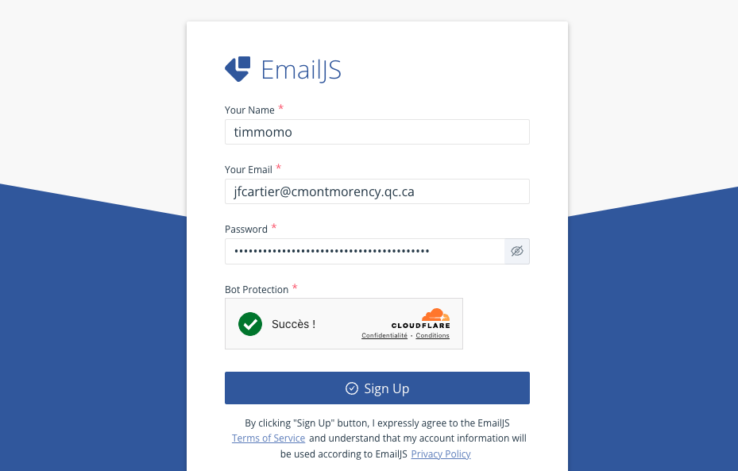
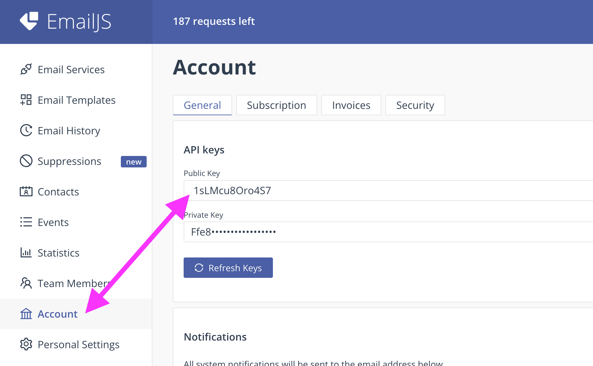
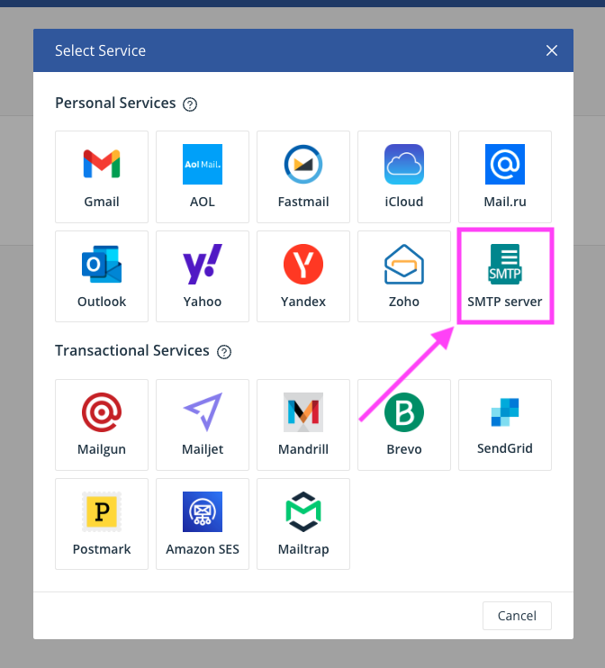
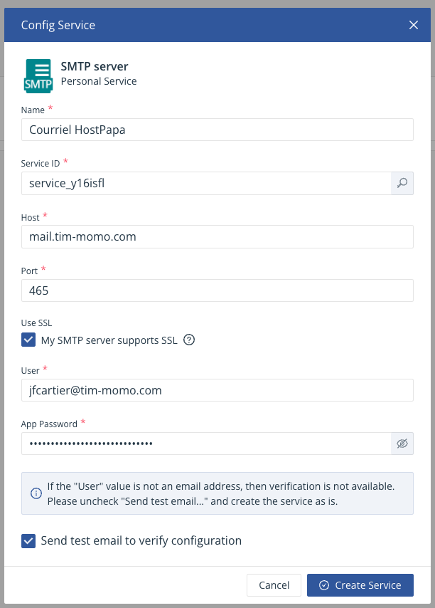
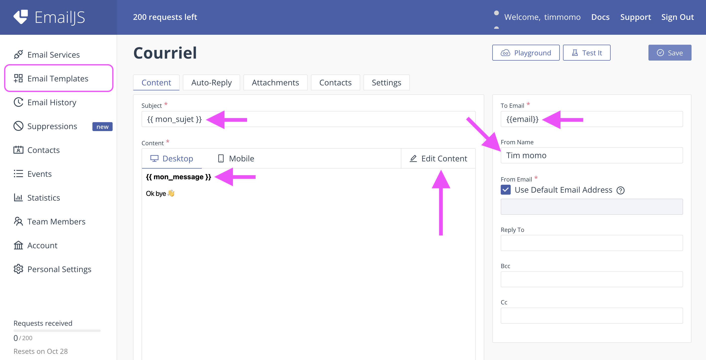
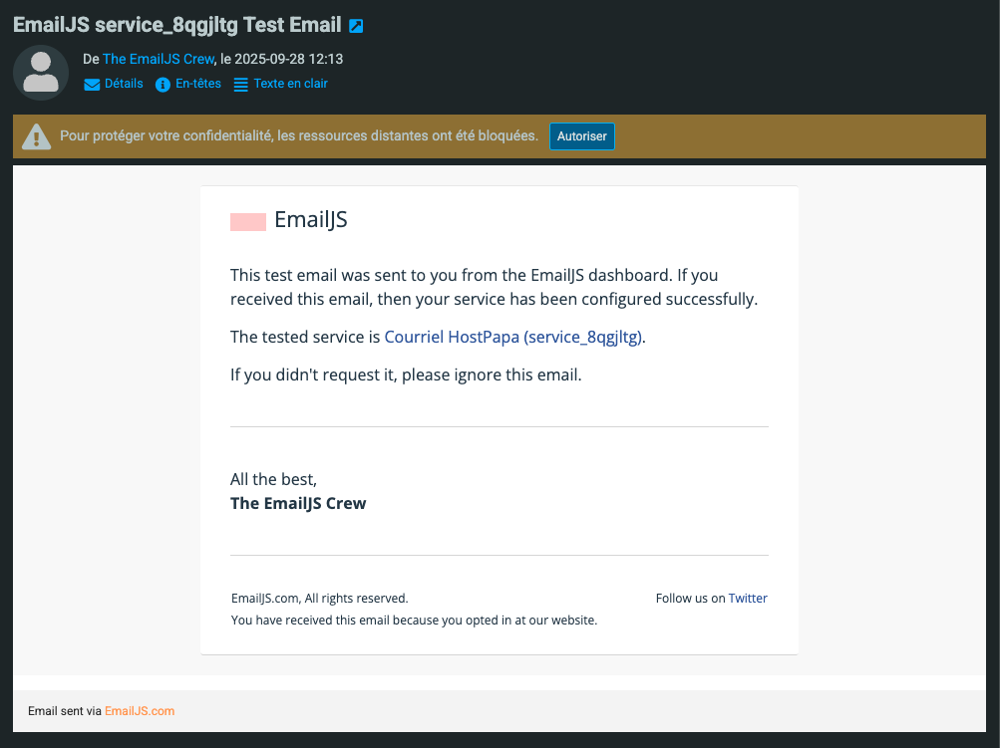

# Cours 13 | Séance de travail - projet final (1/2)

[STOP]

<!-- **Savoirs :** intégration de tous les acquis dans le projet (objectif intégrateur) -->

*[FTP]: File Transfer Protocol

{.w-100}

Place à la pratique&nbsp;! Cette séance et la suivante sont des **ateliers encadrés**&nbsp;: vous avancez votre **projet final** en autonomie, avec le soutien de l'enseignant. C'est ici que tout se rejoint.

!!! abstract "Le projet final"

    Vous réalisez le **site web promotionnel de votre jeu vidéo** - celui que vous développez en parallèle dans le cours d'**Interactivité ludique**. Vos propres médias de jeu (logo, captures d'écran, bande-annonce, musique et effets sonores) deviennent la matière première de votre site 🎮.

## Objectifs de l'atelier

- [ ] Rassembler et **optimiser les médias du jeu** (logo, captures, bande-annonce, sons - cours 7).
- [ ] Assembler l'interface avec **Tailwind + DaisyUI**&nbsp;: hero d'accueil, galerie de captures, section fonctionnalités (cours 2 à 4).
- [ ] Ajouter de l'**interactivité** en JavaScript - menu, onglets, sélecteur de thème mémorisé avec `localStorage` (cours 7 et 12).
- [ ] **Animer** l'ambiance avec GSAP&nbsp;: apparition au défilement, parallaxe, plugins (SplitText, DrawSVG, MorphSVG…), bande-annonce mise en valeur (cours 9 à 11).
- [ ] Intégrer **ma touche supplémentaire**&nbsp;: vitrine 3D avec **model-viewer**, **Tone.js**, **Chart.js** ou **Swup** (cours 12).
- [ ] Rendre le site **accessible**&nbsp;: textes alternatifs, boutons nommés, contraste, clavier et animations réduites (voir ci-dessous).

!!! tip "Travaillez par composantes"

    Découpez votre site en morceaux (navbar, hero, galerie, formulaire…) et avancez-en un à la fois. C'est plus motivant et plus facile à déboguer.

## L'accessibilité

Un site **accessible** peut être utilisé par tout le monde&nbsp;: une personne aveugle qui navigue avec un lecteur d'écran, une personne qui n'utilise que le clavier, une personne sensible au mouvement, ou simplement quelqu'un qui consulte le site en plein soleil sur son cellulaire.

La plupart des correctifs sont **petits**, et ils touchent des éléments déjà présents dans le projet.

### Les textes alternatifs

Chaque image porteuse de sens décrit son contenu dans l'attribut `alt`. Une image purement décorative reçoit un `alt` **vide**, pour que le lecteur d'écran l'ignore.

```html


```

!!! warning "À éviter"

    `alt="image"`, `alt="capture1"` ou le nom du fichier&nbsp;: ces textes n'apprennent rien au visiteur.

### Les boutons qui ne contiennent qu'une icône

Un bouton qui ne contient qu'une icône (son, menu, fermer) est **muet** pour un lecteur d'écran. L'attribut `aria-label` lui donne un nom.

```html
<button id="bouton-son" class="btn btn-ghost btn-circle" aria-label="Activer le son">
  <i data-lucide="volume-x"></i>
</button>
```

### Le contraste

Le texte doit se distinguer nettement de son arrière-plan. Les couleurs d'un thème maison DaisyUI sont à vérifier, en particulier le texte sur les couleurs `primary` et `secondary`.

- Outil&nbsp;: [WebAIM Contrast Checker](https://webaim.org/resources/contrastchecker/)
- Cible&nbsp;: un ratio d'au moins **4.5:1** pour le texte courant

### La navigation au clavier

Le site doit pouvoir se parcourir avec la touche ++tab++ seulement&nbsp;: liens de la navbar, boutons, champs du formulaire. À chaque élément atteint, un **contour de focus** doit être visible.

!!! tip "Le test le plus simple"

    Débrancher la souris (ou ne plus y toucher) et parcourir le site au complet avec ++tab++, ++shift+tab++ et ++enter++.

### Réduire les animations

Certaines personnes activent, dans leur système d'exploitation, l'option **Réduire les animations**&nbsp;: le mouvement à l'écran peut leur causer des nausées ou des vertiges. `gsap.matchMedia()`, déjà vu au cours 11, permet de respecter ce choix&nbsp;:

```js title="src/gsap.js"
const mm = gsap.matchMedia();

mm.add("(prefers-reduced-motion: no-preference)", () => {
  // Les animations placées ici ne jouent que
  // si le visiteur n'a PAS demandé de réduire les animations
  gsap.from(".hero-titre", { y: 100, opacity: 0, duration: 1 });
});
```

!!! info "Tester sans changer ses réglages"

    Dans les DevTools&nbsp;: ++ctrl+shift+p++ (++cmd+shift+p++ sur Mac), taper *reduced motion*, puis choisir **Emulate CSS prefers-reduced-motion: reduce**.

### Le son

Déjà exigé par l'énoncé, mais c'est aussi une question d'accessibilité&nbsp;: **aucun son au chargement**, et un bouton son toujours accessible pour couper l'ambiance.

### Vérifier avec Lighthouse

Les DevTools contiennent un outil d'audit&nbsp;: onglet **Lighthouse**, catégorie **Accessibilité**, puis **Analyser le chargement de la page**. Le rapport donne une note sur 100 et liste chaque problème avec l'élément fautif.

!!! tip "Viser 90 et plus"

    La plupart des points perdus viennent d'un `alt` manquant, d'un bouton sans nom ou d'un contraste trop faible. Les trois se corrigent en quelques minutes.

## Ajouter un formulaire de contact avec EmailJS

Un site professionnel a souvent un **formulaire de contact** qui envoie un courriel. Comme on n'a pas de serveur, on utilise **[EmailJS](https://www.emailjs.com/)**, un service qui envoie le courriel directement depuis le navigateur.

### Créer un compte



Créez un compte à l'adresse&nbsp;: <https://dashboard.emailjs.com/sign-up>

### Récupérer la clé publique

La clé publique se trouve dans l'onglet **Account**.



### Configurer un Email Service





1. Pour le **name**, ajouter « Courriel HostPapa »
1. Laisser intact le **Service ID** généré automatiquement
1. Pour le **host**, ajouter « mail.tim-momo.com »
1. Pour le **port**, ajouter « 465 »
1. Cocher « My SMTP server supports SSL »
1. Pour le **user**, utiliser le courriel créé sur cPanel (cours 5)
1. Pour le **App Password**, le mot de passe de ce courriel
1. Cocher « Send test email to verify configuration »
1. Cliquer sur **Create Service**

### Configurer un Email Template



Les modèles contiennent des **variables** remplacées par le contenu envoyé en JavaScript.

1. Choisir le modèle de départ « One-Time Password »
1. Cliquer sur **Create Template**
1. **Edit Content** → **Design Editor**
1. Retirer le contenu et ajouter la variable `{{mon_message}}`
1. **Apply Changes**
1. Dans le champ **Subject**, ajouter `{{mon_sujet}}`
1. **Save**

### Utiliser EmailJS dans le site

```bash
npm install @emailjs/browser
```

```html title="Lier au HTML"
<head>
  ...
  <script src="./node_modules/@emailjs/browser/dist/email.min.js" defer></script>
  <script src="./assets/js/scripts.js" defer></script>
</head>
```

```js title="scripts.js"
// Initialisation
emailjs.init({ publicKey: "VOTRE_PUBLIC_KEY" });

// Déclencheur
const service_id = "service_xxx";
const template_id = "template_xxx";
const form = document.querySelector("form");

form.addEventListener("submit", (event) => {
  event.preventDefault(); // évite le rechargement de la page

  const templateParams = {
    mon_sujet: form.sujet.value,      // <input name="sujet">
    mon_message: form.message.value,  // <textarea name="message">
    email: form.to_mail.value,        // <input name="to_mail">
  };

  emailjs.send(service_id, template_id, templateParams)
    .then(() => {
      // ✅ Succès
    })
    .catch((err) => {
      // ❌ Erreur
    });
});
```

{data-zoom-image}

## Finitions optionnelles

Pour peaufiner votre site, deux petites librairies amusantes&nbsp;:

- **[Typed.js](https://mattboldt.com/demos/typed-js/)** - un effet de texte « machine à écrire ».
- **[Rough Notation](https://roughnotation.com/)** - des annotations dessinées à la main (souligné, encerclé…).
