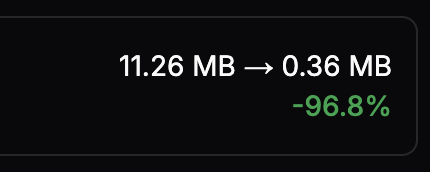
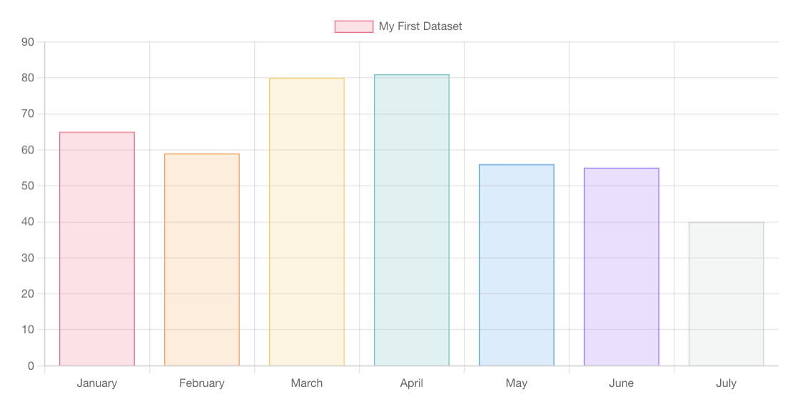
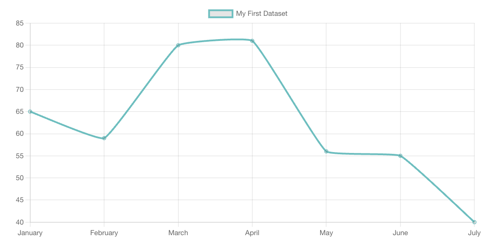
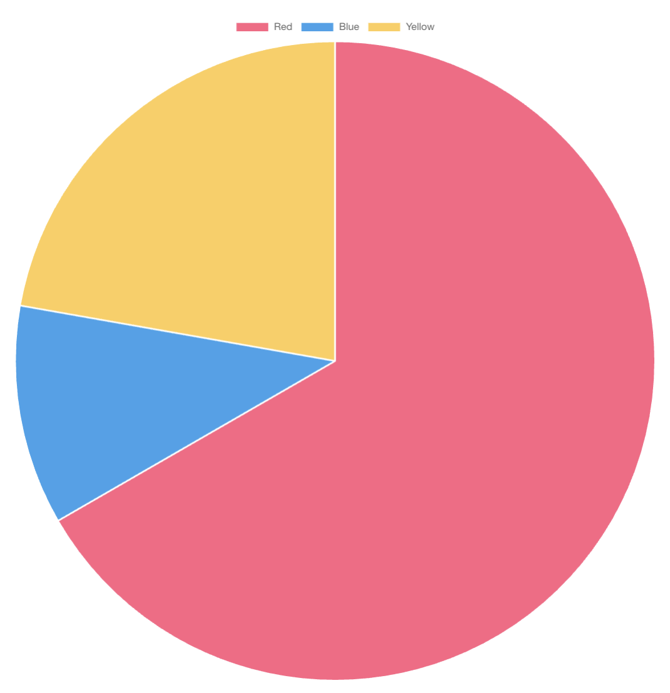
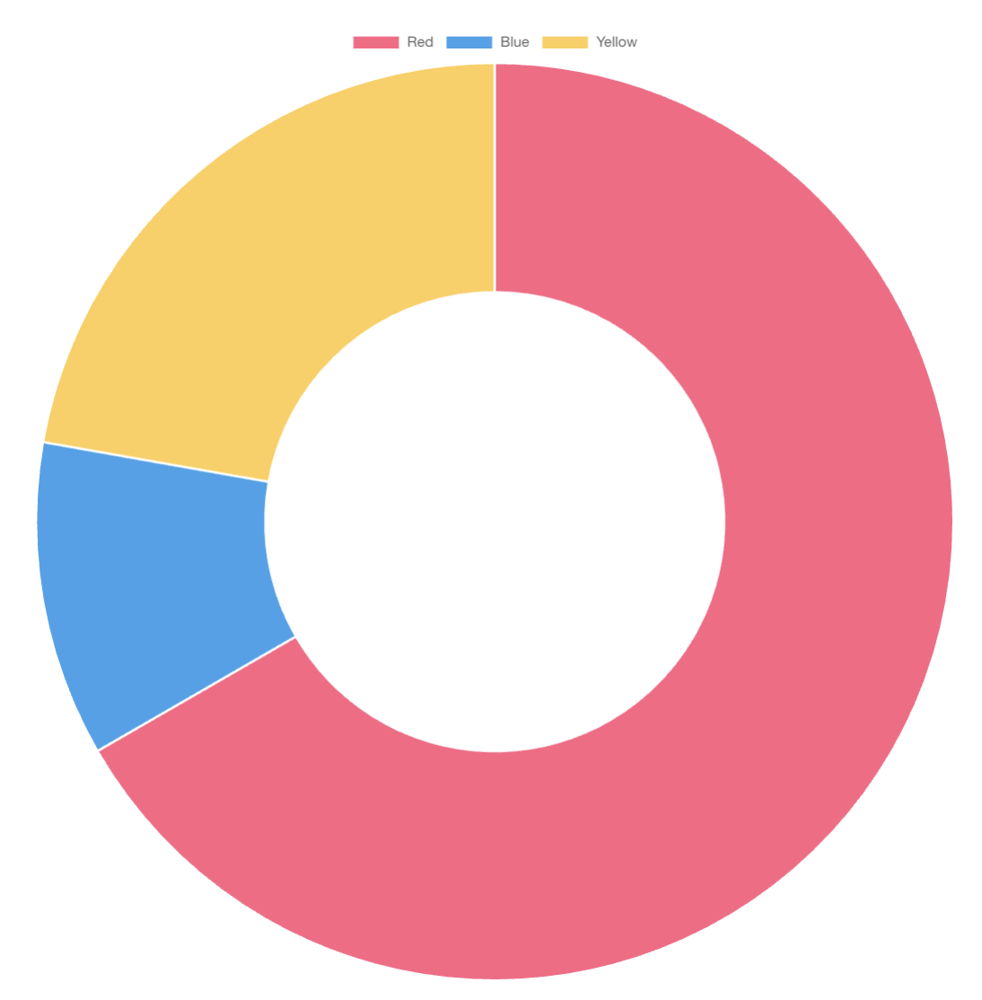
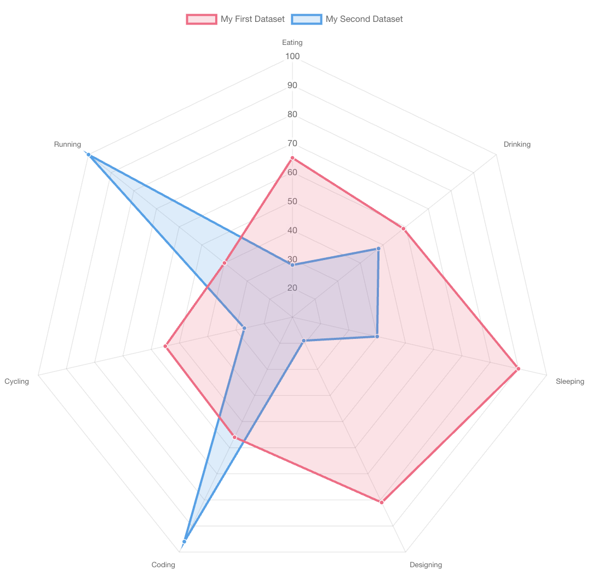
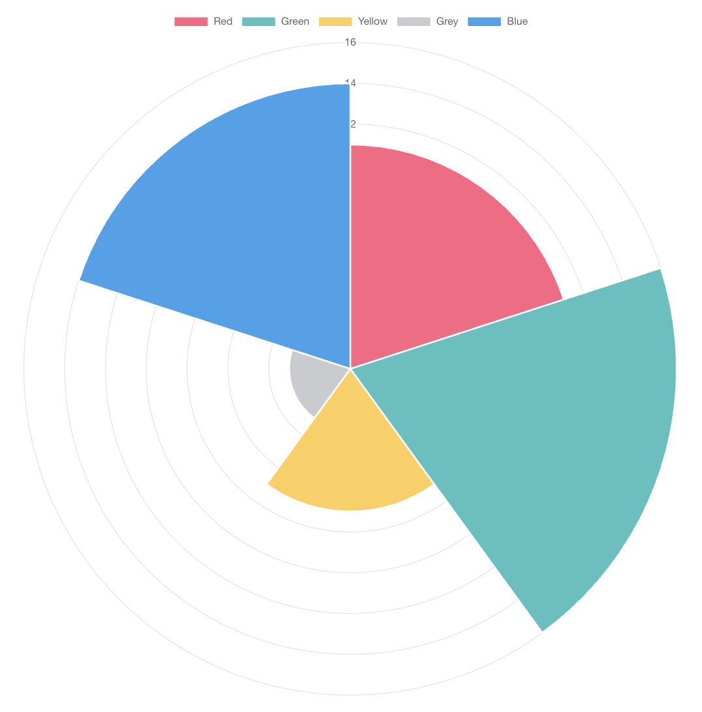
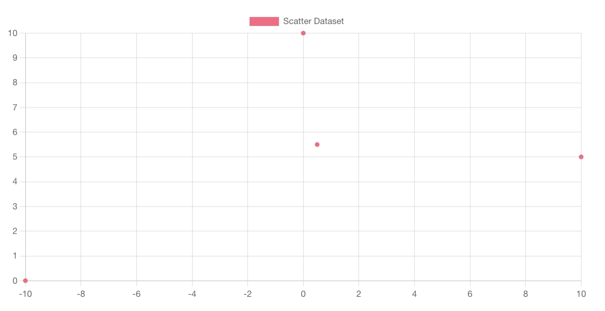
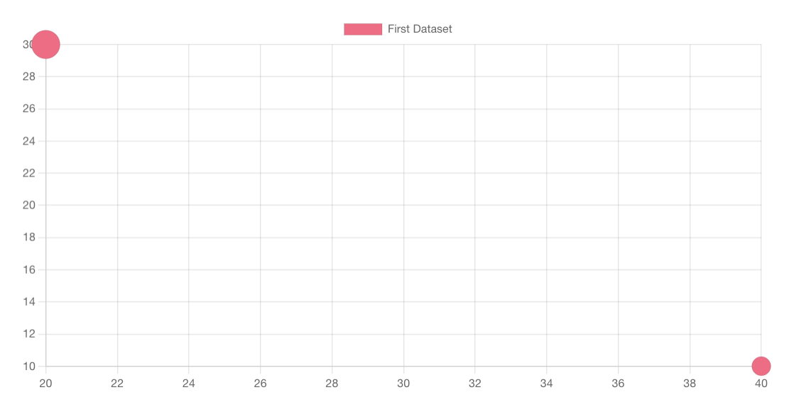
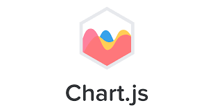

# Extras pour le projet final

Tout ce qui se trouve sur cette page est **facultatif**. Chaque librairie est une option possible de **ma touche supplémentaire** dans le [projet final](./devoir/projet-final/index.md). Une seule suffit.

## 3D

{.h-auto}

### Format Web

Le format 3D en Web s'appelle [**glTF**](https://threejsresources.com/3d-models-for-websites). Il existe sous deux formes. 

| Format | Description |
| :--- | :--- |
| `.gltf` | Plus lourd, mais déboguable  |
| `.glb` | Fichier binaire optimisé 👌 |

??? question "`.fbx` et `.obj`"

    Ce sont des formats d'**échange** entre logiciels 3D, pas des formats de diffusion.

    - `.obj` n'enregistre que les mesh
    - `.fbx` est propriétaire (Autodesk)
    - `.glb` est _open source_

### Export et optimisation

Maya n'offre pas d'export glTF natif. Le chemin le plus simple et gratuit passe par **Blender**, qui servira ici de convertisseur :

#### Maya :simple-autodeskmaya:

- **Centrer** le modèle à l'origine, pivot à la base
-  **Delete History** (_Edit > Delete by Type > History_) et **Freeze Transformations** (_Modify > Freeze Transformations_) sur les objets à exporter
- Utiliser des textures en `.png` ou `.jpg` (fichiers images, pas de textures procédurales) et les garder dans le dossier `sourceimages` du projet

  ??? warning "Une texture procédurale ou autres textures"

      * Si le modèle a une texture procédurale, elle ne s'exporte malheureusement pas dans un fichier `.fbx`. Il faut donc la convertir en image. Dans l'**Hypershade**, sélectionner le matériau puis le modèle et choisir *Edit > Convert to File Texture (Maya Software)* avec une résolution de 1024×1024.
      * Pour les formats d'image autres que `.png` ou `.jpg` (ex. : `.tga`, `.tif`, `.psd`, `.exr`), il faut les réenregistrer en `.png` ou en `.jpg`, puis rebrancher le noeud `file` sur la nouvelle image. La liste des images de la scène se trouve dans *Windows > General Editors > File Path Editor*.

##### Export FBX

- **File > Export Selection** > **FBX export**.
  - Cocher **Smoothing Groups**
  - Cocher **Embed Media** (textures incluses)
  - Décocher **Animation** (si le modèle est statique)

#### Blender :simple-blender:

1. **File > Import > FBX (.fbx)**

  !!! warning "Les matériaux de Maya ne survivent pas toujours au voyage"
  
      Le matériau par défaut de Maya (**OpenPBR Surface**) est mal reconnu par l'importateur FBX de Blender.

      Vérifier les matériaux dans l'onglet **Shading** :
      
      - chacun doit utiliser un noeud **Principled BSDF**
      - les textures branchées au bon endroit (couleur = *Base Color*, normales = *Normal* via un noeud *Normal Map*) et reconnecter ce qui manque au besoin
      - ajuster **Roughness** et **Metallic** à l'oeil

1. **File > Export > glTF 2.0 (.glb/.gltf)** avec :
  * **Format** : _glTF Binary (.glb)_
  * **Include > Limit to** : _Selected Objects_ (si la scène contient autre chose)

### Optimiser

{data-zoom-image}

- Passer votre objet dans **[optimizeglb.com](https://optimizeglb.com/dashboard)**.

### Positionner le fichier

Dans un projet Vite, les modèles vont dans `public/`, classés comme les autres médias :

```txt
public/
└── modeles/
    └── shining-sword.glb
```

!!! info "Pas de modèle sous la main ?"

    - <https://app.cinevva.com/game-assets/free-3d-character-models>
    - <https://www.opensource3dassets.com/en/gallery?avatar=sakura01-art>


### Mise en ligne

**[`<model-viewer>`](https://modelviewer.dev/)** (Google) affiche un modèle 3D interactif avec **une balise HTML** 🤯.

### Installation

```bash title="Terminal"
npm install @google/model-viewer three
```

```js title="src/main.js"
import "@google/model-viewer"
```

```html title="index.html"
<model-viewer
  id="vitrine"
  src="./modeles/epee.glb"
  loading="lazy"
  camera-controls
  class="w-full h-[60vh]"
  alt="Le héros du jeu, tenant son épée">
</model-viewer>
```

??? info "Attributs"

    | Attribut | Rôle |
    | :--- | :--- |
    | `camera-controls` | Permet de tourner autour du modèle (souris ou doigt) |
    | `disable-zoom` | Désactive le zoom à la molette |
    | `auto-rotate` | Rotation automatique lente |
    | `camera-orbit` | Angle de la caméra : _theta_, _phi_ et _radius_ (ex.: `"45deg 75deg 105%"`) |
    | `shadow-intensity` | Ombre portée au sol (`0` à `1`) |
    | `exposure` | Luminosité générale |
    | `environment-image` | Éclairage d'ambiance (`"neutral"` ou une image HDR) |
    | `poster` | Image affichée pendant le chargement |

    Tous les attributs sont documentés, avec exemples interactifs, sur **[modelviewer.dev](https://modelviewer.dev/docs/)**.

### `<model-viewer>` + GSAP

GSAP ne modifie pas juste du CSS, on peut aussi le faire modifier `<model-viewer>` !

Par exemple, la propriété `cameraOrbit` de `<model-viewer>` contrôle l'angle de la caméra. 

Animons ça avec GSAP.

```html title="index.html"
<section class="scene-3d h-screen">
  <model-viewer
    id="mon-epee"
    src="./modeles/epee.glb"
    class="w-full h-full">
  </model-viewer>
</section>
```

```js title="src/main.js"
import gsap from "gsap"
import { ScrollTrigger } from "gsap/ScrollTrigger"
import "@google/model-viewer"

gsap.registerPlugin(ScrollTrigger)

const monEpee = document.querySelector("#mon-epee")
const maCamera = { monTheta: 0 }

gsap.to(maCamera, {
  monTheta: 360,
  duration: 3,
  loop: -1,
  onUpdate: () => {
    monEpee.cameraOrbit = `${maCamera.monTheta}deg 75deg 105%`
  }
})
```

!!! tip "Facile maintenant de s'imaginer utiliser **ScrollTrigger**"

---

## Chart.js

**[Chart.js](https://www.chartjs.org/)** transforme des données en **graphiques** clairs et animés, dessinés dans une balise `<canvas>`. C'est la librairie de visualisation la plus populaire : simple, responsive et gratuite.

### Installation

```bash
npm install chart.js
```

Chart.js dessine dans une balise `<canvas>`. On la place dans la page, là où le graphique doit apparaître, avec un `id` pour la retrouver en JavaScript :

```html title="index.html"
<canvas id="monGraphique"></canvas>
```

Comme pour GSAP (`src/gsap.js`), le code des graphiques va dans **son propre fichier**, `src/graphiques.js`, qu'on importe dans `main.js` :

```js title="src/main.js"
import "./style.css"
import "./graphiques.js"
```

### Premier graphique

Tout se passe dans `src/graphiques.js` :

1. on **importe** Chart.js ;
1. on **sélectionne** le `<canvas>` par son `id` ;
1. on crée le graphique avec `new Chart(cible, configuration)`. La configuration est un objet à trois clés : **`type`**, **`data`** et **`options`**.

```js title="src/graphiques.js"
import Chart from "chart.js/auto"

const ctx = document.querySelector("#monGraphique")

new Chart(ctx, {
  type: "bar",                       // 1. le type de graphique
  data: {                            // 2. les données
    labels: ["Lun", "Mar", "Mer", "Jeu", "Ven"],
    datasets: [{
      label: "Ventes",
      data: [12, 19, 7, 15, 22]
    }]
  },
  options: {                         // 3. les réglages
    responsive: true
  }
})
```

!!! warning "Un site de plusieurs pages"

    Comme `main.js` est chargé sur **toutes** les pages, `graphiques.js` s'exécute aussi sur les pages qui n'ont pas de `<canvas>` : `document.querySelector("#monGraphique")` y retourne `null`, et Chart.js affiche une erreur dans la console. On regroupe donc le code dans un bloc conditionnel (voir [Site de plusieurs pages](./cours12.md#site-de-plusieurs-pages)) :

    ```js title="src/graphiques.js"
    const ctx = document.querySelector("#monGraphique")

    if (ctx) {
      new Chart(ctx, { /* … */ })
    }
    ```

<!-- CODEPEN: premier graphique Chart.js (barres) -->

#### Anatomie des données

C'est le coeur de Chart.js. Deux notions :

| Clé | Rôle |
| :--- | :--- |
| `labels` | Les étiquettes de l'axe (ex. : les jours) |
| `datasets` | Un ou plusieurs **jeux de données** à tracer |
| `datasets[].label` | Le nom du jeu (affiché dans la légende) |
| `datasets[].data` | Les valeurs, **alignées** sur les `labels` |

!!! warning "Aligner `data` et `labels`"

    Le tableau `data` doit avoir **autant de valeurs** que `labels` a d'étiquettes. 5 jours → 5 valeurs. Sinon, le graphique sera décalé ou incomplet.

### Les types de graphiques

Il suffit de changer la clé `type` pour obtenir un rendu complètement différent :

<div class="grid" markdown>
<figure markdown>
{data-zoom-image}
<figcaption>`bar`</figcaption>
</figure>
<figure markdown>
{data-zoom-image}
<figcaption>`line`</figcaption>
</figure>
<figure markdown>
{data-zoom-image}
<figcaption>`pie`</figcaption>
</figure>
<figure markdown>
{data-zoom-image}
<figcaption>`doughnut`</figcaption>
</figure>
<figure markdown>
{data-zoom-image}
<figcaption>`radar`</figcaption>
</figure>
<figure markdown>
{data-zoom-image}
<figcaption>`polarArea`</figcaption>
</figure>
<figure markdown>
{data-zoom-image}
<figcaption>`scatter`</figcaption>
</figure>
<figure markdown>
{data-zoom-image}
<figcaption>`bubble`</figcaption>
</figure>
</div>

### Quelques options utiles

Les `options` personnalisent le comportement et l'apparence. Toutes sont dans la [documentation](https://www.chartjs.org/docs/latest/).

```js
options: {
  responsive: true,
  plugins: {
    legend: { position: "top" },
    title: { display: true, text: "Ventes de la semaine" }
  },
  scales: {
    y: { beginAtZero: true }
  }
}
```

| Option | Effet |
| :--- | :--- |
| `responsive: true` | Le graphique s'adapte à la taille de son conteneur |
| `plugins.legend` | Position/affichage de la légende |
| `plugins.title` | Titre du graphique |
| `scales.y.beginAtZero` | Force l'axe vertical à démarrer à 0 |

!!! tip "Responsive : encadrez le canvas"

    Pour maîtriser la taille, placez le `<canvas>` dans une `<div>` conteneur de dimensions fixes (ex. : `class="w-full max-w-xl"`) plutôt que de dimensionner le canvas directement.

<!-- CODEPEN: changer le type et les options d'un même jeu de données -->

### Exercice - Chart.js (facultatif)

<div class="grid grid-1-2" markdown>
  {.aspect-4-3}

  <small>Exercice - Chart.js (facultatif)</small><br>
  **[Bulletin de saison](./exercices/chartjs-bulletin.md){.stretched-link .back}**
</div>

## Barba : la musique qui continue d'une page à l'autre

Sur un site de plusieurs pages, chaque lien recharge la page au complet : la musique d'ambiance s'arrête. **Barba** intercepte les liens, charge la page suivante en arrière-plan et ne remplace **qu'une partie** de la page. Tout ce qui se trouve en dehors de cette partie (la navbar, le bouton son, la balise `<audio>`) reste en place, et la musique continue.

```bash
npm install @barba/core
```

### Le HTML

Deux attributs suffisent : `data-barba="wrapper"` sur le `<body>`, et `data-barba="container"` sur la partie qui change d'une page à l'autre. **Chaque page** du site a la même structure.

```html title="index.html"
<body data-barba="wrapper">

  <!-- HORS du conteneur : reste en place d'une page à l'autre -->
  <nav class="navbar">
    <a href="./index.html" class="btn btn-ghost">Accueil</a>
    <a href="./univers.html" class="btn btn-ghost">L'univers</a>
    <button id="bouton-son" class="btn btn-outline">🔇 Son coupé</button>
    <audio id="musique" src="./audio/ambiance.mp3" loop></audio>
  </nav>

  <!-- LE conteneur : seul ce bloc est remplacé -->
  <main data-barba="container" data-barba-namespace="accueil">
    ...
  </main>

  <script type="module" src="./src/main.js"></script>
</body>
```

### Le JavaScript

Une transition Barba se décrit en trois moments : `leave` (la page actuelle disparaît), `enter` (la nouvelle apparaît) et `after` (une fois la nouvelle page en place). Les animations des deux premiers sont faites avec GSAP.

```js title="src/barba.js"
import barba from "@barba/core"
import { gsap } from "gsap"
import { ScrollTrigger } from "gsap/ScrollTrigger"

barba.init({
  transitions: [{
    // 1. La page actuelle s'efface
    leave(data) {
      return gsap.to(data.current.container, { opacity: 0, duration: 0.4 })
    },

    // 2. La nouvelle page apparaît, en haut de l'écran
    enter(data) {
      window.scrollTo(0, 0)
      return gsap.from(data.next.container, { opacity: 0, duration: 0.4 })
    },

    // 3. Relancer ce qui dépend du contenu de la page
    after() {
      ScrollTrigger.killAll()
      // ... recréer ici les animations ScrollTrigger de la nouvelle page
    }
  }]
})
```

Le `return` est important : il indique à Barba d'**attendre la fin** de l'animation GSAP avant de passer à l'étape suivante.

!!! warning "Ce qui change quand la page n'est plus rechargée"

    * **Les animations au défilement** : les ScrollTrigger de l'ancienne page doivent être retirés (`ScrollTrigger.killAll()`), puis recréés pour la nouvelle page, dans `after`.
    * **La page active dans la navbar** : la navbar n'est jamais rechargée, donc la classe qui met en évidence le lien actif doit être mise à jour en JavaScript, aussi dans `after`.
    * **Le code dans `main.js`** n'est exécuté qu'**une seule fois**, au tout premier chargement.

!!! example "L'exemple complet"

    Un projet Vite de deux pages, avec la musique continue, la transition GSAP, la relance des apparitions au défilement et la mise à jour du lien actif, est fourni dans `activite/barba/barba-exemple/`.

## D'autres librairies à explorer

Ces librairies ne sont **pas vues en classe**. L'installation et l'utilisation se découvrent dans leur documentation.

| Librairie | Ce qu'elle permet |
| --- | --- |
| **[Lottie](https://lottiefiles.com/)** | Jouer dans la page des animations créées dans **After Effects** (logo animé, icônes, personnages) |
| **[Lenis](https://lenis.darkroom.engineering/)** | Rendre le **défilement fluide** ; conçu pour fonctionner avec GSAP et ScrollTrigger |
| **[Leaflet](https://leafletjs.com/)** | Afficher une **carte interactive**, par exemple la carte du monde du jeu avec ses zones (mode `CRS.Simple`, avec une image) |
| **[PhotoSwipe](https://photoswipe.com/)** | Ouvrir les images d'une galerie en **plein écran**, avec zoom et balayage au doigt |

!!! success "Ce qu'il faut retenir"

    Chaque librairie suit le même rituel : **installer → préparer un conteneur (`<canvas>` ou `<div>`) → appeler la librairie avec une configuration**. Une fois ce réflexe acquis, vous pouvez apprivoiser **n'importe quelle** nouvelle librairie à partir de sa documentation. C'est l'autonomie visée par le cours 🎓.
