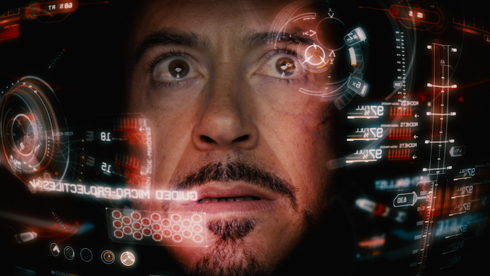
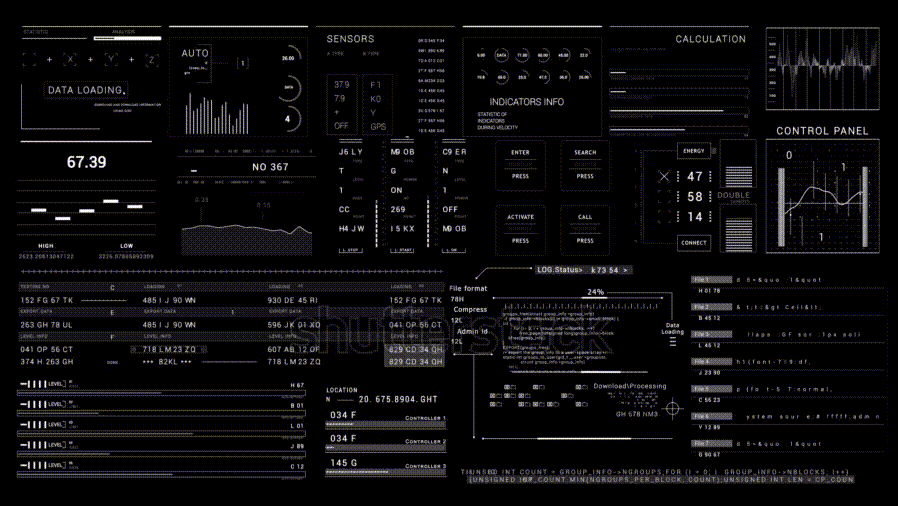
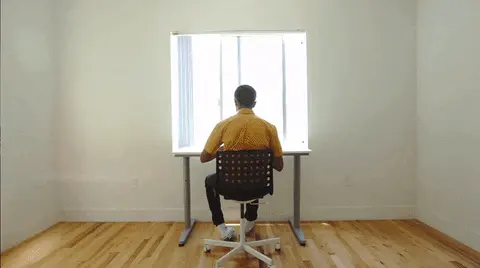
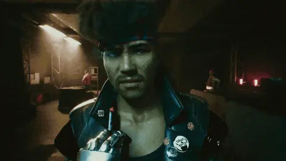
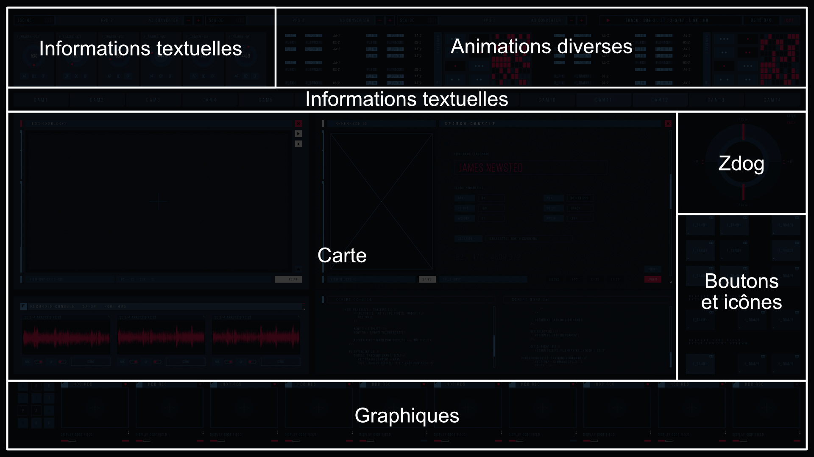
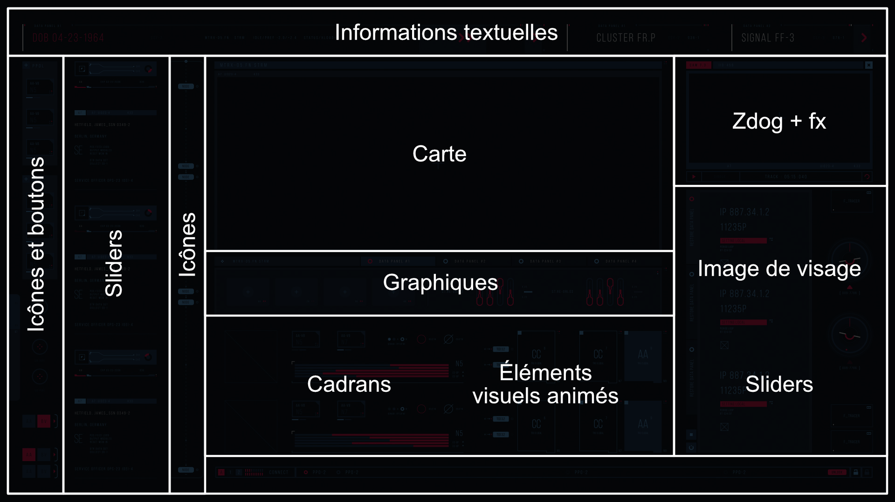
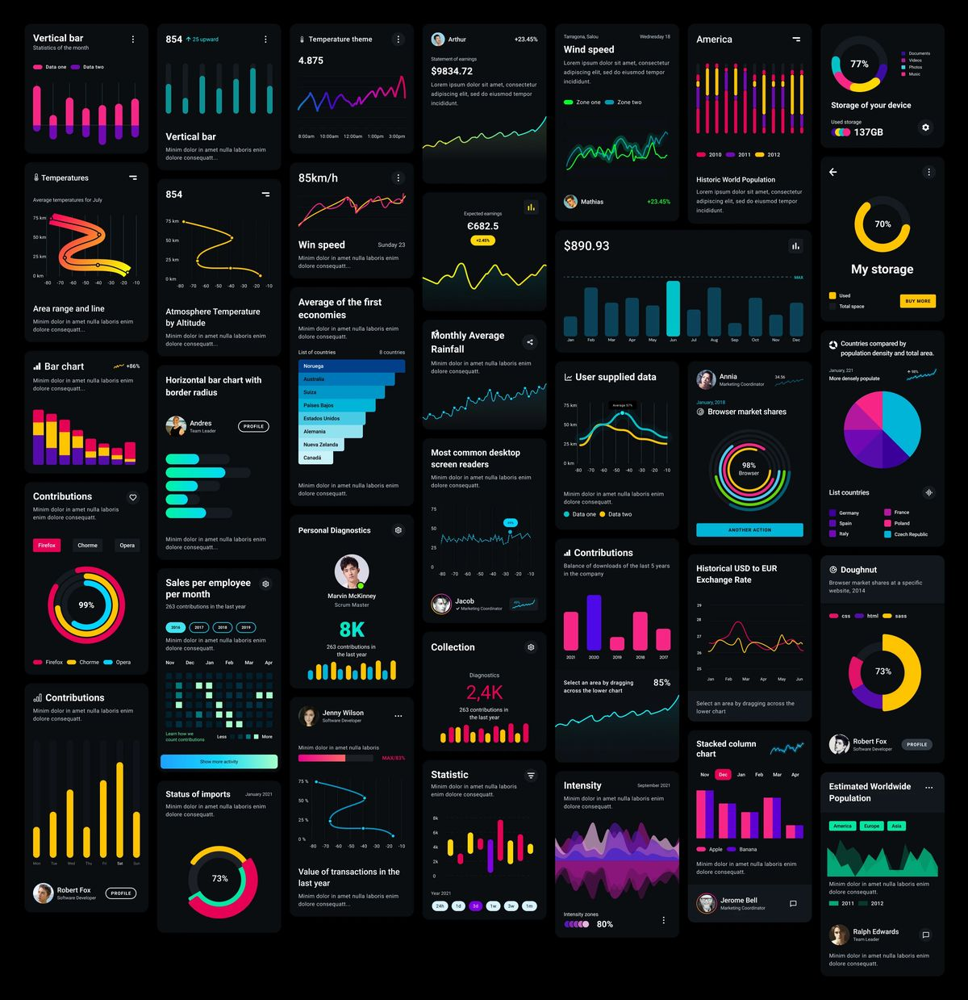

# TP2 | Étape 1 - Planification

*[HUD]: Heads-up display

## Comprendre le concept

{.w-100}

Interface futuriste **animée**, **interactive**, **complexe** et **attrayante**. Aussi appelée HUD. 

Ce genre d'interface est utilisée dans les [**films**](https://www.sitepoint.com/14-top-sci-fi-designs-to-inspire-your-next-interface/) (Ironman), les **téléséries** (Altered Carbon) et les **jeux vidéo** (Cyberpunk 2077) pour impressionner, transmettre rapidement de l'information visuelle et renforcer l'immersion dans un univers de science-fiction.

Quelques éléments classiques :

* Des **animations dynamiques** : graphiques en mouvement, transitions fluides, clignotements et effets lumineux.
* Des **données simulées** : chiffres, courbes, coordonnées ou radars qui donnent l’impression de traiter de l’information complexe.
* Une **composition modulaire** : plusieurs panneaux, cadrans et couches superposées qui évoquent un système multifonction.

### Exemples d'esthétisme

{data-zoom-image}

Mots clés : `Scifi HUD`, `Scifi dashboard`, `Scifi interface`

- <https://pin.it/40TV0NasS>
- <https://ca.pinterest.com/pin/17521886047754599/> (Couleur accent)
- <https://ca.pinterest.com/pin/6051780743730577/> (Couleur accent)
- <https://ca.pinterest.com/pin/181551428723750183/> (Retro)
- <https://ca.pinterest.com/pin/2462974771839964/> (Réalité augmentée)
- <https://ca.pinterest.com/pin/313915036543016350/> (Imagé)
- <https://ca.pinterest.com/pin/18366310958325035/>
- <https://www.shutterstock.com/fr/video/clip-3495967415-advanced-data-analytics-dashboard-display-business-financial/>
- <https://dribbble.com/search/scifi-dashboard>
- <https://www.tumblr.com/sciencefictioninterfaces>
- <https://videohive.net/item/hud-ui-screens/21735841>

## Document de conception

{.w-50}

- [ ] Créer un document Word et l'enregistrer avec la nomenclature : "nomdefamille-prenom_TP2.docx"
- [ ] Faire une [page titre](https://www.cmontmorency.qc.ca/wp-content/uploads/images/etudiants/bibliotheque/guide-presentation-travaux-ecrits.pdf)

## Thématique

{.w-50}

La thématique choisie permettra d'avoir une cohérence tout au long du projet.

- [ ] Trouver une thématique de votre choix, mais elle doit être futuriste.
- [ ] Valider son choix avec l'enseignant
  - [ ] Inscrire la thématique choisie dans le document de conception. Elle devrait s'écrire en une ou deux phrases maximum.

### Exemples de thématique

- Visière d'un cyborg à la recherche d'une proie
- Interface de monitoring d'un réacteur nucléaire
- Tableau de bord d'un vaisseau spatial
- Interface du _loadout_ dans le jeux vidéo [Battlefield 6](bf6.jpg)

## Langue

Le contenu textuel du HUD peut être dans n'importe quelle langue (français, anglais, espagnol, japonais, code morse 🤷).

> Le document de conception doit, pour sa part, être rédigé en français

- [ ] Choisir une langue pour le HUD
  - [ ] Inscrire son choix dans le document de conception

## Esthétisme et inspiration

- [ ] Sur pinterest ou ailleurs, chercher des exemples qui vous plaisent. Vous pouvez utiliser les exemples données plus haut.
  - [ ] À la manière d'un moodboard, inscrire les urls d'inspiration comme référence dans le document de conception

- [ ] Déterminer une palette de couleurs avec idéalement une couleur accent. Le noir et blanc fonctionne très bien aussi.
- [ ] Trouver une ou plusieurs polices de caractères (Google Fonts, Dafont, etc.)
  - [ ] Inscrire ses choix dans le document de conception

!!! example "Images"

    Il ne sera pas obligatoire d'utiliser des images pour le projet, mais pour créer un résultat convainquant, ça peut être très utile.

## Wireframes

Quelques considérations importantes : 

* L'interface doit occuper l'entièreté de la page et devra toute être visible sans avoir à scroller.
* La structure de page devra être faite en Grid CSS.

Avec le logiciel de votre choix (Ex. : Illustrator, Figma, Draw.io, Photoshop) : 

- [ ] Imaginez votre interface et dessiner sa grille.
- [ ] Placer les différents éléments visuels dans la grille (voir plus bas)
- [ ] Annoter les animations prévues dans le dossier de conception
- [ ] Annoter l'interactivité prévue dans le dossier de conception

### Exemples de grille

Une technique intéressante de travailler cette partie est de prendre une image existante et de dessiner sa grille par dessus pour se donner une idée.

{data-zoom-image}

{data-zoom-image}

Au besoin, voici des images de base : [img1](./687474703a2f2f692e696d6775722e636f6d2f527a544d4562782e6a7067.jpeg), [img2](./687474703a2f2f692e696d6775722e636f6d2f6434636f4f52452e6a7067.jpeg), [img3](./687474703a2f2f692e696d6775722e636f6d2f68386f57776f722e6a7067.jpeg), [img4](./687474703a2f2f692e696d6775722e636f6d2f714639333478642e6a7067.jpeg), [img5](./687474703a2f2f692e696d6775722e636f6d2f763734583342792e6a7067.jpeg)

### Exemples de composantes à afficher

{data-zoom-image .w-50}

* Bouton [exemple](https://getbootstrap.com/docs/5.3/components/buttons/#variants)
* Switch [exemple](https://getbootstrap.com/docs/5.3/forms/checks-radios/#switches)
* Barre de progression [exemple](https://getbootstrap.com/docs/5.3/components/progress/#animated-stripes)
* Slider [exemple](https://getbootstrap.com/docs/5.3/forms/range/#overview)
* Bouton rotatif (_knob_) [exemple](https://animejs.com/documentation/animatable/animatable-settings/unit)
* Diagramme [exemple](https://www.chartjs.org/docs/latest/samples/line/line.html) 
* Texte animé [exemple1](https://mattboldt.com/demos/typed-js/), [exemple2](https://animejs.com/documentation/text/splittext/split-parameters/clone)
* Chiffres / compteurs [exemple](https://codepen.io/tim-momo/pen/WbwNLbq/bd60bb374e06b89f9e09f94d740123c5)
* Formes géométriques / traits décoratifs
* Images
* Vidéos
* Effet de sonar [exemple](https://codepen.io/moodyeffects/pen/ZYzgBrY), [exemple2](https://codepen.io/PavelCSS/pen/yyMMee?editors=1010)
* Cible / Réticule [exemple](https://codepen.io/Klax/pen/mdaWmye)
* Effect de distorsion [exemple](https://amagi.dev/vfx-js/)
* Codes binaires / hexadécimaux défilants [exemple](https://codepen.io/dthwalker-the-styleful/pen/jOJeojN)
* Timers / Chronomètres [exemple](https://animejs.com/documentation/timer)
* Alertes / Notifications [exemple](https://getbootstrap.com/docs/5.3/components/alerts/#examples)
* Flux de données textuelles [exemple1](https://codepen.io/hapanyo/pen/LYmYZLb),
* Cartes / Mini-maps [exemple](https://maplibre.org/)
* Tooltips [exemple](https://getbootstrap.com/docs/5.3/components/tooltips/#directions)

### Exemples de données conceptuelles

Les données de l'interface peuvent être parfois difficiles à imaginer. Pour vous aider, vous pouvez réfléchir à des données cohérentes avec le concept choisi, mais fictives à la fois.

!!! example "Exemple de données"

    **Thème** : Visière de cyborg

    **Informations sur la cible**

    - Localisation sur une carte
    - Rose des vents
    - État de santé : fréquence cardiaque, température corporelle, tension artérielle
    - Données biométriques (visage, empreinte digitale, adn)
    - Profil psychologique (calme, stressé, agressif)
    - Activité détectée (« Entre dans un véhicule », puis «Sort du véhicule», puis «Se dirige vers xyz»)

    **Système du cyborg**

    - État du système (CPU, RAM, température interne, énergie)
    - Diagnostic des capteurs (infrarouge, caméra, pression atmosphérique, température)
    - Module d'auto-réparation
    - Alertes système
    - État de la connexion XYZ
    - Objectifs, priorités et progression de la mission
    - Étapes accomplies et restantes
    - Temps estimé avant interception

    **Autres**

    - Switch « activer vision thermique »
    - Bouton « verrouiller cible »
    - Switch « activer camouflage »
    - Bouton mode manuel/automatique
    - Carte tactique interactive
    - Décompte (en binaire, en hexadécimal)
    - Bouton d'autodestruction
