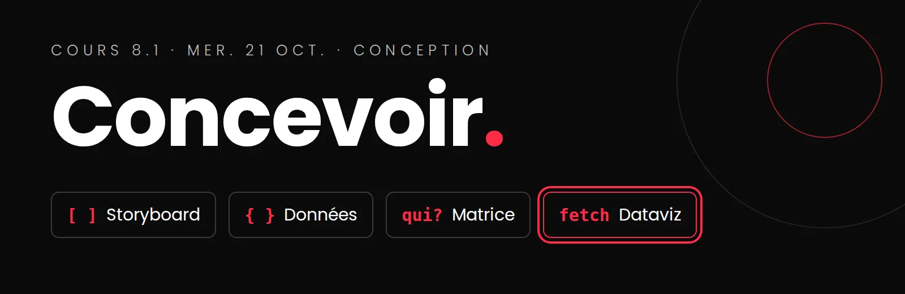

# Cours 8.1
<!-- mer. 21 oct. -->

{.w-100}

<div class="class-content-link">
  
  <span class="sidetext">Utilisation de l'IA restreinte : permise <strong>seulement pour créer vos médias</strong>, jusqu'à nouvel ordre. Le cahier de charges et le storyboard, c'est vous! <a class="lien-details" href="projets/recit-defilant/index.html#ia">Détails</a></span>
</div>

<div class="grid" markdown>

<div class="card" markdown>
:material-file-document-edit-outline: __Le cahier de charges__

---

Le gabarit et les consignes, section par section.

[:octicons-arrow-right-24: Gabarit et consignes](projets/recit-defilant/cahier-de-charges.md){ .stretched-link }
</div>

<div class="card" markdown>
:material-chart-bar: __Le moment dataviz__

---

Les ingrédients, des exemples à décortiquer et une démo avec des données réelles.

[:octicons-arrow-right-24: Le moment dataviz](projets/recit-defilant/dataviz.md){ .stretched-link }
</div>

<div class="card" markdown>
:material-book-open-page-variant-outline: __Les consignes__

---

Le projet au complet : produit, garde-fous, évaluation, calendrier.

[:octicons-arrow-right-24: Consignes complètes](projets/recit-defilant/index.md){ .stretched-link }
</div>

</div>

!!! danger "Avant tout : votre dépôt GitHub"
    **Faites-le en arrivant**, un membre de l'équipe suffit :

    1. **Rendez le dépôt privé** : *Settings* → *General* → tout en bas, *Danger Zone* → *Change repository visibility* → *Make private*.
    2. **Invitez votre coéquipier ou coéquipière et moi** comme collaborateurs : *Settings* → *Collaborators* → *Add people*. Mon nom d'utilisateur : `marie-michelle-ouellet`.

    Sans cette invitation, je ne peux ni voir ni évaluer votre remise du ven. 23 oct.

## Aujourd'hui

- [ ] **Avant tout** : dépôt GitHub privé, et `marie-michelle-ouellet` invitée comme collaboratrice
- [ ] Le storyboard du défilement : plusieurs cadres par chapitre au besoin
- [ ] Le modèle de données JSON : votre objet « chapitre »
- [ ] La matrice de responsabilités : qui possède quoi
- [ ] Le moment dataviz : exemples et démo
- [ ] Rencontre d'équipe avec moi : votre avancement
- [ ] Temps de travail sur le cahier de charges
- [ ] Entrée au journal de bord

!!! warning "Remise 1 : ven. 23 oct., 23 h 59 (pas de cours ce jour-là)"
    Cahier de charges complet dans le dépôt, storyboard dans Figma, un journal par personne. [Liste de vérification de la remise 1](projets/recit-defilant/index.md#remise-1)

<!-- MM : ajouter le tutorat de la semaine, s'il y a lieu. -->

## Déroulement

Aujourd'hui, c'est surtout **votre** temps de travail. Quatre courtes notions, chacune suivie d'un moment pour l'appliquer à votre cahier de charges. Pendant ce temps, je rencontre chaque équipe.

## 1. Le storyboard du défilement

Un storyboard de défilement montre **la suite des moments** que vit le visiteur, pas chaque pixel.

- **Au moins un cadre par chapitre**, et plusieurs si un chapitre contient plusieurs animations.
- Dans la description de **chaque** cadre : le **numéro du chapitre**, ce qui bouge, ce qui le déclenche, la technique.
- Les médias peuvent être des boîtes grises ou des croquis.

[:material-file-document-edit-outline: Consignes du storyboard](projets/recit-defilant/cahier-de-charges.md#le-storyboard-dans-figma){ .md-button }

**À faire (25 min)** : avancez vos cadres dans Figma, à partir du gabarit.

## 2. Le modèle de données JSON

Vos chapitres seront chargés avec `fetch()` depuis un fichier JSON, comme les projets de votre portfolio. Avant de coder, on décide **la forme d'un chapitre** : quelles propriétés, et pour quoi faire.

```json
{
  "id": "la-foret",
  "numero": 3,
  "titre": "Dans la forêt",
  "texte": ["Premier paragraphe...", "Deuxième paragraphe..."],
  "medias": [
    { "type": "calque", "src": "assets/images/foret-avant.webp", "alt": "" }
  ],
  "responsable": "Prénom"
}
```

Questions à vous poser :

- Le texte : une seule chaîne, ou un tableau de paragraphes?
- Les médias : de quels types (image, calque, spritesheet, SVG, vidéo)? Chacun a-t-il un `alt`?
- Un chapitre a-t-il besoin d'un `type`, pour que le JavaScript sache quoi afficher?

**À faire (20 min)** : section 5 du cahier, avec l'objet d'**un** de vos vrais chapitres.

## 3. La matrice de responsabilités

C'est la pièce maîtresse de votre **note individuelle**. Elle dit qui possède quoi, et c'est sur ces zones que porteront vos *commits*, votre contrôle de la qualité et votre défense du 9 décembre.

- Chaque personne : **au moins 3 chapitres** et **un média animable**.
- Le composant Vue, le *fetch* externe et le chargement du JSON ont chacun **un** responsable.
- Faites-la **ensemble**, et prenez-la au sérieux : impossible de défendre le code d'une zone qui n'est pas la vôtre.

**À faire (15 min)** : section 4 du cahier.

## 4. Le moment dataviz

Une question, une donnée réelle, une forme simple, une révélation au défilement, une chute. On regarde des exemples, puis une démo avec des données réelles.

[:material-chart-bar: Le moment dataviz : exemples et démo](projets/recit-defilant/dataviz.md){ .md-button .md-button--primary }

**À faire (15 min)** : section 6 du cahier. Décrivez l'idée, pas encore l'API.

## Rencontres d'équipe

Pendant les temps de travail, je rencontre chaque équipe, **5 minutes**. Ayez à l'écran :

- la **trace de votre brainstorm** (FigJam ou photos) et le thème choisi;
- vos **chapitres** : ce que chacun raconte;
- votre **storyboard**, même commencé.

## Clôture

- Entrée au **journal de bord** : les 5 questions.
- D'ici vendredi 23 h 59 : terminez le cahier, le storyboard et le journal, puis poussez le tout sur GitHub.
