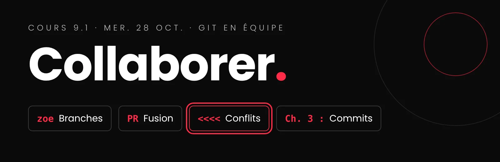

# Cours 9.1
<!-- mer. 28 oct. -->

## Annonces

!!! warning "Dès votre arrivée : votre identifiant GitHub pour Classroom 50"
    Une seule question, 30 secondes : [Inscription à ma classe GitHub Classroom 50 – Remplir le formulaire](https://forms.cloud.microsoft/r/Fa0X0aXWm8){ :target="_blank" }

    Écrivez votre identifiant **exactement** comme sur GitHub. Ensuite, surveillez vos courriels : vous recevrez une **invitation à l'organisation GitHub du cours**. Acceptez-la avant l'exercice de la section 3, sinon vous ne pourrez pas y accéder.

!!! danger "Le centre d'aide C-1602 n'est pas un lieu pour jouer à des jeux vidéo"
    Le local du Centre d'aide est un lieu de travail. Silencieux, comme dans une bibliothèque. On y travaille, c'est la priorité de ce local.

!!! info "Récit défilant : la répartition de l'évaluation a changé"
    Équipe 25 %, individuel 35 %. Le cahier de charges et le storyboard sont notés dans leur **version finale**, à la fin du projet. Le **respect des échéances** devient un volet à part : une remise bâclée vaut presque autant qu'une remise absente. [Voir l'évaluation](projets/recit-defilant/index.md#echeances)

!!! success "Sondage: TUTORAT"
    Quels seraient le moment le plus utile ? [Remplir le formulaire](https://forms.cloud.microsoft/r/147C3TKbpC)

  

---

  

{.w-100}

  
  Utilisation de l'IA restreinte : permise <strong>seulement pour créer vos médias</strong>. Le code, c'est vous! <a class="lien-details" href="projets/recit-defilant/index.html#ia">Détails</a>

:material-source-branch: __Git en équipe__

---

Une branche par personne, les *pull requests*, les conflits et la convention de *commits*.

[:octicons-arrow-right-24: Git en équipe](projets/recit-defilant/git-en-equipe.md){ .stretched-link }

:material-source-merge: __Exercice : un conflit__

---

En duo, dans un dépôt d'exercice Classroom 50 : provoquer un conflit exprès, puis le régler.

[:octicons-arrow-right-24: L'exercice](projets/recit-defilant/exercice-conflit.md){ .stretched-link }

:material-book-open-page-variant-outline: __Les consignes du récit défilant__

---

Le projet au complet : produit, garde-fous, évaluation, calendrier.

[:octicons-arrow-right-24: Consignes complètes](projets/recit-defilant/index.md){ .stretched-link }

## Aujourd'hui

- [ ] Remplir le formulaire Classroom 50 (votre identifiant GitHub), puis accepter l'invitation reçue par courriel
- [ ] Rencontre éclair avec moi : votre storyboard et votre cahier de charges
- [ ] Le storyboard v2 : les exigences précisées, à remettre ven. 30 oct.
- [ ] Git en équipe : branches, *pull requests*, conflits, convention de *commits*
- [ ] Exercice en duo : provoquer et régler un conflit
- [ ] Dans votre projet : la structure commune sur `main`, puis une branche chacun
- [ ] Animations CSS : la spritesheet et la parallaxe
- [ ] Entrée au journal de bord

<!-- MM : ajouter le tutorat de la semaine, s'il y a lieu. -->

## 1. Rencontre éclair : storyboard et cahier de charges

Pendant les périodes de travail d'aujourd'hui (l'exercice, puis le travail dans votre projet), **je passe voir chaque équipe**, environ 5 minutes. Je survole votre storyboard et votre cahier, et je vous dis à première vue ce qui est incomplet ou à clarifier. Je vous dirai aussi si votre **concept** doit être poussé davantage : la [créativité compte](projets/recit-defilant/index.md#creativite).

Quand j'arrive à votre poste, ayez **déjà ouverts** :

- votre **storyboard** dans Figma;
- votre **cahier de charges** sur github.com (`documentation/CAHIER-DE-CHARGES.md`).

En attendant votre tour, relisez la **section 9** de votre cahier : **vos prochaines étapes**. Ce que vous aviez prévu pour aujourd'hui, est-ce fait?

**Après la rencontre**, chacun note dans son **journal de bord** les commentaires reçus et ce que l'équipe va corriger.

### Le storyboard v2 : pour le ven. 30 oct., 23 h 59

Les exigences du storyboard sont maintenant précisées. Vous montez une v2 sur le modèle du Chaperon : **une rangée par moment**, avec le cadre **desktop**, le cadre **mobile** et la **fiche d'annotation**, qui décrit l'animation, pas l'histoire. Vous réutilisez vos cadres de la v1 par copier-coller.

Pour le même jour, complétez aussi la **section 1 de votre cahier** : votre **angle**, votre **identité visuelle** et votre **moment surprenant**. Le gabarit a trois nouvelles lignes pour ça.

!!! danger "Ne touchez pas à votre v1"
    Dans Figma, ne modifiez pas et ne supprimez pas les pages de votre première version. Créez une **nouvelle page** `Storyboard V2`, et travaillez seulement là. Dans le dépôt, `storyboard.pdf` reste tel quel; la v2 va dans `storyboard-v2.pdf`.

[:material-movie-open-edit-outline: Le storyboard : exigences et cadres modèles](projets/recit-defilant/cahier-de-charges.md#storyboard){ .md-button .md-button--primary }

## 2. Git en équipe

À deux dans le même dépôt, on ne travaille plus comme au portfolio. Aujourd'hui : une branche par personne, la fusion par *pull request*, les conflits, et une façon commune de nommer vos *commits*.

**D'abord, un rappel** : c'est quoi une branche, la branche active, créer, changer et publier une branche. Vous l'avez vu au portfolio.

[:material-source-branch: Les branches Git, en 10 minutes](projets/portfolio/branches-git.md){ .md-button }

**Puis, le travail à deux** : la *pull request*, la mise à jour de sa branche, les conflits et la convention de *commits*.

[:material-account-multiple-outline: Git en équipe](projets/recit-defilant/git-en-equipe.md){ .md-button .md-button--primary }
[:material-presentation-play: Présentation (PowerPoint)](assets/documents/Web5_git-en-equipe.pptx){ .md-button }

## 3. Exercice : provoquer et régler un conflit

**En duo, 25 minutes.** Dans un petit dépôt d'exercice créé par Classroom 50, vous allez provoquer un conflit exprès, et le régler. Chacun en règle un.

[:material-source-merge: L'exercice, étape par étape](projets/recit-defilant/exercice-conflit.md){ .md-button }

## 4. Dans votre projet

**En équipe, 20 minutes.** Maintenant, pour vrai :

1. **Ensemble, sur un seul poste**, sur `main` : la structure commune (`index.html`, `css/style.css`, `js/main.js`, `data/data.json`, `assets/images/`), avec le **squelette de tous vos chapitres** dans `data.json`. *Commit* (`Commun : ajoute la structure de départ`), puis *push*.
2. L'autre personne fait un *pull*.
3. **Chacun crée sa branche**, à son prénom, et la publie.
4. Vérifiez sur github.com : le menu des branches affiche `main` et vos deux branches.

À partir de maintenant : **plus personne ne code sur `main`**.

## 5. Animations CSS : parallaxe et spritesheet

Deux des trois formats de **média animable** se jouent en CSS.

**La spritesheet** : toutes les images d'une animation côte à côte dans un seul fichier, montrées une à la fois avec `steps()`. Pour votre projet, la version responsive, avec `transform`.

[:material-filmstrip: Animation par spritesheet](css/animation-spritesheet.md){ .md-button .md-button--primary }
[:material-pencil-ruler: Exercice : le monstre responsive](css/exercice-spritesheet.md){ .md-button }

**La parallaxe en calques** : des plans qui défilent à des vitesses différentes, pour donner de la profondeur.

[:material-layers-outline: La parallaxe : définition et exemples](css/parallaxe.md){ .md-button }
[:material-pencil-ruler: Exercice : la parallaxe en calques](css/exercice-parallaxe.md){ .md-button }

**À faire** : chacun commence la préparation de **son** média animable (calques, spritesheet ou SVG), sur **sa** branche.

## Devoirs

- Entrée au **journal de bord** : les 5 questions, et les commentaires reçus à la rencontre.
- **Storyboard v2**, en équipe : exporté dans `documentation/storyboard-v2.pdf`, au plus tard le **ven. 30 oct., 23 h 59**.
- Sur **votre** branche : commencez la préparation de votre média animable.
- Faites votre premier *commit* selon la convention de l'équipe : `Zone : ce qui a changé`.
