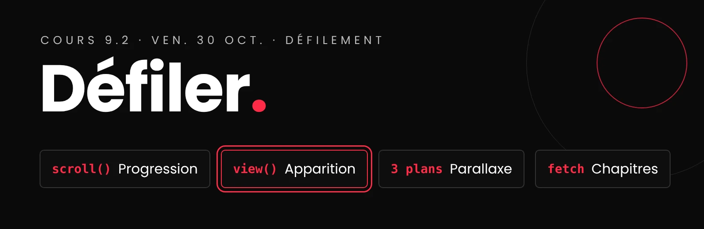

# Cours 9.2
<!-- ven. 30 oct. -->

{.w-100}

<div class="class-content-link">
  
  <span class="sidetext">Utilisation de l'IA restreinte : permise <strong>seulement pour créer vos médias</strong>. Le code, c'est vous! <a class="lien-details" href="projets/recit-defilant/index.html#ia">Détails</a></span>
</div>

<div class="grid" markdown>

<div class="card" markdown>
:material-gesture-swipe-vertical: __Animer au défilement__

---

`scroll()`, `view()`, `animation-range`, et les deux règles obligatoires.

[:octicons-arrow-right-24: La référence](css/animations-scroll.md){ .stretched-link }
</div>

<div class="card" markdown>
:material-layers-outline: __L'effet parallaxe__

---

Des calques qui défilent à des vitesses différentes : définition et exemples.

[:octicons-arrow-right-24: La parallaxe](css/parallaxe.md){ .stretched-link }
</div>

<div class="card" markdown>
:material-code-json: __Du JSON aux chapitres__

---

Dans votre projet : charger vos chapitres avec `fetch`.

[:octicons-arrow-right-24: Les étapes](projets/recit-defilant/json-chapitres.md){ .stretched-link }
</div>

</div>

## Aujourd'hui

- [ ] Le storyboard v2 : vos questions (remise ce soir, 23 h 59)
- [ ] Animer au défilement : `scroll()`, `view()`, `animation-range`, `@supports`, `prefers-reduced-motion`
- [ ] La parallaxe en calques
- [ ] Dans votre projet : du JSON aux chapitres
- [ ] Travail d'équipe : le storyboard v2 et la section 1 du cahier

## 1. :material-movie-open-edit-outline:  Le storyboard v2, ce soir

Le **storyboard v2** et la **section 1 du cahier de charges** (angle, identité visuelle, moment surprenant) sont à remettre **ce soir, 23 h 59**. Vos questions, c'est maintenant.

[:material-movie-open-edit-outline: Le storyboard : exigences et cadres modèles](projets/recit-defilant/cahier-de-charges.md#storyboard){ .md-button .md-button--primary }

## 2. :material-gesture-swipe-vertical: Animer au défilement

Nous avons vu ces notions pour le portfolio au cours 6.1 il y a un mois.

Aujourd'hui, **vous les tapez vous-mêmes** : je code une notion devant vous, vous la refaites dans votre dépôt d'exercice, puis on passe à la suivante.

1. Une barre de progression : `scroll()`.
2. Des cartes qui apparaissent : `view()` et `animation-range`.
3. Un texte qui glisse, et le piège de `overflow: hidden`.
4. Les deux règles obligatoires : `@supports` et `prefers-reduced-motion`.

[:material-gesture-swipe-vertical: Animation au scroll. Vu au cours 6.1](css/animations-scroll.md){ .md-button .md-button--primary}
[:material-pencil-ruler: Exercice : animer au défilement](exercices/ex-scroll/index.md){ .md-button  }


## 3. :material-layers-outline:  La parallaxe en calques

Un des trois formats de **média animable** : une scène découpée en plans, chacun à sa vitesse. 

Techniquement, c'est une animation au défilement de plus : `view-timeline-name` sur la scène, une animation par calque.

[:material-layers-outline: L'effet parallaxe : définition et exemples](css/parallaxe.md){ .md-button .md-button--primary }
[:material-pencil-ruler: Exercice : la parallaxe en calques](exercices/ex-parallaxe/index.md){ .md-button }

## 4. :material-code-json:  Dans votre projet : du JSON aux chapitres

**En équipe.** Vous connaissez la mécanique du `fetch` depuis le portfolio. Cette fois, c'est votre récit : la structure commune (si ce n'est pas déjà fait), puis une personne code le chargement des chapitres pendant que l'autre remplit les siens. Chacun sur sa branche, et on fusionne par *pull request*.

[:material-code-json: Du JSON aux chapitres : les étapes](projets/recit-defilant/json-chapitres.md){ .md-button .md-button--primary }


## Devoirs

<div class="class-content-link">
  
  <span class="sidetext">Utilisation de l'IA restreinte : permise <strong>seulement pour créer vos médias</strong>. Le code, c'est vous! <a class="lien-details" href="projets/recit-defilant/index.html#ia">Détails</a></span>
</div>

### Ce soir, 23 h 59

- **Storyboard v2**, en équipe : sur une nouvelle page Figma, exporté dans `documentation/storyboard-v2.pdf`.
- **La section 1 du cahier de charges** : angle, identité visuelle, moment surprenant.

### D'ici le mer. 4 nov. (cours 10.1)

#### Terminez les exercices, chacun dans son dépôt Classroom50

- [Exercice : un conflit](exercices/ex-conflit-git/index.md), s'il n'est pas terminé;
- [Exercice : le monstre responsive](exercices/ex-spritesheet/index.md);
- [Exercice : animer au défilement](exercices/ex-scroll/index.md);
- [Exercice : la parallaxe en calques](exercices/ex-parallaxe/index.md).

#### Et dans votre projet :

- Le storyboard v2 et la section 1 du cahier, pour ce soir.
- vos chapitres s'affichent depuis `data.json`, sur `main`
- préparer vos médias (éléments animables, arrière-pan des chapitres si applicable, spritesheets, SVG)

!!! danger "Rappel : créditez vos médias dans le README.md"

    - **Banques d'images libres permises** (ex. [Unsplash](https://unsplash.com/){ :target="_blank" }, [Pexels](https://www.pexels.com/){ :target="_blank" }), selon leur licence.
    - **Images générées par IA permises**, si elles sont créditées dans le `README.md`, avec l'outil comme source.
    - **Tous les médias sont crédités** dans le `README.md`, dans un tableau : média, chapitre, source, auteur, licence, modifié ou non.

    ```markdown
    ## Crédits des médias

    | Média | Chapitre | Source | Auteur | Licence | Modifié? |
    |---|---|---|---|---|---|
    | `foret-fond.webp` | 1 | [Unsplash](lien) | Nom auteur | Licence Unsplash | Découpé 3 calques |
    | `renard.svg` | 3 | Firefly | Généré par IA | : | Vectorisé, groupes nommés |
    ```
