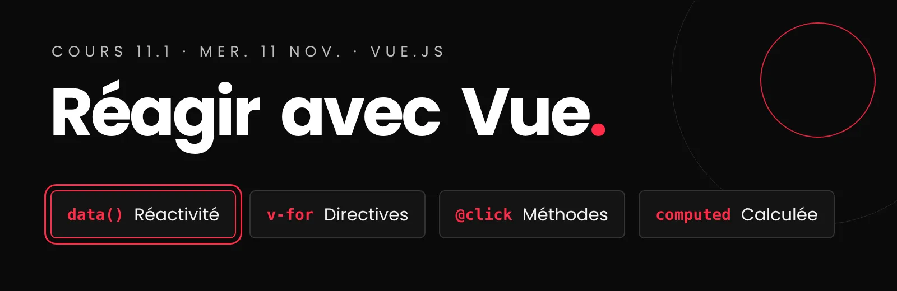

# Cours 11.1
<!-- mer. 11 nov. -->

{.w-100}

  
  Utilisation de l'IA restreinte : permise <strong>seulement pour créer vos médias</strong>. Le code, c'est vous! <a class="lien-details" href="projets/recit-defilant/index.html#ia">Détails</a>

:simple-vuedotjs: __Exercice : Collection de films__

---

Les 4 notions de votre composant : données, clic, classe dynamique et `v-for`.

[:octicons-arrow-right-24: L'exercice](exercices/ex-vue-films/index.md){ .stretched-link }

:material-animation-play-outline: __Vos chapitres__

---

Le plus gros du cours : animer vos chapitres pour le prototype.

[:octicons-arrow-right-24: *Phase 1* : vos animations](projets/recit-defilant/arborescence-recit-defilant.md#fichier-chapitre){ .stretched-link }

:material-play-box-outline: __Le prototype, ~~ven. 13 nov.~~ mer. 18 nov.__

---

Une démo de 60 secondes de votre récit, sur votre poste. Rien à déposer. La bêta est aussi reportée, date à confirmer.

[:octicons-arrow-right-24: Ce que je dois voir](projets/recit-defilant/index.md#prototype){ .stretched-link }

## Aujourd'hui

- [ ] Vos exercices GSAP : auto-validés et poussés sur `main`
- [ ] Vue.js : pourquoi, et les 4 notions de votre composant (20 min)
- [ ] Exercice : Collection de films (45 min)
- [ ] Dans votre projet : vos chapitres, pour le prototype du ~~ven. 13 nov.~~ mer. 18 nov. (le reste du cours)

## 1. :simple-vuedotjs:  Vue.js : pourquoi un cadriciel?

Un navigateur de chapitres se fait aussi en JavaScript seul. Vue est là pour deux raisons :

- **c'est comme ça que le web se construit** : la plupart des interfaces professionnelles utilisent un cadriciel (React, Vue, Svelte), et Vue est la porte d'entrée la plus douce;
- **ça change votre façon de coder** : au lieu de dire **comment** changer la page, étape par étape, vous décrivez **à quoi** elle doit ressembler selon vos données. Vue s'occupe du reste.

[:simple-vuedotjs: Intro et installation de Vue.js](./vue/index.md){ .md-button }

## 2. :material-book-open-variant:  Les 4 notions de votre composant { #principes }

Pour votre navigateur de chapitres, vous avez besoin de **4 notions**, pas plus. Chacune a sa page-sujet, avec des exemples à modifier : relisez-les après le cours, à votre rythme.

**1. Les données et l'interpolation** : `createApp()` crée l'app sur une zone du HTML, `data()` contient ce qui peut changer, et `{{ }}` l'affiche. Quand la donnée change, le texte change : c'est la **réactivité**.

[:simple-vuedotjs: Création d'une app](vue/creation-app.md){ .md-button }

[:simple-vuedotjs: Interpolation](vue/interpolation.md){ .md-button }

**2. Les méthodes et le clic** : `@click` appelle une **méthode**, une action du composant.

[:simple-vuedotjs: Méthodes et événements](vue/methodes-evenements.md){ .md-button }

**3. La classe dynamique** : `:class` ajoute une classe **si** une condition est vraie. C'est le chapitre actif.

[:simple-vuedotjs: Classe dynamique](vue/classe-dynamique.md){ .md-button }

**4. La boucle** : `v-for` répète un élément pour chaque élément d'un tableau. C'est la liste des chapitres.

[:simple-vuedotjs: Boucle `v-for`](vue/boucle.md){ .md-button }

Dans la [documentation de Vue](https://fr.vuejs.org/guide/introduction.html){ :target="_blank" }, choisissez **Options** dans le sélecteur *Préférence d'API*, en haut à gauche : c'est la façon d'écrire Vue de ce cours.

## 3. :material-pencil-ruler:  Pratiquer : un exercice { #exercices }

Seul, dans Classroom 50 : le lien d'acceptation est au début de l'exercice. Gardez les pages-sujets de la section 2 ouvertes à côté.

!!! warning "Auto-validez chaque exercice avant de le remettre"
    Chaque exercice se termine par une liste **Vérifiez votre travail**. Avant votre dernier *push*, testez votre page avec cette liste : chaque énoncé doit être vrai.

!!! tip "Corrigez vos exercices passés"
    Avec la grille **Vérifiez votre travail** de chaque énoncé, puis *push*, chacun dans son dépôt Classroom 50 :

    - [Exercice : le monstre responsive](exercices/ex-spritesheet/index.md#verifier);
    - [Exercice : la parallaxe en calques](exercices/ex-parallaxe/index.md#verifier);
    - [Exercice : Zombi](exercices/ex-gsap-zombi/index.md#verifier);
    - [Exercice : Magie](exercices/ex-gsap-magie/index.md#verifier);
    - [Exercice : la magie au défilement](exercices/ex-gsap-magie-defilement/index.md#verifier).

**Collection de films** (environ 45 min) : les 4 notions, dans l'ordre. Les données et le clic (partie A), la classe dynamique (partie B), puis `v-for` (partie C). C'est le cœur de votre navigateur de chapitres : un élément actif dans une liste.

[:simple-vuedotjs: Exercice : Collection de films](exercices/ex-vue-films/index.md){ .md-button .md-button--primary }

Ensuite, **vos chapitres** : c'est le plus important aujourd'hui. Pour pratiquer Vue plus tard, si vous voulez : [Tableau NBA](exercices/ex-vue-nba/index.md) et [Cheese Kanye says](exercices/ex-vue-kanye/index.md), un premier `fetch()` vers une API (Application Programming Interface) externe.

## 4. :material-account-multiple-outline:  Dans votre projet

**D'abord vos chapitres** : le prototype du ~~ven. 13 nov.~~ mer. 18 nov. porte sur les animations de vos chapitres, pas sur Vue.

[:material-file-tree: *Phase 1*{ .w5-phase .w5-phase-1 } : vos chapitres en HTML](projets/recit-defilant/arborescence-recit-defilant.md#html-phase-1){ .md-button }

**Le composant Vue**, on le construit ensemble vendredi, en direct : la personne responsable l'intégrera ensuite, d'ici la bêta.

## Devoirs

  
  Utilisation de l'IA restreinte : permise <strong>seulement pour créer vos médias</strong>. Le code, c'est vous! <a class="lien-details" href="projets/recit-defilant/index.html#ia">Détails</a>

### D'ici le ~~ven. 13 nov.~~ mer. 18 nov. : le prototype (formatif), en *phase 1*{ .w5-phase .w5-phase-1 }

Reporté au mer. 18 nov. (levée de cours le ven. 13). La **bêta est aussi reportée** : nouvelle date à confirmer, au moins une semaine après le prototype.

Rien à déposer : une **démo de 60 secondes** de votre récit qui défile, sur votre poste, pendant le cours.

- Le récit défile du premier au dernier chapitre, sans erreur dans la console.
- Chaque chapitre a son texte et au moins un média, même provisoires.
- Chaque personne : le texte de ses chapitres intégré dans le HTML (un premier jet réel, aucun lorem ipsum).
- Chaque personne : dans **chacun** de ses chapitres, au moins une animation activée par le défilement, dont au moins une qui anime un média.
- Chaque personne : son travail fusionné dans `main`.
- Chaque personne : son journal, les [5 questions](projets/recit-defilant/index.md#journal-de-bord-individuel) pour ce **bloc 3**, sous un titre `## Questions bloc 3` (ou `###`, selon votre structure) qui les sépare des blocs précédents.

[:material-play-box-outline: Le prototype : ce que je dois voir](projets/recit-defilant/index.md#prototype){ .md-button .md-button--primary }

### Pour vendredi : préparer le choix de votre API

**La personne responsable de la dataviz** relit l'idée de la section 6 du cahier de charges, et arrive vendredi avec **deux API candidates**, trouvées dans les pistes de la page dataviz.

[:material-chart-bar: Le moment dataviz : les pistes d'API](projets/recit-defilant/dataviz.md#demo){ .md-button }
