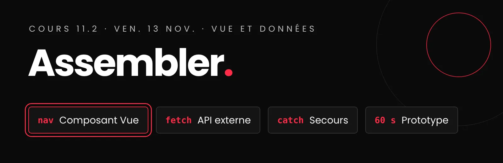

# Cours 11.2
<!-- ven. 13 nov. -->

{.w-100}

<div class="class-content-link">
  
  <span>Utilisation de l'IA restreinte : permise <strong>seulement pour créer vos médias</strong>. Le code, c'est vous! <a class="lien-details" href="projets/recit-defilant/index.html#ia">Détails</a></span>
</div>

<div class="grid" markdown>

<div class="card" markdown>
:simple-vuedotjs: __Le composant Vue__

---

Navigateur de chapitres et barre de progression, construit ensemble, en direct.

[:octicons-arrow-right-24: La référence](projets/recit-defilant/composant-vue.md){ .stretched-link }
</div>

<div class="card" markdown>
:material-api: __Choisir et tester votre API__

---

Trouver l'adresse, lire la réponse, prévoir la panne.

[:octicons-arrow-right-24: Les 7 étapes](projets/recit-defilant/dataviz.md#api){ .stretched-link }
</div>

<div class="card" markdown>
:material-play-box-outline: __Le prototype__

---

Une démo de 60 secondes, sur votre poste. Je passe d'équipe en équipe.

[:octicons-arrow-right-24: Ce que je dois voir](projets/recit-defilant/index.md#prototype){ .stretched-link }
</div>

</div>

## Aujourd'hui

- [ ] API, JSON et fetch : pourquoi ils sont partout
- [ ] Le composant Vue, construit en direct : vous codez avec moi, dans un bac à sable
- [ ] Le *fetch* externe : choisir et tester votre API
- [ ] Prototype : votre démo de 60 secondes, pendant que je passe d'équipe en équipe
- [ ] Dans votre projet : le composant Vue, l'API, et le début de la *phase 2*{ .w5-phase .w5-phase-2 }

## 1. :material-api:  API, JSON et fetch : pourquoi ils sont partout { #pourquoi-api }

**Est-ce vraiment utilisé en entreprise?** Oui, partout. Avant, le serveur fabriquait chaque page avec sa base de données, et chaque clic rechargeait tout. Aujourd'hui, le serveur expose une **API** qui envoie seulement les **données**, en **JSON**, et c'est le navigateur qui fabrique la page avec **`fetch()`**.

- **L'API**, la porte d'un service : la même API sert le site, l'application iOS et l'application Android;
- **le JSON**, la langue de ces données, que tous les langages comprennent;
- **`fetch()`**, le messager du navigateur, qui va les chercher sans recharger la page.

Vous l'avez déjà fait, comme en entreprise : vos projets de portfolio venaient d'Airtable ou de Google Sheets, par leur API.

[:material-api: API, JSON et fetch : le trio du web moderne](js/api-json-fetch.md){ .md-button .md-button--primary }

## 2. :material-code-braces:  Le composant Vue, construit en direct { #composant }

Mercredi, vous avez vu les 4 notions et pratiqué avec l'exercice Collection de films. Aujourd'hui, on assemble le tout : le composant de votre récit, pièce par pièce. **Vous codez avec moi**, dans un bac à sable : un petit dossier à part, **hors de votre dépôt**.

**Le bac à sable**, à créer avant de commencer :

1. Un dossier `bac-a-sable-vue/`, ouvert dans VS Code.
2. Un fichier `index.html`, avec ce départ :

```html
<!DOCTYPE html>
<html lang="fr">
<head>
  <meta charset="UTF-8">
  <title>Bac à sable Vue</title>
  <style>
    .chapitre { min-height: 100vh; padding: 2rem; }
    [v-cloak] { display: none; }
    .actif { font-weight: 700; color: #FF2B47; }
    .chapitres-nav { position: fixed; top: 40%; right: 1rem; }
    .progression {
      position: fixed; inset: 0 0 auto 0; height: 4px;
      background: #FF2B47; transform-origin: left;
    }
  </style>
</head>
<body>
  <div id="navigation"></div>

  <main>
    <section class="chapitre" id="la-foret"><h2>La forêt</h2></section>
    <section class="chapitre" id="la-maison"><h2>La maison</h2></section>
    <section class="chapitre" id="le-loup"><h2>Le loup</h2></section>
    <section class="chapitre" id="la-fin"><h2>La fin</h2></section>
  </main>

  <script src="https://cdn.jsdelivr.net/npm/vue@3.5.13/dist/vue.global.js">
  </script>
  <script type="module" src="js/main.js"></script>
</body>
</html>
```

3. Deux fichiers vides : `js/main.js` et `js/navigation.js`.
4. Ouvert avec **Live Server**.

!!! tip "Pourquoi `vue.global.js`, sans `.prod`?"
    Dans le bac à sable, on prend la version de **développement** : ses messages d'erreur dans la console sont beaucoup plus clairs. Dans votre projet, prenez la version `.prod`, plus légère.

**Les pièces, dans l'ordre :**

- [ ] `main.js` : la liste des chapitres, lue dans le HTML
- [ ] `createApp()` et `mount()` : Vue prend le contrôle de `#navigation`
- [ ] `data()` et `{{ }}` : la réactivité
- [ ] `v-for` : la liste des chapitres
- [ ] `:class` : le chapitre actif
- [ ] `@click` et une méthode : aller au chapitre
- [ ] `mounted()` : écouter le défilement
- [ ] Pour aller plus loin, si on a le temps : `computed`, le titre du chapitre actif

[:simple-vuedotjs: Le composant Vue : la référence complète](projets/recit-defilant/composant-vue.md){ .md-button .md-button--primary }

## 3. :material-api:  Le *fetch* externe : choisir et tester votre API

Vous savez déjà faire un `fetch()` : vous l'utilisez pour `data.json`. Interroger une API, c'est **le même `fetch()`**, avec une adresse sur un autre site. Ce qui est nouveau :

- **choisir** une API : sans clé, CORS, du JSON, et votre donnée;
- **lire** sa réponse : tester l'adresse dans le navigateur, trouver le chemin vers votre valeur;
- **prévoir la panne** : des valeurs de secours, pour que le récit reste lisible.

[:material-api: Choisir et tester votre API : les 7 étapes](projets/recit-defilant/dataviz.md#api){ .md-button .md-button--primary }

!!! example "À vous : 10 minutes"
    **La personne responsable de la dataviz**, avec ses deux API candidates :

    1. Collez l'adresse de chacune dans le navigateur. Laquelle contient **votre** donnée?
    2. Trouvez le **chemin** vers la valeur, comme `data.daily.temperature_2m_max`.
    3. Faites le `fetch()` dans votre bac à sable, et affichez la valeur avec `console.log()`.

    **L'autre personne** fait la même chose avec une API de la [liste de la démo](projets/recit-defilant/dataviz.md#demo) : tout le monde doit savoir lire une réponse d'API.

## 4. :material-play-box-outline:  Le prototype

Pendant le travail en équipe, je passe vous voir. **Préparez votre démo** : Live Server ouvert, la console ouverte, la page en haut du récit.

En 60 secondes, vous faites défiler votre récit du premier au dernier chapitre. On regarde ensemble ce qui fonctionne, et ce qui reste à faire d'ici la bêta.

[:material-play-box-outline: Le prototype : ce que je dois voir](projets/recit-defilant/index.md#prototype){ .md-button }

## 5. :material-account-multiple-outline:  Dans votre projet

**La personne responsable du composant Vue** (voir votre matrice de responsabilités) l'intègre d'ici la **bêta** (ven. 20 nov.) :

1. Sur sa branche, crée `js/navigation.js` à partir du bac à sable.
2. Ajoute la zone `#navigation` et la balise de Vue dans `index.html` : c'est un fichier **commun**, prévenez votre coéquipier ou coéquipière.
3. Branche le composant dans `main.js`, avec la liste des chapitres lue dans le HTML (*phase 1*{ .w5-phase .w5-phase-1 }).
4. *Pull request* dès qu'il s'affiche, même sans style.

[:simple-vuedotjs: Brancher le composant à la *phase 1*{ .w5-phase .w5-phase-1 }](projets/recit-defilant/composant-vue.md#brancher-phase-1){ .md-button }

**La personne responsable de la dataviz** : l'API choisie, testée et documentée dans le cahier de charges (étape 7).

**Tout le monde** : la *phase 2*{ .w5-phase .w5-phase-2 } commence aujourd'hui. Vos chapitres passent du HTML statique à `data.json`, en suivant les étapes, ensemble puis chacun ses chapitres.

[:material-swap-horizontal: *Phase 2*{ .w5-phase .w5-phase-2 } : les étapes du chargement JSON](projets/recit-defilant/json-chapitres.md){ .md-button }
[:simple-vuedotjs: Le composant Vue à la *phase 2*{ .w5-phase .w5-phase-2 }](projets/recit-defilant/composant-vue.md#brancher-phase-2){ .md-button }

## Devoirs

<div class="class-content-link">
  
  <span>Utilisation de l'IA restreinte : permise <strong>seulement pour créer vos médias</strong>. Le code, c'est vous! <a class="lien-details" href="projets/recit-defilant/index.html#ia">Détails</a></span>
</div>

### D'ici le mer. 18 nov. (cours 12.1)

- L'API documentée dans la section 6 du `CAHIER-DE-CHARGES.md`, *commit* `Cahier : ajoute l'API de la dataviz`.
- La *phase 2*{ .w5-phase .w5-phase-2 } bien entamée : les étapes faites ensemble sont sur `main`.

### D'ici le ven. 20 nov. : la bêta, en *phase 2*{ .w5-phase .w5-phase-2 }

- *Phase 2*{ .w5-phase .w5-phase-2 } : **intégration dynamique** exigée, chapitres chargés depuis `data.json`.
- Médias finaux intégrés.
- Le composant Vue en place.
- Dataviz **fonctionnelle** : les données de l'API s'affichent. Elle sera soignée d'ici la remise finale.

[Voir le calendrier](projets/recit-defilant/index.md#calendrier)
