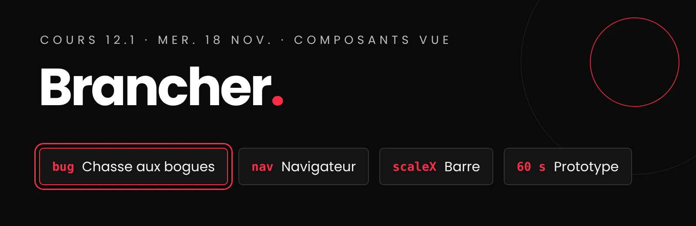

# **Cours 12.1** Les composants Vue
<!-- mer. 18 nov. (reporté du ven. 13 nov. : levée de cours) -->

{.w-100}

!!! warning "Grève du 13 nov."
    En raison de la levée de cours du 13 novembre, il sera repris le **jeudi 17 déc.**
    
    Tout le calendrier qui suit est décalé d'un cours mais quelques dates ont quand même été changées, notamment celle de la Bêta. Grâce à cela, vous avez maintenant 2 semaines entre aujourd'hui (remise du prototype) et la remise de la Bêta finale (avant le QA).
    
    - [Voir le calendrier](projets/recit-defilant/index.md#calendrier)
    - [Voir le plan de cours révisé](https://cmontmorency365-my.sharepoint.com/:b:/r/personal/mariem_ouellet_cmontmorency_qc_ca/Documents/01_cours/Cours%20Web%205%20-%20Projet%20Web/01_plan_de_cours/582-511_web5_plan-de-cours_A2026_V5.pdf?d=w73b61fa54f7345f2856736735b1ac593&csf=1&web=1&e=TtHuyu)

??? danger "Un composant Vue par personne, obligatoire"

    Il n'y a **plus de choix** entre le navigateur de chapitres et la barre de progression : **les deux sont exigés**, et **chaque personne en code un**.

    - Une personne : le **navigateur de chapitres** (`js/navigation.js`).
    - L'autre personne : la **barre de progression** (`js/progression.js`).
    - Une équipe de 3 : la 3e personne code le **panneau de l'équipe** (`js/equipe.js`), qui présente les auteurs et leur rôle. [Le squelette](projets/recit-defilant/composant-vue.md#equipe).

    Chacun l'intègre, le commente et le défend à la [défense](projets/recit-defilant/index.md#calendrier) (cours 15.2, ven. 11 déc.).

    **À faire d'ici le ven. 20 nov.** : mettez à jour la **section 4, matrice de responsabilités**, de votre `CAHIER-DE-CHARGES.md`. Remplacez la ligne du composant Vue par deux lignes, une par composant, avec le prénom de la personne responsable ([le gabarit](projets/recit-defilant/cahier-de-charges.md#le-gabarit)). *Commit* : `Cahier : un composant Vue par personne`.


<br>
<div class="class-content-link">
  
  <span>L'utilisation de l'IA pour coder le projet Récit défilant est <strong>strictement interdite</strong>. Désactivez Copilot dans votre projet.</span>
</div>

<div class="grid" markdown>

<div class="card" markdown>
:simple-vuedotjs: __Les composants Vue__

---

Navigateur de chapitres et barre de progression : on démarre ensemble, vous construisez le reste.

[:octicons-arrow-right-24: La référence](projets/recit-defilant/composant-vue.md){ .stretched-link }
</div>

<div class="card" markdown>
:material-play-box-outline: __Le prototype__

---

Une démo de 60 secondes, sur votre poste. Je passe d'équipe en équipe.

[:octicons-arrow-right-24: Ce que je dois voir](projets/recit-defilant/index.md#prototype){ .stretched-link }
</div>

<div class="card" markdown>
:simple-vuedotjs: __Atelier : votre composant Vue__

---

Du bac à sable au projet : chacun intègre le sien.

[:octicons-arrow-right-24: Brancher le composant](projets/recit-defilant/composant-vue.md#brancher-phase-1){ .stretched-link }
</div>

</div>

## Aujourd'hui

- [ ] Quiz Wooclap : les principes de Vue (10 min)
- [ ] Exercices : terminer *Collection de films*, ou *Cheese Kanye says* si c'est fait (30 min)
- [ ] Révision de l'exercice [*Collection de films*](./exercices/ex-vue-films/index.md) : la chasse aux bogues, en duo (20 min)
- [ ] Les composants Vue, dans un bac à sable : on démarre ensemble, vous construisez le reste (70 min)
- [ ] Remise du prototype : vous me faites une démo de 60 secondes, pendant que je passe d'équipe en équipe
- [ ] Atelier : chaque personne intègre son composant Vue dans le projet (60 min)

## 1. :material-head-question-outline:  Quiz Wooclap : les principes de Vue *10 min* { #quiz }

Six questions pour réactiver ce qu'on a vu mercredi, avant de construire vos composants. Rejoignez l'événement de votre groupe :

- [Gr1 mercredi AM](https://app.wooclap.com/KSMDBMM) (code `KSMDBMM`)
- [Gr2 mercredi PM](https://app.wooclap.com/JOPRDHS) (code `JOPRDHS`)

## 2. :simple-vuedotjs:  Exercices : Films ou Kanye *30 min* { #exercices }

- ❌ **Vous n'avez pas terminé *Collection de films* partie A, B et C?**
  
  **Terminez-le!**

  Si le temps manque, visez la partie C (`v-for` sur un tableau) : c'est un peu comme votre futur navigateur de chapitres du récit défilant, en version simple.

- ☑️ **Vous avez terminé les parties A, B et C de *Collection de films*?**
  
  **Faites *Cheese Kanye says*, parties A et B :**
  
  une méthode Vue qui va chercher des données avec `fetch()`, puis `mounted()`. C'est la recette de votre dataviz, et `mounted()` revient dans la démo. La partie C est un bonus.

[:simple-vuedotjs: Collection de films](exercices/ex-vue-films/index.md){ .md-button } ou [:simple-vuedotjs: Cheese Kanye says](exercices/ex-vue-kanye/index.md){ .md-button }

## 3. :material-bug-outline: Films: la chasse aux bogues *20 min* { #revision }

Le code de l'exercice Collection de films, avec 5 bogues cachés dedans. En duo, vous les trouvez en lisant, puis vous les corrigez un à la fois, la console ouverte.

[:material-bug-outline: La chasse aux bogues](exercices/ex-vue-films/chasse-aux-bogues.md){ .md-button }

Vos réponses vont dans le Wooclap de votre groupe : elles restent cachées aux autres duos jusqu'à la mise en commun.

- [Gr1 mercredi AM](https://app.wooclap.com/BPYIIIL) (code `BPYIIIL`)
- [Gr2 mercredi PM](https://app.wooclap.com/OXZABKP) (code `OXZABKP`)

## 4. :material-code-braces:  Les composants Vue, dans un bac à sable *70 min* { #composant }

<video class="w-100" src="assets/cours11b-navigateur-chapitres.webm" autoplay muted loop playsinline aria-label="Le navigateur de chapitres en action : en défilant, le chapitre actif s'allume dans la liste et la barre de progression avance; un clic sur un chapitre y mène directement"></video>

Le navigateur de chapitres, c'est l'exercice Collection de films avec des chapitres à la place des films. Aujourd'hui, on assemble le tout : les deux composants de votre récit, pièce par pièce. Le navigateur de chapitres d'abord, puis la barre de progression, avec la même recette. **Tout le monde fait les deux**, dans un bac à sable : un petit dossier à part, **hors de votre dépôt**. Dans le projet, chacun n'intègre que le sien.

Pas de dictée : on démarre ensemble, vous écrivez ce que vous connaissez déjà, et je vous donne les pièces difficiles au fil de l'explication.

**Le bac à sable**, à créer avant de commencer :

1. Un dossier `bac-a-sable-vue/`, ouvert dans VS Code.
2. Un fichier `index.html`, avec le code de départ ci-dessous.

  ??? example "Le code de départ : `index.html`"
      ```html
      <!DOCTYPE html>
      <html lang="fr">
      <head>
        <meta charset="UTF-8">
        <title>Bac à sable Vue</title>
        <link rel="stylesheet"
              href="https://fonts.googleapis.com/css2?family=Poppins:wght@400;700">
        <style>
          body {
            margin: 0;
            background: #0b0b0c;
            color: #f4f4f5;
            font-family: "Poppins", sans-serif;
          }
          [v-cloak] { display: none; }

          /* Les chapitres : un écran chacun, un fond différent */
          .chapitre {
            min-height: 100vh;
            display: grid;
            place-content: center;
            text-align: center;
          }
          .chapitre h2 { margin: 0; font-size: 4rem; }
          .surtitre {
            margin: 0;
            color: #a1a1aa;
            letter-spacing: 0.2em;
            text-transform: uppercase;
          }
          #la-foret {
            background: radial-gradient(circle at 30% 70%, #1d3b2a, #0b0b0c 70%);
          }
          #la-maison {
            background: radial-gradient(circle at 70% 30%, #3b2a1d, #0b0b0c 70%);
          }
          #le-loup {
            background: radial-gradient(circle at 40% 40%, #2a2d3b, #0b0b0c 70%);
          }
          #la-fin {
            background: radial-gradient(circle at 60% 60%, #3b1d24, #0b0b0c 70%);
          }

          /* Le navigateur de chapitres */
          .chapitres-nav {
            position: fixed;
            top: 50%;
            right: 2rem;
            transform: translateY(-50%);
            padding: 1rem 1.5rem 1rem 1rem;
            background: rgb(20 20 22 / 0.85);
            border: 1px solid #2c2c31;
            border-radius: 12px;
          }
          .chapitres-nav ol { margin: 0; }
          .chapitres-nav a { color: inherit; text-decoration: none; }
          .chapitres-nav a.actif { font-weight: 700; color: #FF2B47; }

          /* La barre de progression */
          .progression {
            position: fixed;
            inset: 0 0 auto 0;
            z-index: 1;
            height: 6px;
            background: #FF2B47;
            transform-origin: left;
          }
        </style>
      </head>
      <body>
        <div id="navigation"></div>

        <main>
          <section class="chapitre" id="la-foret">
            <p class="surtitre">Chapitre 1</p>
            <h2>La forêt</h2>
          </section>
          <section class="chapitre" id="la-maison">
            <p class="surtitre">Chapitre 2</p>
            <h2>La maison</h2>
          </section>
          <section class="chapitre" id="le-loup">
            <p class="surtitre">Chapitre 3</p>
            <h2>Le loup</h2>
          </section>
          <section class="chapitre" id="la-fin">
            <p class="surtitre">Chapitre 4</p>
            <h2>La fin</h2>
          </section>
        </main>

        <script src="https://cdn.jsdelivr.net/npm/vue@3.5.13/dist/vue.global.js">
        </script>
        <script type="module" src="js/main.js"></script>
      </body>
      </html>
      ```

3. Trois fichiers vides : `js/main.js`, `js/navigation.js` et `js/progression.js`.
4. Ouvert avec **Live Server**.

**Les étapes** : certaines en démo, d'autres seuls. Pour les étapes seuls, les consignes sont dans la page [Les composants Vue](projets/recit-defilant/composant-vue.md#js-navigation).

- [ ] [Étapes 0 et 1](projets/recit-defilant/composant-vue.md#etape-0), en démo : `main.js` et le branchement (10 min)
- [ ] [Étapes 2 à 4](projets/recit-defilant/composant-vue.md#etape-2), seuls : les données, la liste, le chapitre actif (15 min + 5)
- [ ] [Étape 5](projets/recit-defilant/composant-vue.md#etape-5), en démo puis seuls : aller au chapitre, `goTo()` (10 min)
- [ ] [Étape 6](projets/recit-defilant/composant-vue.md#etape-6), en démo puis seuls : suivre le défilement, `mounted()` (15 min)
- [ ] [Étape 7](projets/recit-defilant/composant-vue.md#etape-7), seuls : la barre de progression (15 min)

Pour suivre les consignes en classe, relire après le cours, ou si vous étiez absent :

[:simple-vuedotjs: Les composants Vue : la référence complète](projets/recit-defilant/composant-vue.md){ .md-button .md-button--primary }

## 5. :material-play-box-outline:  Remise : Le prototype, 60 secondes par équipe

Pendant le travail en équipe, je passe vous voir. 

**Préparez votre démo avant que j'arrive**, trois onglets ouverts :

- [ ] **Votre récit**, avec Live Server, la console ouverte, la page en haut du récit.
- [ ] **Votre dépôt sur github.com**, à l'onglet **Pull requests**, filtre **Closed** : les *pull requests* fusionnées dans `main`, de chaque personne.
- [ ] **Votre journal de bord**, chaque personne : `documentation/JOURNAL-prenom.md`, ouvert à la section `## Questions bloc 3`.

En 60 secondes, vous faites défiler votre récit du premier au dernier chapitre. On regarde ensemble ce qui fonctionne, et ce qui reste à faire d'ici la bêta.

[:material-play-box-outline: Le prototype : ce que je dois voir](projets/recit-defilant/index.md#prototype){ .md-button }

## 6. :material-account-multiple-outline:  Atelier : intégrer votre composant Vue *65 min* { #atelier-vue }

**Chaque personne intègre son composant Vue** (voir votre matrice de responsabilités), à partir du bac à sable de la démo, **pendant que je passe d'équipe en équipe** pour le prototype : le navigateur de chapitres pour l'une, la barre de progression pour l'autre.

1. **D'abord, la matrice de responsabilités à jour** : dans la section 4 du `CAHIER-DE-CHARGES.md`, une ligne par composant Vue, avec le prénom de la personne responsable ([le gabarit](projets/recit-defilant/cahier-de-charges.md#le-gabarit)). *Commit* : `Cahier : un composant Vue par personne`.
2. Sur sa branche, crée son fichier à partir du bac à sable : `js/navigation.js` ou `js/progression.js`.
3. Ajoute sa zone dans `index.html`, `#navigation` ou `#barre-progression`. La balise `<script>` de Vue, une seule fois. C'est un fichier **commun** : prévenez votre coéquipier ou coéquipière.
4. Branche son composant dans `main.js` (*phase 1*{ .w5-phase .w5-phase-1 }) : son `import` et son appel. Fichier commun, lui aussi.
5. *Pull request* dès qu'il s'affiche, même sans style.

Votre composant est intégré? La suite, dans l'ordre
{ .w5-groupe }

- [ ] **Adaptez-le au style de votre récit** : couleurs, police, position. Le CSS du bac à sable n'est qu'un départ.
- [ ] **Commentez-le, dans vos mots.** Le code fourni n'a pas de commentaires : c'est à vous d'expliquer ce que fait chaque partie. C'est aussi ce qui vous prépare à la [défense](projets/recit-defilant/index.md#calendrier).
- [ ] **Retournez à vos chapitres** : les animations et les médias qui manquaient au prototype, en visant la **bêta du mer. 2 déc.** C'est le dernier cours avec du temps en classe sur vos chapitres avant la *phase 2*{ .w5-phase .w5-phase-2 }.

!!! tip "Le navigateur de chapitres reste vide dans votre projet?"
    `main.js` lit les sections qui ont la classe `.chapitre`, et le titre dans leur `<h2>`. Si votre HTML est différent, adaptez le sélecteur à **votre** structure.

[:simple-vuedotjs: Brancher les composants à la *phase 1*{ .w5-phase .w5-phase-1 }](projets/recit-defilant/composant-vue.md#brancher-phase-1){ .md-button }

## Devoirs

<div class="class-content-link">
  
  <span>L'utilisation de l'IA pour coder le projet Récit défilant est <strong>strictement interdite</strong>. Désactivez Copilot dans votre projet.</span>
</div>

### D'ici le ven. 20 nov. (cours 12.2)

- **La matrice de responsabilités à jour** (section 4 du `CAHIER-DE-CHARGES.md`) : une ligne par composant Vue, avec son responsable.
- **Votre composant Vue intégré** dans le projet ([la marche à suivre](projets/recit-defilant/composant-vue.md#integrer)), si ce n'est pas terminé en classe : *pull request* fusionnée dans `main` d'ici le mini-jalon du mer. 25 nov. (cours 13.1).
- **L'exercice [*Cheese Kanye says*](exercices/ex-vue-kanye/index.md)** : la première API dans une app Vue. Il prépare le cours 12.2, sur les API externes.

[Voir le calendrier](projets/recit-defilant/index.md#calendrier)
