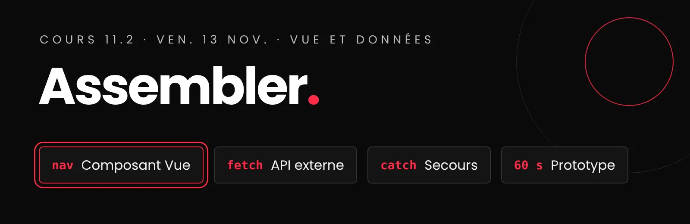

# Cours 12.1
<!-- mer. 18 nov. (reporté du ven. 13 nov. : levée de cours) -->

{.w-100}

!!! warning "Cours reporté : ~~ven. 13 nov.~~ mer. 18 nov."
    En raison de la levée de cours, ce cours et la démo du prototype ont lieu le **mer. 18 nov.** Le cours du 13 nov. sera repris le **jeu. 17 déc.** : tout le calendrier qui suit est décalé d'un cours. La **bêta** a lieu le **mer. 2 déc.**, la **défense** le **ven. 11 déc.** et la **remise finale** le **jeu. 17 déc.** [Voir le calendrier](projets/recit-defilant/index.md#calendrier).

!!! danger "Changement : un composant Vue par personne, obligatoire"
    Il n'y a **plus de choix** entre le navigateur de chapitres et la barre de progression : **les deux sont exigés**, et **chaque personne en code un**.

    - Une personne : le **navigateur de chapitres** (`js/navigation.js`).
    - L'autre personne : la **barre de progression** (`js/progression.js`).
    - Une équipe de 3 : la 3e personne code le **panneau de l'équipe** (`js/equipe.js`), qui présente les auteurs et leur rôle. [Le squelette](projets/recit-defilant/composant-vue.md#equipe).

    Chacun l'intègre, le commente et le défend à la [défense](projets/recit-defilant/index.md#calendrier) (cours 15.2, ven. 11 déc.).

    **À faire d'ici le ven. 20 nov.** : mettez à jour la **section 4, matrice de responsabilités**, de votre `CAHIER-DE-CHARGES.md`. Remplacez la ligne du composant Vue par deux lignes, une par composant, avec le prénom de la personne responsable ([le gabarit](projets/recit-defilant/cahier-de-charges.md#le-gabarit)). *Commit* : `Cahier : un composant Vue par personne`.

<div class="class-content-link">
  
  <span>Utilisation de l'IA restreinte : permise <strong>seulement pour créer vos médias</strong>. Le code, c'est vous! <a class="lien-details" href="projets/recit-defilant/index.html#ia">Détails</a></span>
</div>

<div class="grid" markdown>

<div class="card" markdown>
:simple-vuedotjs: __Les composants Vue__

---

Navigateur de chapitres et barre de progression, construits ensemble, en direct.

[:octicons-arrow-right-24: La référence](projets/recit-defilant/composant-vue.md){ .stretched-link }
</div>

<div class="card" markdown>
:material-play-box-outline: __Le prototype__

---

Une démo de 60 secondes, sur votre poste. Je passe d'équipe en équipe.

[:octicons-arrow-right-24: Ce que je dois voir](projets/recit-defilant/index.md#prototype){ .stretched-link }
</div>

<div class="card" markdown>
:simple-vuedotjs: __Atelier : votre composant Vue__

---

Du bac à sable au projet : chacun intègre le sien.

[:octicons-arrow-right-24: Brancher le composant](projets/recit-defilant/composant-vue.md#brancher-phase-1){ .stretched-link }
</div>

</div>

## Aujourd'hui

- [ ] Les composants Vue, construits en direct : vous codez avec moi, dans un bac à sable
- [ ] Prototype : votre démo de 60 secondes, pendant que je passe d'équipe en équipe
- [ ] Atelier : chaque personne intègre son composant Vue dans le projet

## 1. :material-code-braces:  Les composants Vue, construits en direct { #composant }

<video class="w-100" src="assets/cours11b-navigateur-chapitres.webm" autoplay muted loop playsinline aria-label="Le navigateur de chapitres en action : en défilant, le chapitre actif s'allume dans la liste et la barre de progression avance; un clic sur un chapitre y mène directement"></video>

Mercredi, vous avez vu les 4 notions et pratiqué avec l'exercice Collection de films. Aujourd'hui, on assemble le tout : les deux composants de votre récit, pièce par pièce. Le navigateur de chapitres d'abord, puis la barre de progression, avec la même recette. **Vous codez avec moi**, dans un bac à sable : un petit dossier à part, **hors de votre dépôt**.

**Le bac à sable**, à créer avant de commencer :

1. Un dossier `bac-a-sable-vue/`, ouvert dans VS Code.
2. Un fichier `index.html`, avec ce départ :

```html
<!DOCTYPE html>
<html lang="fr">
<head>
  <meta charset="UTF-8">
  <title>Bac à sable Vue</title>
  <link rel="stylesheet"
        href="https://fonts.googleapis.com/css2?family=Poppins:wght@400;700">
  <style>
    body {
      margin: 0;
      background: #0b0b0c;
      color: #f4f4f5;
      font-family: "Poppins", sans-serif;
    }
    [v-cloak] { display: none; }

    /* Les chapitres : un écran chacun, un fond différent */
    .chapitre {
      min-height: 100vh;
      display: grid;
      place-content: center;
      text-align: center;
    }
    .chapitre h2 { margin: 0; font-size: 4rem; }
    .surtitre {
      margin: 0;
      color: #a1a1aa;
      letter-spacing: 0.2em;
      text-transform: uppercase;
    }
    #la-foret {
      background: radial-gradient(circle at 30% 70%, #1d3b2a, #0b0b0c 70%);
    }
    #la-maison {
      background: radial-gradient(circle at 70% 30%, #3b2a1d, #0b0b0c 70%);
    }
    #le-loup {
      background: radial-gradient(circle at 40% 40%, #2a2d3b, #0b0b0c 70%);
    }
    #la-fin {
      background: radial-gradient(circle at 60% 60%, #3b1d24, #0b0b0c 70%);
    }

    /* Le navigateur de chapitres */
    .chapitres-nav {
      position: fixed;
      top: 50%;
      right: 2rem;
      transform: translateY(-50%);
      padding: 1rem 1.5rem 1rem 1rem;
      background: rgb(20 20 22 / 0.85);
      border: 1px solid #2c2c31;
      border-radius: 12px;
    }
    .chapitres-nav ol { margin: 0; }
    .chapitres-nav a { color: inherit; text-decoration: none; }
    .chapitres-nav a.actif { font-weight: 700; color: #FF2B47; }

    /* La barre de progression */
    .progression {
      position: fixed;
      inset: 0 0 auto 0;
      z-index: 1;
      height: 6px;
      background: #FF2B47;
      transform-origin: left;
    }
  </style>
</head>
<body>
  <div id="navigation"></div>

  <main>
    <section class="chapitre" id="la-foret">
      <p class="surtitre">Chapitre 1</p>
      <h2>La forêt</h2>
    </section>
    <section class="chapitre" id="la-maison">
      <p class="surtitre">Chapitre 2</p>
      <h2>La maison</h2>
    </section>
    <section class="chapitre" id="le-loup">
      <p class="surtitre">Chapitre 3</p>
      <h2>Le loup</h2>
    </section>
    <section class="chapitre" id="la-fin">
      <p class="surtitre">Chapitre 4</p>
      <h2>La fin</h2>
    </section>
  </main>

  <script src="https://cdn.jsdelivr.net/npm/vue@3.5.13/dist/vue.global.js">
  </script>
  <script type="module" src="js/main.js"></script>
</body>
</html>
```

3. Trois fichiers vides : `js/main.js`, `js/navigation.js` et `js/progression.js`.
4. Ouvert avec **Live Server**.

!!! tip "Avant de publier : la version de production de Vue"
    Le bac à sable utilise `vue.global.js`, la version de **développement** : ses messages d'erreur sont clairs. Quand votre récit est **en ligne**, remplacez la balise par celle-ci, trois fois plus légère :

    ```html
    <script src="https://cdn.jsdelivr.net/npm/vue@3.5.13/dist/vue.global.prod.js">
    </script>
    ```

    Pour comprendre la différence : [le guide des fichiers de Vue](https://github.com/vuejs/core/tree/main/packages/vue#which-dist-file-to-use){ :target="_blank" } (en anglais).

**Les pièces, dans l'ordre :**

- [ ] `main.js` : la liste des chapitres, lue dans le HTML
- [ ] Le navigateur, `createApp()` et `mount()` : Vue prend le contrôle de `#navigation`
- [ ] `data()` et `{{ }}` : la réactivité
- [ ] `v-for` : la liste des chapitres
- [ ] `:class` : le chapitre actif
- [ ] `@click` et une méthode : aller au chapitre
- [ ] `mounted()` : écouter le défilement. C'est nouveau : [Le cycle de vie : `mounted()`](vue/mounted.md)
- [ ] La barre de progression : un 2e composant, la même recette

[:simple-vuedotjs: Les composants Vue : la référence complète](projets/recit-defilant/composant-vue.md){ .md-button .md-button--primary }

## 2. :material-play-box-outline:  Remise : Le prototype (~~ven. 13 nov.~~ mer. 18 nov.)

Pendant le travail en équipe, je passe vous voir. 

**Préparez votre démo** : Live Server ouvert, la console ouverte, la page en haut du récit.

En 60 secondes, vous faites défiler votre récit du premier au dernier chapitre. On regarde ensemble ce qui fonctionne, et ce qui reste à faire d'ici la bêta.

[:material-play-box-outline: Le prototype : ce que je dois voir](projets/recit-defilant/index.md#prototype){ .md-button }

## 3. :material-account-multiple-outline:  Atelier : intégrer votre composant Vue { #atelier-vue }

**Chaque personne intègre son composant Vue** (voir votre matrice de responsabilités), à partir du bac à sable de la démo, **pendant que je passe d'équipe en équipe** pour le prototype : le navigateur de chapitres pour l'une, la barre de progression pour l'autre.

1. **D'abord, la matrice de responsabilités à jour** : dans la section 4 du `CAHIER-DE-CHARGES.md`, une ligne par composant Vue, avec le prénom de la personne responsable ([le gabarit](projets/recit-defilant/cahier-de-charges.md#le-gabarit)). *Commit* : `Cahier : un composant Vue par personne`.
2. Sur sa branche, crée son fichier à partir du bac à sable : `js/navigation.js` ou `js/progression.js`.
3. Ajoute sa zone dans `index.html`, `#navigation` ou `#barre-progression`. La balise `<script>` de Vue, une seule fois. C'est un fichier **commun** : prévenez votre coéquipier ou coéquipière.
4. Branche son composant dans `main.js` (*phase 1*{ .w5-phase .w5-phase-1 }) : son `import` et son appel. Fichier commun, lui aussi.
5. *Pull request* dès qu'il s'affiche, même sans style.

[:simple-vuedotjs: Brancher les composants à la *phase 1*{ .w5-phase .w5-phase-1 }](projets/recit-defilant/composant-vue.md#brancher-phase-1){ .md-button }

## Devoirs

<div class="class-content-link">
  
  <span>Utilisation de l'IA restreinte : permise <strong>seulement pour créer vos médias</strong>. Le code, c'est vous! <a class="lien-details" href="projets/recit-defilant/index.html#ia">Détails</a></span>
</div>

### D'ici le ven. 20 nov. (cours 12.2)

- **La matrice de responsabilités à jour** (section 4 du `CAHIER-DE-CHARGES.md`) : une ligne par composant Vue, avec son responsable.
- **Votre composant Vue intégré** dans le projet, si ce n'est pas terminé en classe : *pull request* fusionnée dans `main` d'ici le mini-jalon du mer. 25 nov. (cours 13.1).

[Voir le calendrier](projets/recit-defilant/index.md#calendrier)
