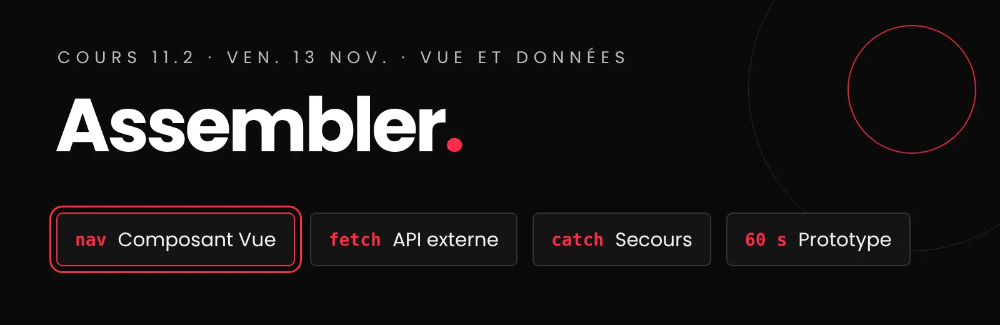

# Cours 12.1
<!-- mer. 18 nov. (reporté du ven. 13 nov. : levée de cours) -->

{.w-100}

!!! warning "Cours reporté : ~~ven. 13 nov.~~ mer. 18 nov."
    En raison de la levée de cours, ce cours et la démo du prototype ont lieu le **mer. 18 nov.** La **bêta est aussi reportée** : nouvelle date à confirmer, au moins une semaine après le prototype.

<div class="class-content-link">
  
  <span>Utilisation de l'IA restreinte : permise <strong>seulement pour créer vos médias</strong>. Le code, c'est vous! <a class="lien-details" href="projets/recit-defilant/index.html#ia">Détails</a></span>
</div>

<div class="grid" markdown>

<div class="card" markdown>
:simple-vuedotjs: __Le composant Vue__

---

Navigateur de chapitres et barre de progression, construit ensemble, en direct.

[:octicons-arrow-right-24: La référence](projets/recit-defilant/composant-vue.md){ .stretched-link }
</div>

<div class="card" markdown>
:material-api: __Choisir et tester votre API__

---

Trouver l'adresse, lire la réponse, prévoir la panne.

[:octicons-arrow-right-24: Les 7 étapes](projets/recit-defilant/dataviz.md#api){ .stretched-link }
</div>

<div class="card" markdown>
:material-play-box-outline: __Le prototype__

---

Une démo de 60 secondes, sur votre poste. Je passe d'équipe en équipe.

[:octicons-arrow-right-24: Ce que je dois voir](projets/recit-defilant/index.md#prototype){ .stretched-link }
</div>

</div>

## Aujourd'hui

- [ ] API, JSON et fetch : pourquoi ils sont partout
- [ ] Le composant Vue, construit en direct : vous codez avec moi, dans un bac à sable
- [ ] Le *fetch* externe : choisir et tester votre API
- [ ] Prototype : votre démo de 60 secondes, pendant que je passe d'équipe en équipe
- [ ] Dans votre projet : le composant Vue, l'API, et le début de la *phase 2*{ .w5-phase .w5-phase-2 }

## 1. :material-api:  API, JSON et fetch : pourquoi ils sont partout { #pourquoi-api }


<div class="w5-schema-cadre" style="margin:1.5em 0;padding:1rem 1.2rem;background:var(--md-code-bg-color);border:1px solid var(--md-default-fg-color--lightest);border-radius:0.4rem;text-align:center">
<svg class="w5-schema" style="width:100%;height:auto;max-width:720px" viewBox="0 0 720 200" role="img" aria-labelledby="t-trio d-trio" font-family="inherit" font-size="14" fill="currentColor">
<title id="t-trio">Le trio : fetch(), l'API et le JSON</title>
<desc id="d-trio">Votre page envoie une demande avec fetch(), le messager. L'API, la porte du service, la reçoit et consulte le serveur et sa base de données. La réponse revient à la page en JSON, la langue des données.</desc>
<defs>
<marker id="ft" viewBox="0 0 10 10" refX="9" refY="5" markerUnits="userSpaceOnUse" markerWidth="11" markerHeight="11" orient="auto-start-reverse"><path d="M0 0 L10 5 L0 10 z" fill="currentColor" fill-opacity=".7"/></marker>
<marker id="fta" viewBox="0 0 10 10" refX="9" refY="5" markerUnits="userSpaceOnUse" markerWidth="13" markerHeight="13" orient="auto-start-reverse"><path d="M0 0 L10 5 L0 10 z" fill="#FF2B47"/></marker>
</defs>
<!-- Votre page -->
<rect x="10" y="30" width="140" height="90" rx="10" fill="none" stroke="currentColor" stroke-opacity=".45"/>
<text x="80" y="62" text-anchor="middle" font-weight="600">Votre page</text>
<rect x="35" y="78" width="90" height="8" rx="2" fill="currentColor" fill-opacity=".15"/>
<rect x="35" y="92" width="56" height="16" rx="2" fill="#FF2B47"/>
<rect x="97" y="92" width="28" height="16" rx="2" fill="currentColor" fill-opacity=".15"/>
<!-- fetch() : la demande -->
<line x1="152" y1="60" x2="416" y2="60" stroke="currentColor" stroke-opacity=".6" stroke-width="2" marker-end="url(#ft)"/>
<rect x="222" y="42" width="124" height="36" rx="18" fill="#FF2B47"/>
<text x="284" y="65" text-anchor="middle" font-weight="700" fill="#fff" font-family="ui-monospace, monospace">fetch()</text>
<text x="284" y="28" text-anchor="middle" font-size="12" fill-opacity=".75">le messager</text>
<!-- L'API -->
<rect x="420" y="20" width="150" height="100" rx="10" fill="none" stroke="currentColor" stroke-width="2"/>
<text x="495" y="66" text-anchor="middle" font-size="26" font-weight="700">API</text>
<text x="495" y="92" text-anchor="middle" font-size="12" fill-opacity=".75">la porte du service</text>
<!-- Derrière l'API -->
<line x1="572" y1="70" x2="606" y2="70" stroke="currentColor" stroke-opacity=".35" stroke-dasharray="4 4"/>
<rect x="608" y="38" width="104" height="64" rx="10" fill="none" stroke="currentColor" stroke-opacity=".3" stroke-dasharray="4 4"/>
<text x="660" y="66" text-anchor="middle" font-size="12" fill-opacity=".6">serveur et</text>
<text x="660" y="82" text-anchor="middle" font-size="12" fill-opacity=".6">base de données</text>
<!-- La réponse : du JSON -->
<path d="M495 122 L495 160 L80 160 L80 124" fill="none" stroke="#FF2B47" stroke-width="2.5" marker-end="url(#fta)"/>
<rect x="222" y="142" width="124" height="36" rx="18" fill="#FF2B47"/>
<text x="284" y="165" text-anchor="middle" font-weight="700" fill="#fff" font-family="ui-monospace, monospace">{ } JSON</text>
<text x="284" y="196" text-anchor="middle" font-size="12" fill-opacity=".75">la langue des données</text>
</svg>
</div>

**Le web moderne tourne sur trois morceaux : les API (Application Programming Interface), le JSON et `fetch()`.** 

Un site dynamique peut se construire de deux façons, et les deux existent aujourd'hui :

- **Site multipage (web classique)** : le serveur fabrique chaque page avec sa base de données, et chaque clic charge une nouvelle page : une nouvelle adresse dans la barre du navigateur, et tout l'écran redessiné;
- **Application web (web moderne)** : le serveur envoie seulement les **données**, en **JSON**, et c'est le navigateur qui les place dans la page avec **`fetch()`** : l'adresse (URL) ne change pas, et seule une partie de l'écran se met à jour, dynamiquement, en temps réel, sans charger une nouvelle page.

Les trois morceaux :

- **L'API**, la porte d'un service : la même API sert le site web, l'application iOS et l'application Android;
- **le JSON**, la langue de ces données, que tous les langages comprennent;
- **`fetch()`**, le messager du navigateur, qui va les chercher sans charger une nouvelle page.

Vous avez déjà le geste : dans votre portfolio, `fetch()` chargeait vos projets depuis un fichier JSON. Interroger une API, c'est le même `fetch()`, avec une adresse sur un autre serveur. Ceux qui ont choisi Airtable l'ont déjà fait.

[:material-api: API, JSON et fetch : le trio du web moderne](js/api-json-fetch.md){ .md-button .md-button--primary }

## 2. :material-code-braces:  Le composant Vue, construit en direct { #composant }

<video class="w-100" src="assets/cours11b-navigateur-chapitres.webm" autoplay muted loop playsinline aria-label="Le navigateur de chapitres en action : en défilant, le chapitre actif s'allume dans la liste et la barre de progression avance; un clic sur un chapitre y mène directement"></video>

Mercredi, vous avez vu les 4 notions et pratiqué avec l'exercice Collection de films. Aujourd'hui, on assemble le tout : le composant de votre récit, pièce par pièce. **Vous codez avec moi**, dans un bac à sable : un petit dossier à part, **hors de votre dépôt**.

**Le bac à sable**, à créer avant de commencer :

1. Un dossier `bac-a-sable-vue/`, ouvert dans VS Code.
2. Un fichier `index.html`, avec ce départ :

```html
<!DOCTYPE html>
<html lang="fr">
<head>
  <meta charset="UTF-8">
  <title>Bac à sable Vue</title>
  <style>
    .chapitre { min-height: 100vh; padding: 2rem; }
    [v-cloak] { display: none; }
    .actif { font-weight: 700; color: #FF2B47; }
    .chapitres-nav { position: fixed; top: 40%; right: 1rem; }
    .progression {
      position: fixed; inset: 0 0 auto 0; height: 4px;
      background: #FF2B47; transform-origin: left;
    }
  </style>
</head>
<body>
  <div id="navigation"></div>

  <main>
    <section class="chapitre" id="la-foret"><h2>La forêt</h2></section>
    <section class="chapitre" id="la-maison"><h2>La maison</h2></section>
    <section class="chapitre" id="le-loup"><h2>Le loup</h2></section>
    <section class="chapitre" id="la-fin"><h2>La fin</h2></section>
  </main>

  <script src="https://cdn.jsdelivr.net/npm/vue@3.5.13/dist/vue.global.js">
  </script>
  <script type="module" src="js/main.js"></script>
</body>
</html>
```

3. Deux fichiers vides : `js/main.js` et `js/navigation.js`.
4. Ouvert avec **Live Server**.

!!! tip "Avant de publier : la version de production de Vue"
    Le bac à sable utilise `vue.global.js`, la version de **développement** : ses messages d'erreur sont clairs. Quand votre récit est **en ligne**, remplacez la balise par celle-ci, trois fois plus légère :

    ```html
    <script src="https://cdn.jsdelivr.net/npm/vue@3.5.13/dist/vue.global.prod.js">
    </script>
    ```

    Pour comprendre la différence : [le guide des fichiers de Vue](https://github.com/vuejs/core/tree/main/packages/vue#which-dist-file-to-use){ :target="_blank" } (en anglais).

**Les pièces, dans l'ordre :**

- [ ] `main.js` : la liste des chapitres, lue dans le HTML
- [ ] `createApp()` et `mount()` : Vue prend le contrôle de `#navigation`
- [ ] `data()` et `{{ }}` : la réactivité
- [ ] `v-for` : la liste des chapitres
- [ ] `:class` : le chapitre actif
- [ ] `@click` et une méthode : aller au chapitre
- [ ] `mounted()` : écouter le défilement
- [ ] Pour aller plus loin, si on a le temps : `computed`, le titre du chapitre actif

[:simple-vuedotjs: Le composant Vue : la référence complète](projets/recit-defilant/composant-vue.md){ .md-button .md-button--primary }

## 3. :material-api:  Le *fetch* externe : choisir et tester votre API

<video class="w-100" src="assets/cours11b-fetch-dataviz.webm" autoplay muted loop playsinline aria-label="La démo La Terre bouge : en arrivant à chaque moment, un fetch() part vers une API externe (USGS, puis Open-Meteo), le JSON revient, et la dataviz s'anime : un compteur et des points pour les séismes, puis des barres qui poussent pour la météo"></video>

Vous savez déjà faire un `fetch()` : vous l'utilisez pour `data.json`. Interroger une API, c'est **le même `fetch()`**, avec une adresse sur un autre site. Ce qui est nouveau :

- **choisir** une API : **sans clé d'identification** (dans les listes d'API, la colonne **Auth : `No`**, plutôt que `apiKey` ou `OAuth`), **CORS : `Yes`** (ou `Unknown`, à tester d'abord), du JSON, et votre donnée;
- **lire** sa réponse : tester l'adresse dans le navigateur, trouver le chemin vers votre valeur;
- **prévoir la panne** : des valeurs de secours, pour que le récit reste lisible.

[:material-api: Choisir et tester votre API : les 7 étapes](projets/recit-defilant/dataviz.md#api){ .md-button .md-button--primary }

[:material-code-json: Trouver une donnée dans un JSON](js/json-chemin.md){ .md-button }

!!! example "À vous : 10 minutes"
    **La personne responsable de la dataviz**, avec ses deux API candidates :

    1. Collez l'adresse de chacune dans le navigateur. Laquelle contient **votre** donnée?
    2. Trouvez le [**chemin**](js/json-chemin.md) vers la valeur, comme `data.daily.temperature_2m_max`.
    3. Faites le `fetch()` dans votre bac à sable, et affichez la valeur avec `console.log()`.

    **L'autre personne** fait la même chose avec une API de la [liste de la démo](projets/recit-defilant/dataviz.md#demo) : tout le monde doit savoir lire une réponse d'API.

## 4. :material-play-box-outline:  Remise : Le prototype (~~ven. 13 nov.~~ mer. 18 nov.)

Pendant le travail en équipe, je passe vous voir. 

**Préparez votre démo** : Live Server ouvert, la console ouverte, la page en haut du récit.

En 60 secondes, vous faites défiler votre récit du premier au dernier chapitre. On regarde ensemble ce qui fonctionne, et ce qui reste à faire d'ici la bêta.

[:material-play-box-outline: Le prototype : ce que je dois voir](projets/recit-defilant/index.md#prototype){ .md-button }

## 5. :material-account-multiple-outline:  Dans votre projet

**La personne responsable du composant Vue** (voir votre matrice de responsabilités) l'intègre d'ici la **bêta** (ven. 20 nov.) :

1. Sur sa branche, crée `js/navigation.js` à partir du bac à sable.
2. Ajoute la zone `#navigation` et la balise de Vue dans `index.html` : c'est un fichier **commun**, prévenez votre coéquipier ou coéquipière.
3. Branche le composant dans `main.js`, avec la liste des chapitres lue dans le HTML (*phase 1*{ .w5-phase .w5-phase-1 }).
4. *Pull request* dès qu'il s'affiche, même sans style.

[:simple-vuedotjs: Brancher le composant à la *phase 1*{ .w5-phase .w5-phase-1 }](projets/recit-defilant/composant-vue.md#brancher-phase-1){ .md-button }

**La personne responsable de la dataviz** : l'API choisie, testée et documentée dans le cahier de charges (étape 7).

**Tout le monde** : la *phase 2*{ .w5-phase .w5-phase-2 } commence aujourd'hui. Vos chapitres passent du HTML statique à `data.json`, en suivant les étapes, ensemble puis chacun ses chapitres.

[:material-swap-horizontal: *Phase 2*{ .w5-phase .w5-phase-2 } : les étapes du chargement JSON](projets/recit-defilant/json-chapitres.md){ .md-button }

[:simple-vuedotjs: Le composant Vue à la *phase 2*{ .w5-phase .w5-phase-2 }](projets/recit-defilant/composant-vue.md#brancher-phase-2){ .md-button }

## Devoirs

<div class="class-content-link">
  
  <span>Utilisation de l'IA restreinte : permise <strong>seulement pour créer vos médias</strong>. Le code, c'est vous! <a class="lien-details" href="projets/recit-defilant/index.html#ia">Détails</a></span>
</div>

### D'ici le ven. 20 nov. (cours 12.2)

- L'API documentée dans la section 6 du `CAHIER-DE-CHARGES.md` ([quoi écrire](projets/recit-defilant/dataviz.md#api-documenter)), *commit* `Cahier : ajoute l'API de la dataviz`.
- La *phase 2*{ .w5-phase .w5-phase-2 } bien entamée : [les étapes faites ensemble](projets/recit-defilant/json-chapitres.md#ensemble) sont sur `main`.

### D'ici la bêta (~~ven. 20 nov.~~ date à confirmer), en *phase 2*{ .w5-phase .w5-phase-2 }

- *Phase 2*{ .w5-phase .w5-phase-2 } : **intégration dynamique** exigée, chapitres chargés depuis `data.json` ([les instructions](projets/recit-defilant/json-chapitres.md)).
- Médias finaux intégrés.
- Le composant Vue en place ([le brancher à la *phase 2*{ .w5-phase .w5-phase-2 }](projets/recit-defilant/composant-vue.md#brancher-phase-2)).
- Dataviz **fonctionnelle** : les données de l'API s'affichent ([les 7 étapes](projets/recit-defilant/dataviz.md#api)). Elle sera soignée d'ici la remise finale.

[:material-swap-horizontal: *Phase 2*{ .w5-phase .w5-phase-2 } : passer du HTML statique au JSON](projets/recit-defilant/arborescence-recit-defilant.md#phase-2){ .md-button }

[:material-code-json: *Phase 2*{ .w5-phase .w5-phase-2 } : les étapes du chargement JSON](projets/recit-defilant/json-chapitres.md){ .md-button }

[Voir le calendrier](projets/recit-defilant/index.md#calendrier)
