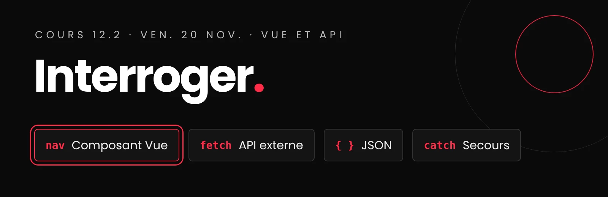

# **Cours 12.2** Les API externes
<!-- ven. 20 nov. -->

{.w-100}

  
  L'utilisation de l'IA pour coder le projet Récit défilant est <strong>strictement interdite</strong>. Désactivez Copilot dans votre projet.

:simple-vuedotjs: __Les composants Vue, la suite__

---

On termine le bac à sable du cours 12.1, là où on s'est arrêtés.

[:octicons-arrow-right-24: Les étapes](projets/recit-defilant/composant-vue.md#js-navigation){ .stretched-link }

:material-api: __API, JSON et fetch__

---

Le trio du web moderne : pourquoi ils sont partout.

[:octicons-arrow-right-24: La page-sujet](js/api-json-fetch.md){ .stretched-link }

:material-api: __Choisir et tester votre API__

---

Trouver l'adresse, lire la réponse, prévoir la panne.

[:octicons-arrow-right-24: Les 7 étapes](projets/recit-defilant/dataviz.md#api){ .stretched-link }

## Aujourd'hui

- [ ] Les composants Vue, la suite : on termine le bac à sable du cours 12.1
- [ ] API, JSON et fetch : pourquoi ils sont partout
- [ ] Où se cache la donnée? Chaque personne, dans Wooclap
- [ ] Le *fetch* externe : choisir et tester votre API
- [ ] Atelier : en équipe, trouvez votre API et faites-la valider avant la fin du cours. Votre composant Vue pas encore intégré? Terminez-le.

## 1. :material-code-braces:  Les composants Vue, la suite { #composant }

On reprend le bac à sable du [cours 12.1](cours12a.md#composant) là où on s'est arrêtés. Ouvrez votre dossier `bac-a-sable-vue/` avec **Live Server**, et cochez les étapes déjà faites.

Pas de bac à sable, ou il ne fonctionne plus? Repartez du [code de départ](cours12a.md#composant), puis suivez les étapes dans l'ordre.

- [ ] [Étapes 0 et 1](projets/recit-defilant/composant-vue.md#etape-0), en démo : `main.js` et le branchement
- [ ] [Étapes 2 à 4](projets/recit-defilant/composant-vue.md#etape-2), seuls : les données, la liste, le chapitre actif
- [ ] [Étape 5](projets/recit-defilant/composant-vue.md#etape-5), en démo puis seuls : aller au chapitre, `goTo()`
- [ ] [Étape 6](projets/recit-defilant/composant-vue.md#etape-6), en démo puis seuls : suivre le défilement, `mounted()`
- [ ] [Étape 7](projets/recit-defilant/composant-vue.md#etape-7), seuls : la barre de progression

[:simple-vuedotjs: Les composants Vue : les étapes](projets/recit-defilant/composant-vue.md#js-navigation){ .md-button .md-button--primary }

## 2. :material-api:  API, JSON et fetch : pourquoi ils sont partout { #pourquoi-api }

<svg class="w5-schema" style="width:100%;height:auto;max-width:720px" viewBox="0 0 720 200" role="img" aria-labelledby="t-trio d-trio" font-family="inherit" font-size="14" fill="currentColor">
<title id="t-trio">Le trio : fetch(), l'API et le JSON</title>
<desc id="d-trio">Votre page envoie une demande avec fetch(), le messager. L'API, la porte du service, la reçoit et consulte le serveur et sa base de données. La réponse revient à la page en JSON, la langue des données.</desc>
<defs>
<marker id="ft" viewBox="0 0 10 10" refX="9" refY="5" markerUnits="userSpaceOnUse" markerWidth="11" markerHeight="11" orient="auto-start-reverse"><path d="M0 0 L10 5 L0 10 z" fill="currentColor" fill-opacity=".7"/></marker>
<marker id="fta" viewBox="0 0 10 10" refX="9" refY="5" markerUnits="userSpaceOnUse" markerWidth="13" markerHeight="13" orient="auto-start-reverse"><path d="M0 0 L10 5 L0 10 z" fill="#FF2B47"/></marker>
</defs>
<!-- Votre page -->
<rect x="10" y="30" width="140" height="90" rx="10" fill="none" stroke="currentColor" stroke-opacity=".45"/>
<text x="80" y="62" text-anchor="middle" font-weight="600">Votre page</text>
<rect x="35" y="78" width="90" height="8" rx="2" fill="currentColor" fill-opacity=".15"/>
<rect x="35" y="92" width="56" height="16" rx="2" fill="#FF2B47"/>
<rect x="97" y="92" width="28" height="16" rx="2" fill="currentColor" fill-opacity=".15"/>
<!-- fetch() : la demande -->
<line x1="152" y1="60" x2="416" y2="60" stroke="currentColor" stroke-opacity=".6" stroke-width="2" marker-end="url(#ft)"/>
<rect x="222" y="42" width="124" height="36" rx="18" fill="#FF2B47"/>
<text x="284" y="65" text-anchor="middle" font-weight="700" fill="#fff" font-family="ui-monospace, monospace">fetch()</text>
<text x="284" y="28" text-anchor="middle" font-size="12" fill-opacity=".75">le messager</text>
<!-- L'API -->
<rect x="420" y="20" width="150" height="100" rx="10" fill="none" stroke="currentColor" stroke-width="2"/>
<text x="495" y="66" text-anchor="middle" font-size="26" font-weight="700">API</text>
<text x="495" y="92" text-anchor="middle" font-size="12" fill-opacity=".75">la porte du service</text>
<!-- Derrière l'API -->
<line x1="572" y1="70" x2="606" y2="70" stroke="currentColor" stroke-opacity=".35" stroke-dasharray="4 4"/>
<rect x="608" y="38" width="104" height="64" rx="10" fill="none" stroke="currentColor" stroke-opacity=".3" stroke-dasharray="4 4"/>
<text x="660" y="66" text-anchor="middle" font-size="12" fill-opacity=".6">serveur et</text>
<text x="660" y="82" text-anchor="middle" font-size="12" fill-opacity=".6">base de données</text>
<!-- La réponse : du JSON -->
<path d="M495 122 L495 160 L80 160 L80 124" fill="none" stroke="#FF2B47" stroke-width="2.5" marker-end="url(#fta)"/>
<rect x="222" y="142" width="124" height="36" rx="18" fill="#FF2B47"/>
<text x="284" y="165" text-anchor="middle" font-weight="700" fill="#fff" font-family="ui-monospace, monospace">{ } JSON</text>
<text x="284" y="196" text-anchor="middle" font-size="12" fill-opacity=".75">la langue des données</text>
</svg>

Une **API** est la porte d'un service, le **JSON** est la langue de ses données, et **`fetch()`** est le messager qui va les chercher. Vous connaissez déjà `fetch()` : dans votre portfolio, il chargeait vos projets depuis un fichier JSON.

[:material-api: API, JSON et fetch : le trio du web moderne](js/api-json-fetch.md){ .md-button .md-button--primary } 

### Où se cache la donnée? *10 min* { #ou-se-cache }

Sur **votre** poste, pas celui de votre coéquipier. Trois adresses d'API, de la plus facile à la plus difficile. Pour chacune :

- [ ] Ouvrez l'adresse dans **Firefox** : il affiche le JSON de façon lisible ([voir la réponse](js/json-chemin.md#firefox)).
- [ ] Trouvez le **chemin** vers la valeur demandée, à partir de `data` ([la méthode](js/json-chemin.md#methode)).
- [ ] Écrivez le **chemin** et la **valeur** dans le Wooclap de votre groupe. Vos réponses restent cachées aux autres jusqu'à la mise en commun.

- [Gr2 vendredi AM](https://app.wooclap.com/UQLJRRR) (code `UQLJRRR`)
- [Gr1 vendredi PM](https://app.wooclap.com/BZUIEPD) (code `BZUIEPD`)

| | L'adresse | La valeur à trouver |
|---|---|---|
| 1 | [Open-Meteo](https://api.open-meteo.com/v1/forecast?latitude=45.5&longitude=-73.57&daily=temperature_2m_max&timezone=America%2FToronto){ :target="_blank" } | La température maximale prévue **demain** à Montréal |
| 2 | [USGS](https://earthquake.usgs.gov/earthquakes/feed/v1.0/summary/all_day.geojson){ :target="_blank" } | Le lieu du **premier** séisme de la liste |
| 3 | [REST Countries](https://restcountries.com/v3.1/name/canada?fields=name,capital,population){ :target="_blank" } | La **capitale** du Canada |

## 3. :material-api:  Le fetch externe : choisir et tester votre API

<video class="w-100" src="assets/cours11b-fetch-dataviz.webm" autoplay muted loop playsinline aria-label="La démo La Terre bouge : en arrivant à chaque moment, un fetch() part vers une API externe (USGS, puis Open-Meteo), le JSON revient, et la dataviz s'anime : un compteur et des points pour les séismes, puis des barres qui poussent pour la météo"></video>

Vous savez déjà faire un `fetch()` : vous l'utilisez pour `data.json`. Interroger une API, c'est **le même `fetch()`**, avec une adresse sur un autre site. Ce qui est nouveau :

- **choisir** une API : **sans clé d'identification** (dans les listes d'API, la colonne **Auth : `No`**, plutôt que `apiKey` ou `OAuth`), **Cross-Origin Resource Sharing (CORS) : `Yes`** (ou `Unknown`, à tester d'abord), du JSON, et votre donnée;
- **lire** sa réponse : tester l'adresse dans le navigateur, trouver le chemin vers votre valeur;
- **prévoir la panne** : des valeurs de secours, pour que le récit reste lisible.

[:material-api: Choisir et tester votre API : les 7 étapes](projets/recit-defilant/dataviz.md#api){ .md-button .md-button--primary }

[:material-code-json: Trouver une donnée dans un JSON](js/json-chemin.md){ .md-button }

### Votre API, dans votre projet *atelier* { #votre-api }

:material-account-group-outline: **En équipe**, explorez les listes d'API ([les pistes](projets/recit-defilant/dataviz.md#pistes)) et trouvez celle de votre moment dataviz. Pas d'idée? [La donnée peut parler du contexte](projets/recit-defilant/dataviz.md#pas-d-idee).

**Avant la fin du cours, venez me montrer votre trouvaille.** Je la valide avec vous. Préparez :

- [ ] l'**adresse** de l'API, ouverte dans Firefox;
- [ ] le **chemin** vers votre donnée, et sa valeur;
- [ ] en **une phrase**, ce que cette donnée apporte à votre histoire.

Une fois validée, la personne responsable de la dataviz fait le `fetch()` dans son bac à sable et documente l'API dans le cahier de charges ([les 7 étapes](projets/recit-defilant/dataviz.md#api)). C'est exigé au mini-jalon du mer 25 nov.

## Devoirs

  
  L'utilisation de l'IA pour coder le projet Récit défilant est <strong>strictement interdite</strong>. Désactivez Copilot dans votre projet.

### D'ici le mer. 25 nov. (cours 13.1) : le mini-jalon

Je le vérifie avec vous au début du cours. Il est formatif.

- **Votre composant Vue intégré** dans le projet : *pull request* fusionnée dans `main` (commencé au cours 12.1).
- **La matrice de responsabilités à jour** (section 4 du `CAHIER-DE-CHARGES.md`) : Qui est responsable de quel composant VUE.js
- **Votre API testée** : l'appel fonctionne, et `console.log()` affiche la donnée que vous voulez montrer ([les 7 étapes](projets/recit-defilant/dataviz.md#api)).
- **L'API documentée** dans la section 6 du `CAHIER-DE-CHARGES.md` ([quoi écrire](projets/recit-defilant/dataviz.md#api-documenter)), *commit* `Cahier : ajoute l'API de la dataviz`.

Au cours 13.1, on commence la *phase 2*{ .w5-phase .w5-phase-2 } ensemble : lisez d'avance [les étapes](projets/recit-defilant/json-chapitres.md#ensemble).

### D'ici la bêta, en *phase 2*{ .w5-phase .w5-phase-2 } *~~ven 20 nov~~ mer 2 déc, cours 14.1*

La bêta doit être **fonctionnelle**, pas finie : l'autre équipe doit pouvoir la tester.

- *Phase 2*{ .w5-phase .w5-phase-2 } : **intégration dynamique** exigée, chapitres chargés depuis `data.json` ([les instructions](projets/recit-defilant/json-chapitres.md)).
- Médias finaux intégrés.
- Les deux composants Vue en place ([les brancher à la *phase 2*{ .w5-phase .w5-phase-2 }](projets/recit-defilant/composant-vue.md#brancher-phase-2)).
- Dataviz **branchée** : les vraies données de l'API s'affichent ([les 7 étapes](projets/recit-defilant/dataviz.md#api)). Son animation viendra après la bêta.
- Au minimum, les animations du prototype : une par chapitre. Les autres viendront après la bêta.

[Voir le calendrier](projets/recit-defilant/index.md#calendrier)
