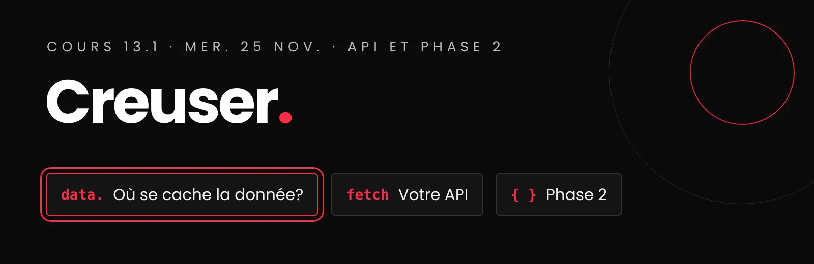

# **Cours 13.1** Des API à la phase 2
<!-- mer. 25 nov. -->

{.w-100}

  
  L'utilisation de l'IA pour coder le projet Récit défilant est <strong>strictement interdite</strong>. Désactivez Copilot dans votre projet.

:material-code-json: __Où se cache la donnée?__

---

Pikachu, puis trois vraies API : trouvez le chemin.

[:octicons-arrow-right-24: L'exercice](exercices/ex-ou-se-cache/index.md){ .stretched-link }

:material-api: __Choisir votre API__

---

Trouver l'adresse, lire la réponse, prévoir la panne.

[:octicons-arrow-right-24: Les 7 étapes](projets/recit-defilant/dataviz.md#api){ .stretched-link }

:material-code-json: __La phase 2__

---

Les chapitres chargés depuis `data.json`, ensemble.

[:octicons-arrow-right-24: Les étapes](projets/recit-defilant/json-chapitres.md#ensemble){ .stretched-link }

## Aujourd'hui

- [ ] API: Trouver une donnée dans un JSON complexe
  - [ ] Exercice : Où se cache la donnée? Chaque personne, dans Wooclap
- [ ] Le *fetch* externe : choisir et tester votre API
- [ ] En équipe : trouvez votre API et faites-la valider avant la fin du cours
- [ ] La *phase 2*{ .w5-phase .w5-phase-2 } : on commence ensemble, puis atelier

## 1. :material-code-json: API: Trouver une donnée dans un JSON complexe

La réponse d'une vraie API est rarement petite : des objets dans des tableaux dans des objets. Pour atteindre votre donnée, il faut écrire son chemin. La méthode, une démo pour tester vos chemins, et les outils de Firefox et de Chrome sont sur leur propre page. 

[:material-code-json: Trouver une donnée dans un JSON](js/json-chemin.md){ .md-button }

Exercice : Où se cache la donnée? *25 min* { #ou-se-cache }

Chaque personne, sur **son** poste : Pikachu (partie A), puis trois vraies API (partie B). Les réponses de la partie B vont dans Wooclap.

[:material-code-json: Exercice : Où se cache la donnée?](exercices/ex-ou-se-cache/index.md){ .md-button .md-button--primary }

## 2. :material-api:  Le fetch externe : choisir et tester votre API *15 min* { #fetch-externe }

<video class="w-100" src="assets/cours11b-fetch-dataviz.webm" autoplay muted loop playsinline aria-label="La démo La Terre bouge : en arrivant à chaque moment, un fetch() part vers une API externe (USGS, puis Open-Meteo), le JSON revient, et la dataviz s'anime : un compteur et des points pour les séismes, puis des barres qui poussent pour la météo"></video>

Vous savez déjà faire un `fetch()` : vous l'utilisez pour `data.json`. Interroger une API, c'est **le même `fetch()`**, avec une adresse sur un autre site. Ce qui est nouveau :

- **choisir** une API : **sans clé d'identification** (dans les listes d'API, la colonne **Auth : `No`**, plutôt que `apiKey` ou `OAuth`), **Cross-Origin Resource Sharing (CORS) : `Yes`** (ou `Unknown`, à tester d'abord), du JSON, et votre donnée;
- **lire** sa réponse : tester l'adresse dans le navigateur, trouver le chemin vers votre valeur;
- **prévoir la panne** : des valeurs de secours, pour que le récit reste lisible.

[:material-api: Choisir et tester votre API : les 7 étapes](projets/recit-defilant/dataviz.md#api){ .md-button .md-button--primary }

[:material-code-json: Trouver une donnée dans un JSON](js/json-chemin.md){ .md-button }

[Des pistes pour choisir votre API](projets/recit-defilant/dataviz.md#pistes)

## 3. :material-account-group-outline:  Votre API, en équipe *30 min* { #votre-api }

:material-account-group-outline: **En équipe**, explorez les listes d'API ([les pistes](projets/recit-defilant/dataviz.md#pistes)) et trouvez celle de votre moment dataviz. Pas d'idée? [La donnée peut parler du contexte](projets/recit-defilant/dataviz.md#pas-d-idee).

**Avant la fin du cours, venez me montrer votre trouvaille.** Je la valide avec vous. Préparez :

- [ ] l'**adresse** de l'API, ouverte dans Firefox;
- [ ] le **chemin** vers votre donnée, et sa valeur;
- [ ] en **une phrase**, ce que cette donnée apporte à votre histoire.

Une fois validée, la personne responsable de la dataviz fait le `fetch()` dans son bac à sable et documente l'API dans le cahier de charges ([les 7 étapes](projets/recit-defilant/dataviz.md#api)). C'est exigé au mini-jalon du ven 27 nov.

## 4. :material-code-json:  La *phase 2*{ .w5-phase .w5-phase-2 }, ensemble { #phase-2 }

Il reste une semaine avant la bêta. On commence la *phase 2*{ .w5-phase .w5-phase-2 } ensemble : les chapitres chargés depuis `data.json`. Ensuite, atelier en équipe.

[:material-code-json: La *phase 2*{ .w5-phase .w5-phase-2 } : ensemble, en 6 étapes](projets/recit-defilant/json-chapitres.md#ensemble){ .md-button .md-button--primary }

## Devoirs

  
  L'utilisation de l'IA pour coder le projet Récit défilant est <strong>strictement interdite</strong>. Désactivez Copilot dans votre projet.

### D'ici le ven 27 nov (cours 13.2) : le mini-jalon

Je le vérifie avec vous au début du cours. Il est formatif.

- **Votre composant Vue intégré** dans le projet : *pull request* fusionnée dans `main`.
- **La matrice de responsabilités à jour** (section 4 du `CAHIER-DE-CHARGES.md`).
- **Votre API testée** : l'appel fonctionne, et `console.log()` affiche la donnée ([les 7 étapes](projets/recit-defilant/dataviz.md#api)).
- **L'API documentée** dans la section 6 du `CAHIER-DE-CHARGES.md` ([quoi écrire](projets/recit-defilant/dataviz.md#api-documenter)).

### D'ici la bêta *mer 2 déc, cours 14.1*

La *phase 2*{ .w5-phase .w5-phase-2 } en place, les deux composants Vue, la dataviz branchée. [Toutes les attentes](projets/recit-defilant/index.md#beta)

[Voir le calendrier](projets/recit-defilant/index.md#calendrier)
