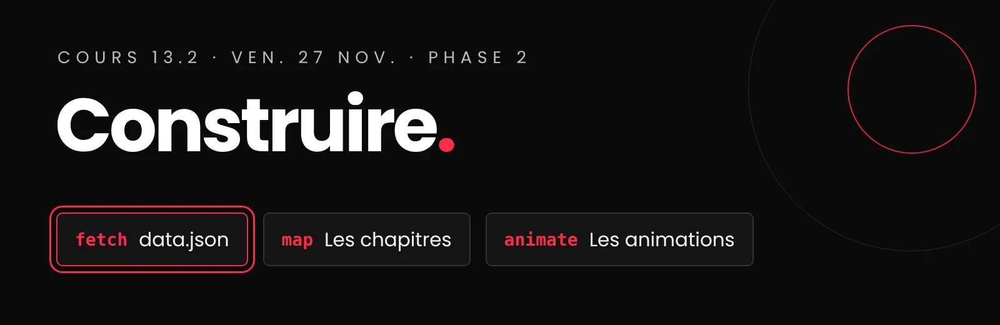

# **Cours 13.2** La phase 2 : du JSON aux chapitres
<!-- ven. 27 nov. -->

{.w-100}

  
  L'utilisation de l'IA pour coder le projet Récit défilant est <strong>strictement interdite</strong>. Désactivez Copilot dans votre projet.

!!! warning "La bêta, c'est mercredi"
    Il ne reste que ce cours avant la bêta du **mer 2 déc**. Aujourd'hui, on met toute la place sur la *phase 2*{ .w5-phase .w5-phase-2 }.

:material-account-group-outline: __Partie 1 : en équipe__

---

Charger `data.json` et construire les chapitres, en 6 étapes.

[:octicons-arrow-right-24: Les étapes](projets/recit-defilant/json-chapitres.md#ensemble){ .stretched-link }

:material-account-outline: __Partie 2 : chacun ses chapitres__

---

Relier le texte et les médias de vos chapitres aux données.

[:octicons-arrow-right-24: Chacun ses chapitres](projets/recit-defilant/json-chapitres.md#chacun-ses-chapitres){ .stretched-link }

:material-flag-checkered: __Le mini-jalon__

---

Je passe d'équipe en équipe pendant l'atelier.

[:octicons-arrow-right-24: Ce que je vérifie](projets/recit-defilant/index.md#mini-jalon){ .stretched-link }

## Aujourd'hui

- [ ] La *phase 2*{ .w5-phase .w5-phase-2 } : le schéma, les étapes, l'étape 1 en direct
- [ ] Partie 1, en équipe : les étapes 1 à 7
- [ ] Partie 2 : chacun ses chapitres
- [ ] Pendant l'atelier : le mini-jalon, et la validation des API qui manquent

## 1. :material-code-json:  La *phase 2*{ .w5-phase .w5-phase-2 } : du JSON aux chapitres *20 min* { #phase-2 }

Vos chapitres ne sont plus écrits dans `index.html` : ils sont construits par JavaScript, à partir de `data.json`.

[:material-code-json: Du JSON aux chapitres](projets/recit-defilant/json-chapitres.md){ .md-button .md-button--primary }

## 2. :material-account-group-outline:  Partie 1 : en équipe *90 min* { #partie-1 }

Les étapes 1 à 6 se codent dans `js/main.js`, puis la mise en commun Git (étape 7).

- [ ] [Étapes 1 à 3](projets/recit-defilant/json-chapitres.md#ensemble-1) : charger, parcourir, la structure d'un chapitre
- [ ] **Point de contrôle** : vos titres s'affichent dans la console
- [ ] [Étapes 4 à 6](projets/recit-defilant/json-chapitres.md#ensemble-4) : dans la page, le contenu, les animations
- [ ] **Point de contrôle** : vos chapitres et vos animations fonctionnent
- [ ] [Étape 7](projets/recit-defilant/json-chapitres.md#ensemble-7) : *commit*, *push*, *pull*

[:material-code-json: Partie 1 : en équipe, en 6 étapes](projets/recit-defilant/json-chapitres.md#ensemble){ .md-button }

## 3. :material-account-outline:  Partie 2 : chacun ses chapitres { #partie-2 }

[:material-code-json: Partie 2 : chacun ses chapitres](projets/recit-defilant/json-chapitres.md#chacun-ses-chapitres){ .md-button }

## 4. :material-flag-checkered:  Pendant l'atelier : le mini-jalon { #mini-jalon }

Je passe d'équipe en équipe. Ayez ouverts :

- [ ] vos *pull requests* fusionnées (les composants Vue);
- [ ] la section 4 du `CAHIER-DE-CHARGES.md` (la matrice);
- [ ] votre API dans Firefox, et la section 6 du cahier.

Votre API n'est pas encore validée? Montrez-la-moi pendant mon passage ([les pistes](projets/recit-defilant/dataviz.md#pistes)).

## Devoirs

  
  L'utilisation de l'IA pour coder le projet Récit défilant est <strong>strictement interdite</strong>. Désactivez Copilot dans votre projet.

### D'ici la bêta *mer 2 déc, cours 14.1*

- La *phase 2*{ .w5-phase .w5-phase-2 } en place : les chapitres chargés depuis `data.json`.
- Les médias finaux et les deux composants Vue.
- La dataviz **branchée** : les vraies données de l'API s'affichent.
- Au minimum, une animation par chapitre.
- En ligne sur GitHub Pages.

[Toutes les attentes de la bêta](projets/recit-defilant/index.md#beta)

[Voir le calendrier](projets/recit-defilant/index.md#calendrier)
