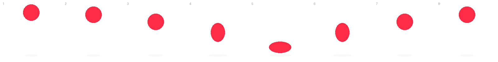

# Animation par spritesheet

<div class="essentiel" markdown>
<p class="essentiel__titre">L'essentiel en 3 points</p>

1. Une **spritesheet** (planche), c'est toutes les images d'une animation **côte à côte dans un seul fichier**. On montre une seule image à la fois, et on passe à la suivante très vite : comme une pellicule de film.
2. En CSS, on déplace la planche derrière une « fenêtre » de la taille d'une image, avec **`steps()`** pour sauter d'une image à l'autre au lieu de glisser.
3. Pour votre récit défilant, utilisez la **version responsive** : une `` déplacée avec **`transform`**. Elle s'adapte à l'écran et respecte le garde-fou « animer seulement `transform` et `opacity` ».

</div>

[:material-play-circle: Voir la démo](demo-spritesheet.html){ .md-button .md-button--primary :target="_blank" }

## Le principe : une pellicule

Au cinéma, une pellicule est une suite d'images fixes. Projetées assez vite, à intervalle régulier, elles donnent l'illusion du mouvement. Plus il y a d'images, plus le mouvement est fluide.

Une spritesheet fait la même chose sur le Web : un seul fichier contient toutes les images de l'animation, et le CSS les montre une à la fois.



## La planche : trois règles

1. **Toutes les images ont la même taille.** Ici, 200 × 200 px.
2. **Elles sont collées les unes aux autres, sans marge**, sur une seule rangée. Un décalage d'un seul pixel, et l'animation « saute ».
3. **La largeur totale = la largeur d'une image × le nombre d'images.** Ici : 200 × 8 = **1600 px**.

Utilisez un format avec transparence : **WebP** (ou PNG, converti ensuite en WebP pour le poids).

## Version 1 : la méthode classique

La planche est placée **en arrière-plan** d'un élément qui a la taille d'**une seule** image. On déplace l'arrière-plan vers la gauche, de toute la largeur de la planche.

```html
<div class="ball" role="img" aria-label="Une balle qui rebondit"></div>
```

```css
.ball {
  width: 200px;   /* la taille d'UNE image */
  height: 200px;
  background-image: url("assets/ball-spritesheet.webp");
  background-repeat: no-repeat;
  animation: ball-frames 0.8s steps(8) infinite;
}

@keyframes ball-frames {
  from { background-position: 0 0; }
  to   { background-position: -1600px 0; } /* toute la planche */
}
```

### Le rôle de `steps()`

Sans `steps()`, le navigateur **interpole** : il fait glisser la planche en douceur, et on voit les images défiler comme un ruban. Ouvrez la démo (exemple 3) pour voir le problème.

`steps(8)` découpe l'animation en **8 sauts secs**, un par image. Le chiffre est toujours **le nombre d'images** de la planche.

## Version 2 : responsive et performante (pour votre projet)

La version 1 a deux défauts :

- elle est en **pixels** : sur un téléphone, 200 px fixes peuvent être trop grands ou trop petits;
- elle anime **`background-position`**, une propriété que le navigateur anime moins efficacement que `transform`.

La solution : la planche devient une vraie image ``, placée dans une **fenêtre** qui cache tout sauf une image. On déplace l'image avec `transform`.

```html
<div class="sprite">
  
</div>
```

```css
.sprite {
  width: min(40vw, 300px); /* n'importe quelle taille */
  aspect-ratio: 1 / 1;     /* le ratio d'UNE image */
  overflow: hidden;        /* on ne voit qu'une image */
}

.sprite img {
  display: block;
  width: 800%;             /* 8 images = 8 fois la fenêtre */
  max-width: none;
  height: 100%;
  animation: sprite-frames 0.8s steps(8) infinite;
}

@keyframes sprite-frames {
  to { transform: translateX(-100%); }
}
```

### Le calcul, pas à pas

- La fenêtre a la taille d'**une** image, quelle que soit cette taille : c'est `aspect-ratio` qui garde la proportion. Pour des images de 300 × 400, ce serait `aspect-ratio: 3 / 4`.
- L'image fait **8 fois** la largeur de la fenêtre (`width: 800%`) : une image de la planche remplit exactement la fenêtre.
- `translateX(-100%)` se calcule sur la largeur **de l'image elle-même** : toute la planche glisse vers la gauche.
- `steps(8)` découpe ce trajet en 8 sauts : 0 %, -12,5 %, -25 %… soit exactement une image à chaque saut.

Pour une planche de **12** images : `width: 1200%` et `steps(12)`. C'est tout.

## Régler la vitesse

La durée de l'animation se calcule avec le nombre d'images par seconde voulu :

```text
durée = nombre d'images ÷ images par seconde
8 images à 10 images/s = 0,8 s
12 images à 12 images/s = 1 s
```

Entre 8 et 12 images par seconde, le mouvement paraît vivant. En dessous, il devient saccadé; c'est parfois voulu, pour un style rétro.

## Jouer une seule fois, ou s'arrêter

| Besoin | Propriété |
|---|---|
| Jouer en boucle | `animation-iteration-count: infinite` |
| Jouer une seule fois et rester sur la dernière image | `animation-iteration-count: 1` et `animation-fill-mode: forwards` |
| Mettre en pause | `animation-play-state: paused` |

Avec `forwards`, la dernière position est `translateX(-100%)`, qui est **hors de la planche**. Pour terminer sur la dernière image, arrêtez l'animation à `translateX(-87.5%)` (7 images sur 8) avec `steps(7)`.

## Moins de mouvement

Comme toutes vos animations, une spritesheet en boucle doit respecter `prefers-reduced-motion` :

```css
@media (prefers-reduced-motion: reduce) {
  .sprite img {
    animation-play-state: paused;
  }
}
```

## Fabriquer votre planche

C'est l'un des trois formats de **média animable** du récit défilant : **6 à 24 images**, que vous préparez vous-même.

1. **Dessinez ou récupérez vos images**, toutes au **même format** (ex. 400 × 400).
2. **Assemblez-les** côte à côte, sans marge :
  - dans **Figma** : un cadre de 8 × 400 = 3200 px de large, une image tous les 400 px (utilisez une grille ou l'auto layout avec un espacement de 0), puis exportez le cadre en PNG;
  - dans **Photoshop** : un document de 3200 × 400, avec un guide tous les 400 px;
  - avec un outil en ligne comme [Responsive CSS Sprites](https://responsive-css.spritegen.com/){ :target="_blank" }, à partir de fichiers séparés.
3. **Convertissez en WebP** ([Squoosh](https://squoosh.app/){ :target="_blank" }), et vérifiez le poids.
4. **Créditez** votre source dans le `README.md` (et l'outil d'IA, s'il a servi de source).

!!! tip "Le test du chiffre"
    Pendant que vous préparez votre planche, écrivez un petit numéro dans le coin de chaque image, comme dans la démo. Si l'animation saute ou tremble, vous verrez tout de suite quelle image est mal placée. Retirez les numéros à la fin.

<!-- Contenu adapté des pages « Animation Sprite Sheet » (582-211) et « Animation sprite sheet intermédiaire » (582-424MO), inspirées du travail de Simon Arnold. -->
