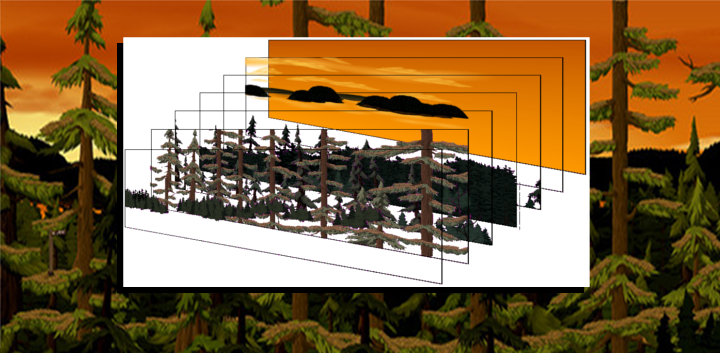
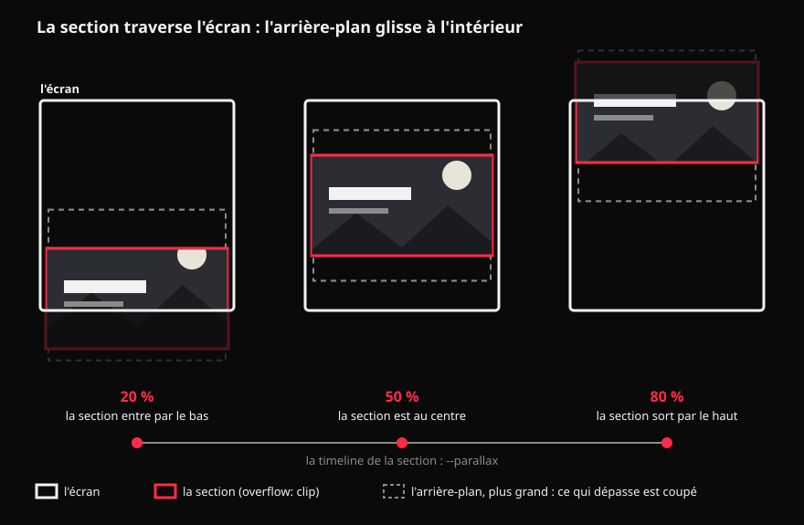
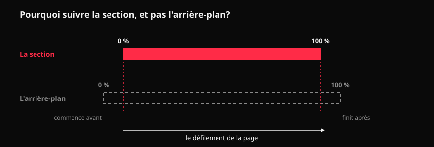

# :material-layers-outline:  L'effet parallaxe



<div class="essentiel" markdown>
<p class="essentiel__titre">L'essentiel en 3 points</p>

1. La **parallaxe**, c'est l'illusion de profondeur créée quand des plans placés à des distances différentes **se déplacent à des vitesses différentes** : ce qui est loin bouge lentement, ce qui est proche bouge vite.
2. Sur le Web, c'est **le défilement qui fait bouger la « caméra »**. On découpe une scène en calques, et chaque calque défile à sa propre vitesse.
3. Bien dosée, elle donne de la profondeur et du rythme à un récit. Exagérée, elle étourdit : on la garde **subtile**, et on respecte **`prefers-reduced-motion`**.

</div>

## D'où vient le mot

Tendez le bras, levez le pouce, et regardez-le en fermant un œil, puis l'autre. Votre pouce semble sauter par rapport au mur du fond. Ce déplacement apparent, selon le point de vue, c'est la **parallaxe**.

Vous la vivez aussi en train ou en voiture : les poteaux au bord de la route défilent à toute vitesse, les arbres un peu plus loin passent plus lentement, et les montagnes à l'horizon semblent presque immobiles. **La vitesse apparente dit la distance.** C'est un des indices que votre cerveau utilise pour percevoir la profondeur.

> Plus c'est loin, plus c'est lent. Plus c'est près, plus c'est rapide.

## Avant le Web : l'animation et les jeux vidéo

### Au cinéma d'animation

Dès les années 1930, les studios Disney utilisent la [caméra multiplane (en anglais)](https://en.wikipedia.org/wiki/Multiplane_camera){ :target="_blank" }, où les décors sont peints sur des plaques de verre superposées, à des distances différentes. En déplaçant les plaques à des vitesses différentes, une image plate prend de la profondeur.

<iframe width="768" height="518" frameborder="0" loading="lazy" allow="autoplay; fullscreen; picture-in-picture; clipboard-write; web-share" allowfullscreen src="https://commons.wikimedia.org/wiki/File:MultiplaneDemo.webm?embedplayer=true" />
  
### Dans les jeux vidéo en 2D

Dans les jeux de plateforme à défilement horizontal, l'arrière-plan est composé de plusieurs bandes (le ciel, les montagnes, la forêt) qui défilent chacune à sa vitesse derrière le personnage.

Dans les deux cas, le principe est celui que vous allez coder : **des calques, et une vitesse par calque**.


## Sur le Web, au défilement

Sur une page, il n'y a pas de caméra : c'est **le défilement** qui la remplace. Quand le visiteur défile, tout le contenu monte à l'écran à la même vitesse. Pour créer la profondeur, on ralentit ou on accélère certains calques par rapport au défilement :

| Calque | Vitesse par rapport au défilement | Effet |
|---|---|---|
| Le fond (ciel, montagnes) | beaucoup plus lent | semble très loin |
| Les plans du milieu | un peu plus lent | semble à mi-distance |
| Le contenu (texte) | la même vitesse | le plan de référence |
| L'avant-plan (feuillage, objets) | plus rapide | semble passer tout près |

<figure markdown>
<video class="w-100" src="https://tim-montmorency.com/timdoc/582-424MO/gsap/exercices/gsap-scrollTrigger-parallax/images/ballons-parallax.mp4" controls muted loop playsinline aria-label="Démo : des ballons et des nuages qui défilent à des vitesses différentes au défilement de la page"></video>
<figcaption>Au défilement, ballons et nuages bougent chacun à leur vitesse : la scène prend de la profondeur.</figcaption>
</figure>

Pour le voir en action, calque par calque, avec les vitesses en chiffres : le [Labo parallaxe](labo-parallaxe.html){ :target="_blank" }.

On rencontre surtout trois formes :

1. **L'arrière-plan lent** : une seule image de fond défile plus lentement que le texte. C'est la forme la plus simple, et la plus courante.
2. **La scène en calques** : une image découpée en plans (fond, milieu, avant), chacun à sa vitesse. C'est le **média animable « image en calques »** de votre récit défilant.
3. **La parallaxe au pointeur** : les calques bougent selon la position de la souris (ou l'inclinaison du téléphone) plutôt qu'au défilement. Même principe, autre déclencheur.

## Les bonnes pratiques

- **Subtile** : quelques pourcentages de différence de vitesse suffisent. Au-delà, la page « flotte » et le texte devient difficile à suivre.
- **Le texte reste stable** : on fait bouger le décor, pas ce qu'on doit lire.
- **Animer seulement `transform`** : jamais `top`, `margin` ou `background-position`, qui ralentissent la page.
- **`prefers-reduced-motion`** : pour les personnes sensibles au mouvement, la parallaxe peut causer des étourdissements ou des nausées. Avec le mouvement réduit, les calques restent immobiles.
- **Sur mobile** : moins de calques, des amplitudes plus petites, ou pas de parallaxe du tout.

## Des exemples

<!-- MM : The Boat se charge (vérifié). Keith Clark et la recherche CodePen non vérifiés par Claude : à tester. -->

- [Firewatch](https://www.firewatchgame.com/){ :target="_blank" } : le site du jeu. Défilez au tout début : six calques de paysage, du ciel jusqu'aux arbres du premier plan. Un classique de la scène en calques.
- [Paysage en parallaxe, de isladjan](https://codepen.io/isladjan/pen/abdyPBw){ :target="_blank" } (CodePen) : une scène de paysage animée au défilement, avec le code à côté.
- [The Goonies](https://the-goonies.webflow.io/){ :target="_blank" } : un hommage au film. On plonge vers la côte, entre des plans qui défilent à des vitesses différentes.
- [Montagnes, forêt et nuages](https://parallax-bgsprod.webflow.io/){ :target="_blank" } : un exemple simple et très propre de scène en calques. Proche de ce que vous ferez.
- [The Boat](https://www.sbs.com.au/theboat/){ :target="_blank" } (SBS, Australie) : un roman graphique interactif, avec du son. Les dessins sont découpés en plans qui glissent à des vitesses différentes : la parallaxe au service d'un récit défilant.
- [Une parallaxe en CSS pur, de Keith Clark](https://keithclark.co.uk/articles/pure-css-parallax-websites/demo3/){ :target="_blank" } : une démo sans JavaScript. Ouvrez les outils de développement pour voir les calques.


## Le faire en CSS { #en-css }

Prérequis : les [animations pilotées par le défilement](animations-scroll.md), et surtout les [timelines nommées](animations-scroll.md#view-timeline-name) (`view-timeline-name`).

La forme la plus simple : **l'arrière-plan lent**. L'arrière-plan défile **plus lentement** que le contenu, comme un paysage au loin vu d'une voiture. En CSS, on anime l'arrière-plan dans le **même sens** que le défilement : il « recule » à l'écran, donc il semble plus lent.

```html
<section class="parallax">
  <div class="parallax__bg"></div>
  <div class="parallax__content">
    <h2>Le titre de la section</h2>
  </div>
</section>
```

```css
.parallax {
  position: relative;
  /* coupe ce qui dépasse de la section : l'arrière-plan
     est plus grand qu'elle, on ne doit pas le voir déborder.
     clip, et surtout pas hidden (voir le piège ci-dessous) */
  overflow: clip;
  /* on nomme la timeline de la section */
  view-timeline-name: --parallax;
}

.parallax__bg {
  position: absolute;
  /* plus grand que la section : il dépasse de 25 %
     en haut et en bas, ce qui lui laisse de la marge
     pour bouger sans laisser de trou.
     Sa hauteur : 25 + 100 + 25 = 150 % de la section */
  top: -25%;
  bottom: -25%;
  left: 0;
  right: 0;
}

/* 15 % de SA hauteur : 15 % de 150 % = 22,5 % de la
   section. C'est moins que la marge de 25 % : aucun trou */
@keyframes parallax {
  from { transform: translateY(-15%); }
  to   { transform: translateY(15%); }
}

.parallax__bg {
  animation: parallax linear both;
  /* l'arrière-plan suit la visibilité de la SECTION */
  animation-timeline: --parallax;
}
```

### Ce qui se passe au défilement



- **La section** (en rouge) défile normalement, comme le reste de la page. Son contenu aussi : le texte n'a aucune animation.
- **L'arrière-plan** (en pointillé) est plus grand que la section : il dépasse de 25 % en haut et en bas. `overflow: clip` coupe ce qui dépasse : on n'en voit que la partie à l'intérieur de la section.
- Pendant que la section monte, l'arrière-plan **descend** à l'intérieur d'elle (de `translateY(-15%)` à `translateY(15%)`). Regardez la lune : à 20 %, elle touche le haut de la section; à 80 %, elle est plus bas dans la section. Elle monte donc **moins vite que le texte** : elle semble plus loin.
- Sans la marge de 25 %, l'arrière-plan laisserait un trou en haut ou en bas de la section en se déplaçant.

!!! tip "La règle de la marge"
    **La marge doit couvrir tout le déplacement.** Attention : le pourcentage de `translateY` se calcule sur la hauteur **de l'arrière-plan**, pas de la section. Ici, l'arrière-plan fait 150 % de la section : `translateY(15%)`, c'est 15 % de 150 % = 22,5 % de la section. La marge est de 25 % : ça passe.

    Avec `translateY(20%)`, ce serait 30 % de la section : plus que la marge, et un trou apparaîtrait au bord de la section. Pour bouger davantage, agrandissez la marge **et** l'amplitude ensemble.

### Pourquoi une timeline nommée?



Avec `view()`, l'arrière-plan suivrait **sa propre** visibilité. Mais il est plus grand que la section : il entre dans l'écran avant elle, et en sort après elle. Son animation commencerait trop tôt et finirait trop tard.

Avec la [timeline nommée](animations-scroll.md#view-timeline-name) `--parallax`, l'arrière-plan suit la visibilité de la **section** : son mouvement va de 0 % à 100 % exactement pendant que la section traverse l'écran.

### Plusieurs calques { #plusieurs-calques }

Le même principe, répété : **une seule timeline** (celle de la section) et **un calque par plan**, chacun avec **sa propre amplitude**. Plus un calque glisse dans la section, moins il monte vite à l'écran, et plus il semble loin. Un calque qui glisse vers le haut (amplitude négative) monte plus vite que le texte : il passe devant.

Le labo montre une scène en quatre calques. Faites défiler, activez les **rayons X** pour voir les calques dépasser de la section, changez les amplitudes, et lisez le CSS qui se met à jour :

[:material-flask-outline: Labo parallaxe : plusieurs calques en direct](labo-parallaxe.html){ .md-button .md-button--primary :target="_blank" }

Voir aussi l'exemple 5 de la [démo des animations au défilement](demo-animations-scroll.html){ :target="_blank" }.

!!! danger "Piège : `overflow: hidden` sur la section"
    Un parent avec `overflow: hidden` (ou `auto`, `scroll`) devient un **conteneur de défilement**. `view()` et `scroll()` suivent alors ce conteneur, qui ne défile pas, au lieu de la page : l'animation reste figée, sans message d'erreur.

    Si vous devez couper ce qui dépasse (un arrière-plan de parallax, un grand texte qui glisse), utilisez **`overflow: clip`** : même effet visuel, sans créer de conteneur de défilement.

N'oubliez pas les [deux règles obligatoires](animations-scroll.md#deux-regles-obligatoires) : `@supports` et `prefers-reduced-motion`.

Pour pratiquer, avec une scène de 5 calques :

[:material-pencil-ruler: Exercice : la parallaxe en calques](../exercices/ex-parallaxe/index.md){ .md-button .md-button--primary }
