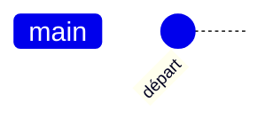
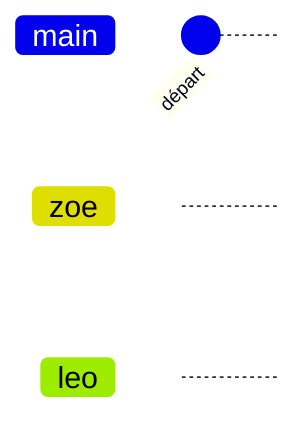
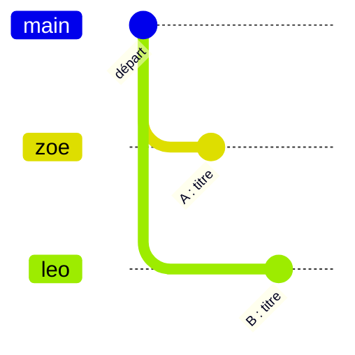
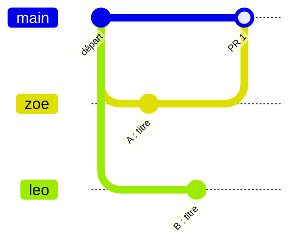
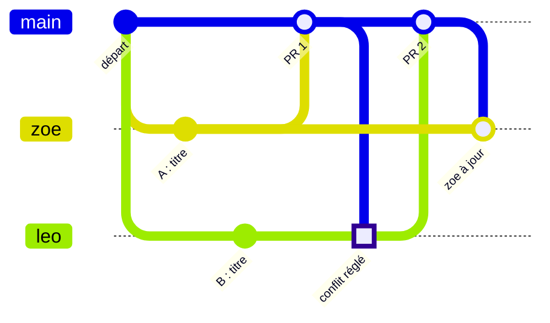

# :material-source-merge:  Exercice : provoquer et régler un conflit

<div class="essentiel" markdown>
<p class="essentiel__titre">L'essentiel en 3 points</p>

1. En duo, dans un **petit dépôt d'exercice** créé par Classroom 50, vous allez **provoquer un conflit exprès**, puis le régler. Rien ne peut briser votre vrai projet.
2. Vous pratiquez tout le flux de l'équipe : une branche chacun, une *pull request*, la mise à jour avec `main`, le conflit, la fusion.
3. Durée : environ **25 minutes**. Puis vous inversez les rôles.

</div>

!!! info "Avant de commencer"
    Gardez ouverte la page [Git en équipe](../../projets/recit-defilant/git-en-equipe.md) : chaque étape y est expliquée en détail. Ici, on parle de **personne A** et **personne B** : décidez qui est qui. Dans les schémas, la personne A s'appelle Zoé (branche `zoe`) et la personne B, Léo (branche `leo`).

## Où se passe chaque étape

Chaque étape commence par l'endroit où vous la faites :

| Icône | Où | Pour quoi |
|---|---|---|
| :material-school-outline: | **Classroom 50**, dans le navigateur | Obtenir le dépôt (partie 1 seulement) |
| :material-github: | **github.com**, dans le navigateur | Les *pull requests* et les fusions dans `main` |
| :material-microsoft-visual-studio-code: | **VS Code**, sur votre poste | Modifier le code, et Git : branche, *commit*, *push*, mise à jour |
| :material-monitor: | **GitHub Desktop**, sur votre poste | **Au choix, à la place de VS Code** pour Git seulement |

Quand une étape se fait dans VS Code **ou** dans GitHub Desktop, il y a deux onglets : choisissez le vôtre.

**À retenir** : sur votre poste, vous travaillez sur **votre branche**. Sur github.com, vous **fusionnez dans `main`**.

## Partie 1 : obtenir votre dépôt de duo (5 min)

Votre dépôt est créé pour vous par **Classroom 50**, avec le fichier `index.html` de départ déjà dedans.

**[Accepter l'exercice dans Classroom 50](https://classroom50.org/apprendre-avec-mariemi/w5/assignments/exercice-conflit-git/accept?k=rthn1z36){ :target="_blank" }**

1. :material-school-outline: **Avant tout** : vous devez avoir accepté l'invitation à l'organisation GitHub du cours (courriel de GitHub). Sinon, Classroom 50 affiche « Not a member yet » : venez me voir.
2. :material-school-outline: **Personne A** : ouvrez le lien ci-dessus, connectez-vous avec **Sign in with GitHub**. Dans **Group name**, écrivez vos deux prénoms (ex. `zoe-leo`), puis **Create group**, et acceptez l'exercice.
3. :material-school-outline: **Personne A ajoute la personne B** : sur la même page, cliquez sur **Manage my group**. Écrivez l'**identifiant GitHub** de la personne B, puis **Add**. C'est la personne qui a créé le groupe qui ajoute l'autre : B n'a rien à demander.
4. :material-school-outline: **Personne B**, une fois ajoutée : ouvrez le même lien (ou rechargez la page) et connectez-vous. Vous êtes déjà dans le groupe : acceptez l'exercice. Si la page ne vous voit pas encore dans le groupe, cliquez sur **Check again**. **Ne créez pas de groupe, et n'utilisez pas Ask to join** (une demande à approuver ailleurs, sur GitHub) : attendez simplement que A vous ajoute.

5. :material-school-outline: Quand le dépôt est prêt, cliquez sur **Open repository** : vous arrivez sur :material-github: github.com. Vérifiez que vous voyez **le même dépôt** tous les deux. **Gardez cet onglet ouvert** : vous y reviendrez pour les *pull requests*.
6. Chacun **clone** le dépôt sur son poste. Sur github.com, le bouton vert **Code** donne l'adresse du dépôt à copier.

=== ":material-microsoft-visual-studio-code: VS Code"

    `Ctrl+Shift+P` → **Git: Clone** → collez l'adresse → choisissez un dossier → **Open**.

=== ":material-monitor: GitHub Desktop"

    **File** → **Clone repository** → onglet **URL** → collez l'adresse → **Clone**. Puis **Open in Visual Studio Code** pour modifier le code.

??? warning "Plan B : si Classroom 50 ne fonctionne pas"
    Ouvrez cet encadré seulement si je vous le demande, ou si votre duo reste bloqué. On crée le même dépôt, directement sur GitHub.

    1. **Personne A** : ouvrez le [dépôt modèle](https://github.com/apprendre-avec-mariemi/gabarit-exercice-conflit-git){ :target="_blank" }, puis **Use this template** → **Create a new repository**. Créez-le dans **votre compte**, en **privé**, sous le nom `exercice-conflit-git`.
    2. **Personne A** : dans le nouveau dépôt, **Settings** → **Collaborators** → **Add people**. Ajoutez la personne B, et `marie-michelle-ouellet` (c'est votre remise).
    3. **Personne B** : acceptez l'invitation, reçue par courriel ou dans les notifications de github.com.
    4. Chacun **clone** le dépôt sur son poste et l'ouvre dans VS Code.

    La suite de l'exercice est identique. C'est d'ailleurs exactement comme ça que fonctionne le dépôt de votre vrai projet.

Le dépôt est **privé** : seuls vous deux et moi y avons accès. Ouvrez `index.html` : il contient ceci.

```html
<!DOCTYPE html>
<html lang="fr">
<head>
  <meta charset="UTF-8">
  <title>Exercice conflit</title>
</head>
<body>
  <h1>Notre récit</h1>
  <p>Couleur principale : à décider</p>
</body>
</html>
```

**Où on en est** : une seule branche, `main`, avec le *commit* de départ.



## Partie 2 : une branche chacun (3 min)

Chacun, **sur son poste**, crée **sa** branche à partir de `main`, à son prénom (en minuscules, sans accents), puis la **publie** sur GitHub.

=== ":material-microsoft-visual-studio-code: VS Code"

    1. En bas à gauche, cliquez sur le nom de la branche (`main`).
    2. **+ Create new branch…** → votre prénom → `Entrée`.
    3. Panneau **Source Control** (`Ctrl+Shift+G`) → bouton **Publish Branch**.
    4. En bas à gauche, vous voyez maintenant **votre** branche.

=== ":material-monitor: GitHub Desktop"

    1. En haut, **Current branch** → **New branch**.
    2. Votre prénom → **Create branch** (à partir de `main`).
    3. En haut, **Publish branch**.
    4. **Current branch** affiche maintenant **votre** branche.

:material-github: **Vérifiez** : sur github.com, rechargez la page du dépôt. Le menu des branches (le bouton `main`, au-dessus de la liste des fichiers) affiche `main` et vos deux branches.

**Où on en est** : deux branches de plus, qui partent de `main`.



## Partie 3 : modifier la même ligne (5 min)

:material-microsoft-visual-studio-code: **En même temps**, chacun modifie **la même ligne** de `index.html`, chacun à sa façon :

- **Personne A** remplace `Notre récit` par un titre de son choix.
- **Personne B** remplace aussi `Notre récit`, par un autre titre.

Puis chacun fait un *commit* sur **sa** branche, et un *push*. Le message : `Commun : change le titre de la page`.

=== ":material-microsoft-visual-studio-code: VS Code"

    1. Panneau **Source Control** (`Ctrl+Shift+G`) : écrivez le message.
    2. **Commit** (si VS Code demande d'ajouter les fichiers, répondez **Yes**).
    3. **Sync Changes** (ou **Push**).

=== ":material-monitor: GitHub Desktop"

    1. En bas à gauche, écrivez le message dans **Summary**.
    2. **Commit to** *votre branche*.
    3. En haut, **Push origin**.

**Où on en est** : chaque branche a un *commit*. `main` n'a pas bougé.



## Partie 4 : la première fusion passe (3 min)

**Personne A**, tout se passe sur :material-github: **github.com**, dans l'onglet de votre dépôt.

1. :material-github: **Ouvrez la page de votre dépôt** (l'onglet gardé ouvert à la partie 1, ou github.com/apprendre-avec-mariemi, puis votre dépôt).
2. :material-github: **Ouvrez une nouvelle *pull request*.** Deux chemins, au choix :
  - juste après votre *push*, un **bandeau jaune** apparaît en haut de l'onglet **Code** : « *zoe had recent pushes* ». Cliquez sur le bouton vert **Compare & pull request**;
  - sinon : l'onglet **Pull requests**, en haut du dépôt (à côté de **Code** et **Issues**), puis le bouton vert **New pull request**, à droite.
3. :material-github: **Vérifiez la direction**, en haut de la page, dans les deux menus : **base: `main`** ← **compare: `zoe`**. La flèche va de **votre branche** vers `main`. GitHub affiche en vert **Able to merge**.
4. :material-github: Cliquez sur le bouton vert **Create pull request**. Écrivez un titre (`Commun : change le titre de la page`), puis cliquez encore sur **Create pull request**, sous le formulaire.
5. :material-github: Vous êtes maintenant sur la page de la PR no 1. Descendez : bouton vert **Merge pull request**, puis **Confirm merge**. L'étiquette violette **Merged** apparaît.

Aucun problème : `main` n'avait pas changé depuis la création de la branche.

**Où on en est** : le titre de A est dans `main`.



## Partie 5 : la deuxième fusion bloque (2 min)

**Personne B**, sur :material-github: **github.com** : ouvrez à votre tour une *pull request*, exactement comme aux étapes 1 à 4 de la partie 4, avec **compare: `leo`**.

Cette fois, à l'étape 3, GitHub affiche en rouge **Can't automatically merge**. Créez la PR quand même. Sur la page de la PR, vous voyez : **This branch has conflicts that must be resolved**, et le bouton de fusion est gris.

Normal : `main` contient maintenant le titre de A, et votre branche, celui de B, **sur la même ligne**. Git ne peut pas deviner lequel garder.

!!! warning "N'utilisez pas le bouton Resolve conflicts de GitHub"
    On règle le conflit **sur votre poste**, à la partie 6 : vous pourrez tester la page avant de l'envoyer.

**Où on en est** : rien n'a changé depuis la partie 4. La PR no 2 attend : `leo` et `main` ont modifié la même ligne depuis leur point de départ commun.

## Partie 6 : régler le conflit (7 min)

**Personne B**, sur votre poste, sur **votre** branche : mettez votre branche à jour avec `main`. C'est là que le conflit apparaît.

=== ":material-microsoft-visual-studio-code: VS Code"

    1. `Ctrl+Shift+P` → **Git: Fetch** (récupère le nouveau `main` de GitHub).
    2. `Ctrl+Shift+P` → **Git: Merge…** (ou *Merge Branch…*) → choisissez **`origin/main`**.
    3. VS Code annonce un conflit. Dans **Source Control**, `index.html` est marqué d'un **!**. Ouvrez-le.

=== ":material-monitor: GitHub Desktop"

    1. Menu **Branch** → **Update from main**.
    2. Une fenêtre annonce un conflit dans `index.html` : **Open in Visual Studio Code**.

:material-microsoft-visual-studio-code: Dans `index.html`, repérez les marqueurs `<<<<<<<`, `=======` et `>>>>>>>`.

1. **Décidez à deux** du bon titre. Au-dessus du conflit, cliquez sur **Accept Current Change** (votre titre), **Accept Incoming Change** (celui de `main`), ou écrivez une nouvelle version à la main.
2. Vérifiez qu'il ne reste **aucun marqueur**. Ouvrez la page avec Live Server.
3. Enregistrez.

Puis terminez la fusion, et envoyez-la :

=== ":material-microsoft-visual-studio-code: VS Code"

    **Source Control** → ajoutez le fichier (**+**) → **Commit** (le message est déjà écrit) → **Sync Changes**.

=== ":material-monitor: GitHub Desktop"

    **Continue merge**, puis en haut, **Push origin**.

:material-github: Retournez sur github.com, onglet **Pull requests** → votre PR no 2. Le conflit a disparu, et le bouton est vert : **Merge pull request** → **Confirm merge**.

:material-microsoft-visual-studio-code: :material-monitor: **Personne A** : mettez votre branche à jour avec `main` à votre tour (mêmes étapes que B, sans conflit cette fois), puis *push*. Vous avez maintenant le titre final.

**Où on en est** : le conflit est réglé dans `leo`, `leo` est fusionnée dans `main`, et `zoe` est à jour.



## Partie 7 : on inverse les rôles

Recommencez les parties 3 à 6 avec la ligne `Couleur principale`, en inversant les rôles : cette fois, c'est **B** qui fusionne en premier, et **A** qui règle le conflit. Essayez **Accept Both Changes**, pour voir ce qu'il fait.

## Pour vérifier

- [ ] :material-github: Onglet **Pull requests** → **Closed** : 4 PR fusionnées.
- [ ] :material-github: Onglet **Insights** → **Network** : le schéma de vos branches qui se rejoignent dans `main`, comme ceux de cette page. (Dans le terminal de VS Code, `git log --oneline --graph --all` montre la même chose.)
- [ ] Chacun a réglé **un** conflit lui-même.
- [ ] Vos *commits* suivent la convention : `Zone : ce qui a changé`.

Une fois l'exercice terminé, **ne supprimez pas le dépôt** : c'est votre remise. Je vois vos PR et votre historique dans Classroom 50.
