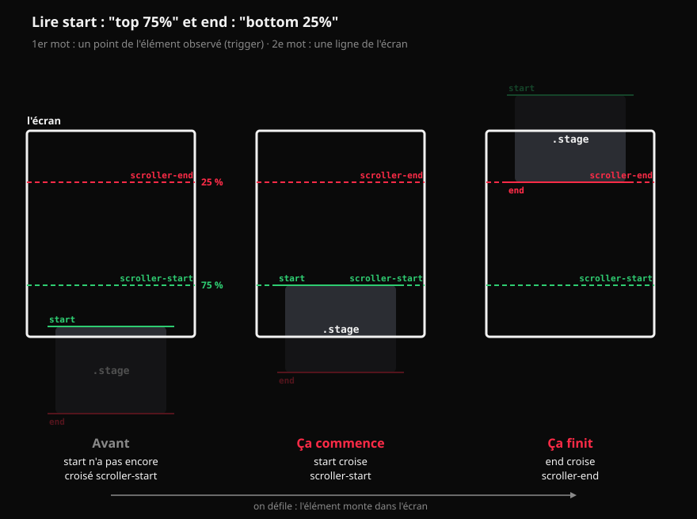
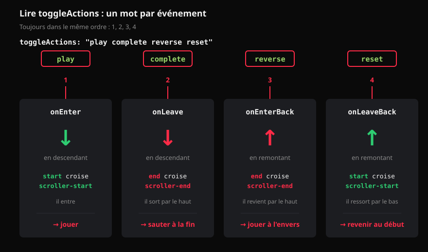

# :material-gesture-swipe-vertical: GSAP: ScrollTrigger

<div class="essentiel" markdown>
<p class="essentiel__titre">L'essentiel en 3 points</p>

1. **ScrollTrigger** accroche une animation GSAP au défilement : on ajoute un objet `scrollTrigger` à un tween (une interpolation) ou, mieux, à une **timeline**.
2. Trois questions : **quand** (`start`, `end`), **quoi faire** (`toggleActions` pour déclencher, `scrub` pour suivre le défilement), et **déboguer** (`markers`).
3. Pour une scène de votre récit : une timeline + `scrub` + `pin`. La scène reste en place pendant que le visiteur fait avancer l'animation.

</div>

Les exemples de cette page **défilent dans leur cadre** : faites défiler à l'intérieur du résultat.

## Ce que ScrollTrigger permet

Trois exemples, pour l'inspiration. Faites défiler dans chaque cadre.

<iframe height="500" style="width: 100%;" scrolling="no" title="La descente en ski" src="https://codepen.io/tim-momo/embed/abRzZvy?default-tab=result&editable=false&theme-id=50173" frameborder="no" loading="lazy" allowtransparency="true" allowfullscreen="true"></iframe>

<small>Démo : GSAP</small>

<iframe height="500" style="width: 100%;" scrolling="no" title="Bienvenue dans la jungle" src="https://codepen.io/tim-momo/embed/zYmxoJB?default-tab=result&editable=false&theme-id=50173" frameborder="no" loading="lazy" allowtransparency="true" allowfullscreen="true"></iframe>

<small>Démo : Louis Hoebregts</small>

<iframe height="500" style="width: 100%;" scrolling="no" title="Weird Fishes" src="https://codepen.io/tim-momo/embed/XWxJNBd?default-tab=result&editable=false&theme-id=50173" frameborder="no" loading="lazy" allowtransparency="true" allowfullscreen="true"></iframe>

<small>Démo : Michelle Barker</small>

## Installer le plugin

ScrollTrigger est un **plugin** de GSAP : on le charge **après** GSAP, puis on l'enregistre **une fois**, au début de votre script.

```html
<script
  src="https://cdn.jsdelivr.net/npm/gsap@3.13.0/dist/gsap.min.js"
></script>
<script
  src="https://cdn.jsdelivr.net/npm/gsap@3.13.0/dist/ScrollTrigger.min.js"
></script>
<script src="js/script.js"></script>
```

```js
gsap.registerPlugin(ScrollTrigger);
```

Dans votre récit, cette ligne va dans `main.js`, avant d'appeler les `animate()` des chapitres.

## Déclencher : `trigger`, `start`, `end`

On ajoute un objet `scrollTrigger` dans les paramètres du tween :

```js
gsap.from(".box", {
  x: -250,
  opacity: 0,
  duration: 1,
  scrollTrigger: {
    trigger: ".stage",    // l'élément observé
    start: "top 75%",     // quand ça commence
    end: "bottom 25%",    // quand ça finit
    markers: true,        // les repères visuels
  },
});
```

---

### Lire `start` et `end`

Chaque valeur a **deux mots** : un point de l'**élément observé**, puis un point de l'**écran**.

```text
start: "top 75%"
        │   └── la ligne à 75 % de la hauteur de l'écran
        └────── le haut de l'élément observé (trigger)
```

« Ça commence quand le **haut de `.stage`** croise la ligne à **75 % de l'écran**. »



Les lignes de l'**écran** (`scroller-start`, `scroller-end`) restent fixes. Les repères de l'**élément** (`start`, `end`) montent avec lui quand on défile. L'animation se joue entre les deux croisements.

Valeurs possibles : `top`, `center`, `bottom`, un pourcentage (`75%`), des pixels (`200px`). Pour `end`, on peut aussi donner une longueur de défilement à partir du `start` : `end: "+=500"` (500 px) ou `end: "+=200%"` (deux écrans).

Par défaut : `start: "top bottom"` (l'élément entre par le bas) et `end: "bottom top"` (il sort par le haut).

---

### Les `markers` : votre meilleur outil

<iframe src="https://tim-montmorency.com/Fragment/v/?f=w5-st-declencher&onglets=resultat&boutons=ouvrir" class="aspect-3-2" style="width:100%;border:0" loading="lazy"></iframe>

`markers: true` affiche 4 repères :

| Repère | Attaché à | Rôle |
|---|---|---|
| `start` | l'élément observé | La position `start` sur l'élément |
| `scroller-start` | l'écran | La ligne que `start` doit croiser |
| `end` | l'élément observé | La position `end` sur l'élément |
| `scroller-end` | l'écran | La ligne que `end` doit croiser |

L'animation commence quand `start` croise `scroller-start`, et finit quand `end` croise `scroller-end`. Gardez les `markers` pendant que vous travaillez, et retirez-les à la fin.

---

### `toggleActions` : que faire, à 4 moments

Sans `scrub`, l'animation joue avec sa propre durée, **déclenchée** à 4 moments :

| Moment | Quand |
|---|---|
| `onEnter` | `start` croise `scroller-start`, en descendant |
| `onLeave` | `end` croise `scroller-end`, en descendant |
| `onEnterBack` | `end` recroise `scroller-end`, en remontant |
| `onLeaveBack` | `start` recroise `scroller-start`, en remontant |

On donne une action pour chacun, **dans cet ordre** :



Actions possibles : `play`, `pause`, `resume`, `reverse`, `restart`, `reset`, `complete`, `none`. 

Par défaut : `"play none none none"` (joue une fois, puis ne fait plus rien).

<iframe src="https://tim-montmorency.com/Fragment/v/?f=w5-st-declencher&onglets=js,resultat&modifiable=1&disposition=cote&boutons=rejouer,ouvrir" style="width:100%;height:520px;border:0" loading="lazy"></iframe>

## Suivre le défilement : `scrub`

Avec `scrub`, l'animation n'est plus déclenchée : sa progression **suit** le défilement. On descend, elle avance; on remonte, elle recule; on s'arrête, elle s'arrête. C'est ce qu'on veut pour un récit défilant.

| Valeur | Effet |
|---|---|
| `scrub: true` | Colle exactement au défilement |
| `scrub: 1` | Rattrape le défilement en 1 seconde : plus doux, surtout avec une roulette de souris |

Avec `scrub`, mettez `ease: "none"` : la vitesse dépend déjà du visiteur.

<iframe src="https://tim-montmorency.com/Fragment/v/?f=w5-st-scrub&onglets=js,resultat&modifiable=1&disposition=pile&boutons=rejouer,ouvrir" style="width:100%;height:1100px;border:0" loading="lazy"></iframe>

## Une scène : timeline + `scrub` + `pin`

Pour une scène de votre récit, on met le `scrollTrigger` sur la **timeline**, pas sur chaque tween. Le défilement fait avancer **toute la séquence**.

`pin: true` **épingle** l'élément observé : il reste en place à l'écran pendant toute la durée du `scrollTrigger`, puis repart avec la page. ScrollTrigger ajoute automatiquement l'espace de défilement nécessaire sous la scène.

```js
const tl = gsap.timeline({
  scrollTrigger: {
    trigger: ".scene",
    start: "top top",  // le haut de la scène touche le haut de l'écran
    end: "+=200%",     // la séquence dure 2 écrans de défilement
    pin: true,         // la scène reste en place pendant ce temps
    scrub: 1,
  },
});

tl.from(".box", { x: "-40vw", duration: 2 })
  .from(".circle", { scale: 0, duration: 1 }, "<0.5")
  .from(".title", { y: 60, opacity: 0, duration: 1 });
```

!!! info "Avec `scrub`, les durées deviennent des proportions"
    Ce n'est plus le temps qui fait avancer la timeline, c'est le défilement. Un tween de `duration: 2` occupe **deux fois plus de défilement** qu'un tween de `duration: 1`. La durée totale de défilement, c'est `end` qui la donne.

<iframe src="https://tim-montmorency.com/Fragment/v/?f=w5-st-pin-timeline&onglets=js,resultat&modifiable=1&disposition=pile&boutons=rejouer,ouvrir" style="width:100%;height:1100px;border:0" loading="lazy"></iframe>

!!! warning "Les garde-fous du récit : au plus la moitié de vos chapitres épinglés"
    Une section épinglée bloque la lecture : le visiteur défile, mais la page n'avance pas. C'est puissant pour un moment fort, lassant si c'est partout. Dans votre récit : chacun épingle **au plus la moitié de ses chapitres** (50 %). Sur 3 chapitres, 1 au plus; sur 4, 2 au plus.

### `pinSpacing`

Par défaut, ScrollTrigger ajoute un espace sous l'élément épinglé, pour que la suite de la page attende la fin de la scène. Avec `pinSpacing: false`, il n'en ajoute pas : la section suivante **monte par-dessus** la scène épinglée. Effet intéressant pour un rideau, mais rarement ce qu'on veut.

## Déclencher du JavaScript : les *callbacks*

ScrollTrigger peut aussi appeler **vos fonctions** à des moments précis, sans rien animer. C'est utile pour changer une classe, mettre à jour un compteur, lancer un `fetch`.

```js
ScrollTrigger.create({
  trigger: ".zone",
  start: "top 60%",
  onEnter: () => console.log("on entre"),
  onLeaveBack: () => console.log("on ressort par le haut"),
  onUpdate: (self) => {
    // self.progress : de 0 à 1
    // self.direction : 1 (vers le bas) ou -1 (vers le haut)
    console.log(self.progress.toFixed(2));
  },
  // Ajoute la classe pendant que la zone est active
  toggleClass: { targets: ".zone", className: "is-active" },
});
```

`ScrollTrigger.create()` crée un déclencheur **sans** animation.

<iframe src="https://tim-montmorency.com/Fragment/v/?f=w5-st-callbacks&onglets=js,resultat&modifiable=1&disposition=pile&boutons=rejouer,ouvrir" style="width:100%;height:1100px;border:0" loading="lazy"></iframe>

Pour une action qui doit se faire **une seule fois** (charger des données), l'`IntersectionObserver` est souvent plus simple et ne demande aucune librairie.

[:material-eye-outline: IntersectionObserver : déclencher une fois](intersection-observer.md){ .md-button }

## Dans votre récit : un module de chapitre { #dans-votre-recit }

Dans votre récit, chaque chapitre crée **ses** animations dans sa fonction `animate()`. 

### Le modèle

Deux réflexes :

- Cherchez vos éléments **dans la section** du chapitre, pas dans toute la page : `gsap.utils.selector(section)` crée une fonction `q()` qui fait exactement ça.
- Enveloppez tout dans `gsap.matchMedia()` pour respecter le mouvement réduit.

```js
// js/chapitres/ch-03.js
export function animate(section, chapter) {
  const q = gsap.utils.selector(section);   // q(".box") : DANS la section
  const mm = gsap.matchMedia();

  mm.add("(prefers-reduced-motion: no-preference)", () => {
    const tl = gsap.timeline({
      scrollTrigger: {
        trigger: section,
        start: "top top",
        end: "+=200%",
        pin: true,
        scrub: 1,
      },
    });

    tl.from(q(".box"), { x: "-40vw", duration: 2 })
      .from(q(".title"), { opacity: 0, duration: 1 });
  });
}
```

??? question "D'où vient `section`?"
    `section` n'est pas un texte comme `"#introduction"` : c'est **l'élément HTML lui-même**, la balise `<section>` du chapitre. Le module du chapitre ne la cherche pas : il la **reçoit**.

    C'est `main.js` qui la trouve. À la fin de la fonction `init()`, une fois le HTML de tous les chapitres dans la page, une boucle `forEach` passe sur les chapitres de `data.json`. Pour chacun, elle va chercher sa `<section>` avec son `id`, puis appelle la fonction `animate()` du module du même rang en lui donnant cette section :

    ```js
    // js/main.js, à la fin de init()
    chapters.forEach((chapter, index) => {
      // ex. <section id="introduction">...</section>
      const section = document.getElementById(chapter.id);
      chapterModules[index].animate(section, chapter);
    });
    ```

    Dans le module, `section` contient donc déjà la balise du chapitre :

    ```js
    // js/chapitres/ch-01.js
    export function animate(section, chapter) {
      // section : <section id="introduction">...</section>
      const q = gsap.utils.selector(section);

      q(".box"); // seulement les .box DANS ce chapitre
    }
    ```

    **Pourquoi `q(".box")` plutôt que `gsap.to(".box", ...)`?** Si un autre chapitre a aussi un élément `.box`, `gsap.to(".box", ...)` les anime **tous les deux**. `q(".box")` cherche seulement dans la section du chapitre : c'est l'équivalent de `section.querySelectorAll(".box")`, en plus court.

    !!! tip "Et avec un sélecteur : `gsap.utils.selector('#introduction')`?"
        Ça fonctionnerait aussi : la fonction accepte un élément ou un sélecteur CSS. Mais il faudrait écrire l'`id` du chapitre en dur dans le module. Si l'équipe renomme le chapitre dans `data.json`, l'animation casse sans message d'erreur. Avec `section`, le module n'a pas besoin de connaître son `id`.

`gsap.registerPlugin(ScrollTrigger)` est fait **une fois**, dans `main.js` : pas dans chaque chapitre. Pour un exemple complet, regardez les chapitres 3 et 6 de la démo du Petit Chaperon rouge, montrée en classe.

??? example "Voir la vidéo de la démo du Petit Chaperon rouge"
    <video class="w-100" src="../projets/recit-defilant/assets/demo-chaperon-defilement.webm" controls muted playsinline preload="none" aria-label="La démo du Petit Chaperon rouge, en défilement, du premier au dernier chapitre"></video>

## Les pièges fréquents

| Symptôme | Cause probable |
|---|---|
| Rien ne bouge, aucune erreur | Le plugin n'est pas chargé, ou `registerPlugin` manque |
| `ScrollTrigger is not defined` | La balise de ScrollTrigger est **avant** celle de GSAP, ou absente |
| L'animation est finie avant qu'on la voie | Pas de `scrollTrigger` : elle joue au chargement de la page |
| Les repères sont décalés après le chargement des images | Les images ont changé la hauteur de la page : appelez `ScrollTrigger.refresh()` une fois les images chargées |
| La section épinglée tremble ou saute | Un `transform` CSS sur l'élément épinglé ou son parent : épinglez un conteneur sans `transform` |

## Pour pratiquer

[:material-pencil-ruler: Exercice : la magie au défilement](../exercices/ex-gsap-magie-defilement/index.md){ .md-button .md-button--primary }

## Références

- [ScrollTrigger : la documentation](https://gsap.com/docs/v3/Plugins/ScrollTrigger/){ :target="_blank" }
- [`gsap.matchMedia()`](https://gsap.com/docs/v3/GSAP/gsap.matchMedia()){ :target="_blank" }
- Explications des marqueurs et des `toggleActions` : notes du cours 582-424, TIM Montmorency.
