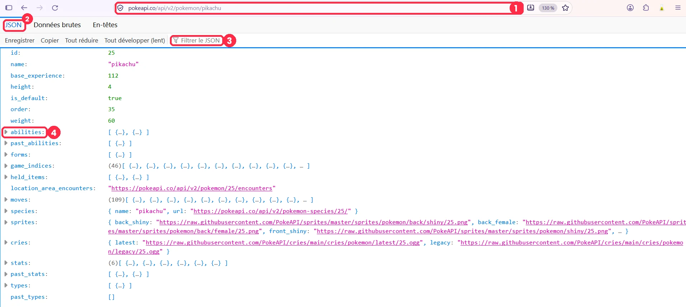
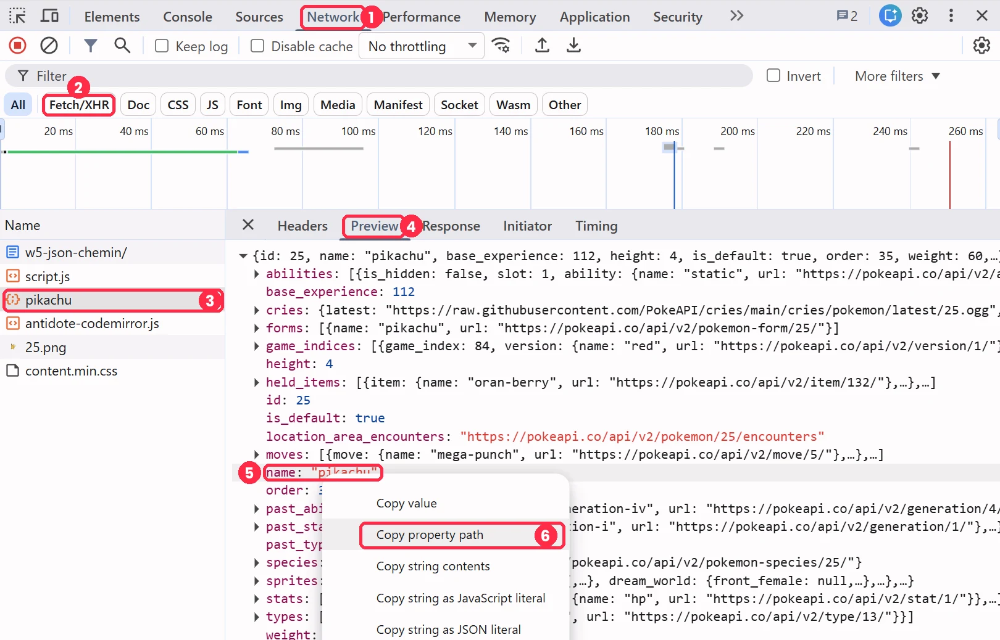

# :material-code-json:  Trouver une donnée dans un JSON

<div class="essentiel" markdown>
<p class="essentiel__titre">L'essentiel en 3 points</p>

1. Une réponse d'API, c'est des objets dans des tableaux dans des objets. Votre donnée est quelque part au fond : pour l'atteindre, on écrit son **chemin**.
2. On avance **de l'extérieur vers l'intérieur** : `.cle` pour un objet `{ }`, `[0]` pour un tableau `[ ]`, et des crochets pour une clé avec un tiret.
3. **Une étape à la fois** : le premier `undefined` vous montre où le chemin casse.

</div>

## La méthode { #methode }

À chaque niveau, regardez le **symbole** qui ouvre la valeur :

| Vous voyez... | C'est... | Vous écrivez... | Exemple |
|---|---|---|---|
| `{` | un **objet** | `.` et le nom de la clé | `data.sprites` |
| `[` | un **tableau** | `[` et la position, à partir de 0 | `data.types[0]` |
| une clé avec un tiret | un objet, mais... | des **crochets** et des guillemets | `data.sprites.other["official-artwork"]` |

Avancez **une étape à la fois**. Le premier `undefined` vous montre où le chemin casse.

## Un exemple : la PokéAPI { #exemple }

Ouvrez [pokeapi.co/api/v2/pokemon/pikachu](https://pokeapi.co/api/v2/pokemon/pikachu){ :target="_blank" } dans *Firefox*, qui affiche le JSON avec des triangles pour plier et déplier (voir [Firefox](#firefox), plus bas). La réponse est longue! Voici quatre chemins, du plus simple au plus difficile :

```js
data.name
// "pikachu" : une clé, directement dans l'objet

data.sprites.front_default
// l'image : un objet (sprites), puis une clé

data.types[0].type.name
// "electric" : un tableau (types), sa 1re case, un objet, une clé

data.sprites.other["official-artwork"].front_default
// la grande image : la clé a un tiret, donc des crochets
```

!!! warning "Le piège du tiret"
    `data.sprites.other.official-artwork` ne fonctionne pas : JavaScript lit le tiret comme une **soustraction** (`official` moins `artwork`). Dès qu'une clé contient un tiret ou une espace, on passe aux crochets : `["official-artwork"]`.

## À vous : tester vos chemins { #tester }

La démo charge la réponse de la PokéAPI. Essayez les chemins proposés, du plus simple au plus difficile, puis les deux versions du piège du tiret.

<iframe src="https://tim-montmorency.com/Fragment/v/?f=w5-json-chemin&onglets=resultat&modifiable=1&boutons=rejouer,ouvrir" style="width:100%;height:550px;border:0" loading="lazy"></iframe>

!!! question "Défi : les points de vie (*hp*) de Pikachu"
    Dans la réponse, cherchez `stats`. C'est un tableau d'objets : lequel contient `hp`, et où est la valeur?

??? success "Réponse"
    `data.stats[0].base_stat`. La 1re case du tableau `stats` est l'objet dont `stat.name` vaut `"hp"`, et sa valeur est dans `base_stat`.

## Plusieurs valeurs : `map()` { #map }

`data.abilities[0].ability.name` donne le nom de la **première** capacité du Pokémon, et seulement elle. Pour avoir **toutes** les capacités, on utilise `map()` : il parcourt un tableau (*array*) et **crée un nouveau tableau**, en gardant de chaque élément seulement ce qu'on lui demande.

```js
const abilities = data.abilities.map((item) => item.ability.name);
// ["static", "lightning-rod"]
```

??? info "Avant, après : ce que map() fabrique"
    Le tableau de départ, `data.abilities`, contient des objets complets. `map()` en tire un **nouveau** tableau, avec seulement les noms. Le tableau de départ, lui, ne change pas.

    ```js
    // Le tableau de départ : data.abilities, des objets complets
    [
      { ability: { name: "static", url: "..." }, slot: 1 },
      { ability: { name: "lightning-rod", url: "..." }, slot: 3 }
    ]

    // Le nouveau tableau, créé par map() : seulement les noms
    ["static", "lightning-rod"]
    ```

??? info "Comment lire la ligne de code"
    Pour chaque `item` du tableau `data.abilities`, garde `item.ability.name`. Remarquez que le chemin ne commence plus par `data`, mais par `item` : il part d'**un seul élément** du tableau, pas de toute la réponse.

Voir [Récap JS : `map()`](recap-js.md#map-join).

## Voir la réponse : Firefox ou Chrome { #outils }

**Firefox** : on ouvre l'adresse de l'API, pour **explorer** avant de coder. **Chrome** : on ouvre **votre page**, pour **vérifier** ce que votre code reçoit vraiment.

### Firefox : l'adresse de l'API, seule { #firefox }

<div class="grid grid-1-2 grid-cover" markdown>
  { data-zoom-image }

  <ol>
    <li>Collez l'adresse de l'API dans la <strong>barre d'adresse</strong>, puis <kbd>Enter</kbd>. Par exemple : <code>https://pokeapi.co/api/v2/pokemon/pikachu</code>.</li>
    <li>Onglet <strong>JSON</strong> : la réponse, bien rangée. L'onglet <strong>Données brutes</strong> montre le texte tel qu'il arrive.</li>
    <li><strong>Filtrer le JSON</strong> : tapez une clé (par exemple <code>official-artwork</code>) pour la trouver dans une longue réponse.</li>
    <li>Le <strong>triangle</strong> devant une clé déplie un objet <code>{ }</code> ou un tableau <code>[ ]</code>.</li>
  </ol>
</div>

### Chrome : la requête de votre page { #chrome }

On ouvre la page qui fait le `fetch()` (votre récit, ou [la démo Pokémon](https://tim-montmorency.com/Fragment/f/w5-json-chemin/){ :target="_blank" }), puis les outils de développement (++f12++).

<div class="grid grid-1-2 grid-cover" markdown>
  { data-zoom-image }

  <ol>
    <li>Onglet <strong>Réseau</strong> (<em>Network</em>). S'il est vide, rechargez la page (<kbd>F5</kbd>) : Chrome note seulement les requêtes faites pendant que l'onglet est ouvert.</li>
    <li>Filtre <strong>Fetch/XHR</strong> : il garde seulement les appels d'API, sans les images ni le CSS.</li>
    <li>Cliquez sur la <strong>requête</strong> de votre API (ici, <code>pikachu</code>).</li>
    <li>Onglet <strong>Aperçu</strong> (<em>Preview</em>) : la réponse, en JSON, avec des triangles pour déplier.</li>
    <li><strong>Clic droit</strong> sur la valeur qui vous intéresse.</li>
    <li><strong>Copier le chemin de la propriété</strong> (<em>Copy property path</em>). Collez-le dans votre code, après <code>data.</code></li>
  </ol>
</div>


## Voir aussi

- [API, JSON et fetch : le trio du web moderne](api-json-fetch.md)
- [Récap JS : le JSON](recap-js.md#json)
