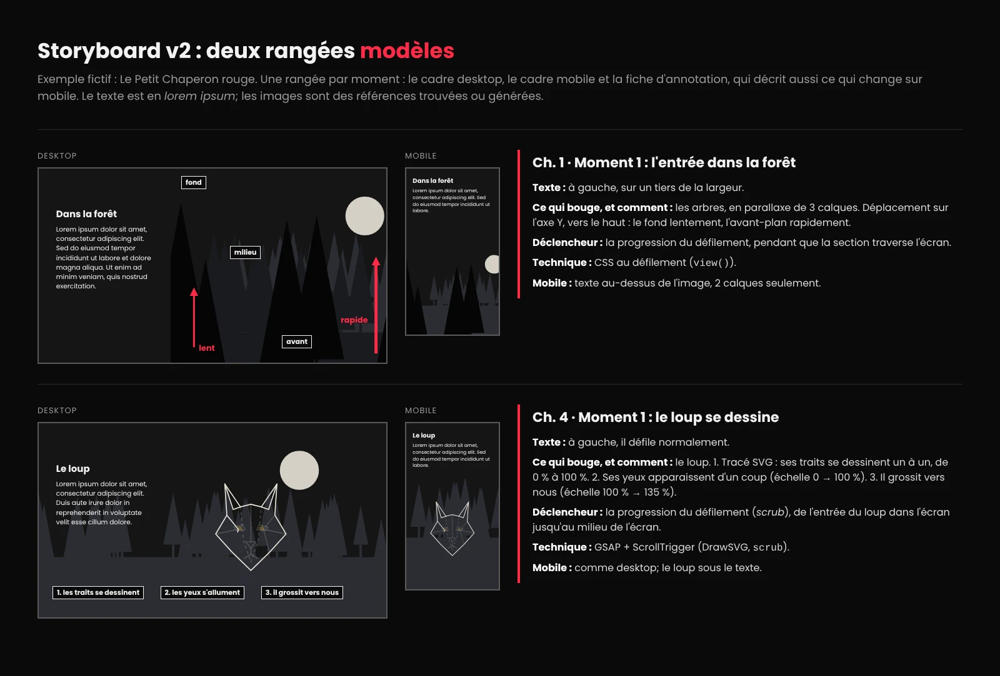

# :material-file-document-edit-outline:  Le cahier de charges et le scénarimage (storyboard)

<div class="class-content-link">
  
  <span class="sidetext">Utilisation de l'IA restreinte : permise <strong>seulement pour créer vos médias</strong>, jusqu'à nouvel ordre. Le code, c'est vous! <a class="lien-details" href="index.html#ia">Détails</a></span>
</div>

<div class="essentiel" markdown>
<p class="essentiel__titre">L'essentiel en 3 points</p>

1. Le cahier de charges fixe **ce que votre équipe va construire, et qui fait quoi**, avant d'écrire une ligne de code.
2. Vous partez du **gabarit** ci-dessous : copiez-le dans `documentation/CAHIER-DE-CHARGES.md`, puis remplissez chaque section, en équipe.
3. À déposer **au plus tard le ven. 23 oct., 23 h 59**, avec le storyboard (lien Figma et export PDF). C'est la remise 1, formative. Le cahier et le storyboard sont **notés dans leur version finale**, à la fin du projet (5 %, note d'équipe).

</div>

[:material-file-document-outline: Consignes complètes du récit défilant](index.md){ .md-button }

!!! warning "Le processus est évalué"
    Le cahier de charges est la première étape de votre processus. Au cours du **mer. 21 oct.**, vous me présenterez votre avancement (concept, chapitres, début du storyboard). Le cahier et le storyboard se font **sans IA** : c'est votre réflexion que je veux voir. Seule exception : une image générée pour illustrer un cadre du storyboard.

!!! danger "Remises formatives : l'échéance compte"
    Même si une remise est dite « formative », **son échéance compte**. Le respect des échéances de **toutes** les remises du projet (cahier de charges, storyboard v2, point de contrôle, prototype, bêta) aura un **impact sur votre note finale**. [Voir les 4 niveaux](index.md#echeances).

    Comme dans le monde professionnel : quand une étape est en retard, c'est toute l'équipe, et tout le projet, qui en souffre.

## Comment s'y prendre

Vous avez deux semaines, incluant un cours  : le **mer. 21 oct.**, arrivez avec votre concept et vos chapitres (étapes 1 et 2); on avance ensemble le storyboard et la matrice. Voici un ordre qui fonctionne :

1. **Le thème et le concept** (section 1). Partez de votre brainstorm (FigJam ou papier), et discutez-en à deux jusqu'à pouvoir le résumer en une phrase.
2. **Le découpage en chapitres** (section 3) : ce que chaque chapitre raconte, avant de penser aux animations.
3. **Le storyboard dans Figma** (section 2) : à quoi ressemble chaque chapitre, et ce qui bouge quand on défile.
4. **Les animations** de chaque chapitre, en respectant les garde-fous (section 3).
5. **La matrice de responsabilités** (section 4) : qui possède quoi. À faire **ensemble**, et à prendre au sérieux : c'est la base de votre note individuelle.
6. **Le reste** : données, dataviz, médias, technologies, prochaines étapes, risques.

## Le storyboard dans Figma { #storyboard }

Un storyboard de défilement n'est pas une maquette de chaque pixel. C'est **la suite des moments** que vit le visiteur.

**Partez du gabarit** : il contient **deux pages**, une pour le storyboard **desktop** (cadres en format paysage) et une pour le storyboard **mobile** (cadres en format portrait). Dupliquez les cadres autant de fois que nécessaire.

[:material-download: Télécharger le gabarit de storyboard (Figma)](../../assets/documents/Storyboard_Gabarit_Mobile_Desktop.fig){ .md-button .md-button--primary download }

Pour l'ouvrir : dans l'accueil de Figma, cliquez sur **Importer** (ou glissez le fichier `.fig` dans la fenêtre), puis partagez le fichier avec votre coéquipier ou coéquipière.

!!! warning "Storyboard v2 : à remettre le ven. 30 oct., 23 h 59"
    Les exigences ci-dessous ont été précisées après la première remise. Vous montez une **v2** de votre storyboard, sur le modèle des cadres du Chaperon (plus bas).

!!! danger "Ne touchez pas à votre v1"
    Dans votre fichier Figma, **ne modifiez pas et ne supprimez pas** les pages de votre première version : c'est la trace de votre processus. Créez une **nouvelle page**, nommée `Storyboard V2`, et travaillez seulement là. Dans le dépôt, gardez aussi `documentation/storyboard.pdf` tel quel.

### Ce que votre storyboard doit contenir

- **Une rangée par moment**, comme dans le modèle : le cadre **desktop**, le cadre **mobile** à côté, puis la **fiche d'annotation**. Tout est visible d'un coup d'œil.
- **Au moins une rangée par chapitre.** Un chapitre où plusieurs animations se produisent, en même temps ou l'une après l'autre, peut avoir **plusieurs rangées** : une par moment important.
- **Le cadre mobile** montre ce qui change sur un petit écran : la place du texte, une animation simplifiée ou retirée.
- **Le texte du chapitre placé dans chaque cadre** : un titre et un petit paragraphe de *lorem ipsum*, à la taille et à l'endroit où il apparaîtra à l'écran. C'est là que le visiteur lit votre récit : le texte doit avoir sa place dans la composition, pas être ajouté à la fin.
- **La fiche d'annotation complète**, à droite des deux cadres (voir ci-dessous).
- **Des images qui montrent ce qu'on doit voir**, pas des boîtes grises : un croquis, ou une image trouvée ou générée, collée dans le cadre pour représenter chaque élément (le décor, le personnage, l'objet). Ce n'est pas l'image finale, c'est une **référence**. Avec des boîtes grises, personne ne sait ce qui est quoi dans le cadre.
- Si un élément n'est pas évident, **nommez-le** avec une petite étiquette (« loup », « calque avant »).
- Repérez votre **moment dataviz** et votre **composant Vue** (navigateur de chapitres ou barre de progression).
- **Poussez votre concept** : la v2 est le moment d'aller plus loin que le minimum. Votre angle, votre identité visuelle et votre moment surprenant doivent se voir dans les cadres (voir [La créativité compte](index.md#creativite)).

### La fiche d'annotation

Dans **chaque** rangée, copiez ces amorces dans une zone de texte, à droite des cadres, et complétez-les :

```text
Ch. # · Moment # :
Texte : où est-il placé?
Ce qui bouge ou ce qui est animé, et comment? :
Déclencheur :
Technique :
Mobile :
```

- **Ce qui bouge** : l'élément, le type d'animation (tableau ci-dessous), et son départ → son arrivée.
- **Déclencheur** : l'entrée dans l'écran, la progression du défilement, une section épinglée, un clic.
- **Technique** : CSS au défilement, GSAP + ScrollTrigger ou IntersectionObserver.
- **Mobile** : ce qui est différent sur mobile (la place du texte, une animation simplifiée ou retirée). Si rien ne change, écrivez « Comme desktop ».

### Nommer le « comment »

| Type | À préciser |
|---|---|
| **Déplacement** | L'axe (X ou Y) et le sens : « de la droite vers le centre », « monte de 200 px » |
| **Rotation** | Le sens et l'amplitude : « tourne d'un demi-tour » |
| **Échelle** | « grossit de 50 % à 100 % » |
| **Apparition, disparition** | Un fondu, ou une entrée par un côté |
| **Tracé SVG** | « la ligne se dessine de gauche à droite » |
| **Image par image** | Spritesheet : combien d'images, en boucle ou une seule fois |
| **Parallaxe** | Les calques et leur vitesse relative : « l'avant-plan va plus vite » |
| **Épinglé** | Ce qui reste fixe, et pendant combien de défilement |

### Décrire l'animation, pas l'histoire

L'histoire, elle est déjà dans votre tableau des chapitres. La fiche décrit **ce que le visiteur voit bouger**, assez précisément pour que quelqu'un d'autre puisse le coder.

| L'histoire (à éviter) | L'animation (ce qu'on veut) |
|---|---|
| Le Chaperon rencontre le loup dans la forêt. | Le loup : déplacement sur l'axe X, de hors écran à droite → au centre, pendant le défilement. Le texte reste épinglé à gauche. |
| La forêt devient de plus en plus sombre. | Le fond : fondu du vert vers le noir (`opacity` d'un calque sombre de 0 à 0,8), selon la progression du défilement. |

### Le modèle : deux rangées



### Monter votre v2, étape par étape

Vous ne repartez pas de zéro : vous réutilisez les cadres de votre v1.

1. Dans Figma, créez une nouvelle page : `Storyboard V2`.
2. Pour chaque moment, créez un grand cadre qui servira de **rangée**, nommé comme le moment (ex. `Ch. 4 · Moment 2`).
3. **Copiez-collez** dans la rangée votre cadre desktop de la v1, et son cadre mobile à côté. S'il n'existe pas encore, créez le cadre mobile.
4. Complétez les deux cadres : le texte en *lorem ipsum*, des images de référence, des étiquettes au besoin.
5. Ajoutez la **fiche d'annotation** à droite, jusqu'à la ligne « Mobile ».
6. Placez les rangées dans l'ordre du récit, l'une sous l'autre.

### Remettre le storyboard : le lien et le PDF

Vous remettez votre storyboard **de deux façons** :

- **Le lien Figma**, dans le `README.md` et dans le cahier (section 2), avec accès donné à `marie-michelle.ouellet@cmontmorency.qc.ca`. C'est la version vivante : je pourrai y laisser des commentaires.
- **Un export PDF**, déposé dans le dépôt : `documentation/storyboard.pdf` pour la v1, `documentation/storyboard-v2.pdf` pour la v2. C'est la version **figée au moment de la remise** : elle montre ce qui était fait à l'échéance.

Pour exporter la v2 : ouvrez la page `Storyboard V2`, puis menu principal → *File* → *Export frames to PDF*. Chaque rangée devient une page du PDF. Vérifiez qu'elles y sont toutes, dans l'ordre du récit.

Pas d'outils IA de Figma pour composer le storyboard ni pour rédiger les annotations. Vous pouvez par contre **générer une image de référence** pour illustrer un cadre : dans ce projet, l'IA sert **seulement à créer des images**, jusqu'à nouvel ordre.

## Le modèle de données JSON { #le-modele-de-donnees-json }

Vos chapitres seront chargés avec `fetch()` depuis un fichier JSON, comme les projets de votre portfolio. Avant de coder, on décide **la forme d'un chapitre** : quelles propriétés, et pour quoi faire.

**Exemple 1 : un chapitre simple**, avec un texte et un média.

```json
{
  "id": "la-foret",
  "numero": 3,
  "titre": "Dans la forêt",
  "texte": ["Premier paragraphe...", "Deuxième paragraphe..."],
  "medias": [
    { "type": "calque", "src": "assets/images/foret-avant.webp", "alt": "" }
  ],
  "responsable": "Prénom"
}
```

**Exemple 2 : un chapitre en plusieurs plans.** Quand un chapitre est une **séquence** de moments animés, chacun avec son média et son animation, on ajoute un tableau `plans`. Le JavaScript boucle sur les plans d'un chapitre, exactement comme il boucle sur les chapitres.

```json
{
  "id": "la-tempete",
  "numero": 4,
  "titre": "La tempête",
  "type": "sequence",
  "plans": [
    {
      "id": "ciel-calme",
      "texte": "La mer est calme. Trop calme.",
      "media": {
        "type": "calques",
        "calques": [
          { "src": "assets/images/ciel-fond.webp", "vitesse": "lente" },
          { "src": "assets/images/vagues.webp", "vitesse": "rapide" }
        ],
        "alt": ""
      },
      "animation": { "technique": "css", "declencheur": "defilement" }
    },
    {
      "id": "eclair",
      "texte": "Un éclair déchire le ciel.",
      "media": {
        "type": "svg",
        "src": "assets/images/eclair.svg",
        "alt": "Un éclair zèbre le ciel"
      },
      "animation": { "technique": "gsap", "declencheur": "epingle" }
    },
    {
      "id": "bateau",
      "texte": "Le bateau tangue, puis disparaît.",
      "media": {
        "type": "spritesheet",
        "src": "assets/images/bateau.webp",
        "images": 12,
        "alt": "Un bateau secoué par les vagues"
      },
      "animation": { "technique": "observer", "declencheur": "entree" }
    }
  ],
  "responsable": "Prénom"
}
```

Ce qui change par rapport à l'exemple 1 :

- `"type": "sequence"` indique au JavaScript de construire plusieurs plans plutôt qu'un seul bloc.
- Chaque plan a **son propre** `id`, `texte`, `media` et `animation` : c'est le même découpage que vos cadres de storyboard.
- Les propriétés du média dépendent de son type : une liste de `calques` avec leur vitesse, un nombre d'`images` pour une spritesheet, un simple `src` pour un SVG.
- L'objet `animation` documente vos choix (technique, déclencheur). Le JavaScript peut s'en servir, ou ce peut être un simple aide-mémoire pour l'équipe.

Questions à vous poser :

- Le texte : une seule chaîne, ou un tableau de paragraphes?
- Les médias : de quels types (image, calque, spritesheet, SVG, vidéo)? Chacun a-t-il un `alt`?
- Vos chapitres affichent-ils des médias différents? Si oui, ajoutez une propriété `type` (ex. `"parallaxe"`, `"dataviz"`) : le JavaScript la lira pour savoir quel HTML construire (voir plus bas).
- Un de vos chapitres contient-il plusieurs moments animés? Si oui, est-ce un chapitre en `plans`?

### À quoi sert la propriété `type`?

Ce n'est pas un type de donnée JavaScript (`string`, `number`) : c'est une **étiquette que vous inventez** dans votre JSON pour dire au JavaScript **quel genre de chapitre** construire.

Le texte se construit toujours de la même façon, mais le média, lui, demande un HTML différent : une parallaxe en calques, une spritesheet, une dataviz. Une seule boucle passe sur tous les chapitres, et pour chacun, un `switch` lit le `type` et choisit le bon gabarit HTML :

```js
function createMedia(chapter) {
  switch (chapter.type) {
    case "parallaxe":
      return `<div class="parallaxe">...</div>`;
    case "dataviz":
      return `<div class="dataviz">...</div>`;
    default:
      return "";
  }
}
```

Sans `type`, il faudrait deviner à partir des autres propriétés (fragile), ou tester l'`id` de chaque chapitre (il faudrait modifier le code chaque fois qu'on renomme un chapitre). C'est le même principe pour `"type": "sequence"` dans l'exemple 2 : il dit au JavaScript de construire plusieurs plans.

## Le moment dataviz

Votre récit doit contenir au moins un moment où des **données réelles** apparaissent : un graphique, un chiffre qui bouge, un élément « vivant » (la météo du jour, l'heure du coucher du soleil, etc.). Ces données viendront d'une **API**, un service en ligne qui renvoie des données en JSON quand on lui envoie une requête avec `fetch()`.

**Au cahier de charges, pas besoin de trouver l'API.** On apprend à interroger une API externe au cours du **mer. 11 nov.**, et c'est là que vous la choisirez et la testerez. Pour l'instant, décrivez seulement :

- **le moment** : dans quel chapitre, et ce que les données apportent à votre histoire;
- **le genre de données** que vous aimeriez montrer (ex. « la température dans une ville », « le nombre de séismes cette semaine », « des œuvres d'un musée »).

[:material-chart-bar: Le moment dataviz : exemples et démo](dataviz.md){ .md-button .md-button--primary }

Restez souple : si aucune API ne fournit exactement vos données, on ajustera l'idée ensemble.

!!! tip "Pour explorer, si vous êtes curieux (facultatif)"

    - [**Public APIs**](https://github.com/public-apis/public-apis){ :target="_blank" } : une grande liste d'API gratuites, classées par thème. Visez les colonnes **Auth : `No`** (sans clé) et **CORS : `Yes`** (utilisable depuis le navigateur).
    - [**Données Québec**](https://www.donneesquebec.ca/){ :target="_blank" } et les [**données ouvertes de Montréal**](https://donnees.montreal.ca/){ :target="_blank" } : des données d'ici, en français. Plusieurs jeux de données sont des fichiers à télécharger plutôt qu'une API : on en reparlera au cours.
    - Quelques API sans clé, à tester le 11 nov. : [Open-Meteo](https://open-meteo.com/){ :target="_blank" } (météo, climat), [REST Countries](https://restcountries.com/){ :target="_blank" } (pays), [Art Institute of Chicago](https://api.artic.edu/docs/){ :target="_blank" } (œuvres d'art), [USGS](https://earthquake.usgs.gov/earthquakes/feed/v1.0/geojson.php){ :target="_blank" } (séismes en temps réel), [PokéAPI](https://pokeapi.co/){ :target="_blank" }, [Open Library](https://openlibrary.org/developers/api){ :target="_blank" } (livres), [Sunrise-Sunset](https://sunrise-sunset.org/api){ :target="_blank" } (lever et coucher du soleil).

## Le gabarit

Copiez tout le bloc ci-dessous (bouton de copie en haut à droite) dans `documentation/CAHIER-DE-CHARGES.md`. Remplacez les indications entre crochets.

!!! tip "la section 8 n'est pas à remplir pour le 23 oct."
    La section 8 n'est pas à remplir pour le 23 oct. vous choisirez vos technologies plus tard.

````markdown
# Cahier de charges : [Titre du récit]

**Équipe** : [Prénom Nom], [Prénom Nom]
**Thème** : [une cause / un mini-documentaire / une vitrine / un explicatif / une fiction]
**Brainstorm** : [lien FigJam, ou lien vers les photos dans `documentation/brainstorm/`]
**Storyboard Figma** : [lien]
**Storyboard PDF** : [documentation/storyboard.pdf](storyboard.pdf)

## 1. Le concept

[En 3 à 5 phrases : de quoi parle votre récit, quelle émotion ou quelle idée le visiteur doit retenir, et à qui il s'adresse.]

**En une phrase** : [votre récit résumé en une seule phrase]

**Notre angle** : [le point de vue qui rend votre récit unique. Ex. pas « les abeilles », mais « une journée dans la vie d'une abeille ouvrière, racontée par elle ».]

**Notre identité visuelle** : [palette, typographie, style d'images, et pourquoi ils conviennent à votre histoire]

**Notre moment surprenant** : [le chapitre, et ce qui s'y passe que le visiteur n'attend pas]

## 2. Le storyboard

[Le lien Figma, et 2 ou 3 phrases sur le déroulement général : comment le récit commence, où est le point culminant, comment il se termine.]

## 3. Les chapitres

6 à 8 chapitres, environ 100 à 250 mots chacun. Au plus 1 animation signature par chapitre, et au plus 2 sections épinglées dans tout le récit.

| # | Titre | Ce que le chapitre raconte | Animation signature | Technique | Médias | Responsable |
|---|---|---|---|---|---|---|
| 1 | [Ex. La forêt s'éveille] | [Ex. On découvre le lieu, au lever du jour] | [Ex. Parallaxe des arbres au défilement] | [CSS au défilement] | [Ex. Image en calques, 3 plans] | [Prénom] |
| 2 | | | | | | |
| 3 | | | | | | |
| 4 | | | | | | |
| 5 | | | | | | |
| 6 | | | | | | |
| 7 | | | | | | |
| 8 | | | | | | |

Vérification : chaque technique (CSS au défilement, GSAP + ScrollTrigger, IntersectionObserver) apparaît au moins une fois.

## 4. La matrice de responsabilités

| Élément | Responsable | Ce que ça comprend |
|---|---|---|
| Chapitres [numéros] | [Prénom] | Contenu, intégration, animations |
| Chapitres [numéros] | [Prénom] | Contenu, intégration, animations |
| Média animable 1 : [format] | [Prénom] | Préparation et intégration |
| Média animable 2 : [format] | [Prénom] | Préparation et intégration |
| Composant Vue : [navigateur de chapitres ou barre de progression] | [Prénom] | |
| *Fetch* externe et dataviz | [Prénom] | |
| Chargement des chapitres (JSON) | [Prénom] | |
| Structure commune (HTML, CSS de base, mise en page) | [Ensemble ou Prénom] | |

## 5. Le modèle de données

Un exemple d'objet chapitre, tel qu'il sera dans votre fichier JSON (inspirez-vous des [deux exemples plus haut](#le-modele-de-donnees-json)) :

```json
{
  "id": 1,
  "titre": "La forêt s'éveille",
  "texte": "...",
  "medias": [
    { "type": "image", "src": "assets/images/foret-fond.webp", "alt": "..." }
  ]
}
```

[Ajoutez ou retirez des propriétés selon vos besoins, et expliquez en 1 ou 2 phrases vos choix.]

## 6. La dataviz

L'API sera choisie au cours du mer. 11 nov. Pour l'instant, décrivez l'idée.

- **Chapitre** : [numéro]
- **La question** à laquelle le moment répond : [ex. combien de fois la Terre a-t-elle tremblé cette semaine?]
- **Genre de données souhaitées** : [ex. la température heure par heure dans une ville]
- **La forme imaginée** : [une donnée qui change le décor / des unités à l'image de votre sujet / une donnée qui pilote une animation / une échelle au défilement / autre. Un graphique à barres est le minimum : visez plus loin.]
- **Ce qu'elles racontent dans le récit** : [1 ou 2 phrases : la chute]
- **Pistes d'API, si vous en avez trouvé** : [facultatif]

## 7. L'inventaire des médias

| Média | Chapitre | Source (produit, banque, IA) | Format | Responsable |
|---|---|---|---|---|
| | | | | |

Médias animables choisis :

- [Prénom] : [image en calques / spritesheet / SVG préparé pour GSAP], pour le chapitre [numéro]
- [Prénom] : [image en calques / spritesheet / SVG préparé pour GSAP], pour le chapitre [numéro]

## 8. Les choix technologiques (NE PAS REMPLIR TOUT DE SUITE)

[Pour chaque outil, 1 ou 2 phrases : pourquoi lui, pour ce projet.]

- **GSAP + ScrollTrigger** : [...]
- **Vue.js (CDN)** : [...]
- **Hébergement** : [...]
- **Autres** (Anime.js, Chart.js, etc., s'il y a lieu) : [...]

## 9. Vos prochaines étapes (d'ici le mer. 28 oct.)

Ce que chacun aura fait d'ici le cours du mer. 28 oct. : 2 ou 3 lignes par personne, sans code. Ex. trouver ou produire les images sources de ses chapitres, commencer à préparer son média animable, écrire le texte d'un chapitre.

**[Prénom]**

- [...]
- [...]

**[Prénom]**

- [...]
- [...]

## 10. Les risques et le plan B

[2 ou 3 risques, et ce que vous couperez ou simplifierez si le temps manque. Ex. « Si la spritesheet prend trop de temps, on réduit à 8 images. »]
````

## Avant de remettre

- [ ] La section 1 décrit votre **angle**, votre **identité visuelle** et votre **moment surprenant**.
- [ ] Toutes les sections sont remplies : aucun crochet ne reste.
- [ ] Chaque personne a au moins 3 chapitres et un média animable dans la matrice.
- [ ] Chaque technique d'animation apparaît au moins une fois dans le tableau des chapitres.
- [ ] Le moment dataviz est décrit : chapitre, genre de données, ce qu'elles racontent.
- [ ] La trace du brainstorm est accessible : lien FigJam partagé, ou photos lisibles dans `documentation/brainstorm/`.
- [ ] Le lien Figma du storyboard fonctionne, avec accès donné à `marie-michelle.ouellet@cmontmorency.qc.ca`.
- [ ] Le storyboard est exporté en PDF dans `documentation/storyboard.pdf`, avec tous les cadres.
- [ ] **Storyboard v2** (ven. 30 oct.) : sur une nouvelle page Figma (la v1 intacte), une rangée par moment : cadre desktop, cadre mobile, fiche. Le texte en *lorem ipsum*, des images de référence (pas de boîtes grises), une fiche complète. Exporté dans `documentation/storyboard-v2.pdf`.
- [ ] Le tout est poussé sur GitHub **au plus tard le ven. 23 oct., 23 h 59**.
