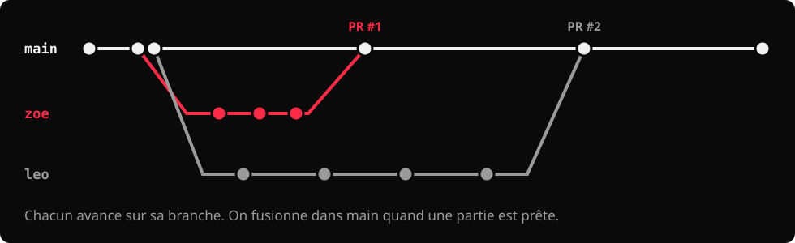
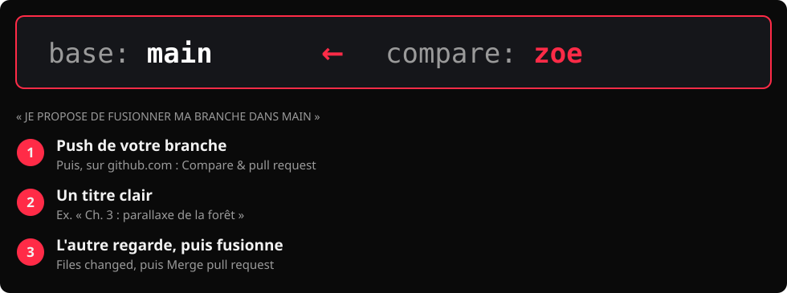
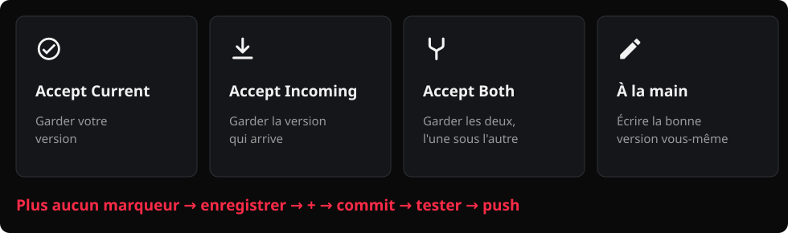
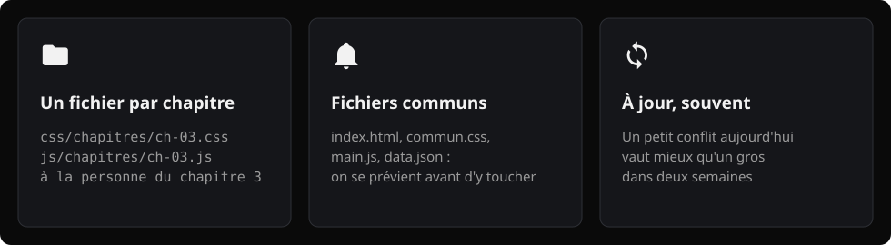

# :material-account-multiple-outline:  Le récit défilant : Git en équipe

<div class="essentiel" markdown>
<p class="essentiel__titre">L'essentiel en 3 points</p>

1. **Une branche par personne**, à votre prénom. On ne code jamais directement sur `main` : `main`, c'est la version de l'équipe, celle qui fonctionne.
2. Quand une partie de votre travail est prête, vous la **fusionnez dans `main` par une *pull request*** sur GitHub. Ensuite, chacun **met sa branche à jour** avec `main`.
3. Des *commits* **uniformes dans l'équipe** : la zone d'abord, puis ce qui a changé, à l'impératif. Ex. `Ch. 3 : ajoute la parallaxe de la forêt`.

</div>

!!! info "Les bases des branches"
    Si le vocabulaire (branche active, créer, changer, publier) vous semble flou, relisez d'abord [Les branches Git, en 10 minutes](../portfolio/branches-git.md). Cette page part de là.

## Pourquoi des branches, à deux?

À deux dans le même dépôt, si vous travaillez tous les deux sur `main`, chaque *push* de l'un peut bloquer l'autre, et une erreur de l'un casse le projet des deux.

Avec **une branche par personne** :

- chacun avance à son rythme, sans déranger l'autre;
- `main` reste stable : c'est la version qu'on montre, qu'on teste et qu'on remet;
- l'historique montre **qui a fait quoi**, ce qui sert à votre évaluation individuelle.

## Le flux de travail, en une image



1. Au départ, l'équipe crée **ensemble** la structure commune sur `main`.
2. Chacun crée **sa** branche à partir de `main` (ici `zoe` et `leo`).
3. Chacun travaille et *commit* sur sa branche.
4. Une partie est prête? On ouvre une ***pull request*** (PR) : « je propose de fusionner ma branche dans `main` ».
5. Après chaque fusion, l'autre **met sa branche à jour** avec `main`, pour travailler sur la dernière version.

## Étape 1 : la structure commune, sur `main`

Une seule fois, au début, **ensemble** sur un seul poste :

1. Créez toute la structure du projet, avec **un fichier CSS et un fichier JS par chapitre, même vides** : voir [La structure du projet](structure-projet.md).
2. Dans `data/data.json`, créez **le squelette de tous vos chapitres**, même vides : un objet par chapitre, avec son `id`, son `numero` et son `responsable`. Chacun remplira ensuite **ses** objets.
3. *Commit* sur `main`, puis *push*.
4. L'autre personne fait un *pull* (ou clone le dépôt).

Pourquoi le squelette? Si chacun ajoute ses chapitres à la fin du fichier en même temps, vous modifiez les mêmes lignes : c'est le conflit assuré. Avec le squelette, chacun remplit des lignes différentes.

## Étape 2 : créer sa branche

Une branche à **votre prénom**, en minuscules, sans accents : `zoe`, `leo`, `marie-eve`.

| Outil | Comment |
|---|---|
| VS Code | Nom de la branche en bas à gauche → **+ Create new branch…** → votre prénom → **Publish Branch** |
| GitHub Desktop | **Current branch** → **New branch** → votre prénom (à partir de `main`) → **Publish branch** |
| Terminal | `git checkout -b zoe`, puis `git push -u origin zoe` |

**Le réflexe** : avant de coder, un coup d'œil à la branche active. Ce doit être **la vôtre**, jamais `main`.

## Étape 3 : travailler et *commit* sur sa branche

Vous travaillez comme d'habitude : de petits *commits* fréquents, puis *push*. Vos *commits* vont sur votre branche, et `main` ne bouge pas.

## C'est quoi, une *pull request*?

Une *pull request* (PR), c'est une **demande** faite sur GitHub : « J'ai fait des changements sur ma branche. Je propose de les intégrer dans `main`. » Le nom vient du point de vue de l'équipe : vous lui demandez de **tirer** (*pull*) vos changements dans la version commune.

Pensez au **mode suggestion** dans Word ou Google Docs : vous proposez des modifications, quelqu'un les relit, puis les accepte. Tant que personne n'accepte, le document de référence ne change pas. Ici, le document de référence, c'est `main`.

### Ce qu'on trouve dans une PR

Une PR est une page de votre dépôt sur github.com, avec :

- **la direction** : quelle branche on fusionne, dans laquelle (`main` ← `zoe`);
- **les *commits*** de la branche qui seront ajoutés à `main`;
- **les différences** (onglet **Files changed**) : chaque ligne ajoutée en vert, chaque ligne retirée en rouge;
- **une conversation** : on peut commenter, poser une question, demander une correction, même sur une ligne précise;
- **le bouton de fusion** (*Merge pull request*). GitHub vous avertit si la fusion crée un conflit.

### Ce qu'il faut retenir

- **Une PR n'est pas une copie figée.** Si on vous demande une correction, faites-la sur votre branche, *commit*, *push* : la PR se met à jour toute seule.
- **Tant que la PR n'est pas fusionnée, `main` ne bouge pas.** C'est ce qui protège la version de l'équipe.
- **Une PR fusionnée reste dans l'historique** (onglet **Pull requests** → **Closed**) : c'est la trace de qui a proposé quoi, et de qui l'a accepté.

| Action | Où | Ce que ça fait |
|---|---|---|
| *Commit* | Votre poste | Enregistre une étape de votre travail, sur votre branche |
| *Push* | Votre poste → GitHub | Envoie vos *commits* sur GitHub, toujours sur votre branche |
| *Pull request* | GitHub | Propose d'intégrer votre branche dans `main` |
| *Merge* | GitHub | Accepte la proposition : vos *commits* entrent dans `main` |

## Étape 4 : fusionner dans `main` avec une *pull request*

Une partie de votre travail fonctionne (ex. le chapitre 3 s'affiche et s'anime)? Proposez-la à l'équipe :



1. Faites un *push* de votre branche.
2. Sur github.com, ouvrez votre dépôt. Un bandeau jaune propose **Compare & pull request**. Sinon : onglet **Pull requests** → **New pull request**.
3. Vérifiez la direction : **base: `main`** ← **compare: `zoe`**.
4. Donnez un titre clair (ex. `Ch. 3 : parallaxe de la forêt`) et décrivez en une ou deux phrases ce que la PR ajoute. **Create pull request**.
5. Votre coéquipier ou coéquipière y jette un œil (onglet **Files changed**), puis **Merge pull request** → **Confirm merge**.

!!! warning "« This branch has conflicts » : on règle localement"
    Si GitHub affiche ce message dans votre PR, le bouton de fusion est grisé. N'utilisez pas le bouton **Resolve conflicts** de GitHub : réglez le conflit **sur votre poste**. Sur votre branche, faites l'[étape 5](#etape-5) (*fetch*, puis *merge* de `origin/main`), [réglez le conflit](#les-conflits) dans VS Code, testez avec Live Server, puis *commit* et *push*. La PR se met à jour toute seule, et le bouton redevient vert.

!!! tip "Petites PR, souvent"
    Une PR par partie terminée (un chapitre, un média intégré), pas une énorme PR la veille de la remise. Plus elle est petite, moins il y a de risques de conflit.

## Étape 5 : mettre sa branche à jour avec `main` { #etape-5 }

Après la fusion d'une PR, `main` contient du nouveau travail. Avant de continuer, **chacun récupère `main` dans sa branche** :

| Outil | Comment, en étant sur **votre** branche |
|---|---|
| VS Code | Palette de commandes (`Ctrl+Shift+P`) → **Git: Fetch**, puis **Git: Merge…** (*Merge Branch…* selon la version) → choisir `origin/main` |
| GitHub Desktop | Menu **Branch** → **Update from main** |
| Terminal | `git fetch`, puis `git merge origin/main` |

Puis *push*. Faites-le **souvent** : au début de chaque séance de travail, et après chaque PR fusionnée.

## Les conflits { #les-conflits }

### Pourquoi un conflit?

Git fusionne seul tout ce qu'il peut. Il s'arrête seulement quand **les deux branches ont modifié les mêmes lignes du même fichier** : il ne peut pas deviner laquelle garder. C'est un **conflit**. Ce n'est pas une erreur : c'est Git qui vous demande de choisir.

### À quoi ça ressemble

Dans le fichier, Git place des marqueurs autour des deux versions :

```text
<<<<<<< HEAD
<h1>La forêt enchantée</h1>
=======
<h1>Dans la forêt</h1>
>>>>>>> origin/main
```

- Entre `<<<<<<< HEAD` et `=======` : **votre** version (la branche active).
- Entre `=======` et `>>>>>>>` : la version qui **arrive** (ici, celle de `main`).

### Le régler dans VS Code

1. Le panneau **Source Control** liste les fichiers en conflit (marqués `!`). Ouvrez-en un.
2. Au-dessus de chaque conflit, VS Code propose :
  - **Accept Current Change** : garder votre version;
  - **Accept Incoming Change** : garder la version qui arrive;
  - **Accept Both Changes** : garder les deux, l'une sous l'autre;
  - ou modifiez le texte à la main pour écrire la bonne version.
3. Vérifiez qu'**aucun marqueur** (`<<<<<<<`, `=======`, `>>>>>>>`) ne reste dans le fichier.
4. Enregistrez, ajoutez le fichier (`+`), puis *commit* (le message est déjà proposé) et *push*.



Dans GitHub Desktop, la fenêtre de fusion liste les fichiers en conflit : ouvrez-les dans VS Code, réglez-les de la même façon, puis cliquez sur **Continue merge**.

!!! warning "Testez avant de pousser"
    Un conflit réglé à la main peut casser la page (une balise fermée en double, une virgule de trop dans le JSON). Ouvrez la page avec Live Server avant de faire le *push*.

### Comment éviter les conflits



- **Un fichier par chapitre** : `css/chapitres/ch-03.css` et `js/chapitres/ch-03.js` pour la personne responsable du chapitre 3 (voir [La structure du projet](structure-projet.md)).
- **Les fichiers communs** (`index.html`, `commun.css`, `main.js`, `data.json`) : on se prévient avant d'y toucher, et on fusionne vite.
- **Mettez votre branche à jour souvent** : un petit conflit aujourd'hui vaut mieux qu'un gros dans deux semaines.

## La convention de *commits* de l'équipe

Les deux membres de l'équipe écrivent leurs messages **de la même façon** :

```text
Zone : ce qui a changé, à l'impératif
```

| Zone | Exemple |
|---|---|
| Un chapitre | `Ch. 3 : ajoute la parallaxe de la forêt` |
| Un média | `Média : prépare la spritesheet du loup (8 images)` |
| Le composant Vue | `Vue : affiche le chapitre actif dans le navigateur` |
| La dataviz | `Dataviz : charge la météo avec fetch` |
| Les données | `Données : remplit les chapitres 3 et 4 dans data.json` |
| La structure commune | `Commun : ajuste la grille de la page` |
| La documentation | `Docs : complète le cahier de charges, section 4` |
| Un correctif de la QA | `Corrige #12 : le menu mobile ne se ferme pas` |

Comme au portfolio : en français, à l'impératif, précis. Jamais `update`, `fix` ou `wip`. La zone au début permet de retrouver en un coup d'œil, dans l'historique, le travail de chacun.

!!! info "`Corrige #12`"
    Au contrôle de la qualité croisé, les problèmes seront notés dans des *issues* GitHub, numérotées. Un *commit* qui commence par `Corrige #12` est relié automatiquement à l'*issue* no 12. On y reviendra en novembre.

## Pour pratiquer

Avant de toucher à votre projet, provoquez un conflit volontairement, dans un petit dépôt d'exercice créé par Classroom 50, et réglez-le à deux.

[:material-source-merge: Exercice : provoquer et régler un conflit](../../exercices/ex-conflit-git/index.md){ .md-button .md-button--primary }
