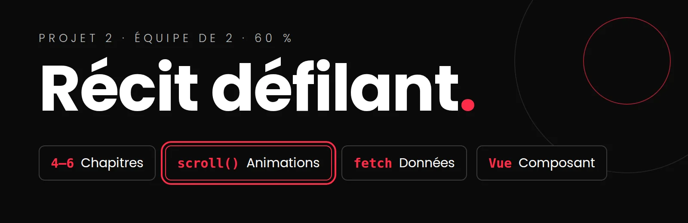

# :material-book-open-page-variant-outline:  Le récit défilant : consignes complètes

{.w-100}

<div class="class-content-link">
  
  <span class="sidetext">Utilisation de l'IA restreinte : permise <strong>seulement pour créer vos médias</strong>, jusqu'à nouvel ordre. Le code, c'est vous! <a class="lien-details" href="#ia">Détails</a></span>
</div>

<!-- MM : premier jet pour le lancement du ven. 9 oct. La grille critériée détaillée, les questions du journal propres au récit défilant sont à compléter. -->

<div class="essentiel" markdown>
<p class="essentiel__titre">L'essentiel en 3 points</p>

1. En **équipe de 2**, vous concevez et codez un **récit défilant** (*scrollytelling*) : une histoire en chapitres qui se déroule et s'anime au rythme du défilement. Thème au choix.
2. Le travail se fait en équipe, mais **la note est surtout individuelle** (35&nbsp;% sur 60&nbsp;%) : chacun est responsable de ses chapitres, de son média animable, de sa QA et de sa défense.
3. **Première étape : le cahier de charges**, à déposer **au plus tard le ven. 23 oct., 23 h 59**. Vous pouvez le commencer dès aujourd'hui, et on avance ensemble au cours du **mer. 21 oct.**

</div>

!!! danger "C'est votre processus qui est évalué"
    Pas seulement le résultat final : **votre démarche, étape par étape**. Vous me présentez votre projet **à chaque étape**, au rythme du groupe. Si je constate qu'une étape a été sautée (un code généré d'un coup, sans planification ni compréhension), **je vous demanderai de la recommencer**. Pas de passe-droit.

[:material-file-document-edit-outline: Le cahier de charges et le scénarimage (storyboard)](cahier-de-charges.md){ .md-button .md-button--primary }
[:material-lightbulb-on-outline: Exemples et inspirations](inspirations.md){ .md-button }

[:material-presentation-play: Présentation de lancement (PowerPoint)](../../assets/documents/Web5_recit-defilant-lancement.pptx){ .md-button }

## Mise en situation

Une organisation (un musée, un organisme, un média, une marque) vous confie un mandat : raconter une histoire sur le web de façon **immersive**. Pas un article qu'on lit, ni une vidéo qu'on regarde : une expérience que le visiteur **fait avancer lui-même en défilant**, où le texte, les images, les animations et les données apparaissent au bon moment.

C'est le format des grands récits interactifs des médias en ligne. Exemples à explorer :

- [The Pudding](https://pudding.cool/){ :target="_blank" } : des essais visuels construits sur des données;
- [Snow Fall (The New York Times, 2012)](https://www.nytimes.com/projects/2012/snow-fall/){ :target="_blank" } : un des premiers récits défilants célèbres.

Ce projet réunit tout ce que vous avez appris : la conception, l'animation, les données, le contrôle de la qualité et le travail d'équipe. C'est aussi une pièce de choix pour votre portfolio.

## Le produit

### Votre récit

Un récit sur un thème de votre choix, par exemple :

- **une cause** (environnement, santé, société);
- **un mini-documentaire** (un lieu, un événement, une personne);
- **une vitrine** (un produit, une œuvre, un artiste);
- **un explicatif** (comment fonctionne quelque chose);
- **une fiction** (un conte, une légende, une histoire inventée).

### Ce qui est obligatoire

| Élément | Exigence |
|---|---|
| **Chapitres** | 6 à 8 chapitres, environ 100 à 250 mots chacun. Au moins 3 chapitres par personne. |
| **Données** | Les chapitres et leurs médias sont chargés avec `fetch()` depuis un fichier JSON. |
| **Dataviz** | Au moins un `fetch()` vers une **API externe gratuite**, pour un moment de visualisation de données ou un élément « vivant ». Au cahier de charges, vous décrivez seulement l'idée et le genre de données : l'API se choisit après le cours du mer. 11 nov. |
| **Animations** | Au moins une animation de chaque technique : **CSS au défilement** (`animation-timeline`), **GSAP + ScrollTrigger**, et un déclencheur **IntersectionObserver**. |
| **Vue.js** | Un composant imposé : le **navigateur de chapitres** ou la **barre de progression**. Vue est chargé par CDN, sans *build*. |
| **Média animable** | Un par personne, préparé pour l'animation (voir plus bas). |
| **Responsive** | Le récit fonctionne sur desktop et sur mobile. Les animations peuvent y être simplifiées. |
| **Accessibilité** | Le récit reste lisible **sans animation**, avec `prefers-reduced-motion`. |
| **Déploiement** | En ligne sur GitHub Pages. |

### La créativité compte { #creativite }

Le cours vise un produit Web **créatif** et **original** : c'est écrit dans ses objectifs. Un récit qui coche toutes les exigences, mais qui ressemble à une page Web ordinaire, ne suffit pas.

Ce que je regarde :

- **Un angle** : votre récit a un point de vue. « Les abeilles », c'est un sujet; « une journée dans la vie d'une abeille ouvrière, racontée par elle », c'est un angle.
- **Une identité visuelle** : une palette, une typographie et un style d'images choisis **pour votre histoire**, cohérents du début à la fin.
- **Des animations qui racontent** : chaque animation signature dit quelque chose de l'histoire. Elle n'est pas là pour décorer.
- **Au moins un moment surprenant** : un passage que le visiteur n'attend pas d'une page Web.
- **Une dataviz qui fait partie du récit** : pas un graphique de rapport, mais une donnée qui prend la forme de votre histoire (voir [le moment dataviz](dataviz.md#plus-loin)).

Être créatif, ce n'est pas ajouter des animations : les garde-fous ci-dessous s'appliquent toujours. C'est faire des **choix**, et les assumer.

### Les garde-fous

Ils existent pour que le projet reste faisable en 8 semaines, à deux.

- **Au plus 1 animation « signature » par chapitre**, et **au plus 2 sections épinglées** (*pin*) dans tout le récit.
- **Médias légers** : images en WebP, vidéos de 30 secondes au plus (ou hébergées sur YouTube ou Vimeo), **10 Mo au plus** pour tout le récit.
- **Animer seulement `transform` et `opacity`** : ce sont les propriétés que le navigateur anime sans ralentir la page.

Mieux vaut 6 chapitres soignés que 8 chapitres bâclés.

### Un média animable par personne

Chaque personne produit **un** média préparé pour l'animation, intégré dans un de ses chapitres. Au choix :

| Format | Ce que vous préparez | Minimum |
|---|---|---|
| **Image en calques** (parallaxe) | Une image découpée en plans (avant, milieu, fond), sur fond transparent | 3 plans |
| **Spritesheet** | Les images d'une séquence, alignées sur une grille régulière, en WebP | 6 à 24 images |
| **SVG préparé pour GSAP** | Un SVG dont les parties sont regroupées et nommées avec des `id` | 3 parties animées séparément |

!!! info "L'IA comme source, la préparation par vous"
    Une image générée par IA peut servir de point de départ. Mais **la préparation pour l'animation est votre travail** : découpage des plans, assemblage et retouche des images de la séquence, vectorisation et nommage des groupes. Créditez le média dans le `README.md`, en indiquant l'outil d'IA comme source. Dans votre journal, réfléchissez à ce que vous avez préparé vous-même.

On verra en classe comment préparer chacun de ces formats. D'ici là, choisissez le vôtre et inscrivez-le dans le cahier de charges.

### Les médias et les crédits

- **Banques d'images libres permises** (ex. [Unsplash](https://unsplash.com/){ :target="_blank" }, [Pexels](https://www.pexels.com/){ :target="_blank" }), selon leur licence.
- **Images générées par IA permises**, si elles sont créditées dans le `README.md`, avec l'outil comme source.
- **Tous les médias sont crédités** dans le `README.md`, dans un tableau : média, chapitre, source, auteur, licence, modifié ou non.

```markdown
## Crédits des médias

| Média | Chapitre | Source | Auteur | Licence | Modifié? |
|---|---|---|---|---|---|
| `foret-fond.webp` | 1 | [Unsplash](lien) | Nom de la personne | Licence Unsplash | Découpé en 3 calques |
| `renard.svg` | 3 | Firefly | Généré par IA | : | Vectorisé, groupes nommés |
```

## Travailler en équipe, être évalué individuellement

### Inscrire votre équipe

Inscrivez les deux noms de votre équipe et votre thème dans le fichier [equipes-recit-defilant.xlsx](https://cmontmorency365-my.sharepoint.com/:x:/g/personal/mariem_ouellet_cmontmorency_qc_ca/IQAjsQ0uE1HKRrkQXrMKFTAMAeVW1rYQkDk6AHIYjIdyfTs?e=dNPvKA){ :target="_blank" }. Ajoutez le thème dès que je l'ai validé.

### Vos zones de responsabilité

Dès le cahier de charges, une **matrice de responsabilités** dit qui possède quoi : chapitres, média animable, composant Vue, *fetch* externe. C'est elle qui permet de vous évaluer individuellement. Chaque personne doit pouvoir expliquer et modifier **tout le code de ses zones**.

### Git

- **Un seul dépôt par équipe**, privé au départ. Invitez votre coéquipier ou coéquipière et `marie-michelle-ouellet` comme collaborateurs.
- Des *commits* réguliers et bien nommés, faits **par la personne qui a écrit le code** : c'est la trace de votre travail.
- Une **branche par personne**, fusionnée dans `main` par *pull request* (voir [Git en équipe](git-en-equipe.md)).
- **Un fichier CSS et un fichier JS par chapitre**, à la personne responsable (voir [La structure du projet](structure-projet.md)).

### Journal de bord individuel

Chaque personne tient **son propre journal** : `documentation/JOURNAL-prenom.md`. Comme au portfolio, à chaque bloc, vous répondez aux 5 questions. Les crédits des médias, y compris ceux générés par IA, vont dans le `README.md`, pas dans le journal.

1. Qu'est-ce que j'ai accompli depuis le dernier bloc? (Vous pouvez faire référence à vos *commits*.)
2. Quelle a été ma principale difficulté et comment je l'ai surmontée?
3. Qu'est-ce que j'ai appris que je ne savais pas avant?
4. Quelle est ma prochaine étape concrète?
5. Si j'ai utilisé l'IA comme source pour un média : qu'est-ce que j'ai préparé moi-même, et qu'est-ce que ça m'a appris?

Votre **première entrée** contient aussi votre processus créatif :

- **2 ou 3 animations qui vous inspirent**, notées seul : le lien, ce qui bouge, ce que vous aimeriez emprunter;
- **la trace du brainstorm** de votre équipe (voir ci-dessous). Chacun l'ajoute dans son propre journal, même si c'est la même trace pour les deux.

### Votre brainstorm : une trace claire, exigée { #brainstorm }

**C'est votre processus qui est évalué, pas seulement l'idée finale.** Je veux voir comment votre équipe est arrivée à son thème. Cette trace est **obligatoire** pour la remise 1.

Elle peut prendre deux formes :

- **Numérique** : un tableau **FigJam**, partagé avec `marie-michelle.ouellet@cmontmorency.qc.ca`. Mettez son **lien** dans votre journal.
- **Papier** : prenez des **photos lisibles** de vos feuilles, déposez-les dans le dépôt sous `documentation/brainstorm/`, et mettez un **lien vers ces photos** dans votre journal.

Une trace claire montre :

- **les idées de départ** : au moins 3 idées par personne;
- **les idées écartées** : ne nettoyez pas, elles font partie du processus;
- **le choix final**, identifié clairement (encerclé, surligné, déplacé à part).

### L'IA dans ce projet : pour vos médias seulement { #ia }

<div class="class-content-link">
  
  <span class="sidetext">Utilisation de l'IA restreinte : permise <strong>seulement pour créer vos médias</strong>, jusqu'à nouvel ordre. Le code, c'est vous!</span>
</div>

**Cette fois, on code sans IA.** Au portfolio, l'IA était permise, documentée et comprise. Pour le récit défilant, on fait un essai différent : je veux que vous puissiez coder **par vous-mêmes**, et que demander à l'IA ne soit pas un réflexe. Chercher, essayer, se tromper, déboguer : c'est comme ça qu'on devient autonome.

Cette règle s'applique **jusqu'à nouvel ordre**. Si elle change en cours de projet, je l'annoncerai en classe et sur cette page.

| Permis | Pas permis |
|---|---|
| Générer une **image source** pour votre média animable, puis la préparer vous-même (voir plus haut) | Copilot dans VS Code : complétions, chat, suggestions |
| La **documentation** : MDN, GSAP, Vue | ChatGPT, Claude, Gemini ou autre pour écrire, corriger ou expliquer votre code |
| Les **notes du cours** et les **démos présentées en classe** | Figma Make, Google Stitch ou autre générateur de code ou de maquette |
| **Vos collègues** : on s'explique, on ne copie pas | L'IA pour rédiger le cahier de charges, le storyboard ou le journal |
| **Moi**, en classe et au tutorat | |
| Générer une **image de référence** pour illustrer un cadre du storyboard | |

!!! tip "Désactiver Copilot dans votre projet"
    Créez le fichier `.vscode/settings.json` à la racine de votre dépôt, et *commitez*-le :

    ```json
    {
      "github.copilot.enable": { "*": false }
    }
    ```

    Les complétions de Copilot sont alors désactivées dans ce projet seulement. Vos autres projets ne changent pas. N'utilisez pas non plus le chat de Copilot.

**Ce qui est évalué, c'est votre processus.** Un projet produit d'un coup ne montre rien de ce que vous savez faire.

- Vous **suivez le groupe** : chaque étape vue en classe se fait dans votre projet, au même rythme.
- Vous me **présentez votre projet à chaque étape** : cahier de charges, storyboard, animations, composant Vue, prototype, bêta.
- **Une étape sautée est à recommencer.** Si je sens qu'une partie a été générée sans passer par les étapes (planifier, coder par incréments, comprendre), je vous demanderai de la refaire. Pas de passe-droit.

!!! danger "Le code que vous ne comprenez pas se voit à la défense"
    Le 9 décembre, en privé, vous devrez montrer, expliquer et modifier en direct le code de **vos** zones, avec des demandes pigées au hasard. Du code produit par l'IA dans votre projet : plagiat.

## Évaluation : 60&nbsp;% de la note finale

| Volet | % | Type | Quand |
|---|---|---|---|
| Planification : cahier de charges et storyboard (version finale) | 5 | équipe | ven. 11 déc. |
| Respect des échéances (toutes les remises) | 5 | équipe | à chaque remise |
| Produit final et présentation | 15 | équipe | ven. 11 déc. |
| Réalisation de vos zones (chapitres, média animable, code) | 15 | **individuel** | ven. 11 déc. |
| Contrôle de la qualité croisé (tester une autre équipe, corriger vos écarts) | 10 | **individuel** | 25 nov. au 4 déc. |
| Défense individuelle | 10 | **individuel** | mer. 9 déc. |
| **Total** | **60** | **25 équipe, 35 individuel** | |

Le cahier de charges et le storyboard sont **notés dans leur version finale**, à la fin du projet, comme au portfolio. D'ici là, ils évoluent avec mes rétroactions.

La [créativité](#creativite) compte dans deux volets : la **planification** (votre concept, votre angle) et le **produit final** (sa réalisation).

### Le respect des échéances { #echeances }

À chaque remise du projet (cahier de charges et storyboard, storyboard v2, point de contrôle, prototype, bêta), votre équipe obtient l'un de ces 4 niveaux :

| Niveau | Ce que ça veut dire |
|---|---|
| **Absent** | Rien remis, gabarit vide, ou remis en retard sans entente préalable. |
| **Bâclé** | Remis à temps, mais je ne peux rien en tirer pour vous donner une rétroaction : parties manquantes, croquis illisibles, rien d'écrit. |
| **De bonne foi** | Un vrai travail, même incomplet ou mal compris : je peux vous donner une rétroaction utile. |
| **Complet** | Tout ce qui était demandé est là. |

**Une remise bâclée vaut presque autant qu'une remise absente.** Déposer « quelque chose » pour respecter l'heure ne suffit pas.

Une étape ratée se rattrape en partie : une **v2 complète** du storyboard (ven. 30 oct.) fait remonter le niveau de la remise du 23 oct. jusqu'à « De bonne foi », jamais jusqu'à « Complet ».

<!-- MM : barème interne par remise : Absent 0, Bâclé 0,5, De bonne foi 2, Complet 3. -->

## Calendrier

| Date | Étape |
|---|---|
| **ven. 9 oct.** | Lancement : inspirations (seul), équipes, brainstorm et thème (en équipe), début du cahier de charges |
| 9 au 20 oct. | **Travail autonome** : concept, chapitres, début du storyboard |
| **mer. 21 oct.** | Cours : storyboard, modèle de données, matrice de responsabilités. Vous me présentez votre avancement. |
| **ven. 23 oct.** | Pas de cours. **Remise 1 : cahier de charges**, déposé au plus tard à 23 h 59 |
| mer. 28 oct. | Rencontres éclair : rétroaction sur votre storyboard et votre cahier. Branches Git. Animations CSS : parallaxe, spritesheet. |
| **ven. 30 oct.** | **Storyboard v2**, déposé au plus tard à 23 h 59. Animations CSS au défilement. Chargement des chapitres en JSON. |
| mer. 4 nov. | GSAP + ScrollTrigger, IntersectionObserver |
| ven. 6 nov. | Construction des chapitres, point de contrôle d'équipe |
| mer. 11 nov. | Initiation à Vue.js : le composant imposé. Le *fetch* externe : choisir et tester votre API. |
| **ven. 13 nov.** | **Prototype** (formatif) : navigable et animé |
| mer. 18 nov. | Responsive, `prefers-reduced-motion`, performance |
| **ven. 20 nov.** | **Bêta** : médias finaux intégrés, prête pour la QA |
| **mer. 25 et ven. 27 nov.** | **Contrôle de la qualité croisé** (issues GitHub) |
| mer. 2 et ven. 4 déc. | Correctifs, déploiement final, préparation de la défense |
| **mer. 9 déc.** | **Défenses individuelles**, en privé |
| **ven. 11 déc.** | **Remise finale et présentations d'équipe** devant la classe |

## Remise 1 : le cahier de charges (ven. 23 oct., 23 h 59) { #remise-1 }

!!! danger "Remises formatives : l'échéance compte"
    Même si une remise est dite « formative », **son échéance compte**. Le respect des échéances de **toutes** les remises du projet (cahier de charges, storyboard v2, point de contrôle, prototype, bêta) aura un **impact sur votre note finale**. [Voir les 4 niveaux](#echeances).

    Comme dans le monde professionnel : quand une étape est en retard, c'est toute l'équipe, et tout le projet, qui en souffre.

- [ ] Le **dépôt GitHub de l'équipe** existe, avec votre coéquipier ou coéquipière et `marie-michelle-ouellet` comme collaborateurs.
- [ ] `README.md` : les noms de l'équipe, le titre et le thème du récit, le lien vers le Figma.
- [ ] `documentation/CAHIER-DE-CHARGES.md` est **complet**, à partir du gabarit.
- [ ] Le **storyboard** du défilement est remis de deux façons :
  - le **lien Figma**, dans le `README.md` et le cahier, avec accès donné à `marie-michelle.ouellet@cmontmorency.qc.ca`;
  - un **export PDF**, déposé dans le dépôt : `documentation/storyboard.pdf`.
- [ ] Chaque personne a son `documentation/JOURNAL-prenom.md`, avec les 5 questions de ce premier bloc, ses 2 ou 3 inspirations et la trace du brainstorm (lien FigJam, ou lien vers les photos dans `documentation/brainstorm/`).

[:material-file-document-edit-outline: Le cahier de charges et le scénarimage (storyboard)](cahier-de-charges.md){ .md-button .md-button--primary }

## Storyboard v2 (ven. 30 oct., 23 h 59) { #storyboard-v2 }

Après nos rencontres du mer. 28 oct., vous reprenez votre storyboard avec les exigences précisées : un cadre mobile pour chaque cadre desktop, le texte de chaque chapitre placé dans le cadre (en *lorem ipsum*), et la fiche d'annotation complète.

[:material-movie-open-edit-outline: Le storyboard : exigences et cadres modèles](cahier-de-charges.md#storyboard){ .md-button .md-button--primary }
