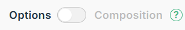

# Rendu de liste avec `v-for`

## Boucle `v-for`

Vue permet de parcourir rendre une liste d'items basée sur un tableau `[ ]` d'objets `{prop:value}` grâce à la directive `v-for`.

Par son nom, on remarque que c'est une boucle `for` de native de Vue.js qui permet de parcourir les éléments d'une liste ou d'un tableau (array).

Pour cela, on doit :

1. Définir un *nom temporaire* qui représentera chaque objet du tableau.
2. Indiquer le *tableau* `[ ]` à parcourir.

Par exemple, pour accéder à chaque rôle contenu dans le tableau `rolesArray`:

```html
<div v-for="role in rolesArr">
  
</div>
```

Ici, `role` est l’objet courant de la boucle.

Si l’on veut accéder à une propriété de cet objet (comme `picture`, `firstName`, `lastName`), on les préfixe avec `role`:
`role.picture`, `role.firstName`, `role.lastName`

<p class="codepen" data-height="600" data-theme-id="50210" data-default-tab="html,result" data-slug-hash="abPeGqp" data-pen-title="DEMO VueJS | boucle" data-user="tim-momo" style="height: 600px; box-sizing: border-box; display: flex; align-items: center; justify-content: center; border: 2px solid; margin: 1em 0; padding: 1em;">
  <span>See the Pen <a href="https://codepen.io/tim-momo/pen/abPeGqp">
  DEMO VueJS | boucle</a> by TIM Montmorency (<a href="https://codepen.io/tim-momo">@tim-momo</a>)
  on <a href="https://codepen.io">CodePen</a>.</span>
</p>


## Index de la boucle

Afin d'obtenir l'index courant dans une boucle `v-for`, il est suffit d'ajouter un 2e paramètre dans la directive. Puisque deux paramètres sont présents, il est nécessaire de les grouper dans entre parenthèses.


Par exemple:

```html
<div v-for="(role, index) in rolesArr">
  
</div>
```
<br>

<p class="codepen" data-height="500" data-theme-id="50210" data-default-tab="html,result" data-slug-hash="GRPVGPg" data-pen-title="DEMO VueJS | boucle index" data-user="tim-momo" style="height: 500px; box-sizing: border-box; display: flex; align-items: center; justify-content: center; border: 2px solid; margin: 1em 0; padding: 1em;">
  <span>See the Pen <a href="https://codepen.io/tim-momo/pen/GRPVGPg">
  DEMO VueJS | boucle index</a> by TIM Montmorency (<a href="https://codepen.io/tim-momo">@tim-momo</a>)
  on <a href="https://codepen.io">CodePen</a>.</span>
</p>


## Combinaison d'une boucle avec des événements et méthodes

On peut utiliser `v-for` pour générer plusieurs éléments. Sur chacun de ces éléments, on peut attacher un ou des événements (par exemple `@click`, `@mouseover`, etc.).

Lorsque cet événement déclenche une méthode, on peut lui fournir comme paramètre l’objet “courant” de la boucle (l’élément de la collection que l’itération est en train de traiter), afin que la méthode sache sur quel objet agir.

Dans l'exemple suivant, au clic du bouton, on appelle la méthode `toggleOrange()` en lui passant comme paramètre l'objet courant de la boucle, soit `role`. Rappelez-vous, `role` est le nom temporaire qu'on a choisi lorsqu'on défini la boucle `v-for` quelques lignes plus haut:

<p class="codepen" data-height="500" data-theme-id="50210" data-default-tab="html,result" data-slug-hash="oNJKyOO" data-pen-title="DEMO VueJS | boucle index" data-user="tim-momo" style="height: 500px; box-sizing: border-box; display: flex; align-items: center; justify-content: center; border: 2px solid; margin: 1em 0; padding: 1em;">
  <span>See the Pen <a href="https://codepen.io/tim-momo/pen/oNJKyOO">
  DEMO VueJS | boucle index</a> by TIM Montmorency (<a href="https://codepen.io/tim-momo">@tim-momo</a>)
  on <a href="https://codepen.io">CodePen</a>.</span>
</p>


## v-if + v-for = discorde

!!! danger "🤼‍♂️ v-if ne s'accorde pas avec v-for"
    On ne doit [jamais combiner v-if et v-for sur une même balise](https://fr.vuejs.org/style-guide/rules-essential#avoid-v-if-with-v-for).
    Au besoin, il est possible d'ajouter une balise  `<template>` en guise d'intermédiaire pour ajouter le `v-for`ou le `v-if`.

    🚫 Interdit
    ```html
    <ul>
      <li
        v-for="user in users"
        v-if="user.isActive">
        {{ user.name }}
      </li>
    </ul>
    ```

    ✅ Valide
    ```html
    <ul>
      <template v-for="user in users">
        <li v-if="user.isActive">
          {{ user.name }}
        </li>
      </template>
    </ul>
    ```


<br>
<a href="https://fr.vuejs.org/guide/essentials/list" class="md-button ">&nbsp;En savoir plus sur <em>Rendu de liste - List Rendering</em></a>
<br>

<small style="vertical-align: bottom">Dans le cadre de ce cours, n'oubliez pas de toujours consulter la docmentation avec l'<em>API Options</em> </small>


## Dans un exemple réel { #exemple-reel }

Les personnages de Rick and Morty, chargés depuis une API (*Application Programming Interface*) publique. Dans l'onglet HTML, deux boucles `v-for` : une sur les boutons de filtre, l'autre sur les personnages reçus de l'API, chacune avec son `:key`.

<iframe src="https://tim-montmorency.com/Fragment/v/?f=w5-vue-personnages&onglets=html,js,css,resultat&modifiable=1&boutons=rejouer,ouvrir" style="width:100%;height:700px;border:0" loading="lazy"></iframe>

## Récapitulatif de ce que on a *Vue.js* jusqu'à maintenant

<p>Analysons ensemble cet exemple de brassage de carte réalisé par le développeur Torontois <a href="https://codepen.io/itslit" target="_blank" rel="noopener noreferrer">Hassan Dj (@itslit</a>)</p>

<p class="codepen" data-height="1000" data-theme-id="50210" data-default-tab="html,result" data-slug-hash="gOVNoby" data-pen-title="Vue Transitions - Shuffle Deck of Cards" data-user="tim-momo" style="height: 1000px; box-sizing: border-box; display: flex; align-items: center; justify-content: center; border: 2px solid; margin: 1em 0; padding: 1em;">
  <span>See the Pen <a href="https://codepen.io/tim-momo/pen/gOVNoby">
  Vue Transitions - Shuffle Deck of Cards</a> by TIM Montmorency (<a href="https://codepen.io/tim-momo">@tim-momo</a>)
  on <a href="https://codepen.io">CodePen</a>.</span>
</p>


## Exercices

[🧑🏽‍💻 Collection de films (partie C : `v-for`)](../exercices/ex-vue-films/index.md){ .md-button }


<script async src="https://public.codepenassets.com/embed/index.js"></script>


