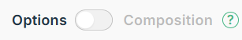

# Conditions v-if et v-show

## Rendu conditionnel avec `v-if`

### Si une donnée n'est pas vide

Certains éléments sont pertinents à afficher uniquement lorsqu'ils contiennent une valeur.

Par exemple, une bulle 🗨️ permettant d'afficher l'année de naissance 📅 `birth` d'une personne n'est désirable que s'il y a une année à afficher.

Si cette information n'est pas fournie, avoir une bulle vide 🗨️ est indésirable au niveau visuel.

```html
<div class="bubble" v-if="birth">{{ birth }}</div>
```

<p class="codepen" data-height="600" data-theme-id="50210" data-default-tab="html,result" data-slug-hash="OJrKZbw" data-pen-title="DEMO VueJS | v-if" data-user="tim-momo" style="height: 600px; box-sizing: border-box; display: flex; align-items: center; justify-content: center; border: 2px solid; margin: 1em 0; padding: 1em;">
  <span>See the Pen <a href="https://codepen.io/tim-momo/pen/OJrKZbw">
  DEMO VueJS | v-if</a> by TIM Montmorency (<a href="https://codepen.io/tim-momo">@tim-momo</a>)
  on <a href="https://codepen.io">CodePen</a>.</span>
</p>
<script async src="https://public.codepenassets.com/embed/index.js"></script>


<br><br>
<a href="https://fr.vuejs.org/guide/essentials/conditional" class="md-button "> En savoir plus sur <em>Rendu conditionnel - Conditional Rendering</em></a>
<br>

### Autre condition `v-if`

Outre le fait de vérifier si une donnée est vide ou non, il est aussi possible d'*ajouter une condition de comparaison* directement dans `v-if`.

Par exemple:

```html
<div class="bubble" v-if="birth>=2000">{{ birth }}</div>
```

Ou encore comparer la valeur de deux données:

```html
<div v-if="firstName==lastName">{{ firstName }}</div>
```


Ou encore vérifier si une donnée bouléenne est égal à `true`:

```html
<div v-if="isOrange">Je suis orange</div>
```

## Sinon avec `v-else`

Vous pouvez utiliser la directive `v-else` pour indiquer un bloc "sinon" lié à un `v-if`:

```html title="HTML"
<div id="app">
  <button @click="toggleNotifications">
    {{ notificationsOn ? 'Désactiver' : 'Activer' }} les notifications
  </button>

  <div v-if="notificationsOn">
    <h2>🔔 Notifications activées !</h2>
    <p>Vous recevrez désormais toutes les alertes importantes.</p>
  </div>
  <div v-else>
    <h2>🔕 Notifications désactivées</h2>
    <p>Aucune alerte ne sera affichée.</p>
  </div>
</div>
```

```js title="JavaScript"
const app = Vue.createApp({
  data() {
    return {
      notificationsOn: false
    }
  },
  methods: {
    toggleNotifications() {
      this.notificationsOn = !this.notificationsOn
    }
  }
})
app.mount('#app')
```


## Affichage conditionnel avec `v-show`

Une autre option pour afficher conditionnellement un élément est la directive `v-show`. L'utilisation est sensiblement la même :

```html title="HTML"
<div id="app">
  <button @click="toggleDetails">
    {{ showDetails ? 'Cacher les détails' : 'Afficher les détails' }}
  </button>

  <p v-show="showDetails">
    Voici un paragraphe qui peut être affiché ou masqué grâce à <code>v-show</code>.
  </p>
</div>

```

```js title="JavaScript"
const app = Vue.createApp({
  data() {
    return {
      showDetails: false
    }
  },
  methods: {
    toggleDetails() {
      this.showDetails = !this.showDetails
    }
  }
})

app.mount('#app')
```

La différence est qu'un élément avec `v-show` sera toujours rendu et restera dans le DOM (dans le HTML); `v-show` bascule uniquement la propriété CSS `display` de l'élément, en basculant de `display: none` à `display:block` par exemple.


<br>

<a href="https://fr.vuejs.org/guide/essentials/conditional" class="md-button ">En savoir plus sur le *rendu conditionnel*</a> <br>

<small style="vertical-align: bottom">Dans le cadre de ce cours, n'oubliez pas de toujours consulter la docmentation avec l'<em>API Options</em> </small>
