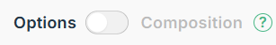

# **Vue.js** Création d'une app Vue [](assets/logo-vue.svg)

!!! abstract

    Il existe 2 styles d'API pour coder en VUE.js: *Options API* et *Composition API*. Donc si vous parcourez la documentation de VUE.js il est possible que vous tombiez sur l'un et l'autre, ne soyez pas intimidés.

    Les deux styles d'API sont tout à fait capables de couvrir les cas d'utilisation courants. Il s'agit d'interfaces différentes alimentées par le même système sous-jacent. En fait, l'*Options API* est mise en œuvre au-dessus de la *Composition API*&nbsp;! Les concepts fondamentaux sont partagés entre les deux styles et ils sont équivalents.
    
    Dans le cadre de ce cours, nous utiliserons le style *Options API*. [Plus d'info ici](https://fr.vuejs.org/guide/introduction.html#api-styles).

## Création d'une app

<p>La première étape consiste à appeler la méthode <em>createApp</em> de l'objet global <em>Vue</em>. Celle-ci permet de créer une nouvelle instance d'une app Vue. Afin de pouvoir accéder à l'app ultérieurement, il est nécessaire de stocker le résultat dans une variable.</p>


**Par exemple:**

```js
const app = Vue.createApp({});
```

!!! info
    Cette variable peut porter n’importe quel nom, mais par convention elle est généralement nommée&nbsp;<em>"app"</em>.

## Attacher l'app à un élément (mount)

<p>Il faut ensuite associer l'app à une balise HTML afin de lui indiquer sa portée. Bref, seules cette balise et ses enfants pourront être contrôlées par l'app. Le reste du document n'existera pas à ses yeux.</p>

<p>Pour ce faire, l'app contenue dans la variable doit appeler sa méthode <em>mount</em> et lui passer en paramètre une chaine de caractères correspondant au sélecteur de la balise désirée. </p>


<info>Cette méthode accepte les mêmes sélecteurs que&nbsp;<a href="https://tim-montmorency.com/timdoc/582-518MO/javascript/querySelector/">querySelector</a>.</info>

<p>Par exemple, si la balise souhaitée a le <code>id</code> app:</p>

```js
app.mount('#app');
```

<p>Si le résultat du <code>mount</code> est stocké dans une variable, il est possible d'y accéder afin de changer ses données ou encore d'appeler ses méthodes.</p>

**Par exemple:**
```js
const vm = app.mount('#app');
```

.

## Cacher la zone avant le démarrage : `v-cloak` { #v-cloak }

Le navigateur affiche le HTML **avant** que Vue démarre. Pendant une fraction de seconde, on voit donc les `{{ }}` tels quels. `v-cloak` règle ça, en deux temps :

1. Ajoutez l'attribut `v-cloak` à la zone de l'app :

    ```html
    <div id="app" v-cloak>
      {{ message }}
    </div>
    ```

2. Dans votre CSS, cachez tout ce qui porte cet attribut :

    ```css
    [v-cloak] {
      display: none;
    }
    ```

Quand l'app est montée (`mount()`), Vue **retire** l'attribut `v-cloak` : la zone apparaît, avec les vraies valeurs.

[La directive `v-cloak`, dans la documentation de Vue](https://fr.vuejs.org/api/built-in-directives.html#v-cloak){ :target="_blank" }

[Plus d'info sur <code>createApp()</code>](https://fr.vuejs.org/guide/essentials/application.html#creating-an-application-instance){ .md-button :target="_blank" }

<small style="vertical-align: bottom">Dans le cadre de ce cours, n'oubliez pas de toujours consulter la docmentation avec l'<em>API Options</em> </small>


