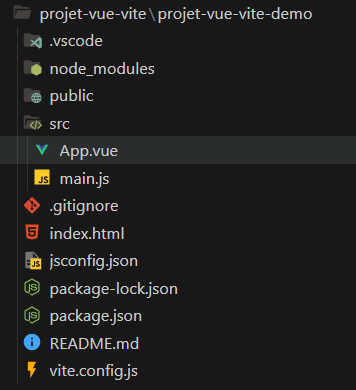

<!--https://squidfunk.github.io/mkdocs-material/reference/admonitions/
✏️note, 📄abstract, ℹ️info, 🔥tip, ✔️success, ❔question, ⚠️warning, ❌failure, ⚡danger, 🐞bug, 🧪example, ❜❜quote
-->

# **Vue.js** Création d’un projet Vue incluant déjà Vite [](assets/logo-vue.svg)

`npm create vue@latest` inclut Vite. Cette commande utilise `create-vue` , qui est le moyen officiellement recommandé pour échafauder un nouveau projet *Vue* et utilise *Vite* comme outil de construction par défaut. 

*Vite* offre une expérience de développement *plus rapide* et *plus moderne* par rapport aux anciennes configurations Vue CLI et Webpack.

## Mise en place

- [ ] Dans Visual Studio Code, ouvrez le dossier où vous souhaitez créer votre projet Vue.js.
- [ ] Ouvrez le terminal de Visual Studio Code. 

## Voici quelques commandes utiles:

- [ ] À l'aide de la commande `pwd` vous pouvez voir le chemin d'accès du dossier où vous vous situez.
- [ ] À l'aide de la commande `ls` vous pouvez voir les fichiers qui se trouve dans le dossier dans lequel vous vous trouvez.
- [ ] Inscrivez `cd.. ↵`  pour reculer d'un dossier.
- [ ] `cd nomdudossier ↵` pour avancer dans un dossier. Allez vous placer là ou vous souhaitez créer votre projet.

## Création du projet

- [ ] Lorsque vous y êtes, inscrivez maintenant:

    ```
    npm create vue@latest
    ```

Si on vous demande de mettre à jour Vue, appuyez sur ++y++ pour **yes**.

## Configuration du projet

- [ ] Vous devriez maintenant voir ce qui suit, vous pouvez donc entrer le nom de votre projet, sans espace et sans accent.

    ```
    Vue.js - The Progressive JavaScript Framework
    ? Nom du projet : 
    ```

- [ ] Par la suite, on vous demandera une série de questions. Faites ++n++  pour **no**, pour chacune des librairie proposées. On en est qu'à l'introduction de Vue, nul besoin de librairie supplémentaire.

## Installation des dépendances

- [ ] Une fois l'installation terminée, `cd nom-de-votre-projet` pour avancer dans le dossier du projet.

- [ ] Faites la commande suivante afin d'installer les dépendances qui vont faire fonctionner le projet.
    ```
    npm install
    ```

## Mise en place de votre environnement pour développer votre projet

- [ ] Ouvrez le projet via l'explorateur de fichier de Visual Studio Code.

- [ ] Ouvrez le fichier App.vue. S'il n'y a pas de *coloration syntaxique* et que tout le code est gris, il serait plus pratique d'activer la coloration syntaxique de ce type de fichier aussi. Ainsi je vous propose d'installer l'extension Visual Studio Code nommée [*Vue - Official*](https://marketplace.visualstudio.com/items/?itemName=Vue.volar):<br>[](https://marketplace.visualstudio.com/items/?itemName=Vue.volar)

- [ ] Une autre extension intéressante, non reliée à Vue directement: *Icons*
de Mhammed Talhaouy. C'est une extention de VSCode qui vous permet de mieux visualiser les types de fichier dans votre exploraeur de fichiers dans VS COde. [Voici le lien vers l'extension](https://marketplace.visualstudio.com/items?itemName=tal7aouy.icons).



## Démarrer le serveur

- [ ] Démarrez le serveur virtuel de votre projet avec le bundler Vite, en inscrivant dans le Terminal:
    ```
    npm run dev
    ```

    Maintenant, vous pouvez voir en direct votre page de projet dans le navigateur via le url suivant:
    ```
    http://localhost:5173/
    ```

!!! tip Pour quitter le mode run dev

    À tout moment, si vous souhaitez sortir du serveur et arrêter le serveur de développement, dans le terminal vous entrez ++q++  pour **quitter**.


## Nettoyage

Pour partir un projet à neuf, on va éliminer ce qu'on n'a pas besoin.

- [ ] Supprimez les dossiers **assets**📁  et **components**📁 
- [ ] Dans le fichier **main.js**, supprimez la ligne <code>`import './assets/main.css'</code> puisqu'on vient de supprimer le dossier qui contenait ce fichier css.
- [ ] Finalement dans le fichier **App.vue**, sélectionnez tout le code (ctrl+a) et supprimer tout le code. Le fichier restera mais sera vide.